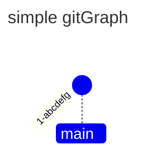
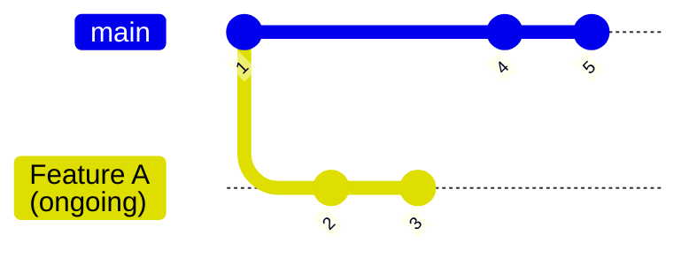
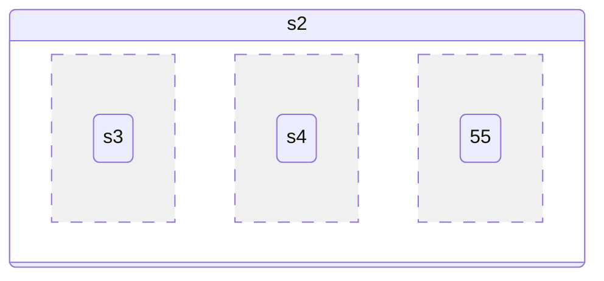

# RFC 0031 E2a — config-free gitGraph/stateDiagram cohort

Machine ledger: [`../../tools/mermaid/e2a-cohort.json`](../../tools/mermaid/e2a-cohort.json)
(schema `loom_mermaid_e2a_cohort/v1`); it is the only enforced expectation path.
Regenerate: `python3 tools/mermaid/generate_e2a_cohort.py` (`--check`).

## Scope and non-goals

Admits frontmatter `description` (documentation-only; validated and
discarded, never rendered) for config-free/init-free originals. StateDiagram-v2
`title` is admitted where the relations family projects a title (a synthetic
control covers it; the pinned cohort has no titled state row). GitGraph has no
title projection, so a titled gitGraph row keeps its whole source.

Non-goals:

- `config:`/`theme`/`themeVariables` stays deferred to E2b.
- A body with a `%%{init}%%` directive keeps its whole source.
- Source fallback earns no drawing credit; a row draws only when the native
  parser AND layout produce complete geometry within 240 columns.
- Extending body grammar or the parent-edge router is out of scope.
- StateDiagram v1 contributes zero qualifying originals (38 config, 4 init).

## T1-A update — strict-first parent-router retry (2026-10-25)

`plan_parent_routes` now runs a strict-first two-pass plan. Pass 1 is the
original sequence-order BFS with the one-cell moat (connectors never cross,
touch, or share). On full-plan failure exactly one deterministic bounded
relaxed whole-plan pass routes same-lane commit trunks first and may run
adjacent to or through an already-laid connector; commit markers and
painted caption/tag/branch spans stay sealed. The retry is bounded: one
attempt, a fresh Work budget per layout, every relaxed-pass BFS expansion
Work-metered per dequeue (at most grid x edges, the same ceiling the strict
prepayment already covered), and unchanged canvas limits (240 x 1024,
1,000,000 Work). Pass-1 output is consumed whenever pass 1 succeeds, so the
14 attested route-debt rows now draw while every previously drawing input
renders byte-identical (verified cell-by-cell in both presets). The two LR
nine-branch rows still cannot close in the 218-column canvas and classify
as canvas capacity debt with the two TB/BT 276-column rows; the reviewed
native-route-debt set is empty pending a future corpus expansion.

## Mechanical selection

Closed column-0 fence, no top-level `config:`, no body `%%{`, over
`cases/{git,state-diagram-v2,state-diagram}`: **69 —
64 gitGraph, 5 stateDiagram-v2,
0 v1** (exclusions git 62 config/9 init,
v2 94/4, v1 38/4).

## Blocker detection

Six classes are fixed source-content detectors; the seventh, the
**execution-attested reviewed set** (`gitgraph-native-parent-route-debt`),
is currently empty (see the T1-A update below). Routing feasibility is not
textually decidable, so any future addition is sha-bound to the pinned
corpus and requires a new independent review row; the C++ cohort gate
empirically enforces every outcome.

- `gitgraph-empty-quoted-tag` — 3
- `gitgraph-canvas-dimension-overflow` — 4
- `gitgraph-title-not-projected` — 1
- `gitgraph-multiline-quoted-branch-label` — 1
- `state-composite-divider` — 1
- `state-composite-brace-on-next-line` — 3
- `gitgraph-native-parent-route-debt` — 0 (retired by T1-A)

The two TB/BT nine-branch rows exceed the 240-column canvas (276 columns);
the two LR nine-branch rows are 218 columns (inside the canvas) but remain
unroutable in the packed ten-lane canvas even after the T1-A strict-first
retry. All four are `gitgraph-canvas-dimension-overflow`.

## Predictions

**56 predicted-draw (55 gitGraph, 1 stateDiagram-v2),
13 predicted-blocked** after T1-A (E2a originally registered 42 draw / 27
blocked). Width policy: 240
only; `narrow_40` uniformly `source`; `restored_240` equals `wide_240`.

## The 13 blocked rows

### 1. `git/nightly-check/11-should-render-a-gitgraph-with-cherry-pick-commit-with-no-tag.mmd`

- **predicted-blocked** — `gitgraph-empty-quoted-tag`
- Witness: `src/ui/visual/mermaid_gitgraph_impl.cpp:268-272; src/ui/visual/mermaid_cells_impl.cpp:41-42` — parse_cherry_pick requires a non-empty quoted tag; tag: "" decodes to no label.


### 2. `git/nightly-check/12-should-render-commits-for-more-than-8-branches.mmd`

- **predicted-blocked** — `gitgraph-canvas-dimension-overflow`
- Witness: `src/ui/visual/mermaid_gitgraph_impl.cpp:434-443 (checked_dimension); :457-637 (plan_parent_routes)` — With nine declared branches the TB/BT lane layout is 276 columns and is rejected by checked_dimension (kWidthLimit=240); the LR layouts are 218 columns but the bounded strict-first parent router (strict pass plus one relaxed whole-plan retry) still cannot close an edge in the packed ten-lane canvas.


### 3. `git/nightly-check/27-should-render-a-gitgraph-with-cherry-pick-commit-with-no-tag-vertical-branch.mmd`

- **predicted-blocked** — `gitgraph-empty-quoted-tag`
- Witness: `src/ui/visual/mermaid_gitgraph_impl.cpp:268-272; src/ui/visual/mermaid_cells_impl.cpp:41-42` — parse_cherry_pick requires a non-empty quoted tag; tag: "" decodes to no label.


### 4. `git/nightly-check/29-should-render-commits-for-more-than-8-branches-vertical-branch.mmd`

- **predicted-blocked** — `gitgraph-canvas-dimension-overflow`
- Witness: `src/ui/visual/mermaid_gitgraph_impl.cpp:434-443 (checked_dimension); :457-637 (plan_parent_routes)` — With nine declared branches the TB/BT lane layout is 276 columns and is rejected by checked_dimension (kWidthLimit=240); the LR layouts are 218 columns but the bounded strict-first parent router (strict pass plus one relaxed whole-plan retry) still cannot close an edge in the packed ten-lane canvas.


### 5. `git/nightly-check/62-should-render-a-gitgraph-with-cherry-pick-commit-with-no-tag-vertical-branch-bottom-to-top.mmd`

- **predicted-blocked** — `gitgraph-empty-quoted-tag`
- Witness: `src/ui/visual/mermaid_gitgraph_impl.cpp:268-272; src/ui/visual/mermaid_cells_impl.cpp:41-42` — parse_cherry_pick requires a non-empty quoted tag; tag: "" decodes to no label.


### 6. `git/nightly-check/64-should-render-commits-for-more-than-8-branches-vertical-branch-bottom-to-top.mmd`

- **predicted-blocked** — `gitgraph-canvas-dimension-overflow`
- Witness: `src/ui/visual/mermaid_gitgraph_impl.cpp:434-443 (checked_dimension); :457-637 (plan_parent_routes)` — With nine declared branches the TB/BT lane layout is 276 columns and is rejected by checked_dimension (kWidthLimit=240); the LR layouts are 218 columns but the bounded strict-first parent router (strict pass plus one relaxed whole-plan retry) still cannot close an edge in the packed ten-lane canvas.


### 7. `git/nightly-check/66-should-render-a-simple-gitgraph-with-a-title-vertical-branch-bottom-to-top.mmd`

- **predicted-blocked** — `gitgraph-title-not-projected`
- Witness: `src/ui/visual/mermaid_gitgraph_impl.cpp:348-403` — GitGraph has no title projection; admitting a titled row would silently drop the title.



### 8. `git/nightly-check/74-should-render-commits-for-more-than-8-branches-using-switch-instead-of-checkout.mmd`

- **predicted-blocked** — `gitgraph-canvas-dimension-overflow`
- Witness: `src/ui/visual/mermaid_gitgraph_impl.cpp:434-443 (checked_dimension); :457-637 (plan_parent_routes)` — With nine declared branches the TB/BT lane layout is 276 columns and is rejected by checked_dimension (kWidthLimit=240); the LR layouts are 218 columns but the bounded strict-first parent router (strict pass plus one relaxed whole-plan retry) still cannot close an edge in the packed ten-lane canvas.


### 9. `git/nightly-check/97-should-render-branch-labels-with-multi-line-text-aligned-with-background-in-lr-layout.mmd`

- **predicted-blocked** — `gitgraph-multiline-quoted-branch-label`
- Witness: `src/ui/visual/mermaid_gitgraph_impl.cpp:55-64` — Cursor::quoted scans one physical line; a quoted label split across lines cannot close.



### 10. `state-diagram-v2/nightly-check/should-align-dividers-correctly.mmd`

- **predicted-blocked** — `state-composite-divider`
- Witness: `src/ui/visual/mermaid_relations_impl.cpp (state edge parse; identifier('--') rejected)` — A standalone '--' region divider reaches edge parsing where identifier('--') is rejected.



### 11. `state-diagram-v2/nightly-check/should-render-edge-labels-correctly-with-multiple-states.mmd`

- **predicted-blocked** — `state-composite-brace-on-next-line`
- Witness: `src/ui/visual/mermaid_relations_impl.cpp (state composite parse; same-line `{` required)` — A composite opens only when '{' is on the same state-declaration line; a standalone next-line '{' falls through to the edge parser and is rejected.

```mermaid-source
---
description: >-
  Ten composite states (State1-State10, each wrapping one nested child)
  chained in a single linear sequence with nine labeled transitions - a
  straightforward long-chain edge-label test with no branching or cycles,
  contrasting with the branching/converging variant in
  should-render-edge-labels-correctly.mmd.
---
stateDiagram-v2

  state State1_____________
  {
  c0
  }

  state State2_____________
  {
  c1
  # ... (excerpt: 52 more lines)
```

### 12. `state-diagram-v2/nightly-check/should-render-edge-labels-correctly.mmd`

- **predicted-blocked** — `state-composite-brace-on-next-line`
- Witness: `src/ui/visual/mermaid_relations_impl.cpp (state composite parse; same-line `{` required)` — A composite opens only when '{' is on the same state-declaration line; a standalone next-line '{' falls through to the edge parser and is rejected.

```mermaid-source
---
description: >-
  Eight composite states (State1-State8, each wrapping one nested child)
  connected by a branching, cyclic web of transitions, including four
  different edges sharing the label "Transition4_____" - tests edge-label
  rendering under crossing/converging paths, as a smaller variant of the
  9-state version in
  pr/should-render-edge-labels-correctly-with-multiple-transitions.mmd.
---
stateDiagram-v2

  state State1_____________
  {
  c0
  }

  state State2_____________
  {
  # ... (excerpt: 49 more lines)
```

### 13. `state-diagram-v2/pr-check/should-render-edge-labels-correctly-with-multiple-transitions.mmd`

- **predicted-blocked** — `state-composite-brace-on-next-line`
- Witness: `src/ui/visual/mermaid_relations_impl.cpp (state composite parse; same-line `{` required)` — A composite opens only when '{' is on the same state-declaration line; a standalone next-line '{' falls through to the edge parser and is rejected.

```mermaid-source
---
description: >-
  Nine composite states (State1-State9, each wrapping a single nested child)
  connected by a branching, cyclic web of transitions, including four
  different edges all labeled "Transition4_____". Exercises edge-label
  placement when many labeled edges converge, branch, and reuse the same
  label text.
---
stateDiagram-v2

  state State1_____________
  {
  c0
  }

  state State2_____________
  {
  c1
  # ... (excerpt: 54 more lines)
```

## Full row ledger

| Path | Family | Metadata | Prediction | 240/40/restored | Blocker |
|---|---|---|---|---|---|
| `git/nightly-check/1-should-render-a-simple-gitgraph-with-commit-on-main-branch.mmd` | gitGraph | description | predicted-draw | drawn/source/drawn | — |
| `git/nightly-check/11-should-render-a-gitgraph-with-cherry-pick-commit-with-no-tag.mmd` | gitGraph | description | predicted-blocked | source/source/source | gitgraph-empty-quoted-tag |
| `git/nightly-check/11-should-render-a-simple-gitgraph-with-cherry-pick-commit.mmd` | gitGraph | description | predicted-draw | drawn/source/drawn | — |
| `git/nightly-check/11-should-render-a-simple-gitgraph-with-two-cherry-pick-commit.mmd` | gitGraph | description | predicted-draw | drawn/source/drawn | — |
| `git/nightly-check/12-should-render-commits-for-more-than-8-branches.mmd` | gitGraph | description | predicted-blocked | source/source/source | gitgraph-canvas-dimension-overflow |
| `git/nightly-check/13-should-render-a-simple-gitgraph-with-three-branches-custom-merge-commit-id-tag-type.mmd` | gitGraph | description | predicted-draw | drawn/source/drawn | — |
| `git/nightly-check/1433-should-render-a-simple-gitgraph-with-a-title.mmd` | gitGraph | description | predicted-draw | drawn/source/drawn | — |
| `git/nightly-check/15-should-render-a-simple-gitgraph-with-commit-on-main-branch-vertical-branch.mmd` | gitGraph | description | predicted-draw | drawn/source/drawn | — |
| `git/nightly-check/16-should-render-a-simple-gitgraph-with-commit-on-main-branch-with-id-vertical-branch.mmd` | gitGraph | description | predicted-draw | drawn/source/drawn | — |
| `git/nightly-check/18-should-render-a-simple-gitgraph-with-tags-committypes-on-main-branch-vertical-branch.mmd` | gitGraph | description | predicted-draw | drawn/source/drawn | — |
| `git/nightly-check/19-should-render-a-simple-gitgraph-with-two-branches-vertical-branch.mmd` | gitGraph | description | predicted-draw | drawn/source/drawn | — |
| `git/nightly-check/2-should-render-a-simple-gitgraph-with-commit-on-main-branch-with-id.mmd` | gitGraph | description | predicted-draw | drawn/source/drawn | — |
| `git/nightly-check/20-should-render-a-simple-gitgraph-with-two-branches-and-merge-commit-vertical-branch.mmd` | gitGraph | description | predicted-draw | drawn/source/drawn | — |
| `git/nightly-check/21-should-render-a-simple-gitgraph-with-three-branches-and-tagged-merge-commit-vertical-branch.mmd` | gitGraph | description | predicted-draw | drawn/source/drawn | — |
| `git/nightly-check/25-should-render-a-simple-gitgraph-with-cherry-pick-commit-vertical-branch.mmd` | gitGraph | description | predicted-draw | drawn/source/drawn | — |
| `git/nightly-check/26-should-render-a-gitgraph-with-cherry-pick-commit-with-custom-tag-vertical-branch.mmd` | gitGraph | description | predicted-draw | drawn/source/drawn | — |
| `git/nightly-check/27-should-render-a-gitgraph-with-cherry-pick-commit-with-no-tag-vertical-branch.mmd` | gitGraph | description | predicted-blocked | source/source/source | gitgraph-empty-quoted-tag |
| `git/nightly-check/28-should-render-a-simple-gitgraph-with-two-cherry-pick-commit-vertical-branch.mmd` | gitGraph | description | predicted-draw | drawn/source/drawn | — |
| `git/nightly-check/29-should-render-commits-for-more-than-8-branches-vertical-branch.mmd` | gitGraph | description | predicted-blocked | source/source/source | gitgraph-canvas-dimension-overflow |
| `git/nightly-check/31-should-render-a-simple-gitgraph-with-a-title-vertical-branch.mmd` | gitGraph | description | predicted-draw | drawn/source/drawn | — |
| `git/nightly-check/32-should-render-a-simple-gitgraph-overlapping-commits-vertical-branch.mmd` | gitGraph | description | predicted-draw | drawn/source/drawn | — |
| `git/nightly-check/33-should-render-a-simple-gitgraph-overlapping-commits.mmd` | gitGraph | description | predicted-draw | drawn/source/drawn | — |
| `git/nightly-check/34-should-render-a-simple-gitgraph-with-two-branches-from-same-commit.mmd` | gitGraph | description | predicted-draw | drawn/source/drawn | — |
| `git/nightly-check/35-should-render-a-simple-gitgraph-with-two-branches-from-same-commit-vertical-branch.mmd` | gitGraph | description | predicted-draw | drawn/source/drawn | — |
| `git/nightly-check/36-should-render-gitgraph-with-branch-that-is-not-used-immediately.mmd` | gitGraph | description | predicted-draw | drawn/source/drawn | — |
| `git/nightly-check/37-should-render-gitgraph-with-branch-that-is-not-used-immediately-vertical-branch.mmd` | gitGraph | description | predicted-draw | drawn/source/drawn | — |
| `git/nightly-check/38-should-render-gitgraph-with-branch-and-sub-branch-neither-of-which-used-immediately.mmd` | gitGraph | description | predicted-draw | drawn/source/drawn | — |
| `git/nightly-check/39-should-render-gitgraph-with-branch-and-sub-branch-neither-of-which-used-immediately-vertical-branch.mmd` | gitGraph | description | predicted-draw | drawn/source/drawn | — |
| `git/nightly-check/4-should-render-a-simple-gitgraph-with-tags-committypes-on-main-branch.mmd` | gitGraph | description | predicted-draw | drawn/source/drawn | — |
| `git/nightly-check/40-should-render-a-simple-gitgraph-with-cherry-pick-merge-commit.mmd` | gitGraph | description | predicted-draw | drawn/source/drawn | — |
| `git/nightly-check/5-should-render-a-simple-gitgraph-with-two-branches.mmd` | gitGraph | description | predicted-draw | drawn/source/drawn | — |
| `git/nightly-check/50-should-render-a-simple-gitgraph-with-commit-on-main-branch-vertical-branch-bottom-to-top.mmd` | gitGraph | description | predicted-draw | drawn/source/drawn | — |
| `git/nightly-check/51-should-render-a-simple-gitgraph-with-commit-on-main-branch-with-id-vertical-branch-bottom-to-top.mmd` | gitGraph | description | predicted-draw | drawn/source/drawn | — |
| `git/nightly-check/53-should-render-a-simple-gitgraph-with-tags-committypes-on-main-branch-vertical-branch-bottom-to-top.mmd` | gitGraph | description | predicted-draw | drawn/source/drawn | — |
| `git/nightly-check/54-should-render-a-simple-gitgraph-with-two-branches-vertical-branch-bottom-to-top.mmd` | gitGraph | description | predicted-draw | drawn/source/drawn | — |
| `git/nightly-check/55-should-render-a-simple-gitgraph-with-two-branches-and-merge-commit-vertical-branch-bottom-to-top.mmd` | gitGraph | description | predicted-draw | drawn/source/drawn | — |
| `git/nightly-check/56-should-render-a-simple-gitgraph-with-three-branches-and-tagged-merge-commit-vertical-branch-bottom-to-top.mmd` | gitGraph | description | predicted-draw | drawn/source/drawn | — |
| `git/nightly-check/6-should-render-a-simple-gitgraph-with-two-branches-and-merge-commit.mmd` | gitGraph | description | predicted-draw | drawn/source/drawn | — |
| `git/nightly-check/60-should-render-a-simple-gitgraph-with-cherry-pick-commit-vertical-branch-bottom-to-top.mmd` | gitGraph | description | predicted-draw | drawn/source/drawn | — |
| `git/nightly-check/61-should-render-a-gitgraph-with-cherry-pick-commit-with-custom-tag-vertical-branch-bottom-to-top.mmd` | gitGraph | description | predicted-draw | drawn/source/drawn | — |
| `git/nightly-check/62-should-render-a-gitgraph-with-cherry-pick-commit-with-no-tag-vertical-branch-bottom-to-top.mmd` | gitGraph | description | predicted-blocked | source/source/source | gitgraph-empty-quoted-tag |
| `git/nightly-check/63-should-render-a-simple-gitgraph-with-two-cherry-pick-commit-vertical-branch-bottom-to-top.mmd` | gitGraph | description | predicted-draw | drawn/source/drawn | — |
| `git/nightly-check/64-should-render-commits-for-more-than-8-branches-vertical-branch-bottom-to-top.mmd` | gitGraph | description | predicted-blocked | source/source/source | gitgraph-canvas-dimension-overflow |
| `git/nightly-check/65-should-render-a-simple-gitgraph-with-three-branches-custom-merge-commit-id-tag-type-vertical-branch-bottom-to-top.mmd` | gitGraph | description | predicted-draw | drawn/source/drawn | — |
| `git/nightly-check/66-should-render-a-simple-gitgraph-with-a-title-vertical-branch-bottom-to-top.mmd` | gitGraph | description,title | predicted-blocked | source/source/source | gitgraph-title-not-projected |
| `git/nightly-check/68-should-render-a-simple-gitgraph-with-two-branches-from-same-commit-vertical-branch-bottom-to-top.mmd` | gitGraph | description | predicted-draw | drawn/source/drawn | — |
| `git/nightly-check/69-should-render-gitgraph-with-branch-that-is-not-used-immediately-vertical-branch-bottom-to-top.mmd` | gitGraph | description | predicted-draw | drawn/source/drawn | — |
| `git/nightly-check/7-should-render-a-simple-gitgraph-with-three-branches-and-tagged-merge-commit.mmd` | gitGraph | description | predicted-draw | drawn/source/drawn | — |
| `git/nightly-check/70-should-render-gitgraph-with-branch-and-sub-branch-neither-of-which-used-immediately-vertical-branch-bottom-to-top.mmd` | gitGraph | description | predicted-draw | drawn/source/drawn | — |
| `git/nightly-check/73-should-render-a-simple-gitgraph-with-three-branches-and-tagged-merge-commit-using-switch-instead-of-checkout.mmd` | gitGraph | description | predicted-draw | drawn/source/drawn | — |
| `git/nightly-check/74-should-render-commits-for-more-than-8-branches-using-switch-instead-of-checkout.mmd` | gitGraph | description | predicted-blocked | source/source/source | gitgraph-canvas-dimension-overflow |
| `git/nightly-check/75-should-render-a-gitgraph-with-multiple-tags-on-a-merge-commit-on-bottom-to-top-orientation.mmd` | gitGraph | description | predicted-draw | drawn/source/drawn | — |
| `git/nightly-check/76-should-render-a-bt-gitgraph-with-branch-ordering-and-merge-from-right-branch-regression-6593.mmd` | gitGraph | description | predicted-draw | drawn/source/drawn | — |
| `git/nightly-check/76-should-render-a-gitgraph-with-multiple-tags-on-a-merge-commit-on-left-to-right-orientation.mmd` | gitGraph | description | predicted-draw | drawn/source/drawn | — |
| `git/nightly-check/77-should-render-a-bt-gitgraph-with-three-branches-and-multiple-merges-regression-6593.mmd` | gitGraph | description | predicted-draw | drawn/source/drawn | — |
| `git/nightly-check/78-should-render-a-bt-gitgraph-with-cherry-pick-regression-6593.mmd` | gitGraph | description | predicted-draw | drawn/source/drawn | — |
| `git/nightly-check/79-should-render-a-bt-gitgraph-with-two-cherry-picks-regression-6593.mmd` | gitGraph | description | predicted-draw | drawn/source/drawn | — |
| `git/nightly-check/97-should-render-branch-labels-with-multi-line-text-aligned-with-background-in-lr-layout.mmd` | gitGraph | description | predicted-blocked | source/source/source | gitgraph-multiline-quoted-branch-label |
| `git/pr-check/11-should-render-a-gitgraph-with-cherry-pick-commit-with-custom-tag.mmd` | gitGraph | description | predicted-draw | drawn/source/drawn | — |
| `git/pr-check/17-should-render-a-simple-gitgraph-with-different-committypes-on-main-branch-vertical-branch.mmd` | gitGraph | description | predicted-draw | drawn/source/drawn | — |
| `git/pr-check/3-should-render-a-simple-gitgraph-with-different-committypes-on-main-branch.mmd` | gitGraph | description | predicted-draw | drawn/source/drawn | — |
| `git/pr-check/30-should-render-a-simple-gitgraph-with-three-branches-custom-merge-commit-id-tag-type-vertical-branch.mmd` | gitGraph | description | predicted-draw | drawn/source/drawn | — |
| `git/pr-check/52-should-render-a-simple-gitgraph-with-different-committypes-on-main-branch-vertical-branch-bottom-to-top.mmd` | gitGraph | description | predicted-draw | drawn/source/drawn | — |
| `git/pr-check/67-should-render-a-simple-gitgraph-overlapping-commits-vertical-branch-bottom-to-top.mmd` | gitGraph | description | predicted-draw | drawn/source/drawn | — |
| `state-diagram-v2/nightly-check/1433-should-render-a-simple-state-diagram-with-a-title.mmd` | stateDiagram-v2 | description | predicted-draw | drawn/source/drawn | — |
| `state-diagram-v2/nightly-check/should-align-dividers-correctly.mmd` | stateDiagram-v2 | description | predicted-blocked | source/source/source | state-composite-divider |
| `state-diagram-v2/nightly-check/should-render-edge-labels-correctly-with-multiple-states.mmd` | stateDiagram-v2 | description | predicted-blocked | source/source/source | state-composite-brace-on-next-line |
| `state-diagram-v2/nightly-check/should-render-edge-labels-correctly.mmd` | stateDiagram-v2 | description | predicted-blocked | source/source/source | state-composite-brace-on-next-line |
| `state-diagram-v2/pr-check/should-render-edge-labels-correctly-with-multiple-transitions.mmd` | stateDiagram-v2 | description | predicted-blocked | source/source/source | state-composite-brace-on-next-line |

## Independent review

- Round 1: changes requested — three empty-tag and four nine-branch rows were
  mis-registered draw; fixed detectors were added.
- Round 2: changes requested then satisfied — independent execution
  reproduced exactly 42 draw / 27 source and identified fourteen further
  parse-accepts-but-unroutable rows plus two LR-vs-TB attribution fixes; all
  are reflected here. The reviewer re-derived the full partition against
  `plan_parent_routes` and the public renderer, not the ledger.
- Round 3 (T1-A, 2026-10-25): implementation verification — after the
  strict-first retry the cohort partitions 56 draw / 13 source; all 42
  pre-change draw rows captured byte-identical (character and background
  per cell) in debug and release, the 14 retired route-debt rows draw with
  descriptions hidden, and the four nine-branch rows keep whole source.
  Full `ctest -L mermaid` is green in both presets apart from the
  pre-existing machine-timing flake `E2E_Pty_Mermaid` (it also fails on
  pristine master isolated on this host); the E6c mandatory-gap roster and
  its SHA pin are unchanged. The retired-set claim awaits independent
  ledger review like every earlier change to the reviewed set.

## Graduation checklist

- [x] Mechanical selection reproduces 64 git + 5 state v2, v1 = 0.
- [x] Both families have at least one predicted-draw row.
- [x] Every blocked row cites a non-envelope grammar/capacity witness.
- [ ] Independent ledger review approved (recorded in JSON).
- [ ] Every predicted-draw row draws at 240; every blocked row keeps source.
- [ ] Zero unclassified git/state originals.
- [ ] Config/init rows keep whole source.
- [ ] Descriptions never appear in any rendered frame.
