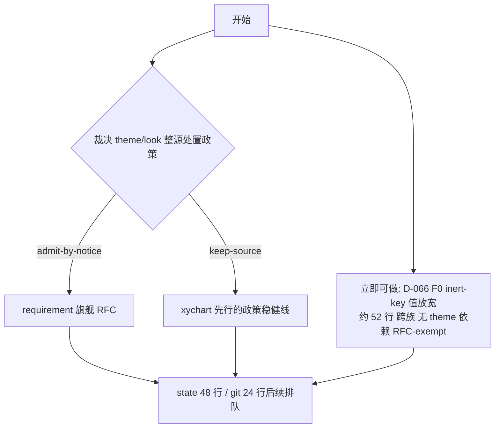

# Mermaid 下一图族选型 spike（D-394）

日期 2026-11-21 · 分支 master · 起点 HEAD `b9ee6c8a` · 本地执行，未 push、未 merge、零生产代码改动。
过程：40 个独立上下文 agent 的工作流（Run `wf_3ac228d8-c1d`，约 43 分钟 / 4.42M subagent tokens），含逐族归因、Adversarial 复核、双角度排序、评审团、完备性批判。全部读自身仓库实测数据，无网络依赖（OGDF 许可事实标注为外部知识、未在线验证）。

## 1. 结论（先行）

1. **OGDF 及任何外部布局库：否决为运行时依赖。** 理由是可测量的硬约束而非审美：OGDF 连续双精度坐标 + GPL copyleft + 与本仓库 240×1024 定宽 cell 的整数几何/Work 计量/双预设字节门不兼容；`predicate_sufficiency` 实测布局并非多数行的充分阻塞点（dagre 谓词命中 167 条中 104 条已 drawn，ELK 命中 79 条中 39 条已 drawn）。"参考成熟实现"落为**算法规范参考 + 有界 Sugiyama 增量升级**，不链接外部库。
2. **排序收敛**：两个独立排序（收益优先 / 风险优先）一致给出 **requirement > state > git > xychart/class**。但对抗复核与评审团同时指出：**决定成败的不是行数，而是"theme/look 整源处置政策"未裁决**——若按 greenfield 家族现行口径（带 theme/look 保持源码），requirement 可做面从 156 塌缩到 ~35、state-v2 从 36 塌缩到 ~20。
3. **推荐路线（两条并行，互不阻塞）**：
   - **立即可做、无需 RFC**：D-066 既定的 **F0 inert-key 值放宽**（1–2 轮、约 52 行、跨族、无 theme 依赖、§3.0 明确 RFC-exempt）。这是计划里的"第一步"，两个排序器都漏掉了它。
   - **首个图族 RFC**：**xychart**（35 行中 27 行可做；只有 3 行涉 theme，是政策最稳健的候选；envelope 放宽是 3 处具体代码改动，且家族几乎可闭合）。requirement 作为**旗舰候选**，前置条件是先立 **theme/look 处置政策 RFC**（跨族裁决，同时解锁 state 48 行）；若政策裁决为 keep-source，则 requirement 退居二线、xychart/git 先行。
4. **既有文档承诺的"参考 dagre/ELK 全量重写"经实测降级**：全量移植最多覆盖 906 行中的 56 行（6.2%，且其中约半另有共阻塞），却会改变 104 dagre + 39 ELK 已绘制行的几何、需要重新准入。正确形态是**按实测队列排序的有界 Sugiyama 升级**（requirement ELK 24 行先行）。

## 2. 数据基线与方法

| 项 | 值（实测） |
|---|---|
| 矩阵 | `build/debug/tests/ui/mermaid-official-matrix.json`，sha256 `ee743515…`，debug/release 字节一致 |
| 总量 | 2738 例 = 2145 original + 593 body_diagnostic；integrity_errors 0 |
| 整源状态 | wide_240：drawn **1239** / source_fallback **906** / error **0**；formal `drawn_at_240` = **1053** |
| 强制 gap | **48**，全部是 flowchart body_diagnostic 行（`e6c-mandatory-gap-roster.json` gates.official_matrix） |
| fallback 归因 | 44 类；causality：permanent 143 / foreign-engine 376 / family-scoped-debt 266 / debt 105 / debt-candidate 16 |
| 既有决策 | 10 条 won't-fix / 终态（design-decisions、D-329 等）；D-329 记录 registry 是已接受终态，重开是 RFC 级决定 |

方法可信度设计：每个"可做"断言都要过独立 agent 重算；行数必须加总到实测值；复核 agent 被要求**证伪**而非确认。复核结果：8 个 top 族中 **2 个无条件通过（state-v2 带保留、swimlanes 完全通过），6 个被推翻细节**——核心结论多数存活，但 bucket 分项有实质错误（见 §5）。

## 3. 906 fallback 的族分布与归因分类

大族（实测行数）与归因结论（"可做"=owned-proof 管线可关闭；"需能力"=布局/渲染新能力；复核列 = 对抗复核结果）：

| 族 | fallback | 可做 | 需能力 | won't-fix | 存疑 | 复核 | 关键事实 |
|---|---|---|---|---|---|---|---|
| flowchart | 240 | ~52 | ~172 | 1 | ~15 | ❌ 分项被推翻 | 行数 240 ✓；分项构造互相重叠，nested 计数错误（实测嵌套仅 14 行、flat 63 行）；`special_link_markers` 非充分阻塞（96 命中中 80 已 drawn） |
| requirement | 156 | 12+48+96 | 0 | 0 | 0 | ❌ 细节纠错 | **核心确认**：172 源 = 16 drawn + 156 fallback，全部 reason=frontmatter；但 look_neo 96 行的"RGB→调色板映射"阻塞被证伪——ER/class 已用 accept+notice 画 look:neo（54/54、30/30），真实工作是新 presentation profile + notice 通路 + description/config 共存解析 |
| git | 77 | 24 (全 S) | 49 | 4→疑似 0 | 0 | ❌ 但计数确认 | 135 源 = 58 drawn + 77 fallback；roster 分区精确；rotateCommitLabel 4 行"wont-fix"被孪生对照证伪（fixture 91/92 body 字节相同），可重分类 |
| state-diagram-v2 | 70 | 36 | 30 | 1 | 3 | ✅ 带保留 | 103 源 = 33 drawn + 70 fallback；6 行三层嵌套无 drawn 见证（已绘制最大深度 2）；24 行 concurrency 中仅 2 行有实测 `--` 阻塞，其余 22 是 frontmatter 门 |
| swimlanes | 46 | 0 | 46 | 0 | 0 | ✅ | 全部 46 行是 `swimlane-beta`，渲染器**完全没有该家族**——单一缺失能力 |
| xychart | 35 | ~27 | 8 | 0 | 0 | ❌ 细节纠错 | 48 源 = 13 drawn + 35 fallback；18 行 envelope 中 1 行实需 dataLabelColor 准入；`x-axis-range-same-value` 被两个 bucket 双计；description+config 共存不是"单一顶层 reject"而是代码路径改动 |
| class-diagram | 25 | 15 | 0 | 0 | 10 | 未复核 | 15 行赋值未定义 CSS class（终端的忠实结构 no-op，但 RFC 0030:2213 契约说"未定义类名回退源码"，需修约）；10 行 click/link 交互无处理器 |
| er-diagram | 24 | 24 | 0 | 0 | 0 | 未复核 | 15 行 classDef/:::/style 表现面 + 9 行严格标签语法；ELK 被实测降级（纯 ELK 子集已 drawn） |
| state-diagram (v1) | 23 | 12 | 11 | 0 | 0 | 未复核 | 与 v2 同族模式（theme/look 准入 + 2 个真实布局项） |
| timeline | 23 | 23 | 0 | 0 | 0 | 未复核 | 全部同一原因：家族自身"无色/无 look 契约"闸门；16 行 look 复用已绘制的三节 body |
| mindmap | 19 | 4 | 9 | 6 | 0 | 未复核 | icon 字形 5 行 + base themeVariables 1 行 wont-fix；bang/cloud/hexagon 轮廓 8 行需能力；tidy-tree config 4 行可做 |
| usecase | 18 | 1 | 8 | 9 | 0 | 未复核 | 9 行 theme/colorScheme 的"被断言主体就是配色"；1 行 config+accessibility 可做；8 行交互/样式能力 |
| pie | 17 | 4 | 4 | 9 | 0 | 未复核 | 9 行纯 theme；useMaxWidth/非法 donutHole/textPosition 可做；donut/legend 位置/highlight 需能力 |
| sankey | 17 | 2 | 6 | 9 | 0 | 未复核 | 9 行"被断言主体是节点/连线着色"；2 行 legacy label 可做；6 行 nodeAlignment 几何需能力 |
| treemap | 16 | 14 | 0 | 0 | 2 | 未复核 | valueFormat 6 + classDef 8 均可做；stroke-dasharray 2 行存疑 |
| gantt | 13 | 2 | 0 | 11 | 0 | 未复核 | 11 行 theme 闸门 + 2 行严格日期形状（fail-closed 是设计特性） |
| 小族尾部 | 87 | ~42 | ~16 | ~7 | ~4 | ❌ 多处推翻 | agentflow 11/venn 10/c4 9/journey 8/quadrant 7/tree-view 7/ishikawa 6/cynefin 5/architecture 4/katex 4/wardley 4/conf 3/radar 3/info 2/packet 2/railroad 1/zenuml 1；"body 与已绘制等价"的断言多数不成立（journey 0/8、radar 0/3、tree-view 0/6） |

合计校验：819（16 大族）+ 87（尾部）= 906 ✓。工作流曾报 912——原因是尾部两组 agent 把 c4 9 行双计并漏掉 conf-and-directives 3 行（评审与收益排序器均独立发现此错）；本表以实测逐族数校正。

## 4. 布局算法 / 外部库结论（"参考成熟实现"的落地形态）

| 选项 | 判定 | 依据 |
|---|---|---|
| OGDF 链接为运行时依赖 | **否决** | GPL copyleft（仓库 LICENSE 未定，README:390）+ 连续 double 坐标与整数 cell/Work 计量/双预设字节门不兼容 + 几何与 mermaid@12.2.0 不符、无法缩减 fallback；confidence=medium（许可为外部知识，未在线验证） |
| dagre/ELK 全量 C++ 移植 | **有条件否决** | 最多覆盖 56/906（6.2%），却改变 104 dagre + 39 ELK 已绘制行几何、需重新准入、与已评审的"layout 选择不影响终端渲染"契约冲突；且无字节级终端几何真值 oracle |
| **有界 Sugiyama 升级**（现有两引擎） | **推荐形态** | 复用现有 node sizing/Work meter/正交 A* 路由；按实测队列排序，requirement ELK 24 行（15 行有已绘制孪生）为首个有界 cohort；仅在隔离实验证明布局是充分阻塞时才做 |
| 外部库怀疑者结论 | 维持 RFC 0030 既有决策 | 布局在多数行不是充分阻塞；但诚实记录：formal 覆盖 49.1% 距 90% 里程碑仍有 878 行，拒绝外部库存在机会成本；GPL 义务绑定分发，若严格内部使用需法务确认 |

关键反模式提醒：`predicate_sufficiency` 表必须作为任何布局工作立项的前置证据——"dagre/elK 相关"不等于"被布局引擎阻塞"。

## 5. 对抗复核与评审发现的实质问题（如实记录）

被推翻且必须在开线前修正的：
1. **flowchart 分项不可用**：style/classDef/special 构造互相重叠（union 71 行 vs 声称的 disjoint 52），nested 计数错误，securityLevel 34 行中有 31 行另有后置检测器。该族如需立项，必须重做 per-fixture 隔离实验（照 D-329 linkStyle 模式）。
2. **requirement 的 theme 阻塞被误判**：不是 RGB 映射，而是 accept+notice 投影（ER/class 先例，成本更低）；但描述+config 共存需要 relations core 新 profile 与 notice 通路——不是"一个 envelope 开关"。
3. **git rotateCommitLabel 的 wont-fix 被孪生对照证伪**（91 vs 92 body 字节相同），4 行可重分类。
4. **xychart 双计**：`x-axis-range-same-value` 同时计入 envelope 与 degenerate-axis；实际 envelope 可做 17 行而非 18。
5. **尾部族 body 等价性断言多数不成立**：只有 15/42 行存在 body 等价的已绘制 fixture；journey/radar/tree-view 全为 0。尾部"可做"结论需逐行重验。
6. **复核/评审共同指出的政策级问题**（见 §7）不解决，任何行数排序都不可信。

## 6. 排序结果（两个独立排序 + 评审裁定）

两排序收敛前五：**requirement (156) > state (93) > git (77) > class (25) / xychart (35)**。风险优先排序强调：requirement 全部 doable 且原因单一（envelope）；state-v2 是唯一通过对抗复核的非平凡家族；git 24 行全 S 工作量；xychart 几乎可闭合；class 单位行成本最低。

评审团（数据准确性 + 政策比例性）均 **approve=true**，但给出决定性细化：
- requirement 的 5-7 轮估算引用的 D-066 数字是**另一诊断（feature census）**的估计，不直接支撑 theme 披露 RFC；
- "被断言主体就是 theme/look"的行是否允许 accept+notice，在 relational 家族（ER/class 允许）与 greenfield 家族（ishikawa/cynefin/wardley 禁止）之间存在**未裁决的口径分裂**；
- 若按 Flow/sequence 口径，requirement 可做面 156→~35、state 36→~20，xychart 受影响最小（仅 3/35 theme 行）；
- requirement 的"156→0"应修正为 **154 + 2 行 indented-fence 策略待裁**；
- narrow_40 下 git/state/xychart 绘制为 0——收益是 wide-240 口径，投递前必须预声明窄屏行为；
- 固定验证成本（全矩阵 debug 242s/release 27s、`ctest -L mermaid` ~8 分钟）可能超过单族边际收益，小族批次 ROI 更高。

## 7. 完备性批判要点（决策前必须回答）

1. **theme/look 整源处置政策**（头号未决问题）：admit-by-notice 还是 keep-source？决定 requirement/state/gantt/usecase/pie/sankey 的可做面。
2. nightly 上游 harness 是否注册 redux*/neo* 主题名（D-066 F1 标注 UNVERIFIED）：未注册则这些 fixtures 可能是 theme-inert（廉价可做）；注册则是真调色板。
3. 候选家族（requirement/state/git/class/xychart）**没有任何既有 owned-proof authority**（requirement11 仅 11 行），每条准入都要新的 sha-pinned proposal + Pin 头 + 双消费者验证——成本远高于行数直觉。
4. body_diagnostic 轨道只覆盖 flowchart/sequence；候选族"body 已画好、只卡 envelope"的前提**未经官方轨道测量**。
5. 上游每个 fixture 自身断言的"被断言主体"未读——决定 admit body 是忠实投影还是禁止的 strip。
6. `expected/reason=frontmatter` 是语料级默认值（1238/1239 已绘制行的 expected 也是 source），不能当作阻塞证据使用——本 spike 的归因来自 per-fixture 源码分析，但未来报告必须避免循环引用。
7. "使用常见度"因子在仓库内**零证据**；语料行数本身是上游 e2e 套件构成，不构成用户价值代理。
8. mandatory_gaps=48 全是 flowchart——对非 flowchart 改动**不提供回归保护**，真正的保护是全量 serial 矩阵的 drawn→failure 单调检查。

## 8. 推荐路线与 RFC 草案

1. **立即（无需 RFC）**：F0 inert-key 值放宽（state ≤33、xychart ≤10、requirement ≤4、er ≤2、git ≤1），按 D-066 §3.0 执行，1–2 轮，附逐行隔离验证。
2. **政策前置**：theme/look whole-original 处置 RFC（跨族裁决，含"被断言主体"判读规则与 narrow_40 预声明规则）。
3. **首个图族 RFC（推荐：xychart；旗舰：requirement）**：
   - xychart：27 行可做（17 envelope + 10 config 值），3 处具体代码改动（description+config 共存、dataLabelColor 角色准入、show* 值放宽），家族近闭合；政策风险最低。
   - requirement（政策裁决为 admit-by-notice 后）：154 行可做，分 12（inert 配置）/ 48（ELK/HTML-labels 投影）/ 96（6 个 theme 变体）三步；owned-proof 机制从零搭建，首轮必须包含 proposal + Pin 头 + 双消费者校验的最小骨架。
4. **git 24 行（全 S）**可作为同批次的低风险填充，先于任何布局能力工作。
5. **布局能力**：仅当某个族的隔离实验证明布局是充分阻塞时，才启动 requirement ELK 有界升级；不做全量 dagre/ELK 移植、不引入 OGDF。

## 9. 证据与可复现

- 工作流 Run ID `wf_3ac228d8-c1d`（40 agents，0 错误）；逐 agent 结果 `journal.jsonl` 与完整输出 `/tmp/claude-1001/…/tasks/wld3cpbjo.output`；脚本 `…/workflows/scripts/mermaid-next-family-spike-wf_3ac228d8-c1d.js`（可用 resumeFromRunId 复跑）。
- 本报告所有矩阵数字均可用 `python3 -I` 对 `build/debug/tests/ui/mermaid-official-matrix.json`（sha `ee743515…`）复算。
- 已知过程缺陷（效率记录）：分类 agent 的 bucket 分项存在算术/重叠错误，被独立复核与评审团抓住；结论——**凡"分项加总"类结论，必须由独立 agent 重算而非信任单一 agent**。该规则建议补入 `docs/dev/engineering-efficiency.md`；本任务未越权改动该文档。
