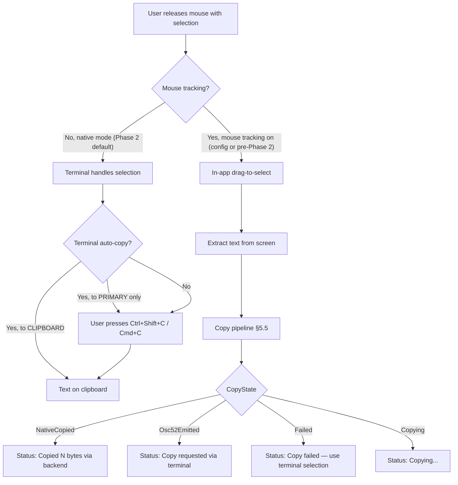
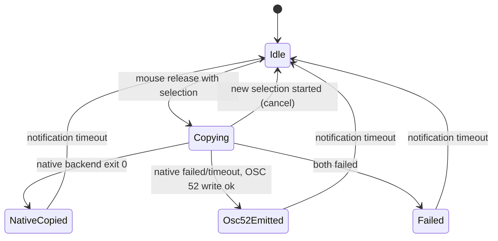
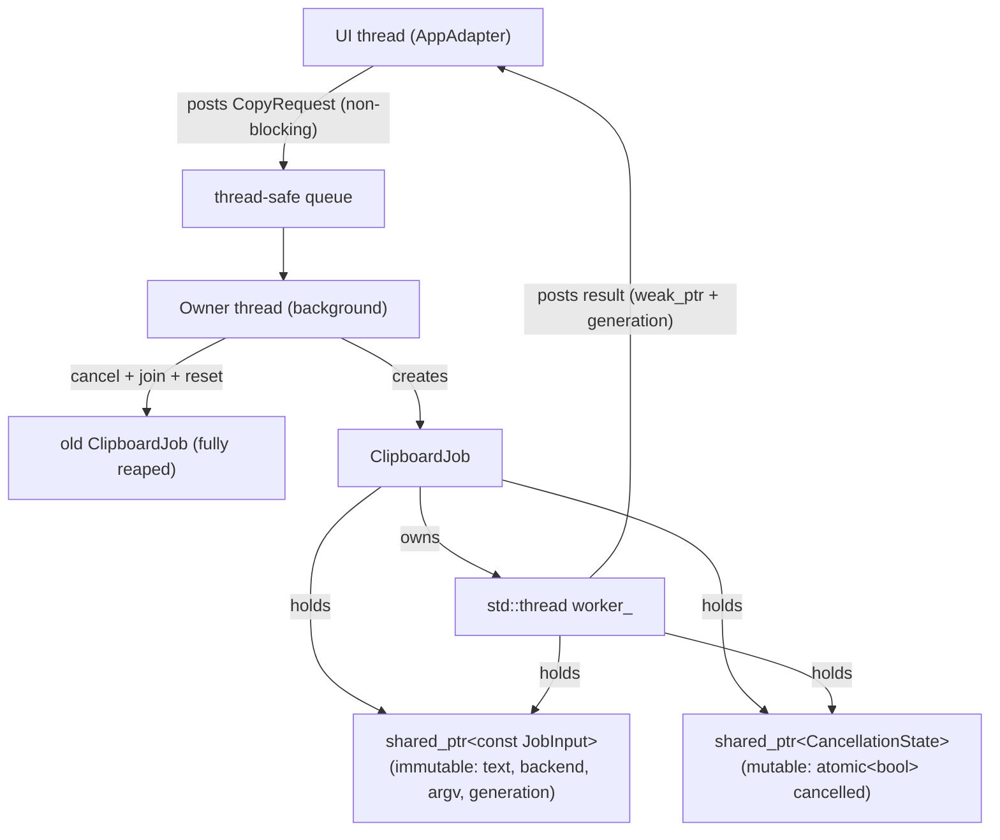

# RFC 0007 — Native Text Selection and Reliable Clipboard Copy

## 1. Summary

Users cannot select text in Loom's terminal UI with their mouse. The root
cause is that FTXUI enables terminal mouse tracking by default
(`track_mouse_ = true`), and Loom never calls `TrackMouse(false)`. Mouse
tracking causes the terminal to deliver all mouse events to the application
as escape sequences, bypassing the terminal's native text selection. Loom
has a custom drag-to-select implementation (`app_text_selection.cpp`) that
compensates, but its copy pipeline silently discards failures and its
"Copied N bytes" notification is shown unconditionally — even when both
copy backends (OSC 52 + native clipboard) failed.

This RFC proposes: (1) fix the copy pipeline so it never lies about
success, (2) disable mouse tracking by default so users can select text
natively, with a config option to re-enable mouse mode. A runtime F2
mouse-mode toggle is deferred to a follow-up RFC (§7.3) because FTXUI's
current signal-handler lifecycle and private `Install()`/`Uninstall()`
methods make a correct implementation impractical without upstream changes.

## 2. Motivation

### 2.1 User report

> 我的鼠标选中我们 Terminal UI 产出的文本之后，它没有自动复制到剪贴板上。

The user expects to select text with the mouse and have it copied to the
clipboard, with visible feedback. Today, mouse tracking blocks native
selection entirely, and the in-app fallback copy fails silently.

### 2.2 Root cause (three-bot investigation, 2026-10-09)

Dev-0, Dev-2, and Dev-1 independently investigated and converged on the
same chain:

| Step | Location | Fact |
|------|----------|------|
| 1 | `app_run.cpp:32` | `ScreenInteractive::Fullscreen()` created |
| 2 | `screen_interactive.hpp:93` | `bool track_mouse_ = true;` (FTXUI default) |
| 3 | `screen_interactive.cpp:627-632` | `Install()` sends `ESC[?1000h`, `?1003h`, `?1015h`, `?1006h` |
| 4 | Loom source | Zero `TrackMouse(false)` call sites |
| 5 | Terminal | All mouse events delivered to app; native selection blocked |

Loom's in-app selection (`app_text_selection.cpp`) is supposed to
compensate. It has two copy backends:

- **OSC 52** (`copy_cmd.cppm:179-202`): writes `ESC]52;c;<base64>BEL` to
  stdout. Works in iTerm2, Ghostty, WezTerm, Alacritty, Kitty, VS Code
  1.91+. Does NOT work in macOS Terminal.app. tmux requires
  `set-clipboard on` AND the `Ms` terminfo capability AND outer-terminal
  support.
- **Native clipboard** (`clipboard.cppm:321-338`): `pbcopy` on macOS,
  `wl-copy`/`xclip` on Linux, `clip.exe` on Windows.

Both return values are discarded:

```cpp
// app_text_selection.cpp:182-183
(void)loom::commands::copy_to_clipboard_osc52(text);
(void)loom::utils::clipboard::write_text(text);
```

The "Copied N bytes" notification at `:184-186` fires unconditionally,
even if both backends failed.

**What is confirmed vs not confirmed:** The investigation confirms that
mouse tracking is enabled by default and copy results are discarded. The
user's specific on-site failure (which terminal, which selection path,
what error) has not been reproduced. The fixes in this RFC address the
confirmed defects; the user's environment may have additional factors
(e.g., tmux `set-clipboard off`, SSH without OSC 52 passthrough).

### 2.3 Additional defects found by Dev-2

| ID | Severity | File:Line | Defect |
|----|----------|-----------|--------|
| D-1 | P1 | `app_text_selection.cpp:182-186` | Copy results discarded; "Copied" shown on failure |
| D-2 | P1 | `clipboard.cppm:336` | `exec_write` blocks UI thread with no timeout |
| D-3 | P1 | `clipboard.cppm:328-332` | Linux: no detection of wl-copy/xclip availability; no xsel fallback; no SSH awareness |
| D-4 | P1 | `app_text_selection.cpp:149,166` | 3-cell threshold (comment says "3px"); same-row 1-3 cell selections excluded |
| D-5 | P2 | `app_text_selection.cpp:81-89` | Rectangle extraction, not linear; cross-row drag may miss line starts/ends |
| D-6 | P2 | `app_text_selection.cpp:97` | Leading empty lines dropped by `if (!result.empty())` |
| D-7 | P2 | `terminal_io.cppm:747-754` | `enable_mouse_tracking()` / `disable_mouse_tracking()` are dead code (never called) |
| D-8 | P2 | `app_text_selection.cpp:163-178` | Release endpoint only updated when selection not active; no-motion press/release not handled |
| D-9 | P2 | `copy_cmd.cppm:200-202` | `fprintf`/`fflush` return values not checked; always returns success |

### 2.4 Terminal compatibility (Dev-2 investigation, corrected)

| Terminal | Native selection (mouse tracking off) | Auto-copy target | OSC 52 write | Bypass key (in mouse mode) |
|----------|---------------------------------------|------------------|--------------|---------------------------|
| iTerm2 | ✓ | CLIPBOARD (default) | ✓ (needs clipboard-access permission) | Option+drag |
| Ghostty | ✓ | PRIMARY by default (`copy-on-select=true`); CLIPBOARD requires `copy-on-select=clipboard` | ✓ (default allow; config can deny/ask) | Shift+drag (default; affected by `mouse-shift-capture` and XTSHIFTESCAPE) |
| Terminal.app | ✓ | None (Cmd+C) | Unreliable (version-dependent; do not depend on it) | Fn+drag |
| Alacritty | ✓ | None (config) | ✓ (`OnlyCopy` default) | Shift+drag |
| Kitty | ✓ | PRIMARY auto-updates; CLIPBOARD needs config | ✓ (Loom caps at 100KB; Kitty default `clipboard_max_size` is 512MB) | Shift+drag |
| WezTerm | ✓ | CLIPBOARD + PRIMARY (default) | ✓ | Shift+drag |
| tmux | ✓ (own mouse/copy-mode independent of outer terminal) | Depends on config | `set-clipboard on` + `Ms` capability + outer terminal support | Outer terminal's bypass key |
| VS Code | ✓ | None (config) | ✓ (1.91+) | Shift (all platforms); Alt (Windows/Linux); Option (macOS, needs `macOptionClickForcesSelection`) |

**Critical distinctions:**

1. **PRIMARY vs CLIPBOARD (Linux):** These are independent buffers.
   Ghostty's default `copy-on-select=true` writes to PRIMARY (middle-click
   paste), not CLIPBOARD (Ctrl+V paste). To guarantee system-clipboard
   copy, the user must configure `copy-on-select=clipboard` or use the
   in-app selection path (which writes to CLIPBOARD via OSC 52 / native
   tools). macOS Ghostty 1.1+ also has an independent selection
   clipboard, so "macOS has no X11 PRIMARY" is not a valid inference.

2. **SSH:** When Loom runs over SSH, native clipboard tools (xclip,
   wl-copy) write to the REMOTE machine's clipboard, not the user's local
   machine. OSC 52 goes through the terminal and writes to the LOCAL
   clipboard. On SSH sessions, the native path is skipped by default.

3. **tmux:** tmux is a multiplexer layer, not a terminal. Its mouse and
   copy-mode behavior is independent of the outer terminal. Direct OSC 52
   from an application inside tmux requires ALL of: (a) `set-clipboard on`
   in tmux config, (b) the `Ms` terminfo capability, (c) outer terminal
   OSC 52 support and authorization, (d) for nested tmux, each layer must
   pass through. The default `set-clipboard external` blocks
   application-direct OSC 52 but does not block tmux's own copy-mode
   sync.

4. **"Native selection works" is not an invariant Loom can guarantee.**
   Loom guarantees it does not enable DEC mouse tracking. Whether native
   selection is available depends on the terminal's own policy (tmux
   `mouse on`, terminal config, etc.). Loom does not control this.

### Evidence

| Metric | Current | Target | How measured |
|---|---|---|---|
| Mouse tracking at startup | DECSET `?1000h ?1003h ?1015h ?1006h` sent (FTXUI default, `track_mouse_ = true`) | No DEC mouse tracking sent | PTY byte-level capture of terminal output at startup |
| Native text selection | Blocked by mouse tracking in Ghostty/iTerm2/tmux | Works without modifier keys | Manual test in Ghostty, iTerm2, tmux (§2.4 matrix) |
| Copy feedback accuracy | "Copied" shown unconditionally; return values discarded (`app_text_selection.cpp:182-183`) | Four-state feedback (copying/succeeded/failed/unsupported) | Unit test + golden snapshot |
| Copy pipeline cancellation | No cancellation; UI thread blocks up to 3.5s on job join | Background owner thread; cancel/reap/start serialized; ≤1.1s shutdown | Unit test with timing assertions |
| SSH clipboard | Native tools write to remote clipboard (wrong machine) | OSC 52 only on SSH; native tools skipped | Integration test with SSH detection |
| Config ~/.agents fallback | `mouseMode` not loaded from `~/.agents/settings.json` | Read via `settings_home_read()` file-level resolver | PTY byte-level test + ConfigManager unit tests |

## 3. Goals

1. **Loom does not enable DEC mouse tracking at startup.** Users can
   select text natively in terminals that support it, without holding
   modifier keys (subject to the terminal's own selection policy, which
   Loom does not control).
2. **Copy feedback is always honest.** The user is never told "Copied"
   when the copy failed. Four states: `Copying` / `NativeCopied(backend)`
   / `Osc52Emitted` / `Failed`.
3. **The UI thread is never blocked by clipboard operations during
   interactive operation (POSIX).** Native clipboard calls are async
   with a hard timeout (SIGTERM → SIGKILL + reap). On Windows, the
   existing synchronous `clip.exe` call is an accepted exception (async
   Windows pipeline deferred, see Non-Goal #10).
4. **SSH sessions default to OSC 52 only.** Native clipboard tools are
   skipped when `SSH_CONNECTION` is set, to avoid writing to the remote
   machine's clipboard.
5. **Users can re-enable mouse mode via config.** A `mouseMode` setting
   in `settings.json` restores the previous behavior (mouse tracking on,
   in-app selection) for users who need it.

## 4. Non-Goals

1. **Implementing a custom terminal emulator.** We work within the
   terminal's existing selection and clipboard mechanisms.
2. **Reading the clipboard.** Loom only writes to the clipboard. OSC 52
   read support is explicitly out of scope (security risk, terminal
   prompts).
3. **Auto-detecting terminal capabilities.** We do not probe for OSC 52
   support or auto-copy behavior. The four-state feedback system handles
   all cases.
4. **Replacing the in-app rectangle selection with linear selection.**
   The current rectangle extraction is kept as a documented limitation;
   linear selection is a future enhancement (D-5).
5. **tmux copy-pipe integration.** tmux's `set-clipboard on` + `Ms`
   capability are the documented requirements; we do not implement
   `copy-pipe` fallback or passthrough.
6. **Runtime F2 mouse-mode toggle.** Deferred to a follow-up RFC (§7.3).
   FTXUI's `Install()`/`Uninstall()` are private and its signal-handler
   lifecycle makes a correct implementation impractical without upstream
   changes.
7. **Windows mouse-mode toggle.** F2 is deferred entirely; Windows uses
   the Phase 2 default (mouse tracking off) with no runtime toggle.
8. **Container clipboard detection.** Docker/Podman containers are not
   auto-detected; users in containers should rely on OSC 52. Documented
   as a known limitation.
9. **SSH native clipboard override.** SSH always skips native tools.
   Users who want native clipboard over SSH (e.g., X11 forwarding) can
   use a wrapper script. No config override is provided.
10. **Windows async clipboard pipeline.** The async clipboard pipeline is
    POSIX-only (Linux + macOS). Windows keeps the existing synchronous
    `clip.exe` call. Windows async requires a Job Object for descendant
    containment and overlapped I/O for deadline-controlled pipe writes —
    deferred to a follow-up.

## 5. Proposal

### 5.1 Architecture overview



### 5.2 Terminal-output ownership invariant

**Only the FTXUI/UI thread writes to the terminal (stdout/stderr).**
Worker threads produce results and post them back via `Post(Event::Custom)`
or `PostRenderEvent()`. This invariant already exists in Loom (paste
workers, agent tasks) and is extended to clipboard operations:

- OSC 52 sequences are written on the UI thread inside the copy
  completion handler (which runs on the UI thread via PostRenderEvent).
- Native clipboard commands (pbcopy/xclip/wl-copy) run on a worker
  thread; their stdout/stderr are redirected to /dev/null (they do not
  write to the terminal).
- A `TerminalEmitter` seam (injectable interface) abstracts
  `std::cout << ... << std::flush` for PTY byte-level testing.

**Signal handler writes are prohibited.** No signal handler (SIGTSTP,
SIGINT, etc.) may write to stdout/stderr directly. Signal handlers set
atomic flags; the event loop checks flags and writes on the UI thread.
This prevents control sequences from interleaving with FTXUI's frame
output. (This constraint is documented now because the deferred Phase 3
F2 toggle must adhere to it.)

### 5.3 Mouse tracking default and config (Phase 2)

**Startup (default: mouse tracking OFF):**

```cpp
// app_run.cpp — RunApp receives mouse_mode as a parameter (see Composition route below)
if (!mouse_mode) {
    screen.TrackMouse(false);  // FTXUI skips DECSET for 1000/1003/1015/1006
}
```

FTXUI's `Install()` checks `track_mouse_` and only sends the DECSET
sequences if true. Setting it false before `Loop()` is the supported API
(`screen_interactive.cpp:386-403` — "must be called outside of the main
loop").

**Config option:**

A `mouse_mode` boolean is added to `DisplaySettings`
(`src/config/config.cppm:122-130`), following the existing flat camelCase
schema.

- **C++ field:** `bool mouse_mode = false;` in `DisplaySettings`
  (alongside `vim_mode`, `compact_mode`, etc.)
- **External JSON key:** `mouseMode` in `settings.json` (canonical flat
  camelCase format, parsed in the same section as `vimMode`,
  `showThinking`, etc. at `config.cppm:1402-1471`)
- **Save:** `frag.mouse_mode = settings_.display.mouse_mode ? "true" : "false";`
  in the save section (`config.cppm:1692-1703`)
- **Default:** `false` (mouse tracking off, native selection on)
- **Invalid values:** Non-bool values are ignored (the `is_bool()` check
  fails, default is kept)
- **Tier/cascade:** Standard settings cascade (local > project > user),
  same as all other `DisplaySettings` fields. `ConfigManager` respects
  `LOOM_CONFIG_DIR` (`config.cppm:389-392`).
- **~/.agents read fallback (Dev-0 v7.4 P1-3):** The project's read
  cascade is `$LOOM_CONFIG_DIR > ~/.loom > ~/.agents`
  (`src/constants/paths.cppm:71-111`). However, `ConfigManager`'s
  default user_path uses `config_home_write()`
  (`config.cppm:390`), which only handles `$LOOM_CONFIG_DIR > ~/.loom`
  and misses the `~/.agents` fallback. Users with only
  `~/.agents/settings.json` would not have their `mouseMode` loaded.
  **Fix:** `ConfigManager` gains a **read/write path split** —
  `user_read_path_` (uses `settings_home_read()`, includes `~/.agents`
  fallback) and `user_write_path_` (uses `config_home_write()`,
  `$LOOM_CONFIG_DIR > ~/.loom`, never `~/.agents`). Each operation
  uses the appropriate path:

  | Operation | Path | Rationale |
  |-----------|------|-----------|
  | User-tier load | `user_read_path_` | Reads from `~/.agents` if `~/.loom` doesn't exist |
  | `save_user()` | `user_write_path_` | Writes to `~/.loom`, never `~/.agents` |
  | Runtime `/config set` | `user_write_path_` | Same as `save_user` |
  | MCP user-scope enumeration (`find_mcp_server_files`) | `user_read_path_` | Physical source — the file that was actually loaded |
  | MCP `add --scope user` | `user_write_path_` | Always writes to `~/.loom`; can create it from fallback state |
  | MCP `remove` (no `--scope`) | All writable physical layers | Traverses candidates; skips fallback entries, reports each as skipped |
  | MCP `enable`/`disable` (named, no `--scope`) | Effective owner only | Owner-only; reject if owner is fallback, do NOT create/modify `~/.loom` |
  | MCP `enable`/`disable all` | Per-server effective owner | Group by owner; skip fallback-owned, modify writable; all-fallback → explicit read-only result |
  | MCP post-write reload | `user_read_path_` | Re-resolved; after write, `~/.loom` exists and takes precedence |
  | Tier signature | `user_read_path_` | Signature of the file that was actually loaded |
  | `user_config_path()` | `user_write_path_` | The path that will be written to |
  | `tier_files_changed()` | `user_read_path_` | Checks the loaded file for external changes |

  **Re-resolution rule (Dev-2 v7.5 P1-2, Dev-0 v7.5 P0, Dev-2 v7.6
  P1-1):** `user_read_path_` is re-resolved on EVERY `load()` call
  (via `settings_home_read()`), not just at construction — **but only in
  default-path mode**. Explicit-path mode and single-project mode are
  exceptions:

  | Constructor mode | Re-resolution? | User tier behavior |
  |------------------|----------------|--------------------|
  | Default (no args) | Yes — every `load()` re-resolves via `settings_home_read()` | Follows cascade: `$LOOM_CONFIG_DIR > ~/.loom > ~/.agents` |
  | Explicit paths (`ConfigManager(user, project, local)`) | No — uses fixed passed-in paths | Uses the explicit `user` path; does NOT re-resolve |
  | Single project (`ConfigManager(project)`) | No — user tier stays empty | No user tier at all |

  This ensures that after a write creates `~/.loom/settings.json`, the
  next `load()` on the SAME instance in default-path mode picks up the
  new source. This is critical because `set_user_setting()` writes and
  then quietly reloads on the same object (`config.cppm:3837-3842`),
  and MCP mutators reload via `reload_and_sync` on the same instance
  (`mcp_cmd.cppm:705-717`). `tier_files_changed()` compares both the
  effective source path AND the file signature — if the source path
  changed (e.g., `~/.agents` → `~/.loom`), that is a change. **Failed
  writes do not rebind** — see the atomic-write rule below.

  **Settings-file-level read resolver (Dev-0 v7.6 P0, Dev-2 v7.6
  P1-2):** The existing `config_home_read()` is a **directory-level**
  resolver — it selects `~/.loom` if the directory exists, even if
  `settings.json` doesn't. This causes a failure mode: `save_user`
  creates the `~/.loom` directory, then the file patch fails; the next
  `load()` selects the empty `~/.loom` directory, silently dropping
  the `~/.agents` config.

  **Fix:** A new `settings_home_read()` helper (distinct from
  `config_home_read()`, to avoid changing sessions/plugins directory
  semantics) resolves the user-tier **settings file** by file
  existence, not directory existence:

  1. **`$LOOM_CONFIG_DIR` override (unconditional):** If
     `LOOM_CONFIG_DIR` is set (non-empty), return
     `$LOOM_CONFIG_DIR/settings.json` **unconditionally** — even if the
     file does not exist. No downgrade to HOME paths. This preserves
     the existing override semantics (`paths.cppm:80`): an explicit
     `LOOM_CONFIG_DIR` is an isolated config root, and falling through
     to `~/.loom` or `~/.agents` would leak host credentials and MCP
     configs into the isolated environment.
  2. `~/.loom/settings.json` — if the **file** exists, use it.
  3. `~/.agents/settings.json` — if the **file** exists, use it
     (fallback).
  4. If none exist, return the preferred write path
     (`config_home_write() / "settings.json"`).

  **Unparseable higher-priority file:** If a higher-priority
  `settings.json` exists but is unparseable, the error/diagnostic is
  kept — no silent downgrade to the fallback. The user must fix the
  broken file.

  **Atomic-write rule:** `save_user` and all user-scope writes MUST
  use atomic write (write to a temp file, then `rename()` to the final
  path). `ConfigManager` already has an atomic writer with locks and
  inode CAS via `patch_object_file` → `write_config_file_replace`
  (`config.cppm:2891/:3001/:3093`); the generic
  `src/utils/fs/atomic_replace.cppm` helper does not lock on its own
  and is a supplementary reference, not the config writer. This rule
  codifies the existing ConfigManager mechanism — it does NOT require
  replacing it with a generic writer. The existing concurrency,
  permission, and error semantics are preserved. This is
  defense-in-depth: even with the file-level resolver, atomic write
  ensures no partial state is visible. Combined, the file-level
  resolver + atomic write make "failed write does not rebind" an
  invariant.

  **Fallback-only MCP modification behavior (Dev-2 v7.5 P1-1, Dev-0
  v7.5 P1, Dev-0 v7.7 P1, Dev-0 v7.8 P1, Dev-2 v7.8 P1, Dev-0 v7.9
  P1):** When the user scope is loaded from `~/.agents` (fallback), MCP
  servers from that file are **read-only** — they are visible in
  enumeration (marked with their true physical path
  `~/.agents/settings.json`) but cannot be modified in place.

  **Physical-source descriptor and mutation outcome model (Dev-0 v7.9
  P1-1):** The existing `McpStorageScope::User` cannot express "writable
  `~/.loom`" vs "read-only `~/.agents`" as two physical sources. To
  support the fallback semantics, the MCP layer gains:

  - **`McpPhysicalSource`** — a shared descriptor for each physical
    settings file that contributes MCP servers:
    ```
    struct McpPhysicalSource {
        McpStorageScope scope;       // User, Project, Local
        std::filesystem::path path;  // Real physical path (e.g., ~/.agents/settings.json)
        bool writable;               // false for read-only fallback
    };
    ```
    The `mcp_scope_paths`, owner map, and physical-name bookkeeping are
    extended to carry this descriptor instead of bare scope/path.

  - **`McpMutationOutcome`** — a unified result for all mutation
    operations (remove/enable/disable, named and all):
    ```
    struct McpMutationEntry {
        std::string server_name;
        std::optional<McpPhysicalSource> source; // nullopt for NotFound
        enum class Status {
            Modified,        // Actually written to disk
            Unchanged,       // Writable, already in target state (no-op)
            SkippedReadOnly, // Read-only fallback, not modified
            WriteFailed,     // I/O error on writable layer
            NotFound         // Entry not found (source is nullopt)
        };
        Status status;
        std::string detail;  // e.g., "skipped read-only fallback in ~/.agents"
    };
    struct McpMutationOutcome {
        std::vector<McpMutationEntry> entries;
        // Aggregate helpers:
        //   all_read_only()  → !entries.empty() && every entry is SkippedReadOnly
        //   has_failures()   → any WriteFailed
        //   modified_count() → count of Modified (excludes Unchanged)
        //   skipped_count(), failed_count(), unchanged_count()
        //   is_empty()       → entries.empty() (no MCP servers at all)
    };
    ```
    `remove`/`enable`/`disable` (named and all) all render
    `CommandResult` from this model. The CLI layer no longer interprets
    "touched and failed both empty" as "not found" — `NotFound` is an
    explicit status with `source = nullopt`. This proves that
    partial/read-only results cannot silently write to `~/.agents` or
    be masked by I/O failures.

  **Empty-collection and NotFound semantics (Dev-0 v7.10 P1-1, P1-3):**
  - `all_read_only()` returns `!entries.empty() && every(SkippedReadOnly)`.
    An empty outcome (no MCP servers configured) is NOT "all read-only" —
    the `CommandResult` for an empty `all` operation reports "no MCP
    servers configured" (or equivalent), not "all entries are read-only
    fallback".
  - Unscoped `remove` on a non-existent server → one entry with
    `status = NotFound`, `source = nullopt`. The `CommandResult` reports
    "server not found" (not "read-only fallback" and not a silent no-op).
  - Named `enable`/`disable` on a non-existent server → same `NotFound`
    representation.
  - Unscoped `remove` on a fallback-only server → one entry with
    `status = SkippedReadOnly`, `source = ~/.agents/settings.json`. The
    `CommandResult` reports "read-only fallback" guidance (not "not
    found"). This closes the existing misrender path where touched/failed
    both empty → CLI renders "not found" (`mcp_cmd.cppm:781-795`).

  **Read-only vs idempotent no-op priority (Dev-0 v7.9 P1-2, Dev-2
  v7.10 P1):**
  **Read-only classification takes priority over idempotent no-op.**
  If an entry is in a read-only fallback, it is reported as
  `SkippedReadOnly` regardless of whether it is already in the target
  state. Rationale: the user must learn that the entry is read-only,
  not just that it is already enabled/disabled — otherwise a stale
  fallback entry silently shadows a writable entry without the user's
  knowledge. Concretely:
  - Named `enable`/`disable` on a fallback-only entry that is already
    in the target state → "read-only fallback" rejection (not "already
    enabled/disabled").
  - `all` on a fallback entry already in the target state → counted as
    `SkippedReadOnly` (not filtered as a no-op).
  - Writable entries that are already in the target state → `Unchanged`
    (not `Modified`). No file is written, and `modified_count()`
    excludes them. This preserves the existing behavior: `mcp_cmd.cpp:93`
    skips these entries, `:123-126` returns "already" for named, and
    `:144` changed count only counts actual modifications. The `Unchanged`
    status makes this explicit in the model instead of relying on
    free-text `detail` to distinguish no-op from real modification.

  MCP mutation operations are split into three categories, preserving
  the existing per-operation scope semantics:

  - **`mcp add --scope user`:** Always writes to `user_write_path_`
    (`~/.loom`). This can create `~/.loom/settings.json` from a
    fallback-only state. The `~/.agents` entry remains unchanged but is
    shadowed by the new `~/.loom` file after the next load.

  - **`mcp remove` (no `--scope`):** Traverses all writable physical
    layers (existing behavior, `config.cppm:828-879`). Skips fallback
    entries and reports each as "skipped read-only fallback". The
    outcome **distinguishes skipped-fallback from actual I/O write
    failure** — a skipped fallback is not an error, but a write failure
    on a writable layer is.

  - **`mcp enable` / `disable` (named, no `--scope`):** Owner-only
    (existing behavior, `mcp_cmd.cpp:133`, `config.cppm:944`). If the
    effective owner is the fallback file, the operation **rejects with
    a "read-only fallback" message** and does NOT create or modify
    `~/.loom`. If the owner is writable, only that owner is modified.
    If a same-named entry also exists in the fallback, the result
    reports "skipped read-only fallback in ~/.agents".

  - **`mcp enable` / `disable all`:** Groups by effective owner
    (existing behavior, `mcp_cmd.cpp:96`). For each server:
    - Owner is fallback → skip, count as "skipped read-only".
    - Owner is writable → modify.
    - If **all** servers are fallback-owned → return an explicit
      "all entries are read-only fallback" result; **never** create or
      modify `~/.loom`.
    - If some succeed → partial result with skipped count.

  - **Explicit `--scope`:** Operates only on the specified layer
    (existing behavior). For `remove`/`enable`/`disable` with
    `--scope user` when the user tier is fallback → reject with
    "read-only fallback". This does NOT apply to `add --scope user`,
    which is always allowed to create the writable `~/.loom` shadow
    (see above).

  The "read-only fallback" rejection message guides the user to either:
  1. Copy the entry to `~/.loom/settings.json` manually, or
  2. Use `loom mcp add` (which creates `~/.loom/settings.json` and
     writes the new entry there — the `~/.agents` entry remains
     unchanged but is shadowed by the new `~/.loom` file)

  After the first successful write to `~/.loom`, the read cascade
  prefers `~/.loom` and the `~/.agents` MCP servers are no longer
  visible (Loom config takeover). The `~/.agents` file is **not**
  copied to `~/.loom` — no copy-down of potentially sensitive content
  (auth tokens in MCP server configs).

  **Product semantics — "Loom config takeover":** When the user starts
  with only `~/.agents/settings.json`, Loom reads it (via
  `user_read_path_`). The first time Loom writes user config
  (`save_user`, `/config set`, or MCP write), it creates
  `~/.loom/settings.json` (via `user_write_path_`). From that point
  on, the read cascade prefers `~/.loom` over `~/.agents`. This is
  the expected behavior: Loom manages its own config directory;
  `~/.agents` is a read-only interop fallback for initial migration.

  **This is a read-only fallback** — `save_user` and
  user-scope writes must still land in `~/.loom/settings.json`, never
  in `~/.agents`; the original `~/.agents/settings.json` must remain
  byte-unchanged after a save. This is a bug fix to `ConfigManager`,
  not a contract change — the read cascade was always supposed to
  include `~/.agents`.
- **Parse+save owner:** `loom.config.config` (`ConfigManager`)

**Composition route to RunApp (Dev-0 v7 P1 — LOOM_CONFIG_DIR; Dev-2 v7.2 — direct bridge parameter; Dev-0 v7.2 P1-3 — snapshot before move):**

The `mouseMode` value must be read from `ConfigManager` (which respects
`LOOM_CONFIG_DIR`), NOT from `AppAdapter::SettingsManager` (whose
user-tier path is hardcoded to `$HOME/.loom/settings.json` and ignores
`LOOM_CONFIG_DIR`). The route:

1. `main.cpp` `load_config()` creates a `ConfigManager`, loads the
   config, reads `file_config.settings().display.mouse_mode`, and
   returns it via an **out parameter** (`bool& mouse_mode`). The
   `QueryEngineConfig` return value does NOT carry `mouse_mode` — it is
   a query-layer public model and should not hold UI startup state
   (Dev-0 v7.2 P1-3).
2. `main.cpp` saves the value as a **local `bool` variable** before the
   `QueryEngine` move at `main.cpp:2031` (`std::move(config)`). The
   local variable survives the move and is available at the bridge
   call site (`main.cpp:2059`).
3. **ABI sync — three sites, one type:** `loom_ui_run_app_bridge`
   gains a `bool mouse_mode` parameter (6th parameter, appended after
   `permission_hook`):
   - **Declaration:** `main.cpp:47-53` — `extern "C" [[nodiscard]] int
     loom_ui_run_app_bridge(..., bool mouse_mode);`
   - **Call site:** `main.cpp:2059` — `loom_ui_run_app_bridge(...,
     mouse_mode);`
   - **Definition:** `app_run.cpp:118-126` — `extern "C" int
     loom_ui_run_app_bridge(..., bool mouse_mode)` — passes through to
     `RunApp`.
4. `RunApp` signature gains `bool mouse_mode`; it calls
   `screen.TrackMouse(false)` if false, before `screen.Loop(app)`.

This uses `ConfigManager` as the single effective-settings source,
respecting `LOOM_CONFIG_DIR` and the full three-tier cascade (local >
project > user). No re-loading in the app, no cascade drift.

**Read-once semantics:** The `mouseMode` value is read once at startup
(in `load_config()`) and passed to `RunApp`. File watcher updates
(`SettingsManager` change detection) do NOT change the installed FTXUI
mouse mode — FTXUI does not support runtime mouse-mode toggling (see
§5.4). The user must restart Loom to change mouse mode.

**No new AppAdapter field needed.** When mouse tracking is off, the
terminal delivers no mouse events, so `HandleTextSelectionMouse` is never
called. When `mouseMode: true` in config, FTXUI delivers mouse events
and the existing handler works unchanged. No `mouse_mode_` field or gate
is added to `AppAdapter`.

**Exit safety:** When `TrackMouse(false)` is set before `Loop()`, FTXUI
does not send DECSET at startup and does not push DECRST cleanup to
`on_exit_functions`. On exit (normal, signal, or crash), no mouse tracking
cleanup is needed because it was never enabled. This is the simplest and
safest approach — no lifecycle management required.

### 5.4 Deferred: F2 runtime mouse-mode toggle (Phase 3, follow-up RFC)

The F2 runtime toggle is deferred because FTXUI's current API makes a
correct implementation impractical. This section documents the problems
and the requirements for the follow-up RFC.

**Problem 1 — Signal handler lifecycle (Dev-0 P0-1, Dev-2 P0):**

FTXUI installs its SIGTSTP handler inside `Install()` (called from
`PreMain()`, called from `Loop` constructor). `InstallSignalHandler`
(`screen_interactive.cpp:250-254`) calls `std::signal(sig, RecordSignal)`
which **sets** the signal disposition, not just queries it. The old
handler is saved and restored on `Uninstall()`. Any wrapper installed by
Loom is lost after the first `Uninstall()`/`Install()` cycle (triggered
by SIGTSTP). `WithRestoredIO()` has the same problem.

Note: `std::signal(sig, nullptr)` is not a query API — it sets the
disposition to `SIG_DFL`. To query the current handler without modifying
it, use `sigaction(sig, nullptr, &oldact)`. But even with the correct
query API, the lifecycle problem (wrapper lost after Uninstall/Install)
remains.

**Problem 2 — Private lifecycle methods (Dev-0 P2, Dev-2 #3):**

`Install()` and `Uninstall()` are **private** in FTXUI's public header
(`screen_interactive.hpp:60-64`). The `sigwait` thread approach (which
would call `Uninstall()`/`Install()` from a posted task) is therefore
not implementable without modifying FTXUI.

**Requirements for the follow-up RFC:**

1. **FTXUI public lifecycle API:** The follow-up RFC must either (a)
   upstream a patch to FTXUI making `Install()`/`Uninstall()` public or
   adding a `SetMouseTracking(bool)` API, or (b) find an alternative
   approach that works within FTXUI's public API.
2. **`sigwait` thread (candidate approach, to be verified):** Block
   SIGTSTP in all threads, use a dedicated `sigwait` thread, post tasks
   to the FTXUI event loop. This avoids signal handler wrappers entirely
   but requires the public lifecycle API from requirement 1.
3. **Global state:** Mouse mode state must be a global
   `std::atomic<bool>` (not `AppAdapter` member), because `AppAdapter`
   is a local `shared_ptr` in `RunApp()` and is destroyed before
   `atexit` handlers run.
4. **PTY graduation criteria:** At least two suspend/resume cycles,
   `WithRestoredIO` round-trip, normal exit, abnormal exit. Must verify
   the process actually stops (not just observe DEC bytes).
5. **Signal limitations:** `abort()` does not run `atexit` handlers.
   SIGKILL cannot be caught. These are documented limitations.

### 5.5 In-app selection copy pipeline

The copy path in `app_text_selection.cpp` is restructured into a
four-state result:

```cpp
enum class CopyState {
    Idle,
    Copying,        // async native clipboard in progress
    NativeCopied,   // native clipboard tool exited 0
    Osc52Emitted,   // OSC 52 sequence written to stdout (terminal may ignore)
    Failed,         // both paths failed
};
```



**Async native clipboard — architecture (v6):**

The async clipboard uses a **dedicated background owner thread** that
serializes cancel/reap/start. This prevents parallel workers from
overwriting each other's clipboard content (Dev-2 v5) and keeps all
blocking joins off the UI thread (Dev-0 v5).



**Why a background owner thread (Dev-2 v5):**

Without serialization, two workers can run in parallel (A cancelled, B
started). A's backend might set the clipboard *after* B's backend,
overwriting B's content. The generation counter only prevents stale
*notifications*, not stale *clipboard writes*. The owner thread ensures
A is fully cancelled and reaped before B starts — no parallel workers,
no clipboard overwrite race.

**Why the UI thread never blocks (Dev-0 v5):**

The UI thread posts copy requests to the coordinator's queue and
returns immediately. All `join()` calls happen on the owner (background)
thread. The join is bounded: the worker uses `poll()` with a 100ms
timeout and checks the cancel flag each iteration, so cancel-to-exit
latency is ~100ms (poll wakeup) + kill/reap time. The kill/reap sequence
(SIGTERM → 500ms leader wait → descendant check → SIGKILL → 500ms group
wait) is bounded to ~1.1s worst case. Common case (backend exits on
SIGTERM): ~150ms. The 3s deadline covers the write+wait phase; the
total operation upper bound (including kill sequence) is ~4s (3s +
500ms TERM deadline + 500ms KILL+reap deadline).

**JobInput vs CancellationState (Dev-0 v5):**

`JobInput` is an immutable struct (text, backend path, argv, envp,
generation) shared via `shared_ptr<const JobInput>`.
`CancellationState` is a separate mutable struct holding
`std::atomic<bool> cancelled`, shared via `shared_ptr<CancellationState>`.
The worker holds both; `ClipboardJob` holds `CancellationState` (to call
`cancel()`) and the `std::thread`. The cancel atomic does not live inside
the const `JobInput` — it has its own mutable object.

**SIGPIPE handling (Dev-2 v5):**

When the backend exits early and the worker writes to the stdin pipe,
the default SIGPIPE disposition terminates the entire Loom process
before `write()` returns -1/EPIPE. Dev-2 verified this experimentally
(writing process exits with signal 13).

The worker thread blocks SIGPIPE at thread start:

```cpp
// Worker thread entry — thread-local, does not affect other threads
sigset_t mask;
sigemptyset(&mask);
sigaddset(&mask, SIGPIPE);
pthread_sigmask(SIG_BLOCK, &mask, nullptr);
```

With SIGPIPE blocked, `write()` returns -1 with `errno = EPIPE` when the
read end is closed. The worker handles EPIPE gracefully (backend exited
early → report failure). `poll()` also returns `POLLERR`/`POLLHUP` on the
write end, which the worker checks. This is thread-local — the UI thread
and other threads are unaffected.

**Spawn (posix_spawn, not fork):**

The project already uses `posix_spawn` in `bash_execution.cppm:184-208`.
This avoids the multi-threaded `fork()` hazard (child inherits locks,
can deadlock before exec). The clipboard backend is spawned the same way:

1. Create stdin pipe:
   - **Linux:** `pipe2(O_CLOEXEC)` — both ends close-on-exec, both
     blocking initially.
   - **macOS:** `pipe()` + `fcntl(fd, F_SETFD, FD_CLOEXEC)` on both
     ends (macOS has no `pipe2`).
2. Set the **write end** to non-blocking:
   `fcntl(pipefd[1], F_SETFL, O_NONBLOCK)` — the parent writes without
   blocking.
3. The **read end** (which becomes the child's stdin) remains **blocking**
   — normal tools like `cat` expect blocking stdin. (Dev-2 verified that
   making the read end non-blocking causes `cat` to exit immediately with
   EAGAIN.)
4. Set up `posix_spawn_file_actions`:
   - `adddup2(pipefd[0], STDIN_FILENO)` — child reads from pipe
   - `adddup2(devnull, STDOUT_FILENO)` — child stdout to /dev/null
   - `adddup2(devnull, STDERR_FILENO)` — child stderr to /dev/null
   - `addclose(pipefd[0])`, `addclose(pipefd[1])`
5. Set up `posix_spawnattr`:
   - `POSIX_SPAWN_SETPGROUP` — create a new process group (child PID =
     process group ID).
   - `POSIX_SPAWN_SETSIGMASK` with an **empty signal mask** — the child
     (and its descendants) must NOT inherit the worker thread's blocked
     SIGPIPE. Without this, `pthread_sigmask(SIG_BLOCK, {SIGPIPE})` in
     the worker would be inherited by `pbcopy`/`wl-copy`/wrapper scripts,
     silently changing backend signal semantics (Dev-0 v6 P0-1).
   - All `posix_spawnattr_*` and `posix_spawn_file_actions_*` return
     values are checked; any failure aborts the native attempt and falls
     back to OSC 52.
6. `posix_spawnp(&pid, backend_path, &actions, &attr, argv, envp)`.
7. Parent closes `pipefd[0]` (read end); keeps `pipefd[1]` (write end).
8. Destroy `posix_spawnattr` and `posix_spawn_file_actions` regardless
   of success or failure.

**If `POSIX_SPAWN_SETPGROUP` is unavailable or fails:** Abort the native
clipboard attempt and fall back to OSC 52. A degraded `kill(pid, ...)`
path is intentionally NOT provided: `kill(pid)` cannot kill descendant
processes, which weakens cancellation semantics and leaves leftover
processes outside the 3s deadline (Dev-2 v5). The setpgid failure is
logged, and the copy pipeline proceeds directly to OSC 52.

**Write (worker thread, non-blocking, deadline-aware):**

The worker tracks a **3s total deadline** from the moment of spawn, shared
across the write and wait phases. The 100ms `poll()` timeout is a
per-iteration ceiling for cancel responsiveness — it is NOT the total
deadline. The worker checks `elapsed >= 3s` after every poll iteration.

**Absolute deadline execution rule (Dev-0 v7.5 P1-2, Dev-2 v7.5,
Dev-0 v7.6 P1):** All phases use `steady_clock` absolute deadlines.
Every `poll()`/sleep timeout is `min(100ms, remaining_time)` — never
a fixed 100ms, and never a negative value (check `remaining <= 0`
first; if so, skip the poll and proceed directly to the deadline
action). **The application does not initiate `poll()`/sleep beyond the
absolute deadline.** Exit wall-clock completion is still subject to
OS scheduler delay (the kernel may delay wakeup arbitrarily), so the
upper bounds (~4s total, ~1.1s cancellation) are **application-level
budgets**, not strict wall-clock hard limits. Tests verify
application-level deadline selection and logical branching (e.g.,
"deadline expired → kill sequence entered"), not strict wall-clock
upper bounds. `poll(2)` may overflow the requested timeout by a
small scheduling amount; a negative timeout means infinite wait, so
the `remaining <= 0` guard is mandatory:

- Write+wait deadline: `steady_clock::now() + 3s` (from spawn)
- TERM deadline: `steady_clock::now() + 500ms` (from kill sequence start)
- KILL+reap deadline: `steady_clock::now() + 500ms` (from SIGKILL)

1. Record `deadline = steady_clock::now() + 3s` at spawn.
2. Use `poll()` on `pipefd[1]` with `min(100ms, deadline - now)` timeout
   in a loop, checking the cancel flag and the deadline each iteration.
3. Write text in a loop, handling `EAGAIN`/`EWOULDBLOCK` by polling.
4. Handle `EPIPE` (backend exited early) and `EINTR` (retry). SIGPIPE is
   blocked in the worker thread (see above), so `write()` returns -1/EPIPE
   instead of terminating the process.
5. Check `poll()` for `POLLERR`/`POLLHUP` on the write end — the backend
   closed its stdin. Treat as failure.
6. If the deadline expires (backend not reading stdin fast enough), kill
   the process group (see Wait) and report failure.
7. Close `pipefd[1]` after all text is written (signals EOF to child).

**Wait (worker thread, deadline-aware, cancel-responsive):**

The wait phase shares the same 3s deadline from the write phase. If the
write phase consumed 2s, the wait phase has at most 1s remaining.

1. Poll the child PID with `waitpid(WNOHANG)` in a loop (sleep
   `min(100ms, remaining)` between checks, where `remaining` is the
   time left on the 3s write+wait deadline). **Every iteration checks
   the cancel flag AND the deadline** — if either is triggered,
   immediately jump to the kill sequence (step 3). This ensures
   cancel-to-exit latency is ~100ms even when the worker is in the
   wait phase (e.g., the backend consumed all stdin but is hanging
   before exit) (Dev-0 v6 P1).
2. If the child exits 0 before the deadline, report success. If non-zero,
   report failure.
3. On deadline expiry or cancel: kill the process group and ensure full
   cleanup. **The entire kill sequence is deadline-bounded — no blocking
   `waitpid` is used** (Dev-0 v7 P0). The kill sequence has exactly TWO
   500ms deadlines (Dev-0 v7.2 P1-2, Dev-2 v7.2 P2):
   a. `kill(-pgid, SIGTERM)` — signal ALL processes in the group.
   b. **TERM deadline (500ms, absolute):** Record
      `term_deadline = steady_clock::now() + 500ms`. Poll
      `waitpid(pid, WNOHANG)` for the leader AND `kill(-pgid, 0)` for
      the group, sleeping `min(100ms, term_deadline - now)` between
      checks. If both report the leader exited and the group is empty,
      skip to step (e).
   c. **After the TERM deadline expires (regardless of leader
      state):** `kill(-pgid, 0)` to check if the group still exists.
   d. If the group exists: `kill(-pgid, SIGKILL)` — **unconditional**,
      even if the leader is still alive. This handles backends that
      ignore SIGTERM.
   e. **KILL+reap deadline (500ms, absolute, shared):** Record
      `kill_deadline = steady_clock::now() + 500ms`. Poll
      `kill(-pgid, 0)` until it returns -1/ESRCH (group empty) AND
      `waitpid(pid, WNOHANG)` until the leader is reaped, sleeping
      `min(100ms, kill_deadline - now)` between checks. Both checks
      share the SAME 500ms absolute deadline — they are NOT sequential
      500ms budgets. **Never use blocking `waitpid(pid, ...)`** — if
      the leader is in uninterruptible sleep, blocking waitpid would
      hang forever, violating the bounded-join guarantee.
   f. **Unreaped leader fallback:** If the leader is still not reaped
      after the KILL+reap deadline (e.g., the process is in
      uninterruptible `D` state), the coordinator records the PID in a
      `pending_reaps_` list. The owner thread retries `waitpid(pid,
      WNOHANG)` on each wake (see §5.5 Owner pending_reaps_ management). The
      child remains Loom's responsibility (it is NOT reparented to init
      while Loom is alive); only when Loom exits does init reap any
      remaining zombies. A warning is logged. The worker thread exits
      regardless — the join bound is maintained.
4. Report failure (timeout or cancelled).

**Cleanup confirmation and the serialization invariant:** The "old job
fully reaped before new job starts" guarantee (Invariant 8) applies when
cleanup is confirmed successful (leader reaped, group empty). If cleanup
fails (unkillable process in `D` state), the result is **degraded/
uncertain**: the stale process was SIGKILLed or is stuck in kernel space,
but its termination is not confirmed, so it may have already written to
the clipboard or have pending kernel I/O. This branch does **not** promise
the final clipboard belongs to the latest selection. The PID is recorded
in `pending_reaps_` for background reaping, and a warning is logged. The
normal (successful-cleanup) path retains the full serialization guarantee.

**Note on process-group containment:** `kill(-pgid, ...)` kills all
processes in the POSIX process group. However, if the backend actively
creates a new session or process group (e.g., via `setsid()`), those
descendants escape the group and are not killed. This is a documented
limitation — well-behaved clipboard backends (pbcopy, xclip, wl-copy) do
not do this. The guarantee is "no leftover process-group members", not
"no leftover descendants under any circumstances" (Dev-0 v6 P1).

**Cancel and replacement (serialized by owner thread):**

1. UI thread posts a new CopyRequest to the coordinator's queue. The
   generation counter is advanced immediately when the request is posted.
2. Owner thread pops the request. If a current job exists:
   a. `cancel()` — sets `cancelled = true` (non-blocking).
   b. `join()` — waits for the worker to see the flag, kill the process
      group, reap, and exit. Bounded to ~150ms (common) or ~1.1s
      (cancellation worst case: 100ms poll wakeup + 500ms TERM deadline
      + 500ms KILL+reap deadline).
   c. `reset()` — destroys the old ClipboardJob.
3. Owner thread creates a new ClipboardJob, which spawns a new worker.
4. The new worker is the ONLY clipboard worker running. No parallel
   workers, no clipboard overwrite race (when cleanup is confirmed
   successful; see §5.5 Cleanup confirmation for the degraded case).
5. When the worker posts its result to the UI thread, the UI thread
   re-checks the generation counter. If a newer request was posted since
   this worker started, the result is discarded (even if the clipboard
   write succeeded).

**Shutdown (linearized, bounded exception to UI nonblocking):**

`AppAdapter`'s destructor (which runs on the app/UI destruction path,
`src/ui/app/app_render_event.cpp:122-140`) calls `coordinator.shutdown()`.
This is the **only** place a blocking wait occurs on the UI thread, and
it is explicitly documented as a bounded shutdown-path exception to
Invariant 12 (Dev-0 v6 P0-2).

`shutdown()` linearization rules:
1. **Stop accepting new requests:** Under a mutex, set `running_ = false`
   (atomic). Any `post()` calls after this point are silently discarded
   (the caller does not block).
2. **Discard all pending requests:** Under the same mutex, atomically
   clear the incoming queue. Requests queued before `shutdown()` but not
   yet popped are discarded — they are NOT processed during teardown.
3. **Wake the owner thread:** Notify the condition variable so the owner
   thread wakes from its blocking `pop()`.
4. **Owner thread exit:** The owner thread wakes, acquires the mutex,
   and re-checks `running_`. If `running_ == false`:
   a. If a current job exists: `cancel()` + `join()` (bounded ~150ms
      common / ~1.1s worst case).
   b. **Final pending_reaps_ sweep:** One pass of `waitpid(pid, WNOHANG)`
      on every PID in `pending_reaps_`. Reaped entries are removed.
      Entries still unreaped after this pass are logged as warnings and
      abandoned — they become init's responsibility when Loom exits.
      This is a single non-blocking pass (no retry loop), so it adds
      negligible shutdown cost.
   c. Does NOT start any new ClipboardJob.
   d. Exits the owner loop.
5. **Owner-side start recheck:** Even outside shutdown, the owner thread
   re-checks `running_` under the mutex BEFORE creating each new
   ClipboardJob. This closes the race where the owner pops a request
   just before `shutdown()` clears the queue — the recheck prevents the
   owner from starting a new job after shutdown has begun (Dev-0 v7 P1).
6. **Join owner thread:** `shutdown()` joins the owner thread. Total
   shutdown cost: ~150ms (common) or ~1.1s (worst case: 100ms poll
   wakeup + 500ms TERM deadline + 500ms KILL+reap deadline).

**Why this is acceptable:** The AppAdapter destructor is the last thing
that runs before process exit. A bounded wait at shutdown is standard
practice (joining threads in destructors). The "UI thread never blocks"
invariant applies to interactive operation, not process teardown. The
wait is bounded and logged if it exceeds the common case.

**Why not move the wait off the UI thread:** Moving the coordinator to
a longer-lived object (e.g., a global singleton) would complicate
lifetime management and risk accessing destroyed FTXUI state. The
bounded shutdown wait is simpler and safer.

**Owner pending_reaps_ management (Dev-0 v7.2 P1-1, v7.4 P1-1):**

The owner thread is the **sole owner** of `pending_reaps_`. Workers
never touch `pending_reaps_` directly.

**PID handoff channel (worker → owner):** `ClipboardJob` holds an
`std::optional<pid_t> unreaped_pid` field. The worker sets this field
before exiting if the leader was not reaped during the kill sequence
(step f). After `join()` returns, the owner reads `job->unreaped_pid`
during `reset()` and, if set, adds the PID to `pending_reaps_`. This
is a synchronous handoff — the owner always sees the field before
destroying the ClipboardJob, so no PID is lost.

**Owner loop — sweep on EVERY wake (not just idle timeout):**

The owner thread does NOT block indefinitely on `pop()`. It uses
`wait_until` with a **1-second cadence**, and performs a nonblocking
`pending_reaps_` sweep on **every** wake — whether caused by a new
request, a timeout, or shutdown:

1. Wait for a new request or timeout (1s), whichever comes first.
2. **Nonblocking pending_reaps_ sweep (always runs, on every wake):**
   iterate `pending_reaps_` and call `waitpid(pid, WNOHANG)` on each
   entry.
   - If `waitpid` returns the PID (reaped) or -1/ECHILD (already
     reaped): remove the entry.
   - If `waitpid` returns 0 (still running): keep the entry for the
     next wake.
3. If `!running_`: perform the final sweep (shutdown step 4b) and exit.
4. If a new request was popped: process it (cancel/reap old, start
   new) as described in "Cancel and replacement" above.

This ensures that zombie processes are reaped even under continuous
copy-request pressure (where the 1s timeout may never fire) — the
sweep runs on request wakes too. The 1s cadence is a fallback for
idle periods.

**Test (graduation criteria):**
- **Delayed-reap simulation:** a backend that exits but whose leader
  is not immediately reaped (test hook delays `waitpid`). Verify:
  (a) the PID appears in `pending_reaps_` via the `unreaped_pid`
  handoff, (b) after the 1s idle cadence, the PID is reaped and
  removed, (c) no zombie remains after shutdown.
- **Continuous-request pressure:** a test that fires copy requests
  in rapid succession (faster than the 1s cadence) while a PID is in
  `pending_reaps_`. Verify the PID is still reaped (sweep runs on
  request wakes, not just idle timeouts).

**Windows — async pipeline deferred (Dev-0 v5, Dev-2 v5):**

The async clipboard pipeline (posix_spawn, process groups, poll,
SIGPIPE handling) is **POSIX-only (Linux + macOS)**. Windows keeps the
existing synchronous `clip.exe` call. The async Windows pipeline is
deferred because:

- `CreateProcess` + `CREATE_NEW_PROCESS_GROUP` + `TerminateProcess` only
  kills the direct child, not descendants (unlike POSIX `kill(-pgid, ...)`).
  True descendant containment requires a Job Object
  (`CreateJobObject` + `AssignProcessToJobObject` +
  `JOB_OBJECT_LIMIT_KILL_ON_JOB_CLOSE`).
- Windows async pipe I/O requires overlapped I/O with
  `WaitForSingleObject` + timeout, or `CancelIoEx`.
  `SetNamedPipeHandleState` with `PIPE_NOWAIT` exists but is not
  recommended for async I/O (Dev-2 v5).
- The existing synchronous `clip.exe` call works correctly; it blocks the
  UI thread for the duration of the copy (typically <100ms for small text).

The PRR does not claim Windows async coverage. Windows async clipboard
is a follow-up item. The Phase 1 success criteria are scoped to Linux
and macOS.

**SSH detection (D-3):**

If `SSH_CONNECTION` or `SSH_TTY` environment variable is set, Loom
assumes it is running over SSH. In SSH sessions:
- Native clipboard tools are SKIPPED (they would write to the remote
  machine's clipboard, not the user's local machine).
- The copy pipeline goes directly to OSC 52.
- The status bar shows "Copy requested via terminal (SSH)" to set
  expectations.

**Linux backend detection (D-3):**

Backend resolution follows this order, using `PATH` lookup with `X_OK`
(not `access(F_OK)` on a bare name):

1. If `WAYLAND_DISPLAY` is set: `wl-copy`
2. `xclip -selection clipboard -silent`

Each is resolved via `PATH` search. If no backend is found, skip the
native path and go straight to OSC 52. All Linux backends explicitly
target CLIPBOARD (not PRIMARY). PRIMARY sync is not performed.

**Backend "set-before-exit" invariant:** A backend must set the clipboard
content BEFORE the original process exits 0. This is what makes the
owner-thread serialization correct: when the worker detects exit 0, the
clipboard is already set, and no daemonized descendant can overwrite a
subsequent selection's content.

- `pbcopy` (macOS): sets clipboard, exits 0. ✅
- `wl-copy` (Wayland): sets clipboard via the Wayland data source, then
  forks to persist. Original exits 0 after clipboard is set. ✅
- `xclip -silent` (X11): sets clipboard (takes ownership), then forks
  into the background (the `-silent` flag is the default; `-quiet` would
  stay in the foreground). Original exits 0 after clipboard is set. The
  child stays in the process group to serve paste requests; it is NOT
  killed on success (only on timeout/cancel, which is correct —
  cancellation means the clipboard should not be set). ✅
- `xsel` (X11): **EXCLUDED.** xsel daemonizes (double-fork + setsid)
  BEFORE calling `set_selection()`. The original process exits 0 before
  the daemon sets the clipboard, creating a race: the daemon can
  overwrite a subsequent selection's content even with serialized
  cancel/reap (Dev-2 v7). `xsel --nodetach` would avoid the race but
  conflicts with the "exit 0 = success + 3s timeout" model (the
  foreground process persists to hold the X11 clipboard ownership).
  xsel is not used as a fallback in this phase.

**OSC 52 write failure detection (D-9):**

`copy_to_clipboard_osc52()` currently returns success regardless of
`fprintf`/`fflush` failure. It is updated to check return values:

```cpp
if (std::fprintf(stdout, "\033]52;c;%s\a", b64.c_str()) < 0) return failure;
if (std::fflush(stdout) != 0) return failure;
return success;
```

**OSC 52 in tmux — prerequisites:**

Direct OSC 52 from an application inside tmux requires ALL of:
1. `set-clipboard on` in tmux config (default is `external`, which
   blocks application-direct OSC 52)
2. The `Ms` terminfo capability on the tmux client
3. Outer terminal OSC 52 support and authorization
4. For nested tmux: each layer must pass through

Loom does NOT auto-modify tmux config. If OSC 52 fails (write error),
the `Failed` state tells the user to use terminal selection +
Ctrl+Shift+C / Cmd+C. The `Osc52Emitted` state means the sequence was
written but the terminal may or may not accept it (e.g., tmux
`set-clipboard external` silently drops it).

**Oversized payload:**

Loom applies a conservative 100KB cap to the OSC 52 path only (the
native clipboard path sends the full text without truncation). If the
selected text exceeds 100KB:

- **Native path:** Full text sent to backend. No truncation.
- **OSC 52 fallback:** Text is truncated at a UTF-8 safe boundary (never
  split a multi-byte sequence). The status bar shows
  "Copy requested via terminal (N of M bytes sent)" — distinguishing
  bytes actually sent from the original selection size. The notification
  never says "Copied" for the OSC 52 path; it always says "requested"
  because the terminal may silently drop the sequence.

Note: Kitty's default `clipboard_max_size` is 512MB (configurable), so
the 100KB cap is Loom's conservative choice, not a terminal-imposed
limit. Other terminals may have lower or undocumented limits; the
`Osc52Emitted` state expresses that the sequence was written but
acceptance by the terminal is unknown.

### 5.6 Status bar feedback

`StatusBarData` gains a `std::string mouse_mode_label` field for the
persistent mode indicator. Transient copy notifications reuse the existing
`footer_notification_queue`.

| Condition | Message | Type |
|-----------|---------|------|
| `Copying` | `Copying...` | Transient |
| `NativeCopied` | `Copied N bytes (pbcopy)` | Transient |
| `Osc52Emitted` | `Copy requested via terminal (OSC 52)` | Transient |
| `Osc52Emitted` (SSH) | `Copy requested via terminal (SSH)` | Transient |
| `Osc52Emitted` (truncated) | `Copy requested via terminal (N of M bytes sent)` | Transient |
| `Failed` | `Copy failed — select text in terminal and use Ctrl+Shift+C` | Transient |
| Native mode (default) | `Select text to copy` | Persistent |
| Mouse mode (config) | `Mouse mode: drag to select` | Persistent |

The persistent label is always shown (not empty) so the user always knows
which mode they are in.

**Golden snapshot impact:** The new `mouse_mode_label` field adds a
persistent status bar element. Existing golden snapshots that capture the
status bar will need regeneration.

### 5.7 Short selection threshold fix (D-4)

The `dx²+dy² > 9` threshold is in character cells, not pixels. A same-row
drag of 1-3 cells (selecting 1-3 characters) is excluded. The threshold
is changed to `dx²+dy² > 0` (any displacement beyond the starting cell).

This is a confirmed P1 defect and ships in Phase 1 with the copy pipeline
fixes.

### 5.8 Dead code removal (D-7)

`terminal_io.cppm`'s `enable_mouse_tracking()` / `disable_mouse_tracking()`
are dead code (never called). Since Phase 3 (F2 toggle) is deferred, these
functions are **deleted** rather than updated. If the follow-up RFC
implements F2, the functions can be restored with all four modes.

### 5.9 Shared-change gate for Phase 2 config changes (Dev-0 PRR P1-3)

Phase 2 introduces changes to shared config infrastructure
(`ConfigManager`, MCP CLI) that affect callers beyond the mouse-selection
feature. This section is the shared-change gate: caller inventory,
compatibility risks, and per-change rollback/verification.

**Caller inventory:**

| Changed API | Callers | Compatibility risk |
|-------------|---------|--------------------|
| `ConfigManager::user_path_` → split into `user_read_path_` / `user_write_path_` | `load()`, `save_user()`, `set_user_setting()`, `find_mcp_server_files()`, MCP mutators, `tier_files_changed()`, `user_config_path()` | Low — internal field; callers updated to use the appropriate path. No public API change. |
| New `settings_home_read()` helper | `ConfigManager` default constructor + `load()` re-resolution | Low — new function in existing module (`loom.constants.paths`); no existing caller modified. |
| New `McpPhysicalSource` / `McpMutationOutcome` / `McpMutationEntry` structs | MCP `remove`/`enable`/`disable` (named and all) in `mcp_cmd.cppm` | Medium — changes the return type of MCP mutators. CLI rendering updated. The structs live in `loom.config.config` (co-located with `mcp_scope_paths()`, `mcp_owner_`, `find_mcp_server_files()` which are ConfigManager members). The commands layer (`loom.commands.mcp_cmd`) consumes them — no upward dependency. |
| MCP mutation semantics (fallback read-only) | `mcp add/remove/enable/disable` | Medium — behavior change: fallback entries become read-only. Users who previously wrote to `~/.agents` via MCP commands will now get "read-only fallback" rejection. Migration: `mcp add` creates `~/.loom` shadow. |

**Per-change rollback and verification:**

| Change | Atomic commit boundary | Rollback | Verification |
|--------|----------------------|----------|--------------|
| `settings_home_read()` helper | Own commit (new file + unit tests) | Revert commit; `ConfigManager` falls back to `config_home_read()` | Unit tests: file-level resolver, LOOM_CONFIG_DIR override, unparseable file |
| `ConfigManager` read/write split | Own commit (field split + caller updates + tests) | Revert commit; single `user_path_` restored | Unit tests: read/write split, same-instance takeover, failed-write-no-rebind, constructor modes |
| `McpPhysicalSource` + `McpMutationOutcome` | Own commit (new structs in `config.cppm` + MCP CLI updates in `mcp_cmd.cppm` + tests) | Revert commit; MCP mutators return to existing `McpRemoveOutcome`/bulk writer | Unit tests: per-entry status (Modified/Unchanged/SkippedReadOnly/WriteFailed/NotFound), aggregate helpers, empty-collection semantics |
| MCP fallback read-only semantics | Same commit as above (depends on outcome model) | Same as above | Unit tests: fallback-only remove/enable/disable, no-scope multi-layer, explicit --scope, all fallback, mixed |

**Local alternative considered:** Limit Phase 2 to mouseMode's minimal config
read path (use existing `config_home_read()` without the file-level resolver)
and defer the full `settings_home_read()` + MCP fallback to a separate RFC.
Rejected: the `~/.agents` fallback is a correctness issue (users with only
`~/.agents/settings.json` lose their `mouseMode` config), and the MCP
read-only fallback prevents accidental writes to `~/.agents` (which may
contain sensitive auth tokens). Both are bug fixes, not new features.

**Graph/build impact:** No new dependencies. `settings_home_read()` is a
new function in an existing module (`loom.constants.paths`). The
`McpPhysicalSource`/`McpMutationOutcome` structs are new types in
`loom.config.config` (co-located with the ConfigManager MCP APIs that
produce them). The commands layer consumes them — no upward dependency
from config to commands. No new textual third-party includes. No SCC
growth (new types are leaf-level, no cycles introduced). BMI PSS impact:
negligible (new function + new structs in existing modules; the only
interface change is the MCP mutator return type, which is a breaking
change updated in the same commit).

## 6. Alternatives considered

### A. Keep mouse tracking on, fix only the copy pipeline

Don't disable mouse tracking; just fix the silent failures and add
honest feedback. Users hold Shift/Option/Fn to bypass.

**Rejected because:** The user's primary complaint is that they can't
select text natively. Keeping mouse tracking on means users must hold
modifier keys, which is undiscoverable and varies by terminal. The
default should be native selection.

### B. Disable mouse tracking entirely (no runtime toggle, no config fallback)

Call `TrackMouse(false)` before `Loop()` and never re-enable. Users lose
in-app drag-to-select, hyperlink clicking, and mouse scroll permanently.

**Rejected because:** The in-app selection provides a CLIPBOARD-targeted
copy path (via OSC 52 + native tools), which is valuable on terminals
where native auto-copy targets PRIMARY or doesn't exist. Hyperlink
clicking is also a useful feature. The `mouseMode` config option (§5.3)
provides a recovery path without requiring a runtime toggle.

### C. Config-based toggle (chosen for Phase 2)

Read `mouseMode` from settings.json before `Loop()`. Users edit config
and restart to change.

**Chosen for Phase 2:** Simple, no lifecycle complexity, provides a
recovery path. The F2 runtime toggle (Phase 3, deferred) would be better
UX but requires FTXUI upstream changes.

### D. Implement OSC 52 clipboard read for auto-detection

Probe the terminal's OSC 52 support by attempting a read and checking for
a response.

**Rejected because:** OSC 52 read is a security-sensitive operation that
may prompt the user or be blocked by terminal policy. Write/read
permissions are independent — a failed read does not prove write is
unsupported. The four-state feedback system handles all cases without
probing.

### E. Patch FTXUI to add a public dynamic mouse-mode API

Add `ScreenInteractive::SetMouseTracking(bool)` to FTXUI that handles
DECSET/DECRST, exit stack, and suspend/resume.

**Deferred to follow-up RFC:** This is the cleanest long-term solution
but requires patching a third-party dependency. The follow-up RFC for
Phase 3 should evaluate whether to upstream this patch.

## 7. Implementation Phases

### Phase 1 — Copy pipeline reliability (P0)

**Goal:** Fix the confirmed copy defects. The default mouse tracking
behavior does not change in this phase (mouse tracking remains on), but
copy behavior changes: async with timeout, SSH-aware, honest feedback.

**PRR gate:** Phase 1 introduces async process management (posix_spawn,
process groups, kill/reap), which is production behavior. The PRR
checklist (§11) must pass before Phase 1 merges.

**Changes:**
- [ ] `copy_cmd.cppm`: `copy_to_clipboard_osc52()` checks `fprintf`/
      `fflush` return values, returns `VoidResult` with error on failure
      (D-9)
- [ ] `clipboard.cppm`: add `ClipboardCoordinator` — background owner
      thread that serializes cancel/reap/start per §5.5; UI thread posts
      requests via thread-safe queue, never blocks
- [ ] `clipboard.cppm`: add `ClipboardJob` + `JobInput` (immutable) +
      `CancellationState` (mutable atomic) per §5.5; worker blocks SIGPIPE
      via `pthread_sigmask`; posix_spawn + POSIX_SPAWN_SETPGROUP;
      pipe+fcntl (macOS) / pipe2 (Linux); non-blocking write end, blocking
      read end; poll 100ms timeout; waitpid(WNOHANG); kill(-pgid);
      SIGTERM→SIGKILL+reap (D-2)
- [ ] `clipboard.cppm`: setpgid failure → abort native attempt, fall back
      to OSC 52 (no degraded kill(pid) path)
- [ ] `clipboard.cppm`: add SSH detection (`SSH_CONNECTION`/`SSH_TTY`);
      skip native path on SSH (D-3)
- [ ] `clipboard.cppm`: add Linux backend detection — PATH + X_OK lookup,
      order: wl-copy → xclip -silent, all targeting CLIPBOARD; **xsel
      excluded** (daemonizes before setting clipboard, race condition) (D-3)
- [ ] `app_text_selection.cpp`: restructure copy path per §5.5, replace
      `(void)` discards with `CopyState` four-state logic (D-1)
- [ ] `app_text_selection.cpp`: post copy requests to coordinator;
      generation counter advanced on post, re-checked on result callback
- [ ] `app_text_selection.cpp`: reduce threshold to `> 0` (D-4)
- [ ] `app_text_selection.cpp`: update release endpoint when selection is
      active (D-8)
- [ ] `terminal_io.cppm`: delete dead `enable_mouse_tracking()` /
      `disable_mouse_tracking()` functions (D-7)
- [ ] Diagnostics: log backend/status/duration/byte-count to application
      log (never selected text content, never to `~/.loom/dump-prompts/`)
- [ ] Tests: native success → `NativeCopied`; native failure + OSC 52 →
      `Osc52Emitted`; both fail → `Failed`; async timeout kills process;
      no late notifications after new selection; SSH skips native;
      1-char selection; release endpoint update; SIGPIPE blocked;
      setpgid failure falls back; clipboard content matches latest
      selection (not just notification)

**Graduation criteria:**
- [ ] Unit tests for `CopyState` four-state logic
- [ ] Integration test: native backend timeout (simulated with
      `sleep 100` as clipboard command) → `Osc52Emitted`, UI not blocked
- [ ] Integration test: no native backend available → `Osc52Emitted`
- [ ] Integration test: OSC 52 write failure (closed stdout) → `Failed`
- [ ] Integration test: SSH env set → native path skipped
- [ ] Unit test: 1-char selection triggers copy
- [ ] Integration test: backend that ignores SIGTERM → SIGKILL + reap.
      Time budget: 3s (write+wait deadline) + 500ms (TERM deadline) +
      500ms (KILL+reap deadline) ≈ 4s worst case. The cancellation
      budget is independent: cancel-to-exit is ~100ms (poll wakeup) +
      500ms (TERM) + 500ms (KILL+reap) ≈ 1.1s (Dev-2 v7, Dev-0 v7.2).
- [ ] Integration test: backend that doesn't read stdin + oversized text
      → poll timeout, process killed, `Osc52Emitted`
- [ ] Integration test: selection A (slow backend) then selection B
      (fast backend) → final notification is B, not A; **final clipboard
      content is B's text, not A's** (owner thread serialization)
- [ ] Integration test: **A consumes all stdin then hangs** (e.g.,
      `cat > /dev/null; sleep 100`) → B's replacement cancels A within
      ~150ms (wait phase checks cancel flag every 100ms), not the full
      3s deadline (Dev-0 v6 P1)
- [ ] Integration test: App destruction during active copy → no UAF,
      no crash, coordinator shutdown joins within ~1.1s
- [ ] Integration test: child process AND process group reaped after
      timeout/cancel (no leftover descendants, verified via `ps`)
- [ ] Integration test: `EPIPE` on stdin write (backend exited early) →
      handled gracefully, Loom process survives (SIGPIPE blocked)
- [ ] Integration test: **backend exits immediately + large text** →
      EPIPE/POLLHUP handled, Loom survives, falls back to OSC 52
      (Dev-2 v5 P0 acceptance)
- [ ] Integration test: `EINTR` on stdin write → retried
- [ ] Integration test: `POSIX_SPAWN_SETPGROUP` failure → native attempt
      aborted, falls back to OSC 52 (no degraded kill(pid) path)
- [ ] Integration test: child process signal mask is empty (SIGPIPE not
      inherited from worker thread) — verify via a test backend that
      checks its own signal mask (Dev-0 v6 P0-1)
- [ ] Integration test: all `posix_spawnattr_*` / `posix_spawn_file_actions_*`
      return values checked; simulated attr failure → fallback to OSC 52
- [ ] Integration test: **delayed reap** — backend exits but leader is
      not immediately reaped (test hook delays `waitpid`); verify PID
      appears in `pending_reaps_` via the `unreaped_pid` handoff, is
      reaped after the 1s idle cadence, and no zombie remains after
      shutdown (Dev-0 v7.2 P1-1)
- [ ] Integration test: **continuous-request pressure** — fire copy
      requests in rapid succession (faster than the 1s cadence) while a
      PID is in `pending_reaps_`; verify the PID is still reaped (sweep
      runs on request wakes, not just idle timeouts) (Dev-0 v7.4 P1-1)
- [ ] Debug + release builds pass (Linux + macOS)
- [ ] ctest green (debug + release, serial)
- [ ] PRR checklist (§11) passed
- [ ] Agent-run design review approved

**Rollback:** Revert the Phase 1 commit. Copy behavior returns to
synchronous, always-succeeds, no-SSH-awareness. Mouse tracking is
unaffected.

### Phase 2 — Default native selection + config fallback (P0, behavior change)

**Goal:** Loom does not enable DEC mouse tracking at startup. Users can
select text natively. Users who need mouse mode can re-enable via config.

**Prerequisite:** Phase 1 graduated.

**Changes:**
- [ ] `config.cppm`: add `bool mouse_mode = false;` to `DisplaySettings`;
      parse `mouseMode` flat key (camelCase, alongside `vimMode`); save
      in the save fragment (alongside `vim_mode`)
- [ ] `config.cppm`: fix `ConfigManager` user-tier read/write split —
      add `user_read_path_` (uses new `settings_home_read()` helper,
      file-level cascade including `~/.agents` fallback) and
      `user_write_path_` (uses `config_home_write()`, never
      `~/.agents`); route load/save_user/runtime config/MCP user
      scope/tier signature/user_config_path/tier_files_changed per
      the §5.3 path table; re-resolution only in default-path mode
      (Dev-0 v7.4 P1-1, Dev-2 v7.6 P1-1)
- [ ] `main.cpp`: `load_config()` gains a `bool& mouse_mode` out
      parameter; reads `file_config.settings().display.mouse_mode` from
      ConfigManager and writes it to the out parameter. The
      `QueryEngineConfig` return value does NOT carry `mouse_mode`
- [ ] `main.cpp`: save `mouse_mode` as a local `bool` before the
      `QueryEngine` move at `main.cpp:2031`; pass it to the bridge call
      at `main.cpp:2059`
- [ ] `app_run.cpp`: `RunApp` signature gains `bool mouse_mode` parameter;
      `loom_ui_run_app_bridge` gains a `bool mouse_mode` parameter (6th,
      after `permission_hook`); declaration at `main.cpp:47-53`, call at
      `main.cpp:2059`, definition at `app_run.cpp:118-126` — all three
      sites updated in the same commit; `RunApp` calls
      `screen.TrackMouse(false)` if false, before `screen.Loop(app)`
      (see §5.3 composition route)
- [ ] `StatusBarData`: add `std::string mouse_mode_label` field
- [ ] Status bar: show persistent "Select text to copy" (native mode) or
      "Mouse mode: drag to select" (config mode)
- [ ] User docs: document copy behavior per terminal, `mouseMode` config
      option (ships with this phase, not deferred)

**Migration impact (user-visible):**
- **Gained:** Native text selection in terminal (no modifier keys needed)
- **Lost (default):** Mouse scroll in TUI, click-to-open hyperlinks,
  click-to-focus UI elements
- **Recovery:** Set `"mouseMode": true` in `settings.json` to restore
  previous behavior

**Graduation criteria:**
- [ ] PTY byte-level test: default config → initial terminal output does
      NOT contain `?1000h`, `?1003h`, `?1015h`, `?1006h`
- [ ] PTY byte-level test: `mouseMode: true` → initial terminal output
      DOES contain `?1000h`, `?1003h`, `?1015h`, `?1006h`
- [ ] PTY byte-level test: initial terminal output DOES contain `?1049h`
      (alternate screen, confirming the app is running)
- [ ] PTY byte-level test: **cascade priority** — temporary
      `LOOM_CONFIG_DIR` + conflicting `mouseMode` values across
      user/project/local tiers → verify the effective value (highest
      precedence) reaches the DECSET output (Dev-0 v7.2 P1-3). This
      validates the ConfigManager → bridge route, not just the default
- [ ] PTY byte-level test: **~/.agents fallback** — no `LOOM_CONFIG_DIR`,
      no `~/.loom`, only `~/.agents/settings.json` with `mouseMode: true`
      → verify mouse tracking IS enabled (DECSET present), confirming
      the `settings_home_read()` fallback works (Dev-0 v7.4 P1-3)
- [ ] **ConfigManager read/write split regression tests** (Dev-0 v7.5
      P1-1, Dev-2 v7.4/v7.5/v7.6):
  - [ ] Only `~/.agents`: `mouseMode` is read
  - [ ] After reading `~/.agents`, `save_user` and `/config set` only
        write `~/.loom`; original `~/.agents/settings.json` is
        byte-unchanged
  - [ ] **Same-instance takeover:** after `save_user` / runtime
        `/config set` / MCP user-scope write on the SAME ConfigManager
        instance, immediate `reload()` / tier signature /
        `tier_files_changed()` all switch to `~/.loom` (Dev-0 v7.5 P0)
  - [ ] **Failed-write-no-rebind:** `save_user` creates `~/.loom`
        directory but file patch fails → same instance AND new instance
        both continue reading `~/.agents/settings.json` (Dev-0 v7.6 P0,
        Dev-2 v7.6 P1-2). Must test "directory created, write fails",
        not just "fails before mkdir"
  - [ ] **Constructor modes:** default-path mode re-resolves on every
        load; explicit-path mode uses fixed paths (no re-resolution);
        single-project mode has no user tier (Dev-2 v7.6 P1-1)
  - [ ] After successful write, new `ConfigManager`'s effective config
        prefers `~/.loom` over `~/.agents` (Loom config takeover)
  - [ ] `~/.loom` and `~/.agents` coexist: `~/.loom` takes precedence
  - [ ] **Unparseable higher-priority file:** `~/.loom/settings.json`
        exists but is invalid JSON → error/diagnostic kept, no silent
        downgrade to `~/.agents` (Dev-0 v7.6 P0)
  - [ ] **LOOM_CONFIG_DIR override isolation (Dev-2 v7.7 P1):**
        `LOOM_CONFIG_DIR` set to an empty directory (no `settings.json`),
        HOME has `~/.loom/settings.json` with credentials/MCP →
        `settings_home_read()` returns `$LOOM_CONFIG_DIR/settings.json`
        unconditionally, does NOT fall through to HOME paths. Verifies
        no host credential leakage into isolated config
  - [ ] **MCP fallback enumeration:** MCP servers from `~/.agents` are
        enumerated with their true physical path, marked read-only
  - [ ] **MCP `add --scope user` from fallback:** always writes to
        `~/.loom`, can create it from fallback-only state; `~/.agents`
        entry unchanged but shadowed after reload (Dev-0 v7.7 P1)
  - [ ] **MCP `enable`/`disable` named, fallback-only owner:** rejects
        with "read-only fallback" guidance; does NOT create or modify
        `~/.loom` (Dev-0 v7.5 P1, Dev-2 v7.5 P1-1, Dev-0 v7.8 P1)
  - [ ] **MCP `enable`/`disable` named, fallback-only already in target
        state (Dev-0 v7.9 P1-2):** read-only classification takes
        priority over idempotent no-op — rejects with "read-only
        fallback" (not "already enabled/disabled"); `~/.agents` file
        byte-unchanged
  - [ ] **MCP `enable`/`disable` named, owner-only scope (Dev-2 v7.8
        P1):** same-named entry in local+project+fallback → only
        highest-priority writable owner (local) is modified; project
        and fallback entries are byte-unchanged; outcome records
        `Modified` for local, `SkippedReadOnly` for fallback
  - [ ] **MCP `enable`/`disable all`, mixed fallback+writable (Dev-0
        v7.8 P1):** skips all fallback-owned entries, modifies writable
        owners; outcome records `Modified`/`SkippedReadOnly` per entry;
        `CommandResult` message includes skipped count
  - [ ] **MCP `enable`/`disable all`, all fallback (Dev-0 v7.8 P1):**
        every entry is `SkippedReadOnly`; `all_read_only()` → true;
        returns explicit "all entries are read-only fallback" result;
        does NOT create or modify `~/.loom`
  - [ ] **MCP `enable`/`disable all`, fallback already in target state
        (Dev-0 v7.9 P1-2):** fallback entry already enabled/disabled →
        counted as `SkippedReadOnly` (not filtered as no-op); writable
        entries in target state → `Unchanged` (not `Modified`)
  - [ ] **MCP `enable`/`disable all`, all writable no-op (Dev-2 v7.10
        P1):** all writable entries already in target state → all
        `Unchanged`; `modified_count()` → 0; no files written; named
        `enable`/`disable` returns "already enabled/disabled" feedback
        (existing behavior preserved)
  - [ ] **MCP `enable`/`disable all`, writable no-op + write failure +
        fallback skip (Dev-2 v7.10 P1):** one writable entry already in
        target state (`Unchanged`), one writable entry has I/O error
        (`WriteFailed`), one fallback entry (`SkippedReadOnly`) →
        outcome has all three statuses; `modified_count()` → 0;
        `has_failures()` → true; `~/.agents` unchanged; no false
        "partial success" reported for the no-op entry
  - [ ] **MCP `enable`/`disable all`, writable failure + fallback skip
        (Dev-0 v7.9 P1-3):** one writable owner has I/O error, one
        fallback entry → outcome has both `WriteFailed` and
        `SkippedReadOnly`; `has_failures()` → true; `~/.agents`
        unchanged; `~/.loom` not created by the skip
  - [ ] **MCP `remove` no-scope, multi-writable + fallback + write
        failure (Dev-0 v7.9 P1-3):** entries in local+project+fallback,
        project write fails → outcome: local `Modified`, project
        `WriteFailed`, fallback `SkippedReadOnly`; `~/.agents`
        byte-unchanged; `CommandResult` distinguishes all three statuses
  - [ ] **MCP `remove` no-scope, multi-layer (Dev-0 v7.7 P1, Dev-0
        v7.8 P1):** traverses writable layers, skips fallback entries,
        reports each as "skipped read-only fallback"; outcome
        distinguishes skipped-fallback from actual I/O write failure
  - [ ] **MCP `remove` no-scope, fallback-only (Dev-0 v7.10 P1-2):**
        server exists only in `~/.agents` → outcome has one entry with
        `status = SkippedReadOnly`, `source = ~/.agents/settings.json`;
        `CommandResult` reports "read-only fallback" guidance (NOT
        "not found"); `~/.agents` byte-unchanged; `~/.loom` NOT created
  - [ ] **MCP `remove` no-scope, not found (Dev-0 v7.10 P1-1):** server
        does not exist in any layer → outcome has one entry with
        `status = NotFound`, `source = nullopt`; `CommandResult` reports
        "server not found" (not "read-only fallback", not silent no-op)
  - [ ] **MCP `enable`/`disable` named, not found (Dev-0 v7.10 P1-1):**
        same as above — `NotFound` with `source = nullopt`;
        `CommandResult` reports "server not found"
  - [ ] **MCP `enable`/`disable all`, empty (no servers) (Dev-0 v7.10
        P1-3):** `entries` is empty; `all_read_only()` → false (not
        true); `is_empty()` → true; `CommandResult` reports "no MCP
        servers configured" (NOT "all entries are read-only fallback")
  - [ ] **MCP explicit `--scope user` on fallback (remove/enable/
        disable only):** rejects with "read-only fallback"; `~/.agents`
        file byte-unchanged; write path (`~/.loom`) NOT created. `add
        --scope user` is NOT rejected (always allowed to create writable
        shadow) (Dev-0 v7.8 P1, Dev-0 v7.9 P1-3, Dev-2 v7.9 P2)
  - [ ] MCP user scope, `tier_files_changed`, and runtime config paths
        don't drift; `~/.agents` sensitive content is NOT copied to
        `~/.loom`
- [ ] Golden snapshots regenerated for status bar changes
- [ ] Debug + release builds pass
- [ ] ctest green (debug + release, serial)
- [ ] Agent-run design review approved
- [ ] Manual smoke: Ghostty, iTerm2, tmux (core real environments from
      §2.4 matrix)

**Rollback:** Revert the Phase 2 commit. Mouse tracking returns to
default-on. **Limitation:** rollback does not undo a persisted `~/.loom`
config takeover — if the user's first `save_user` created
`~/.loom/settings.json`, reverting the code does not delete the file.
The user must manually remove `~/.loom/settings.json` to restore
`~/.agents` fallback. This is acceptable: the takeover is a one-way
migration by design (Loom manages its own config directory).

**Documentation gate (same phase, Dev-2 PRR R6):** The following docs
ship with Phase 2, not deferred to Phase 5:
- `CLAUDE.md` updated if conventions change (e.g., new `settings_home_read()`
  helper, ConfigManager read/write split)
- `docs/decisions/design-decisions.md` updated with non-obvious constraints
  (e.g., "LOOM_CONFIG_DIR is an unconditional override — no downgrade",
  "MCP fallback is read-only — writes go to ~/.loom")
- User-facing docs: default mouse-off behavior, `mouseMode` config key,
  terminal compatibility matrix (§2.4)

### Phase 3 — DEFERRED: F2 runtime mouse-mode toggle

**Status:** Deferred to a follow-up RFC. See §5.4 for the problem
analysis and requirements.

**Why deferred:** FTXUI's `Install()`/`Uninstall()` are private, and its
signal-handler lifecycle makes a correct implementation impractical. The
follow-up RFC must first resolve the FTXUI API gap (upstream patch or
alternative approach).

**Follow-up RFC requirements:**
- FTXUI public lifecycle API (upstream `SetMouseTracking(bool)` or
  equivalent)
- `sigwait` thread for SIGTSTP handling (candidate, to be verified)
- Global `std::atomic<bool>` for mouse mode state
- PTY tests: ≥2 suspend/resume cycles, WithRestoredIO, normal/abnormal
  exit, process actually stops
- F2 keybinding documentation

### Phase 4 — Selection quality (P2)

**Goal:** Address remaining selection quality defects.

**Prerequisite:** Phase 2 graduated.

**Changes:**
- [ ] D-5: Evaluate linear vs rectangle extraction. Rectangle is kept as
      the default for this phase; linear selection is a future
      enhancement. Document the rectangle limitation in user docs.
- [ ] D-6: Preserve leading empty lines in extracted text
- [ ] CJK/emoji: verify selection extraction handles wide characters
      correctly (FTXUI's `Cell` may split them)
- [ ] Same-coordinate click (press + release at same cell, no Motion
      event): verify it does not trigger copy. A press with no Motion
      event but a release at a different coordinate still triggers copy
      (consistent with the Phase 1 release-endpoint fix).
- [ ] Cancel/blur: verify selection is cleared on focus loss
- [ ] Tests: cross-row selection; empty-line handling; CJK/emoji;
      same-coordinate click (no copy); release-coordinate-change (copy);
      cancel/blur

**Graduation criteria:**
- [ ] Unit tests for all above
- [ ] Debug + release builds pass
- [ ] ctest green
- [ ] Agent-run code review approved

**Rollback:** Revert the Phase 4 commit. Selection quality returns to
Phase 2 behavior.

### Phase 5 — Documentation (P2)

- [ ] `docs/decisions/design-decisions.md`: record the mouse-tracking
      default-off decision and the terminal-compatibility matrix
- [ ] User docs: terminal-specific copy instructions (Ghostty, iTerm2,
      tmux, etc.)

## 8. Invariants

1. **Loom does not enable DEC mouse tracking at startup** (unless
   `mouseMode: true` in config). The terminal's native selection is not
   blocked by the application. (The terminal's own selection policy —
   tmux mode, terminal config — is outside Loom's control.)
2. **The user is never lied to about copy status.** `NativeCopied` means
   a native clipboard backend exited 0. `Osc52Emitted` means the OSC 52
   sequence was written to stdout (the terminal may or may not accept
   it). `Failed` means both paths failed. `Copying` means an async
   operation is in progress.
3. **The UI thread is never blocked by clipboard operations.** Native
   clipboard calls run on a worker thread with a ~4s total operation
   timeout (3s write+wait deadline + 500ms TERM deadline + 500ms
   KILL+reap deadline, measured from spawn). `cancel()` is non-blocking;
   cancellation/shutdown upper bound is ~1.1s.
4. **Only the UI thread writes to the terminal.** Worker threads redirect
   stdio to /dev/null and post results back via `PostRenderEvent()`.
   Signal handlers set atomic flags; they never write to stdout directly.
5. **The status bar always shows the current mode.** Native mode shows
   "Select text to copy"; mouse mode shows "Mouse mode: drag to select".
6. **FTXUI's `TrackMouse(false)` is called before `Loop()`.** It is not
   called at runtime (FTXUI does not support that).
7. **In-app copy writes to CLIPBOARD, not PRIMARY.** The native clipboard
   tools (pbcopy/xclip/wl-copy) and OSC 52 both target the system
   clipboard, ensuring Ctrl+V / Cmd+V pastes the selected text.
8. **At most one clipboard worker runs at a time.** The background owner
   thread serializes cancel/reap/start: the old worker is fully cancelled
   and reaped before the new worker starts. When cleanup is confirmed
   successful (leader reaped, group empty), this prevents stale clipboard
   writes from overwriting the latest selection's content. When cleanup
   fails (unkillable process), the result is degraded/uncertain — the
   stale process may have already written to the clipboard (see §5.5
   Cleanup confirmation). The generation counter is advanced when a
   request is posted and re-checked when the result callback fires on the
   UI thread, preventing stale notifications.
9. **SSH sessions skip native clipboard tools.** OSC 52 is the only
   copy path on SSH. No override is provided.
10. **The worker thread never owns the job handle.** `ClipboardJob` owns
    the worker; the worker holds `shared_ptr<const JobInput>` (immutable)
    and `shared_ptr<CancellationState>` (mutable atomic) only. This
    prevents self-join and use-after-free.
11. **SIGPIPE is blocked in the clipboard worker thread.** The worker
    calls `pthread_sigmask(SIG_BLOCK, {SIGPIPE})` at thread start. This
    is thread-local — the UI thread and other threads are unaffected.
    `write()` returns -1/EPIPE instead of terminating the process.
12. **The UI thread never blocks on clipboard operations during interactive
    operation.** Copy requests are posted to a thread-safe queue; all
    `join()` calls happen on the background owner thread. The join is
    bounded to ~150ms (common) or ~1.1s (cancellation worst case: 100ms
    poll wakeup + 500ms TERM deadline + 500ms KILL+reap deadline).
    **Exception:** `coordinator.shutdown()` in the AppAdapter destructor
    blocks for the same bounded duration — this is a shutdown-path cost,
    not an interactive operation.

## 9. Terminal Compatibility Matrix

See §2.4. This matrix is the authoritative reference and will be
maintained in `design-decisions.md` after RFC approval.

## 10. Migration Plan

**Phase 1 (copy behavior change, default interaction unchanged):**
- Copy operations become async with ~4s total timeout (3s write+wait
  deadline + 500ms TERM + 500ms KILL+reap; was: synchronous, no timeout,
  could block UI indefinitely)
- SSH sessions skip native clipboard tools (was: attempted native
  tools, which wrote to remote clipboard)
- Linux backend detection uses PATH+X_OK (was: hardcoded names, no
  availability check)
- Notifications show honest four-state feedback (was: always "Copied")
- Short selections (1-3 cells) now trigger copy (was: excluded)
- Rollback: revert Phase 1 commit

**Phase 2 (default interaction change):**
- Default: mouse tracking OFF, native selection works (was: mouse
  tracking ON, native selection blocked)
- Lost: mouse scroll, click-to-open hyperlinks, click-to-focus
- Recovery: `"mouseMode": true` in `settings.json`
- Rollback: revert Phase 2 commit

## 11. Production Readiness Review (PRR)

This PRR must pass before Phase 1 merges (the first code-changing phase).

| Question | Answer |
|----------|--------|
| What happens if FTXUI upgrades and changes mouse mode bytes? | Phase 2 only calls `TrackMouse(false)` (a public API). FTXUI's internal DECSET bytes are not referenced. No drift risk. |
| What happens if the terminal doesn't support OSC 52? | `Osc52Emitted` → user sees "Copy requested via terminal"; if the terminal silently drops it, the user can use native selection + Ctrl+Shift+C. No crash. |
| What happens if the clipboard backend hangs forever? | ~4s total operation timeout (3s write+wait + 500ms TERM + 500ms KILL+reap, measured from spawn). UI not blocked. |
| What happens if `pbcopy`/`xclip` is not installed? | PATH+X_OK lookup fails → skip native path → `Osc52Emitted`. No crash. |
| What happens with xsel? | xsel is **excluded** from the backend list. It daemonizes (double-fork + setsid) before setting the clipboard, so the original exits 0 before the clipboard is set — a daemonized descendant can overwrite a subsequent selection's content even with serialized cancel/reap. `xsel --nodetach` conflicts with the exit-0-success model. Documented in §5.5. |
| What happens with `xclip -silent` child process? | `xclip -silent` sets the clipboard, then forks into the background. The original exits 0 (success detected). The child stays in the process group to serve paste requests. It is NOT killed on success. It IS killed on timeout/cancel (correct — cancellation means the clipboard should not be set). The child is reparented to init (or the nearest subreaper) when the **original xclip process** exits, not when Loom exits — it is a child of xclip, not of Loom. Loom's `waitpid` only reaps the original; the child is not Loom's direct child. |
| What happens on SSH? | Native path skipped; OSC 52 goes through terminal to local clipboard. Documented. |
| What happens in tmux with `set-clipboard external`? | OSC 52 is silently dropped by tmux. User sees `Osc52Emitted` but clipboard is not set. User can use tmux copy-mode or terminal selection. Documented. |
| What happens if the clipboard backend writes before being killed? | The owner thread serializes cancel/reap/start — the old worker is fully reaped before the new worker starts. The old backend may have set the clipboard before being killed, but the new backend overwrites it. When cleanup is confirmed successful and the new backend succeeds, the final clipboard content matches the latest selection. When cleanup fails (unkillable process), the result is degraded/uncertain (see §5.5). |
| What happens if the worker thread outlives `AppAdapter`? | Worker holds `shared_ptr<const JobInput>` + `shared_ptr<CancellationState>`; posts via `weak_ptr<AppAdapter>`. If AppAdapter is destroyed, weak_ptr expires, result discarded. Coordinator shutdown joins the owner thread, which cancels + joins the current worker. No UAF. |
| What happens if `pipe()`/`pipe2()` fails? | `write_text_async` returns error → copy pipeline falls through to OSC 52. No crash. |
| What happens if `posix_spawn()` fails? | Same as above — fall through to OSC 52. |
| What happens if `POSIX_SPAWN_SETPGROUP` fails? | Abort the native attempt; fall back to OSC 52. No degraded `kill(pid)` path (cannot guarantee descendant cleanup). Logged. |
| What happens if the backend ignores SIGTERM? | 500ms grace → SIGKILL + reap. Tested in graduation criteria. |
| What happens if the backend doesn't read stdin? | `poll()` on stdin pipe times out (100ms per iteration, 3s total) → kill process group → `Osc52Emitted`. Tested. |
| What happens on `EPIPE`/`EINTR` during stdin write? | SIGPIPE is blocked in the worker thread (`pthread_sigmask`), so `write()` returns -1/EPIPE instead of terminating the process. `EPIPE`: backend exited early, report failure. `EINTR`: retry. `POLLERR`/`POLLHUP`: backend closed stdin, report failure. Tested. |
| What happens on Windows? | Phase 1: existing synchronous `clip.exe` call (unchanged). Async pipeline is POSIX-only (Linux + macOS). Windows async deferred — requires Job Object for descendant containment and overlapped I/O for pipe writes. PRR does not claim Windows async coverage. Phase 2: `TrackMouse(false)` works. Phase 3: deferred. |
| What happens on macOS (no `pipe2`)? | `pipe()` + `fcntl(O_NONBLOCK)` on write end, `FD_CLOEXEC` on both ends. Read end (child stdin) remains blocking. |
| Golden snapshot impact? | Status bar gains `mouse_mode_label`; goldens regenerated in Phase 2. |
| Truecolor golden impact? | Status bar label uses existing design tokens. No new colors. Goldens regenerated. |
| termios/platform impact? | Phase 2: `TrackMouse(false)` affects only DEC private modes, not termios. Phase 1: no termios changes. |
| Diagnostics? | **User-facing:** the status bar four-state feedback (Copying/Copied/Failed/OSC 52) is the diagnostic — no additional log output needed for users. **Developer-facing:** error-level events (backend not found, spawn failure, timeout, kill failure) are recorded via `log::add_to_in_memory_errors()` (existing in-memory buffer, `src/utils/diagnostics/log.cppm:95`), which the UI can surface on demand. The worker thread NEVER writes to stdout/stderr — this preserves the terminal-output ownership invariant (§5.2). Fields: backend name, result status, duration, byte count. Never selected text content. Never to `~/.loom/dump-prompts/` (that directory is for query engine API dumps). Acceptance: no stdout/stderr pollution from clipboard worker, no selected text in any log, session traces (`messages.jsonl`) remain valid. |
| Build system? | No new dependencies. `posix_spawn`/`pipe`/`fcntl`/`kill` are POSIX (Linux/macOS). Windows existing path uses `_popen`/`_pclose` (unchanged). |
| Signal safety? | **Loom's own** signal handlers set atomic flags only; no Loom signal handler writes to stdout. FTXUI's internal signal handlers (installed by `Install()`) restore terminal state on SIGTSTP/SIGINT — this is FTXUI's behavior, not Loom's, and is unaffected by this RFC. The clipboard worker thread blocks SIGPIPE via `pthread_sigmask` (thread-local, not inherited by children due to `POSIX_SPAWN_SETSIGMASK`). |
| `abort()` / SIGKILL? | `abort()` does not run `atexit` handlers. SIGKILL cannot be caught. Terminal state that may be left behind: (1) **mouseMode=false (default):** Loom did not enable mouse tracking — but the terminal may have pre-existing mouse tracking from a previous application that crashed; `TrackMouse(false)` cannot clear it. (2) **mouseMode=true:** DECSET `?1000h`/`?1003h`/`?1015h`/`?1006h` was sent at startup; abnormal exit leaves mouse tracking enabled. (3) **termios:** FTXUI's `Install()` sets raw mode; abnormal exit may leave the terminal in raw mode (no line buffering, no echo). (4) **cursor:** cursor may remain hidden if FTXUI hid it. Recovery for all cases: terminal's own reset (`reset` command or terminal restart). Documented limitation. |
| Multi-threaded fork safety? | Using `posix_spawn` (not `fork()`), which is async-signal-safe and does not inherit locks. Project already uses this pattern (`bash_execution.cppm`). |

### 11.1 Build and architecture contract (Dev-2 PRR R1, Dev-0 PRR P1-1)

**TU/CMake ownership:**

| New code | Target | Module | File |
|----------|--------|--------|------|
| `ClipboardCoordinator` (declaration) | `loom_utils` | `loom.platform.clipboard_coordinator` | `src/utils/platform/clipboard_coordinator.cppm` |
| `ClipboardCoordinator` (implementation) | `loom_utils` | — (PRIVATE `.cpp`) | `src/utils/platform/clipboard_coordinator.cpp` |
| `ClipboardJob` (declaration) | `loom_utils` | `loom.platform.clipboard_job` | `src/utils/platform/clipboard_job.cppm` |
| `ClipboardJob` (implementation) | `loom_utils` | — (PRIVATE `.cpp`) | `src/utils/platform/clipboard_job.cpp` |
| `JobInput` / `CancellationState` | `loom_utils` | `loom.platform.clipboard_job` | Same `.cppm` as `ClipboardJob` |
| `settings_home_read()` | `loom_constants` | `loom.constants.paths` | `src/constants/paths.cppm` (new function in existing module) |
| `McpPhysicalSource` / `McpMutationOutcome` | `loom_config` | `loom.config.config` | `src/config/config.cppm` (new structs in existing module — co-located with `mcp_scope_paths()`, `mcp_owner_`, `find_mcp_server_files()` which are ConfigManager members at `config.cppm:757/:834/:1032`) |
| `TrackMouse(false)` call | `loom_ui_app` | — (`.cpp`, no module export) | `src/ui/app/app_run.cpp` (one line before `Loop()`) |
| `mouseMode` config | `loom_config` | `loom.config.config` | `src/config/config.cppm` (new field + parse) |

**Rationale for McpPhysicalSource/McpMutationOutcome in `loom_config`:** The MCP scope/owner/remove APIs (`mcp_scope_paths()`, `mcp_owner_`, `find_mcp_server_files()`) are ConfigManager members in `config.cppm`. Placing the shared descriptor/outcome types in the commands layer would force `loom_config` to upward-depend on `loom_commands`, violating the DAG. The types live in `loom.config.config`; the commands layer (`loom.commands.mcp_cmd`) consumes them.

**BMI PSS measurement plan:**
- **Before (baseline):** Record BMI PSS (from `/proc/<pid>/smaps_rollup` `Pss:`) for affected producer TUs: `config.cppm`, `clipboard.cppm`, `app_run.cpp`, `mcp_cmd.cppm`, `paths.cppm`.
- **After (graduation):** Re-measure the same TUs. Expected delta: negligible (new function in existing module + new structs; no interface changes to existing functions).
- **Fan-out:** `settings_home_read()` is a new function in `paths.cppm` — importers of `loom.constants.paths` recompile. `McpPhysicalSource`/`McpMutationOutcome` are new structs in `config.cppm` — importers of `loom.config.config` recompile. The MCP mutation return type changes (§5.9): `mcp remove`/`enable`/`disable` return `McpMutationOutcome` instead of the existing `McpRemoveOutcome`/bulk writer. This is a **breaking interface change** — all callers of MCP mutators are updated in the same commit. The CLI rendering layer (`mcp_cmd.cppm`) is the only caller.
- **Inline ratchet:** `inline_def_check.py` baseline recorded before Phase 1; graduation requires no increase in inline-body count for affected TUs.
- **macOS-14 concurrency:** `cmake --build --preset debug -j$(sysctl -n hw.ncpu)` wall time measured before and after; no degradation beyond noise (±10%).
- **Body-edit fan-out:** Each new `.cpp` implementation file compiles independently; body edits to `clipboard_coordinator.cpp` or `clipboard_job.cpp` recompile only that TU (not the BMI closure).
- **Graph/inline acceptance:** `graph_check.py --target-ui9` passes (no new cycles); `inline_def_check.py` no increase; no new textual third-party includes.
- **No concurrency degradation:** No new global locks; `ClipboardCoordinator` uses a dedicated background thread + thread-safe queue (no contention with UI thread).

### 11.2 Test mapping and acceptance signals (Dev-0 PRR P1-1, Dev-2 PRR R3)

**Test target mapping:**

| New behavior | Test file | Test type |
|-------------|-----------|-----------|
| ClipboardCoordinator cancel/reap/start serialization | `tests/utils/test_clipboard_coordinator.cpp` (new) | Unit |
| ClipboardJob spawn/write/wait/kill | `tests/utils/test_clipboard_job.cpp` (new) | Unit |
| SIGPIPE handling (worker block + child empty mask) | `tests/utils/test_clipboard_sigpipe.cpp` (new) | Integration |
| SSH detection (skip native tools) | `tests/utils/test_clipboard_ssh.cpp` (new) | Unit |
| Linux backend detection (xclip/wl-copy, xsel excluded) | `tests/utils/test_clipboard_backends.cpp` (new) | Unit |
| Threshold fix (dx²+dy² > 0) | `tests/ui/test_ui_messages.cpp` (existing, new cases) | Unit |
| `settings_home_read()` file-level resolver | `tests/utils/paths_cascade_test.cpp` (existing, new cases) | Unit |
| ConfigManager read/write split | `tests/services/test_config.cpp` (existing, new cases) | Unit |
| MCP fallback mutation semantics | `tests/commands/test_mcp_fallback.cpp` (new) | Unit |
| Mouse tracking OFF at startup (DECSET absent) | `tests/ui/test_app_runtime.cpp` (existing, new cases) | PTY byte-level |
| ~/.agents fallback (mouseMode loaded) | `tests/ui/test_app_runtime.cpp` (existing, new cases) | PTY byte-level |
| Status bar label (Copying/Copied/Failed/OSC 52) | `tests/commands/test_statusline.cpp` (existing, new cases) | Golden snapshot |
| Cascade priority (LOOM_CONFIG_DIR + tiers) | `tests/ui/test_app_runtime.cpp` (existing, new cases) | PTY byte-level |

**Wall-clock assertion policy (Dev-2 PRR R3):**
- **Deterministic deadline tests:** Use a `steady_clock` seam (injectable clock) to test deadline selection and logical branching. No real wall-clock assertions.
- **Loose integration watchdog:** For end-to-end tests that involve real process spawning, use a generous watchdog (e.g., 10s) that catches hangs but does not assert exact timing. The ≤1.1s/~150ms budgets are application-level budgets, not test assertions.
- **Known flake rerun:** `ServerMain.DirectConnect*` (tests 706/708) use real TCP sockets with 3-second timeouts. If they fail under high parallel load, re-run in isolation — they pass alone.

**Golden snapshot policy:**
- **Phase 1:** Status bar footer changes (Copying/Copied/Failed/OSC 52) require golden regeneration. Goldens are reviewed in the same commit.
- **Phase 2:** Status bar gains `mouse_mode_label`; goldens regenerated. Two-phase truecolor golden review: Phase 1 (footer states) + Phase 2 (mouse mode label).

**ctest count reconciliation:**
- **Baseline:** No hardcoded baseline number. At Phase 1 start, run a clean debug build (`cmake --preset debug && cmake --build --preset debug -j8`) and enumerate `ctest --preset debug -N`. The baseline is valid only if zero `*_NOT_BUILT` placeholders exist. Record the total as the phase baseline.
- **Expected delta:** +15–25 new tests (from the mapping above). Exact count reconciled at each phase graduation.
- **Serial ctest is the signal:** `ctest --preset debug -j1` must pass. Parallel ctest may have known flakes (ServerMain.DirectConnect*).

**Test CMake integration:**
New test files are added to existing directory CMakeLists.txt files (no new directory hierarchy):
- `tests/utils/test_clipboard_*.cpp` → added to `tests/utils/CMakeLists.txt` (existing target: `test_utils` or per-file target, following the existing pattern)
- `tests/commands/test_mcp_fallback.cpp` → added to `tests/commands/CMakeLists.txt`
- New test cases in existing files (`test_ui_messages.cpp`, `paths_cascade_test.cpp`, `test_config.cpp`, `test_app_runtime.cpp`, `test_statusline.cpp`) → no CMake changes needed (already registered)

### 11.3 Platform evidence (Dev-0 PRR P1-1)

| Platform | Evidence required | Phase |
|----------|-------------------|-------|
| Linux debug | `cmake --preset debug && cmake --build --preset debug -j8 && ctest --preset debug -j1` green | 1, 2 |
| Linux release | `cmake --preset release && cmake --build --preset release -j8 && ctest --preset release -j1` green | 1, 2 |
| macOS | `cmake --preset debug && cmake --build --preset debug -j8 && ctest --preset debug -j1` green (pipe+fcntl path, no pipe2) | 1 |
| Truecolor golden | `COLORTERM=truecolor` + `ftxui::Terminal::SetColorSupport(TrueColor)` in test main; goldens match | 1, 2 |
| Offline dep cache | `.deps-cache/` present; FetchContent not triggered | 1, 2 |
| ASan | `cmake --preset asan && cmake --build --preset asan -j8 && ctest --preset asan -j1` green | 1 |

### 11.4 Rollback (Dev-0 PRR P1-1)

| Phase | Atomic commit boundary | Revert steps | Verification |
|-------|----------------------|--------------|--------------|
| Phase 1 | One commit: ClipboardCoordinator + ClipboardJob + posix_spawn pipeline + threshold fix + dead code removal + tests | `git revert <phase1-commit>` | Copy behavior returns to synchronous `exec_write`; mouse tracking unchanged; ctest green |
| Phase 2 (config + MCP) | Commits per §5.9 shared-change gate (settings_home_read → ConfigManager split → McpPhysicalSource/McpMutationOutcome in config → MCP CLI updates) | `git revert <phase2-commits>` in reverse order | ConfigManager returns to single `user_path_`; MCP mutators return to existing `McpRemoveOutcome`/bulk writer; ctest green |
| Phase 2 (mouse tracking) | One commit: TrackMouse(false) + mouseMode config + status bar label + user docs | `git revert <phase2-mouse-commit>` | Mouse tracking returns to default-on; `~/.loom` takeover persists (documented limitation); ctest green |

## 12. Open Questions

| # | Question | Owner | Deadline | Acceptance criteria |
|---|----------|-------|----------|---------------------|
| 1 | OSC 52 oversized payload: truncate or split? | Dev-1 | Phase 1 merge | Truncate at 100KB (Loom conservative cap) with UTF-8 safe boundary; native path sends full text (§5.5) |
| 2 | Concurrent selections (multi-touch, fast double-click)? | Dev-1 | Phase 1 merge | At-most-one-job invariant covers this; test added |
| 3 | Rectangle vs linear selection (D-5)? | Dev-2 | Phase 4 merge | Decision documented in RFC; rectangle kept as limitation, linear is future |
| 4 | OSC 52 in tmux: detect and use copy-pipe? | Dev-2 | Phase 1 merge | Decision: no (document `set-clipboard on` + `Ms` requirement) |
| 5 | FTXUI upstream patch for `SetMouseTracking(bool)`? | Dev-0 | Phase 3 RFC | Evaluate in follow-up RFC; patch or alternative approach |
| 6 | `mouseMode` config owning module and schema? | Dev-1 | Phase 2 merge | Added to existing display/app settings; default false; settings cascade |
| 7 | Windows async clipboard pipeline? | Dev-0 | Follow-up | Job Object (`CreateJobObject` + `JOB_OBJECT_LIMIT_KILL_ON_JOB_CLOSE`) for descendant containment; overlapped I/O + `WaitForSingleObject` for deadline-controlled pipe writes; or accept synchronous `clip.exe` permanently |

## 13. Review History

| Date | Reviewer | Verdict | Notes |
|------|----------|---------|-------|
| 2026-10-09 | Dev-0 (agent) | REQUEST CHANGES | P0: F2 lifecycle not implementable; P1: TTY ownership, async timeout, three-state, phase design; P2: invariant scope, Linux detection, open questions |
| 2026-10-09 | Dev-2 (agent) | REQUEST CHANGES | R1-R7: product overreach, lifecycle gap, jthread, SSH, copying state, off-by-one, structure |
| 2026-10-09 | Dev-1 (author) | — | v3: addressed both; phase reorder, SSH detection, four-state, terminable process job, Mermaid, PRR, migration, terminal matrix |
| 2026-10-09 | Dev-0 (agent, re-review) | REQUEST CHANGES | P0-1: SIGTSTP wrapper can't survive FTXUI suspend/resume; P0-2: atexit UAF + TTY conflict; P0-3: async clipboard missing impl details; P1: Phase 1 label, config fallback, PRR depth. Recommended Phase 1+2 first, Phase 3 deferred. |
| 2026-10-09 | Dev-2 (agent, re-review) | REQUEST CHANGES | P0: SIGTSTP wrapper + signal(SIGTSTP, nullptr) misuse; P1: atexit semantics, copy task timeout/replacement, Phase 2 recovery path, honest feedback, PRR gate; P2: status bar label contradiction, no-motion test |
| 2026-10-09 | Dev-1 (author) | — | v4: Phase 3 deferred; sigwait approach documented; atexit UAF documented; async clipboard impl contract expanded; PRR expanded. v5: config fallback added to Phase 2; PRR moved before Phase 1; copy task cancel/replace state machine completed; honest feedback corrected; status bar label unified; abort()/SIGKILL limitations documented. |
| 2026-10-09 | Dev-0 (agent, v4 review) | REQUEST CHANGES | P0-1: JobState self-join (worker holds shared_ptr<JobState>, JobState joins worker); P0-2: pipe2 not on macOS, fork() unsafe in multithreaded process, setpgid race, Windows spawn unspecified; P1: mouse_mode_ field doesn't exist, status bar contradiction, native_over_ssh no schema, PRR logging wrong directory; P2: Install/Uninstall are private |
| 2026-10-09 | Dev-2 (agent, v4 review) | REQUEST CHANGES | #1: pipe2(O_NONBLOCK) makes child stdin non-blocking (cat EAGAIN); #2: JobState self-join; #3: macOS pipe2 unavailable, Install/Uninstall private; PRR: setpgid failure not guaranteed, diagnostics should use app log not dump-prompts |
| 2026-10-09 | Dev-1 (author) | — | v5: ClipboardJob ownership model (job owns worker, worker holds shared_ptr<const JobState>); posix_spawn + POSIX_SPAWN_SETPGROUP (not fork); pipe+fcntl for macOS, pipe2 for Linux; write end non-blocking, read end (child stdin) blocking; cancel() non-blocking; mouse_mode_ field removed; status bar label unified; native_over_ssh removed; PRR logging to app log; §5.4 updated (Install/Uninstall private, follow-up RFC needs FTXUI public API) |
| 2026-10-09 | Dev-0 (agent, v5 review) | REQUEST CHANGES | #1: ClipboardJob dtor join on UI thread blocks up to 3.5s; separate immutable JobInput from mutable CancellationState (cancel atomic can't live in const state). #2: pipe2(O_NONBLOCK) makes child stdin non-blocking (already fixed in v5: pipe2(O_CLOEXEC) + fcntl on write end). #3: Windows TerminateProcess doesn't kill descendants; use Job Object or document as limitation. |
| 2026-10-09 | Dev-2 (agent, v5 review, SHA-256 f54788ba19f2) | REQUEST CHANGES | P0: SIGPIPE kills process before EPIPE (verified: signal 13); need pthread_sigmask in worker + acceptance test. P1: cancel/replace race — parallel workers allow stale clipboard writes (generation only blocks notifications); need background owner thread serializing cancel/reap/start. P1: setpgid failure "bounded" guarantee wrong; abort native attempt instead of degraded kill(pid). P1: Windows SetHandleMode not a Win32 API; defer Windows async. P2: ownership tree should be Mermaid; 100KB cap shouldn't promise "safe" for all terminals. |
| 2026-10-09 | Dev-1 (author) | — | v6: background owner thread serializes cancel/reap/start (no parallel workers, no stale clipboard writes); JobInput (immutable) separated from CancellationState (mutable atomic); SIGPIPE blocked via pthread_sigmask in worker (thread-local); setpgid failure → abort native, fall back to OSC 52; Windows async deferred (POSIX-only pipeline); acceptance tests added (SIGPIPE + large text, clipboard content matches latest selection, setpgid failure); 100KB cap clarified (Osc52Emitted expresses unknown terminal acceptance) |
| 2026-10-09 | Dev-0 (agent, v6 review) | REQUEST CHANGES | P0-1: worker SIGPIPE block inherited by child (needs POSIX_SPAWN_SETSIGMASK with empty mask); P0-2: shutdown join on UI destruction path contradicts invariant 12 (needs linearized shutdown + bounded exception); P1: wait phase missing cancel checks (A hangs after stdin → B waits 3s not 150ms); P1: "if no process group" branch contradicts setpgid failure policy; P1: mouse_mode config contract too vague (needs exact key/schema/composition route); P1: Windows sync clip.exe should be explicit exception to "UI never blocks" |
| 2026-10-09 | Dev-1 (author) | — | v7: POSIX_SPAWN_SETSIGMASK with empty mask (child doesn't inherit worker SIGPIPE block); shutdown linearized (stop accepting → discard pending → cancel/reap current → exit; bounded exception to invariant 12); wait phase checks cancel every 100ms iteration; "if no process group" branch removed; mouse_mode config contract precise (DisplaySettings.mouse_mode, flat key mouseMode, AppAdapter setting_bool, RunApp queries before Loop); Windows sync clip.exe explicit exception in Goal 3 |
| 2026-10-09 | Dev-2 (agent, v7 review) | P1 (xsel) | xsel daemonizes (double-fork + setsid) BEFORE set_selection(); original exits 0 before clipboard is set; daemon can overwrite subsequent selection's content even with serialized cancel/reap. Recommendation: exclude xsel from backend list; --nodetach conflicts with exit-0-success model. |
| 2026-10-09 | Dev-1 (author) | — | v7.1: xsel excluded from Linux backend list; xclip -silent used instead (fork AFTER set_selection, original exits 0 after clipboard set); "set-before-exit" invariant documented for all backends; PRR rows added for xsel exclusion and xclip -silent child behavior |
| 2026-10-09 | Dev-2 (agent, v7.2 review) | APPROVE (design) | All P0/P1 closed; no remaining blocking issues. Design approval only — PRR still required before implementation. |
| 2026-10-09 | Dev-0 (agent, v7.2 review) | REQUEST CHANGES | P1-1: pending_reaps_ no continuous reaping under request pressure; P1-2: time budget inconsistent across sections; P1-3: ConfigManager → QueryEngineConfig → bridge composition route not minimal |
| 2026-10-09 | Dev-1 (author) | — | v7.3: pending_reaps_ sweep on every owner wake (not just idle timeout); two 500ms kill deadlines (TERM + KILL+reap); out parameter + local bool + direct bridge parameter for mouseMode composition |
| 2026-10-09 | Dev-2 (agent, v7.3 review) | APPROVE (design) | All findings closed; no new blocking issues. |
| 2026-10-09 | Dev-0 (agent, v7.3 review) | REQUEST CHANGES | P1-1: pending_reaps_ handoff not provable (no worker→owner channel); P1-2: non-cancellation budget still 3s; P1-3: ~/.agents fallback missing from ConfigManager |
| 2026-10-09 | Dev-1 (author) | — | v7.4: ClipboardJob::unreaped_pid field for synchronous PID handoff; non-cancellation budget unified to ~4s; config_home_read() for user_read_path_ (includes ~/.agents fallback) |
| 2026-10-09 | Dev-2 (agent, v7.4 review) | APPROVE (design) | All findings closed; no new blocking issues. |
| 2026-10-09 | Dev-0 (agent, v7.4 review) | REQUEST CHANGES | P1-1: ConfigManager read/write split not complete contract (single user_path_ serves load/save/MCP/signature); P1-2: hard timeout needs absolute deadline rules |
| 2026-10-09 | Dev-1 (author) | — | v7.5: user_read_path_ vs user_write_path_ with path table; steady_clock absolute deadlines + min(100ms, remaining) + remaining<=0 guard; Loom config takeover semantics |
| 2026-10-09 | Dev-2 (agent, v7.5 review) | REQUEST CHANGES | P1-1: MCP enumeration can't use write path; P1-2: re-resolution timing missing; P2: deadline wording |
| 2026-10-09 | Dev-0 (agent, v7.5 review) | REQUEST CHANGES | P0: same-instance read-path rebinding missing; P1: MCP read origin vs write target |
| 2026-10-09 | Dev-1 (author) | — | v7.6: every-load re-resolution rule; MCP read-only fallback with reject-and-guide mutation; deadline "budget + scheduling tolerance" with remaining<=0 guard; same-instance takeover + failed-write-no-rebind + MCP fallback tests |
| 2026-10-09 | Dev-2 (agent, v7.6 review) | REQUEST CHANGES | P1-1: re-resolution breaks explicit-path constructors; P1-2: failed-write-no-rebind inconsistent with directory cascade |
| 2026-10-09 | Dev-0 (agent, v7.6 review) | REQUEST CHANGES | P0: empty ~/.loom shadows ~/.agents; P1: deadline should be application-level budget |
| 2026-10-09 | Dev-1 (author) | — | v7.7: constructor-mode exceptions table (default re-resolves, explicit/single-project fixed); settings_home_read() file-level resolver; atomic-write rule; deadline wording refined; Phase 2 graduation criteria updated |
| 2026-10-09 | Dev-2 (agent, v7.7 review) | REQUEST CHANGES | P1: LOOM_CONFIG_DIR override broken by file-level resolver; P2-1: resolver name contradiction; P2-2: atomic_replace path + ConfigManager existing writer |
| 2026-10-09 | Dev-0 (agent, v7.7 review) | REQUEST CHANGES | P1-1: LOOM_CONFIG_DIR override (same as Dev-2); P1-2: MCP fallback add/remove/enable/disable needs split, especially mixed scope |
| 2026-10-10 | Dev-1 (author) | — | v7.8: LOOM_CONFIG_DIR unconditional override in settings_home_read(); MCP path table split (add/remove/enable/disable); no-scope multi-layer partial result; atomic_replace path corrected; resolver name synced; duplicate "Report failure" deleted |
| 2026-10-10 | Dev-2 (agent, v7.8 review) | REQUEST CHANGES | P1: no-scope multi-layer rule expands enable/disable scope beyond owner-only; P2: atomic writer source attribution still wrong |
| 2026-10-10 | Dev-0 (agent, v7.8 review) | REQUEST CHANGES | P1: enable/disable all + named no-scope multi-layer semantics not closed; bulk writer may write fallback or create ~/.loom |
| 2026-10-10 | Dev-1 (author) | — | v7.9: MCP mutation split into 3 categories (remove traverses writable layers; enable/disable named owner-only; enable/disable all groups by owner); atomic writer ref corrected to ConfigManager's patch_object_file → write_config_file_replace; 6 new graduation tests |
| 2026-10-10 | Dev-0 (agent, v7.9 review) | REQUEST CHANGES | P1-1: need unified physical-source + mutability descriptor and mutation outcome model; P1-2: fallback vs idempotent no-op classification priority undefined; P1-3: graduation tests must verify model and command-layer results |
| 2026-10-10 | Dev-1 (author) | — | v7.10: McpPhysicalSource + McpMutationOutcome data model defined; read-only takes priority over idempotent no-op; graduation tests expanded with model-level verification (modified/skipped_read_only/write_failed per entry); Review History backfilled v7.2–v7.9 |
| 2026-10-10 | Dev-2 (agent, v7.10 review) | REQUEST CHANGES | P1: writable no-op mixed with Modified (can't preserve existing feedback/count); P2: McpMutationEntry missing Status status member |
| 2026-10-10 | Dev-0 (agent, v7.10 review) | REQUEST CHANGES | P1-1: unscoped NotFound has no expressible source; P1-2: missing fallback-only unscoped remove test; P1-3: all_read_only() empty-collection semantics |
| 2026-10-10 | Dev-1 (author) | — | v7.11: Unchanged status added to enum (writable no-op ≠ Modified; no file written; modified_count() excludes Unchanged); Status status member added to McpMutationEntry; 2 new graduation tests (all-writable-no-op, no-op+write-failure+fallback-skip) |
| 2026-10-10 | Dev-2 (agent, v7.11 review) | APPROVE (design) | No new P0/P1/P2; Unchanged classification and modified_count verified against mcp_cmd.cpp:93/:123-126/:144 |
| 2026-10-10 | Dev-1 (author) | — | v7.12: source made optional (std::optional<McpPhysicalSource>, nullopt for NotFound); all_read_only() defined as !empty && all(SkippedReadOnly); empty-collection and NotFound semantics documented; 4 new graduation tests (fallback-only remove, not-found remove/enable/disable, empty-all) |
| 2026-10-10 | Dev-2 (agent, v7.12 review) | APPROVE (design) | No new P0/P1/P2; optional source, NotFound, empty-collection, and fallback-only remove semantics verified; no regression from v7.11 |
| 2026-10-10 | Dev-0 (agent, v7.12 final) | APPROVE (design/accepted gate) | All design blockers closed; no remaining P0/P1/P2. Design approved for accepted stage. PRR still required before implementable. |
| 2026-10-10 | Dev-0 (agent, PRR round 1) | REQUEST CHANGES | P0: PRR artifact not reproducible (RFC not committed to git). P1-1: PRR template incomplete (no test mapping, no BMI measurement, no platform evidence, no rollback steps). P1-2: Observability/documentation deliverables insufficient. P1-3: Phase 2 shared-change gate missing. |
| 2026-10-10 | Dev-2 (agent, PRR round 1) | REQUEST CHANGES | R1 (P1): Build contract missing (TU/CMake ownership, BMI PSS measurement, fan-out, inline ratchet). R2 (P1): Diagnostics sink not closed (worker thread must not write to stdout). R3 (P1): Acceptance signals insufficient (tight wall-clock assertions, no golden gate for Phase 1). R4 (P2): DECRST claim incorrect. R5 (P2): Windows/xclip details wrong. R6 (P2): Docs gate/rollback incomplete. |
| 2026-10-10 | Dev-1 (author) | — | PRR fixes round 1: P0 fixed (committed at 6f17705); P1-3 fixed (§5.9 shared-change gate); R2 fixed (thread-safe queue → UI thread marshal); R4 fixed (TrackMouse(false) doesn't send DECRST); R5 fixed (Windows _popen/_pclose, xclip child reparented when original exits); R6 fixed (Phase 2 rollback limitation + documentation gate); R1 fixed (§11.1 TU/CMake ownership + BMI PSS measurement plan); R3 fixed (§11.2 wall-clock policy + golden gate + ctest reconciliation); P1-1 fixed (§11.1–11.4 test mapping, platform evidence, rollback); P1-2 fixed (logging channel specified, documentation gate added). |
