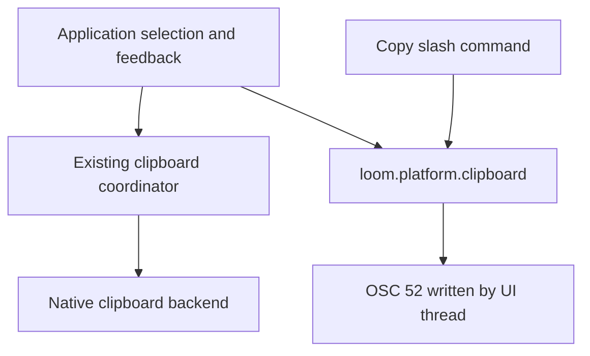

# RFC 0010 — In-App Selection Copy and Clipboard Infrastructure

RFC 0011 refines the OSC ownership established here: sequence generation now
belongs to `loom.terminal.osc`, and stdout delivery to `loom.terminal.output`.
The selection, backend routing, default and feedback decisions remain intact.

## Summary

Make in-app text selection with automatic clipboard copy the default. Move
OSC 52 encoding and emission out of the slash-command module into the existing
`loom.platform.clipboard` infrastructure. Both the UI and `/copy --osc52`
must report terminal delivery as a request, rather than confirmed clipboard
success. This revises RFC 0007's default-mode decision; its asynchronous native
copy coordinator, SSH routing, deadlines and terminal-output ownership remain.

## Motivation

### Evidence

| Metric | Current | Target | Measurement |
|---|---|---|---|
| UI imports of `loom.commands.copy_cmd` for OSC 52 | 1 | 0 | Source import graph |
| OSC 52 implementations in slash commands | 1 | 0 | Source inspection |
| Default `DisplaySettings::mouse_mode` | false | true | Config and PTY tests |
| Copy result surfaces | Native inline toast; OSC/failure footer | One inline copy feedback surface | UI tests |

The current default disables mouse tracking, so Loom never receives selection
events. The current UI can copy only when mouse mode is explicitly enabled.
Its native completion already distinguishes success from OSC emission, but the
command reports both as `Copied`. These are directly observable source facts.

## Goals

- G1. Default startup enables mouse tracking and a completed in-app drag copies
  displayed text automatically, including UTF-8 and reverse drags.
- G2. Clipboard infrastructure owns the only OSC 52 encoder/emitter; no UI
  dependency on the copy-command module remains.
- G3. The inline feedback distinguishes `Copying…`, confirmed native copy,
  `Copy sent to terminal · paste to verify`, and copy failure. Old results must
  not overwrite feedback or emit OSC 52 after selection is cleared/replaced.
- G4. Keep explicit `mouseMode: false` as the persistent native-selection
  option and preserve the existing immediate F2 toggle. F2 is best-effort: an
  FTXUI reinstall (suspend/resume or restored I/O) can re-enable tracking.
  Preserve settings schema, precedence and explicit values.
- G5. Use conventional linear multi-row selection with matching highlight and
  extraction; keep leading empty rows and avoid copying wide-cell fillers.

## Non-Goals

No new clipboard service, terminal capability probes, clipboard reads, tmux
configuration, new settings keys, protocol changes, continuous render timer,
copy-mode scrolling, double-click word selection or platform-worker redesign.
Do not modify unrelated concurrent changes already present in this checkout.

## Proposal

### Ownership and compatibility

Add an out-of-line OSC 52 function to the existing clipboard module and its
implementation unit in `loom_utils`. Reuse `loom.crypto.crypto` Base64 encoding.
The function returns a write/flush result; this is not a clipboard acceptance
acknowledgement. The UI invokes it only while draining the current copy result
on the UI thread. `/copy` uses the same primitive; its native/file/stdout
behavior and arguments remain unchanged. The internal command helper is
removed together with its callers; it is not a released external API.

Set the existing mouse-mode default to true. Explicit false still turns off
FTXUI tracking. Preserve the existing settings read/write cascade and file
format. Update startup/config tests and user guidance for the new default.

Selection owns its text, geometry and copy-feedback state. A release sets
`Copying…` and posts the existing asynchronous coordinator. Native success
sets confirmed-copy feedback. Failure/unsupported triggers OSC 52 on the UI
thread; write success sets terminal-request feedback, write failure sets failed
feedback. Selection clearing invalidates outstanding result generations.
Use the existing bottom_float copy toast for all four states instead of mixing
footer notifications with inline confirmation. No selected text enters logs.

Normalize drag endpoints in row-major order. First/last rows use their own
column bounds; intermediate rows span the screen. Highlight and extraction
share the same geometry. Preserve leading empty rows and skip empty wide-cell
continuations (`character == ""`), while preserving ordinary spaces
(`character == " "`). When either endpoint lands on a wide glyph owner or continuation,
expand the selected interval to include the glyph owner cell and its filler
(snap a continuation start left; extend an owner end right).
Test both endpoint directions on CJK/emoji owners and continuations; preserve empty rows
by row position rather than by checking whether accumulated text is empty.

### Affected contracts and boundaries

The shared change is authorized by the user's explicit request. Local UI-only
encoding would duplicate the same protocol in `/copy`; retaining a commands
dependency would preserve the inverted ownership. The smallest shared change
is one declaration plus an implementation in the existing clipboard module.
The `mouseMode` key and boolean semantics stay unchanged; only its absent-key
default changes. Terminal emission remains stdout with the existing OSC 52
wire shape. Session traces and model wire protocols are unaffected. The copy
feedback strings and startup mouse sequences change on both producer and tests.

## Phases and graduation criteria

| Phase | Title | Scope | Status | Graduation criteria (measured) |
|---|---|---|---|---|
| A | Infrastructure and interactive copy | Clipboard, command, config, selection, tests, docs | done | Zero UI imports of copy_cmd; exact-byte OSC and default/false PTY checks passed; native/terminal/failure/stale and geometry tests passed; debug/release builds and serial CTest passed (2398 passed each, 0 failed); RFC/graph lint passed; independent review APPROVE; existing full-tree inline ratchet failures unchanged |

## Production Readiness Review

- Correctness: native backend success remains the only confirmed-copy result;
  OSC delivery remains unconfirmed. Cover encoding, write/flush failure,
  unsupported/native failure, stale completions, reverse and multi-row drags.
- Test accounting: retain all existing tests. Add focused GoogleTest cases to
  existing test targets and extend existing PTY startup cases; record final
  totals after CTest discovery. No disposable script counts as test evidence.
- Goldens: existing bottom_float styling is reused. Existing unrelated goldens
  remain untouched; any changed copy feedback assertions are inspected.
- Build: declarations stay in interfaces and OSC implementation moves out of
  line. No new library or upward edge, no dependency upgrade or concurrency
  restriction. Run both presets and graph lint.
- Metrics: Linux `/proc` PSS is unavailable on this macOS host. No claim of
  memory improvement; record build/test outcomes, not fabricated PSS values.
- Compatibility: explicit settings values and persisted formats are retained.
  Changing the absent-key default is intentional and documented. No model or
  trace schema changes. No compatibility shim for the internal helper.
- Observability/lifecycle: reuse existing event-driven coordinator, deadlines,
  cancellation/reaping and clipboard debug channel. No new worker or ticker.
- Rollback: restore the false default for immediate native-selection rollback;
  infrastructure migration can be reverted as one coherent file set.
- Platform scope: local macOS debug/release and real PTY checks are required.
  Linux CI and terminal clipboard acceptance are external verification limits;
  existing platform guards and SSH tests are retained.
- Documentation/deletion: remove obsolete command encoder/footer-copy helpers,
  document default and accurate terminal-request feedback in README, docs index
  and design decisions. All prose/comments remain English.

## Rollout and rollback

Ship phase A as one coherent change without creating a commit in this task.
Users with `mouseMode: false` keep terminal selection; absent-key users receive
automatic in-app copy. F2 remains available as an immediate, best-effort toggle
in enabled mouse mode; this RFC does not redesign FTXUI suspend/resume. Roll back
the default independently if needed, or revert phase A's task-specific edits
while preserving unrelated checkout changes. No data migration is required.

## Drawbacks

The application now receives mouse events by default. Native terminal selection
requires F2 or explicit false. F2 can be reset by FTXUI reinstall, so explicit
false is the reliable persistent option. OSC 52 acceptance remains terminal-dependent,
and rendered text is limited to the visible frame rather than source Markdown.

## Alternatives considered

1. Do nothing: leaves the UI-to-command dependency and requires opting in to
   automatic copy; does not satisfy the requested experience.
2. OSC 52 only: simplifies routing but loses working native copy in terminals
   that ignore OSC 52. Keep the proven native-first, SSH-aware coordinator.
3. A new clipboard service or emitter interface: unnecessary; existing
   clipboard infrastructure and UI output ownership already provide the seams.
4. Native terminal selection by default: the app cannot observe its selected
   text or display accurate per-copy feedback. Retain it as the explicit mode.

## Testing and verification plan

GoogleTest exact-byte OSC encoding/write tests; command OSC feedback test;
selection copy-state, stale-result and geometry tests (forward/reverse
multi-row selection, leading blank rows and wide-glyph endpoints); exact
command assertion that OSC reports a terminal request, never `Copied`; existing actual native
backend capture tests; config absent-key/explicit-false tests; PTY default and
explicit-false DECSET checks. Run focused tests, both complete presets and
serial CTest, `tools/rfc/rfc_lint.py`, `tools/arch/graph_check.py`, and
`tools/arch/graph_check.py --target-ui9`. No test deletion is planned.

## Documentation impact

README mouse-mode usage, docs RFC index, design-decision addendum and module
comments. RFC 0007 remains a historical record; this RFC revises its default
and geometry non-goal without rewriting its implementation history.

## Open questions

None. Product scope and the default change are authorized by the user request.

## Implementation History

| Date | Phase | Event | Commit / PR | Evidence (metrics, test totals) |
|---|---|---|---|---|
| 2026-10-13 | — | RFC opened for independent design/PRR review | uncommitted | Current source ownership and default inspected; task-start file contents saved outside repo |
| 2026-10-13 | — | Accepted and implementable: independent design and PRR APPROVE | uncommitted | agent:selection_review; wide-glyph endpoint contract and F2 reinstall limitation resolved; baseline graph 634 modules, zero cycles/upward/dead imports; both CTest discoveries 2390 |
| 2026-10-13 | A | Implementation started | uncommitted | Scope authorized; no new service or settings key |
| 2026-10-13 | A | Independent code review APPROVE | uncommitted | agent:selection_review; no unresolved findings; graph checks (default, UI9, Core8), RFC lint and task-scoped whitespace checks passed |
| 2026-10-13 | A | Implemented; graduation criteria satisfied | uncommitted | Debug/release builds passed; each CTest preset has 2420 registered, 2398 passed, 20 skipped, 2 disabled, 0 failed; real PTY default/false checks passed; remaining platform/gate limitations recorded below |

## Implementation verification

Both debug and release builds passed with the project's warning-as-error
settings. CTest discovery increased from 2390 to 2420 in each preset: nine
clipboard infrastructure tests, one command test, one config test and nineteen
UI tests. Existing test cases were retained; the existing PTY test gained
default and explicit-false startup cases.

| Check | Result |
|---|---|
| Debug focused selection/clipboard/config suite | 81 passed, 3 existing source guards skipped, 0 failed |
| Debug full serial CTest | 2398 passed, 20 skipped, 2 disabled, 0 failed; 338.02 seconds |
| Release full serial CTest | 2398 passed, 20 skipped, 2 disabled, 0 failed; 288.13 seconds |
| RFC lint | Passed, 10 RFCs |
| Module graphs: default, UI9, Core8 | Passed; no new upward edge or cycle |
| Task-specific whitespace/diff audit | Passed; unrelated checkout changes preserved |
| Inline-definition ratchet | Existing full-tree violations; no task-added violation |

The existing full-tree inline-definition gate fails in seven modules. Using
the gate's own counter on task-start snapshots and current touched interfaces
shows unchanged counts in `app` (2), `app_impl` (18), `config` (101) and
`clipboard` (8), and a reduction in `copy_cmd` from 19 to 17. No baseline
exceptions were added, and unrelated interfaces were not changed to satisfy
this task's checks.

The twenty skipped tests are sixteen existing BashDanger cases, one
Windows-only PowerShell execution test and three existing clipboard source
guards. Two existing fullscreen click tests are disabled. The new clipboard,
selection and config tests, and the expanded real-PTY startup test, ran.
Native backend tests capture the actual subprocess input without changing the
user's clipboard. Terminal clipboard acceptance and Linux CI are unverified;
successful OSC 52 emission is deliberately reported only as a terminal request.

### Task-owned files

- Infrastructure: `src/utils/platform/clipboard.cppm`,
  `src/utils/platform/clipboard.cpp`, `src/cmake/targets/loom_utils.cmake`.
- Command: `src/commands/copy_cmd.cppm`.
- Config/startup: `src/config/config.cppm`, `src/main.cpp`,
  `src/ui/app/app_run.cpp`.
- Selection and feedback: `src/ui/app/app.cppm`,
  `src/ui/app/app_text_selection.cpp`, `src/ui/app/app_render_event.cpp`,
  `src/ui/app/app_extra_methods.cpp`, `src/ui/app/app_testing_seams.cpp`.
- Tests: `tests/utils/CMakeLists.txt`, `tests/utils/test_clipboard_osc52.cpp`,
  `tests/commands/test_misc_commands.cpp`,
  `tests/services/test_config_rw_split.cpp`, `tests/e2e/e2e_pty_decset.cpp`,
  `tests/ui/test_ui_features.cpp`.
- Documentation: `README.md`, `docs/README.md`,
  `docs/decisions/design-decisions.md`, this RFC.
