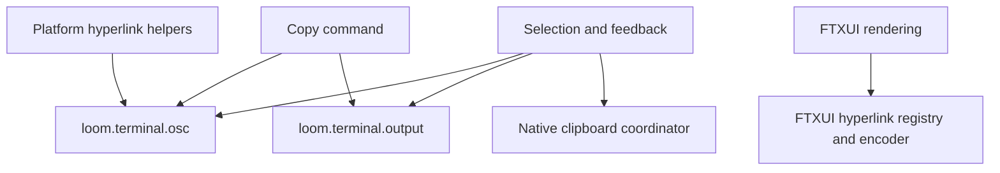

# RFC 0011 — Common OSC Protocol Ownership

## Summary

Give Loom-owned OSC sequence generation one pure protocol owner,
`loom.terminal.osc`, under `src/utils/terminal/`. Separate byte generation from
stdout delivery, native platform capabilities and UI feedback. Migrate OSC 2,
8 and 52 completely, retaining valid-input wire bytes and existing clipboard
routing. This refines RFC 0010's shared-clipboard ownership without replacing
its selection, lifecycle or feedback behavior.

## Motivation

### Evidence

| Metric | Current | Target | Measurement |
|---|---|---|---|
| Loom-owned OSC 8 encoders | 2 | 1 | hyperlink.cppm and ink_utils.cppm |
| Hyperlink capability implementations | 2, different heuristics | 1 | Same two modules |
| Other Loom-owned OSC encoders | OSC 2 in UI; OSC 52 in clipboard | One protocol owner for all three | Source scan |
| Protocol generation coupled to stdout | Clipboard emit_osc52 | 0 in protocol module | Imports/source and output capture tests |
| CTest registrations | 2420 each preset | Baseline plus explicitly reconciled tests | ctest --preset debug/release -N |

Architecture correctness precedes feature completeness and implementation cost.
The invariant needing central ownership is protocol encoding, not clipboard
backend selection. The duplicate ink_utils hyperlink helpers and UI title
helper have no consumers in src/tests, but their functionality must remain
available through the protocol owner with native tests.

## Goals

- G1. All Loom-owned OSC 2/8/52 generation lives in one protocol module.
- G2. Protocol functions are pure: no stdout, getenv, platform processes, UI
  dependency, clipboard reads or terminal capability detection.
- G3. OSC 2 and 8 reject C0/DEL controls in their protocol fields, preventing
  ESC/BEL/NUL injection. UTF-8 and valid URLs/titles retain their wire bytes.
  OSC 52 Base64-encodes arbitrary text bytes, including NUL and controls.
- G4. Native/SSH routing, asynchronous lifecycle, four-state UI feedback,
  command arguments, settings, traces and FTXUI hyperlink hit-testing remain.
- G5. Migrate every existing caller and test, remove obsolete self-owned
  encoders, and independently review the complete migration.

## Non-Goals

Do not implement OSC 11/133/1337, terminal queries, new capability heuristics,
tmux passthrough, all-purpose terminal services, third-party replacements,
global ANSI parser consolidation or clipboard-worker changes. Existing OSC
parsing/stripping is input/rendering behavior, not sequence generation.
Unrelated dirty work is preserved and committed as explicitly authorized;
pre-existing CI gate defects must be repaired before committing it.

## Proposal

### Detailed design

Both new modules belong to the existing loom_utils target; no new library.
Interfaces contain declarations only; bodies live in .cpp implementation
units. Namespaces are `loom::terminal::osc` and `loom::terminal::output`.

The protocol exports typed `window_title(title)` and `hyperlink(uri, text)`
returning the existing utils Result<string>, and `clipboard_request(text)`
returning string. OSC 2 and OSC 8 use ST (ESC-backslash); OSC 52 retains BEL.
An internal framing helper is not a public arbitrary-command extension point.
Hyperlink URI is the OSC payload; display text remains opaque and is not
sanitized as part of the protocol. Empty URI produces closing hyperlink
semantics; empty title/text and non-ASCII payloads are supported.

`loom.terminal.output::write_control_sequence(bytes)` writes the complete
string_view byte range to stdout and flushes, returning utils VoidResult on
write/flush failure. It does not encode OSC or schedule work. The caller owns
serialization; interactive fallback stays on the UI thread. Success confirms
byte delivery only, never terminal clipboard acceptance.

Delete platform.clipboard's emit_osc52 declaration/implementation and migrate
the UI and command directly to the two lower-level APIs. Keep native clipboard
functions/coordinator unchanged. Platform hyperlink retains its capability
gate, URL/file conversion and OS openers; make_hyperlink delegates encoding,
and returns plain text on unsupported terminal or rejected URI. Delete unused
ink_utils capability/encoder duplicates and terminal_io's set_title; the new
protocol title API preserves that feature. No compatibility shim is needed
for these internal unconsumed helpers. FTXUI remains responsible for rendering
hyperlinks and registering pixel IDs, which Loom's click routing consumes.

### Contracts and compatibility

Preserve OSC 52's exact selector `c`, Base64, BEL, OSC 8's open/close framing
and ST, and OSC 2's ST. Invalid title/URI controls now produce an explicit
invalid_argument error; valid-input bytes and capability decisions do not
change. Retain command error translation and accurate terminal-request text.
No settings key, persisted format, model protocol or trace shape changes.
No golden update is expected because visible valid-input rendering is intact.

## Phases and graduation criteria

| Phase | Title | Scope | Status | Graduation criteria (measured) |
|---|---|---|---|---|
| A | Common protocol and full migration | utils, command, UI, tests, docs | done | Zero self-owned encoders outside osc; one capability implementation; pure protocol imports; all exact-byte/error/integration tests passed; debug/release builds and serial CTest (2415 Passed each, 0 failed); all architecture/RFC gates passed; independent code APPROVE |

## Production Readiness Review

- Correctness: native tests cover all three OSC commands, UTF-8, empty values,
  Base64 padding/controls/NUL, invalid title/URI, opaque display text and
  write/flush failures. Existing command, selection, backend and PTY tests run.
- Build: utils-only downward dependencies (crypto/error/std), no new target,
  interface bodies or textual third-party headers. Measure build wall time,
  module graph and test totals. /proc PSS unavailable on this macOS host;
  record this limitation without fabricating memory metrics.
- Compatibility: all valid-input protocol bytes remain identical. No terminal
  capability or backend policy migration. Invalid control payloads rejected.
- Observability: keep coordinator diagnostics and four-state feedback. Output
  failures still map to command errors or failed selection feedback.
- Lifecycle: no workers, timers, retries or shared mutable state introduced.
- Documentation/deletion: catalog the sole protocol owner, update docs index,
  delete obsolete generation helpers and migrate their tests in the same phase.
- Rollback: revert phase A's coherent commit; no data migration required.
- Platform: dual local macOS presets plus real PTY checks. Linux and actual
  terminal acceptance remain external verification limits.
- Full checkout: independent prior-change review and CI gates precede commits.
  Preserve screen golden whitespace, because it represents actual output.

## Rollout and rollback

Implement after independent design/PRR approval. Keep prior changes and this
refactor in separately explained Conventional Commits on master. User has
explicitly requested all current work be committed; do not push. Revert the
protocol refactor independently if necessary, preserving previous features.

## Drawbacks

Adds two small modules/implementation units and explicit imports at output
sites. Control rejection changes previously unsafe malformed-input behavior.

## Alternatives considered

1. Do nothing: preserves duplicate encoding/heuristics and mixed ownership.
2. Fold everything into clipboard: wrong ownership for title/hyperlink and
   couples pure protocol to platform processes and terminal I/O.
3. A general OscService owning probing, workers and feedback: mixes protocols,
   platform decisions and UI lifecycle; more complexity without a requirement.
4. Replace FTXUI encoder: would bypass registered pixel hyperlink IDs and
   third-party screen output ownership. Keep its integrated renderer intact.

## Testing and verification plan

Migrate nine existing clipboard OSC tests to the correct protocol/output
owners; account for every rename. Add title/hyperlink/validation and no-output
tests and platform hyperlink fallback coverage. Re-run command/selection
integration. Discover and reconcile final totals. Run debug/release builds and
full serial CTest, RFC lint and every existing architecture CI gate. Independent
review covers protocol code and prior dirty changes before commits.

## Documentation impact

Update docs index and design decisions; no change to settings or CLI usage.
Add an AGENTS.md architecture note for the new terminal protocol directory.
RFC 0010 remains historical with an explicit pointer to this refinement.

## Open questions

None. Scope, architecture priority and committing all work are user-authorized.

## Implementation History

| Date | Phase | Event | Commit / PR | Evidence (metrics, test totals) |
|---|---|---|---|---|
| 2026-10-13 | — | RFC opened for independent design/PRR review | pending | Source inventory and task-start dirty checkout snapshot saved; 2420 registrations per prior completed preset |
| 2026-10-13 | — | Accepted and implementable: design and PRR APPROVE | pending | agent:osc_review; protocol/output boundary, exact byte compatibility, control validation, rank-2 graph coverage and FTXUI integration approved |
| 2026-10-13 | A | Implementation started | pending | Two pure/output modules added; native and FTXUI owners retained; existing 9 tests migrated to 25 plus one platform fallback integration case (expected 2437 total) |
| 2026-10-13 | A | Independent code and RFC conformance APPROVE | local master series (RFC-0011) | agent:osc_review; all material findings resolved; full dual-preset verification and architecture gates independently examined |
| 2026-10-13 | A | Implemented; graduation criteria satisfied | local master series (RFC-0011) | 2437 registrations per preset, 2415 Passed / 20 Skipped / 2 Disabled / 0 failed; valid wire bytes and FTXUI hit testing preserved |

## Implementation verification

| Check | Measured result |
|---|---|
| Test accounting | 2420 to 2437 registrations per preset; original 9 cases migrated to 25 protocol/output cases, plus 1 platform fallback case; net +17 |
| Debug/release incremental builds | Passed, warning-as-error; 618 Ninja actions each; build-log creation-to-final-output spans 208.83s / 277.82s on this macOS host |
| Debug focused protocol/clipboard/selection/PTY/Agent suite | 104 passed, 3 existing guards skipped, 0 failed; 23.27s |
| Debug full serial CTest | 2415 passed, 20 skipped, 2 disabled, 0 failed; 351.69s |
| Release full serial CTest | 2415 passed, 20 skipped, 2 disabled, 0 failed; 296.11s |
| Module graph | 636 modules / 788 units; 0 cycles, upward edges or dead imports |
| Architecture CI gates | Core8, UI9, store placement, target grouping, all negative controls, UI theme lint and inline-definition ratchet passed |
| RFC lint | Passed, 11 RFCs |

The twenty skipped cases are sixteen existing BashDanger tests, one
Windows-only PowerShell execution test and three existing clipboard source
guards. Two existing fullscreen click tests remain disabled. Every migrated or
new protocol/output/platform case ran; existing FTXUI LinkHyperlink coverage
checks the registered pixel ID and URL and remains intact.

Before committing the accumulated work, fourteen unchanged function bodies
were moved into their own module implementation units to repair seven existing
inline-definition violations: config 101 to 100, agent 20 to 19, query 25 to
23, API 40 to 39, app 2 to 1, design tokens 13 to 6 and text input 29 to 28.
No frozen count or checker exemption was relaxed. Theme lint recognizes the
exact new authoritative palette implementation file; other UI files and
negative controls remain checked. Store/TLL negative-test expectations were
updated for the already-present TodoStore and the existing diagnostic wording.

Independent accumulated-work review also caught a missing background Agent
Queued-to-Running transition. The owned worker now marks Running immediately
before executing; the held-response real AgentTool integration test asserts
Running before shutdown. Queued execution registration semantics stay intact.

Native clipboard tests capture subprocess input without changing the user's
clipboard. Terminal acceptance and Linux CI are not verified locally. No PSS
or CI-runner build performance improvement is claimed; local build-log spans
are incremental validation timings, not cold-build benchmark results.
