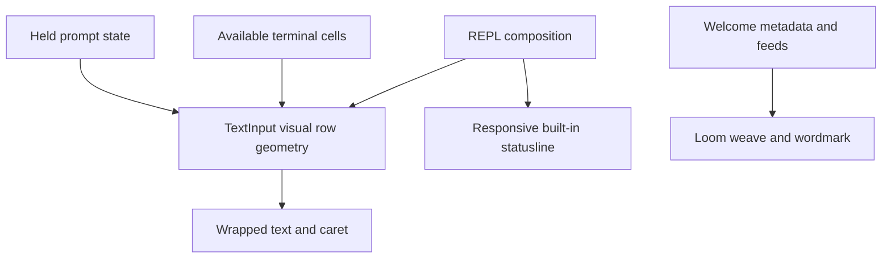

# RFC 0012 — Loom Prompt Wrapping and Chrome

## Summary

Wrap the actual prompt to the available terminal cells, keep its caret visible
and aligned with visual rows, simplify built-in status chrome responsively,
and replace remaining vendor mascot artwork with the existing Loom weave
identity. Preserve editing state, submitted bytes, status configuration,
external status commands, welcome metadata, notices and feeds.

## Motivation

### Evidence

| Current evidence | Required outcome |
|---|---|
| TextInputImpl splits only explicit newlines, composing each as hbox | Long logical lines become visible wrapped rows |
| Prompt caret uses logical column and rel_y without wrapped rows | Caret matches actual visual row, including resize |
| RenderPromptInput forces at least 40 columns | Respect narrow terminal width |
| Built-in statusline concatenates unbounded labels and 10-cell bars | One legible, prioritized row without clipping partial fields |
| Welcome layouts still contain Clawd-shaped body art | Only Loom artwork across condensed/compact/horizontal layouts |
| Source has no Clawd/Orange/Upstream/CPP Pod/CPP Round selector entries | Remove actual legacy artwork, not unrelated uses of terminology |

The user confirmed logo cleanup belongs to this request. Baseline is a clean
master checkout; both CTest presets register 2437 tests.

## Goals

- G1. Long Chinese/ASCII/emoji prompts wrap without changing input bytes.
- G2. Caret placement shares cell-aware visual geometry with rendering,
  including explicit newlines, middle edits, end-of-row caret and resize.
- G3. Preserve selection, image-chip highlighting, masking, placeholders,
  command hints and completion ghost text. Long prompts use a bounded visible
  viewport that follows the caret instead of exhausting transcript height.
- G4. Built-in statusline uses semantic tokens and concise grouped fields,
  remains one row and prioritizes useful context on narrow terminals.
- G5. All welcome/logo layouts use Loom's weave/wordmark, preserve metadata,
  feeds/notices and theme accessibility; delete unused legacy art/helpers.

## Non-Goals

No editing/buffer redesign, new status configuration key, status worker or
render timer, image generation, external status command restyling, unrelated
Faithful message-renderer renames, git-upstream renames or general token cleanup.
No commit/push is requested for this new task.

## Proposal

### Detailed design

Dependency invariant: `loom.ui.widgets.text_input` owns visual-row geometry;
the existing `loom.ui.screens.repl_screen -> loom.ui.widgets.text_input` edge
supplies constraints. `loom.ui.prompt.prompt_input_footer` owns semantic footer
layout; `loom.ui.foundation.logo` remains a leaf. No new production module,
library/service target or reverse UI dependency is introduced. Validate the
default and UI9 module graphs after implementation.

Fix wrapping in loom.ui.widgets.text_input, where selection/caret rendering
already belongs. A render width projected by the REPL is concrete layout
input, not a new service. Width means total usable cells inside the input
node; the widget subtracts prefix and line-number columns itself. Visual row
spans are half-open source-byte ranges shared by text, selection, mask/chip,
caret and viewport calculations. Reuse FTXUI glyph/cell-width helpers, never split
UTF-8 sequences or wide-glyph continuation cells. Use one visual-row calculation
for rendering and caret coordinates. Logical byte offsets and editing history
remain unchanged. Keep default behavior for callers without a constrained
width; remove the REPL's artificial minimum width. The REPL supplies a bounded
height derived from its terminal geometry and follows the caret when rows exceed
that budget. Selection and chips retain their visual semantics after wrapping.

Status layout belongs to prompt_input_footer with terminal width projected
from repl_screen_layout. Put statusline on a dedicated full-width row above
the left/right mode/notification/bridge footer, so right chrome cannot consume
its budget. Subtract explicit status padding before allocating its fields.
Keep the existing enable/segment controls and external command override.
Built-in content groups cwd/branch/model and usage/cost;
abbreviate long values or omit lower-priority fields as needed, without leaving
partial labels, broken UTF-8 or dangling separators; ellipses are cell-aware
and only whole semantic tokens are selected. Context percentage remains
visible where practical; remove repetitive model/git/ctx labels and long empty
progress-bar chrome. Mouse hint remains discoverable in compact form.

Logo migration belongs to foundation.logo and its callers/tests. Reuse the
existing Loom weave icon and a Loom wordmark in every layout. Preserve welcome
mode thresholds, dark/light/monochrome themes, username/model/path/billing,
notice aggregation and feed order. Remove vendor mascot art and helpers;
palette fields may be removed/renamed only after confirming logo-only use.
Do not touch actual AgentColor::Orange or unrelated historical identifiers.

## Phases and graduation criteria

| Phase | Scope | Status | Graduation criteria |
|---|---|---|---|
| A | Prompt, built-in footer, logo, native tests and docs | complete | Wrapped ASCII/CJK/emoji and resizing/caret/selection/viewport regressions pass; narrow/wide footer tests; all welcome layouts show Loom; exact CTest accounting; debug/release builds and full CTest; all architecture gates; independent code APPROVE |

## Production Readiness Review

- Correctness: screen pixel/visible text/caret tests exercise public components
  at narrow and wide dimensions, mixed UTF-8, explicit lines, cursor movement
  and long input. Existing edit, paste, chip and submit tests remain.
- Build: no new library, reverse dependency or speculative abstraction;
  declarations remain in interfaces and bodies in implementation units.
- Lifecycle: held TextInputImpl remains held. No per-render component rebuild,
  worker, polling or animation timer. Layout updates do not clear edit state.
- Compatibility: submitted text, stored settings, session/model schemas,
  status command behavior and enabled segment semantics are unchanged.
- Visuals: update only prompt/status/logo goldens that change intentionally;
  inspect rendered terminal screens and preserve fixed-width whitespace.
- Observability: status/backend diagnostics and errors remain unchanged.
- Rollback: revert this uncommitted task's coherent delta; no data migration.
- Metrics: baseline 2437 registrations; reconcile additions/deletions exactly.
  Local macOS dual presets required; Linux and physical terminal appearance
  remain external limits. /proc PSS is unavailable; no memory claim.

## Rollout and rollback

After independent design/PRR approval, implement disjoint owning modules in
parallel and integrate their UI geometry. Preserve all concurrent changes.
Keep the task uncommitted. Rollback restores task-start file snapshots without
touching earlier master commits.

## Drawbacks

Wrapped input uses more rows; a bounded viewport limits transcript displacement.
Narrow statuslines hide lower-priority detail. Logo art changes intentionally.

## Alternatives considered

1. Keep clipping/horizontal-only display: fails the requested text visibility.
2. Wrap only the outer prompt with paragraph/flexbox: loses caret/selection/chip
   correspondence and preserves the wrong geometry owner.
3. Make the statusline itself multi-row: steals transcript space and breaks
   stable chrome height. Retain one status row above the footer controls.
4. Rename vendor mascot labels without replacing art: does not establish Loom
   identity. Reuse the already-present Loom weave.

## Testing and verification plan

Native screen and input tests, narrow/wide status tests with active right
chrome and padding (whole tokens, no wrap), theme/logo tests and
goldens; real PTY prompt rendering where practical. Both presets and full
serial CTest; RFC, graph, inline and theme/negative architecture checks.
Record final totals and resolve independent review findings before delivery.

## Documentation impact

Docs index and design decision entry for visual prompt geometry, footer
priority and Loom-only artwork. Source comments and prose remain English.

## Open questions

None. User confirmed scope; routine layout choices follow existing tokens.

## Implementation History

| Date | Phase | Event | Commit / PR | Evidence |
|---|---|---|---|---|
| 2026-10-13 | — | Opened for design/PRR review | uncommitted | Live source root causes inspected; task-start snapshots saved; 2437 baseline registrations |
| 2026-10-13 | — | Accepted and implementable; design and PRR APPROVE | uncommitted | agent:prompt_chrome_review; exact-width footer invariant and named geometry/dependency owner confirmed |
| 2026-10-13 | A | Independent code review APPROVE; material findings resolved | uncommitted | agent:prompt_chrome_review; removed residual vendor brand token/parser, widened context capacity and formatting to int64; final native suites pending |
| 2026-10-13 | A | Complete; graduation APPROVE; RFC implemented | uncommitted | agent:phase_completion_review; both full suites 2440 passed, 20 skipped, 2 disabled, 0 failed; final builds, architecture gates, snapshot review and diff checks passed |

### Review findings

| Severity | Evidence and impact | Resolution |
|---|---|---|
| P1 | Unused vendor-named background token/parser and accent constants remained after art removal | Deleted unused field/parser after caller audit; renamed accent constants to Loom; source/tests brand-name search is empty |
| P2 | Engine capacity is uint32_t but new UI projection used int; large valid capacities could overflow | Use int64_t across projection/footer/formatting; native regression covers a 4-billion-token capacity and accurate percentage |

The real PTY test originally used a fixture response without text deltas and
assumed text-block user serialization. Reusing the existing delta response
helper and checking the backend's actual scalar content resolved both fixture
errors. Actual prompt visibility, reflow and original submitted bytes passed.

### Snapshot migration review

The first full debug run found 27 failures confined to legacy streaming footer
expectations: 2413 passed, 27 failed, 20 skipped and 2 disabled. The existing
normalizer now recognizes
the semantic status row only below an actual prompt frame and only for the
runtime temporary-directory stem or its abbreviation; negative cases preserve
ordinary paths, ellipses, transcript text and malformed usage. No production
behavior changed to accommodate snapshots.

All 62 streaming goldens replace exactly one final footer line; all prior rows
are byte-identical. The 32 replay/migration checks pass without update mode.
Independent agent:prompt_chrome_review audited every delta and the normalizer
and returned APPROVE. Final full debug/release results follow below.

### Changed file inventory

| Owner | Files |
|---|---|
| Input widget | `src/ui/widgets/text_input.cppm`, `text_input_render.cpp` |
| Screen integration | `src/ui/screens/repl_screen.cppm`, `repl_screen_events.cpp`, `repl_screen_layout.cpp`, `repl_screen_prompt_render.cpp`, `chrome_store.cppm`; `src/ui/app/app_extra_methods.cpp` |
| Footer | `src/ui/prompt/prompt_input_footer.cppm`, `prompt_input_footer.cpp` |
| Loom brand | `src/ui/foundation/logo.cppm`, `logo.cpp`, `design_tokens.cppm`, `design_tokens.cpp`, `theme_provider.cppm` |
| Build wiring | `src/cmake/targets/loom_ui_foundation.cmake`, `loom_ui_prompt.cmake`; `tests/ui/CMakeLists.txt`, `tests/e2e/CMakeLists.txt` |
| Native verification | `tests/ui/test_prompt_wrap.cpp`, `test_ui_light.cpp`, `test_ui_paste.cpp`, `test_ui_render_pure.cpp`, `test_streaming_replay.cpp`, `test_streaming_migration.cpp`; `tests/support/screen_normalize.hpp`; `tests/e2e/e2e_pty_shutdown.cpp` |
| Intentional goldens | 62 files under `tests/fixtures/streaming_snapshots/`, each changes only the final footer row |
| Design record | This RFC, `docs/README.md`, `docs/decisions/design-decisions.md` |

## Final verification

Both final builds (`cmake --build --preset debug -j8` and release) succeeded
with the repository warning policy. Full serial native CTest results:

| Preset | Registered | Passed | Skipped | Disabled | Failed | Seconds |
|---|---:|---:|---:|---:|---:|---:|
| debug | 2462 | 2440 | 20 | 2 | 0 | 351.11 |
| release | 2462 | 2440 | 20 | 2 | 0 | 294.57 |

Registration delta: baseline 2437 + 16 prompt regressions + 7 status regressions
+ 1 additional logo-theme test + 1 real PTY workflow = 2462. No new skips or
disabled cases. The disabled sticky-prompt/new-message callback tests and
platform/tree-sitter skips are retained.

The real PTY workflow verifies mixed CJK/emoji/ASCII visibility, 120-to-60-cell
SIGWINCH reflow, original submit bytes exactly once, a finite local fixture
response and restored terminal state. No external model was contacted.

RFC lint; core8/UI9 dependency graphs; store/TLL placement; inline-definition
ratchet; theme lint; and UI9/store/TLL negative controls all passed. Final diff
checks passed. Both production and snapshot code reviews returned APPROVE;
all material findings were resolved. The task remains uncommitted on master.

Limits: this evidence is from local macOS and a real pseudo-terminal. Linux
builds and appearance under other physical terminal/font combinations were
not exercised. No memory/performance claim is made.
