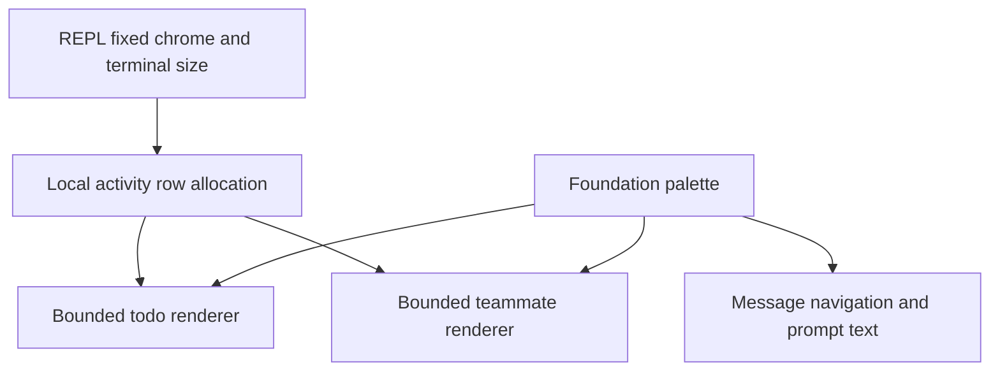

# RFC 0013 — Readable, Bounded, Brand-Coherent Terminal UI

## Summary

Make informational text readable and bound the task/teammate chrome before
removing unused design APIs and exact duplicate tokens. Then coordinate UI
accents with Loom's terracotta/gold identity without collapsing meaningful
status or agent identities. Keep the native FTXUI architecture, existing
configuration, message layout, event-driven rendering and all current local
changes. This is a local, uncommitted implementation tracked in this RFC.

## Motivation

### Evidence

Source and consumer audit on 2026-10-13, against the current dirty working tree:

| Metric | Current | Target | Evidence / measurement |
|---|---|---|---|
| Dark subtle foreground | (80,80,80), 2.00:1 on (32,33,36) | Informational consumers >=4.5:1 on explicit RGB surfaces | WCAG relative-luminance calculation |
| New-message pill text | subtle on (55,55,55)/(70,70,70): 1.48/1.17:1 | >=4.5:1 normal/hover/selected | fullscreen_layout.cppm |
| Pinned todo list | header plus all items: 10 items need 11 rows | Task + teammate activity share a finite terminal-height budget | todo_panel.cppm / repl_screen_layout.cpp |
| Pinned teammate strip | one row per teammate, no local cap | Include total and omitted counts within same budget | live_teammates.cppm |
| Palette / Role | 132 fields / 39 roles | 105 fields / 25 roles | Exact all-seven-theme equality inventory |
| Duplicate color data | 13 semantic alias fields + 14 individual rainbow fields | Remove 27 fields; migrate real consumers | All seven palettes compared, including referenced dark/light values |
| Color arithmetic | expects rgb(...) from Color::Print(false); FTXUI returns ANSI parameters | Delete unused arithmetic and its unused caller closure | FTXUI Color::Print and primitive consumer audit |
| Empty design APIs | unused spacing, TextSize, Radius, easing coefficients and primitive families | Retain only externally consumed primitives | src/tests consumer audit |
| Baseline native verification | each preset: 2519 registered, 2497 passed, 20 skipped, 2 disabled | exact reconciled counts, no failures | preceding task's full serial CTest |
| Architecture | zero module/directory SCCs; 12 singleton UI areas; 59 target nodes | preserve DAG, UI9/store/TLL gates | graph_check.py --target-ui9 --store-lint --tll-lint |

The original critique confused legacy chat components with live REPL renderers.
Core user/assistant messages already omit header timestamps/role labels and use
left-aligned glyph-led rows. Prompt input already has two rules. Notifications
already have priority and expiry. Their redesign is outside this proposal.
Contrast ratios are relative, not a medical comfort threshold: white has
16.10:1 on the cited dark background. This RFC makes no eye-fatigue or animation
frame-rate claim.

## Goals

- G1. Affected ordinary informational foregrounds meet >=4.5:1 against
  explicit RGB bubble/hover/selection surfaces in all four truecolor themes.
  Transparent task/team rows use readable tokens without dim and pass >=4.5:1
  against their palette.background reference. Their unknown real terminal
  canvas remains outside numeric certification; no new filled canvas is added.
- G2. At 80x24 with a one-row prompt, 10 todos and 20 teammates and no
  autocomplete popup, the measured
  transcript viewport retains at least 12 rows. With a long prompt at 40x24,
  retain at least 8 rows and a visible caret. Task plus teammate activity
  never exceeds the computed cap; empty activity consumes no rows.
- G3. Keep completed/total/omitted counts and favor current in-progress work.
  Keep the complete state vectors, input bytes, task order and actions intact.
- G4. Remove only proved duplicate data and no-consumer API closures. Keep
  border_subtle and genuinely different per-theme semantic/status tokens.
- G5. Replace loud generic mode/role accents with Loom terracotta/gold family
  equivalents; agent identities remain eight named, distinguishable colors.
  Keyword highlights remain an opt-in cue with coordinated warm stops.
- G6. Preserve dark/light, their color-vision-deficiency variants, monochrome
  and ANSI modes. Numeric RGB contrast is not claimed for user-defined ANSI
  palettes or an unknown transparent terminal canvas.
- G7. Debug/release -Werror builds, focused native tests, full serial CTest,
  RFC lint and graph gates pass. Review changed terminal snapshots visually.

## Non-Goals

No OSC-11/auto-theme implementation, root-canvas rewrite, entire color-literal
sweep, new theme engine, general RGB/animation abstraction, typography redesign,
new render ticker, dependency upgrade, command information architecture,
StatusLine default change, notification service, new task persistence or modal,
new message timestamp/role/glyph layout, or commit/push. Do not implement the
unrelated phases of provisional RFC 0006. RFC 0012 input/caret/selection and
status-command contracts remain intact.

## Proposal

### Ownership and dependency direction

- foundation owns concrete palettes, token declarations and theme lookup.
- todos and teams own bounded pure activity Element builders.
- screens/repl_screen_layout owns the shared terminal-height allocation.
- messages/user_text_message and chrome/fullscreen_layout own the affected
  informational foreground selection; no selection/scroll state migration.
- Tests use the native FTXUI screen and current public renderer interfaces.

No new production module, service, library, state store or import direction.
Only the necessary pure parameters are added to existing renderers. Existing
unbounded standalone renderer calls keep their default behavior; the REPL
always supplies a finite budget.
RenderPromptSuggestions gains a defaulted visible-item cap for the same local
height contract; callers that omit it retain the existing five/six-item policy.

### Phase A: readable text and bounded activity

Use muted for informational secondary text, not the decorative subtle token.
Affected consumers include completed task labels/status, teammate output tails,
user-message prefix and new-message/sticky-message controls. Do not dim readable
information below the chosen foreground's contrast. Borders retain their
existing subtle tokens. Raise truecolor muted values to a neutral that passes
the bubble/hover/selection/canvas matrix; update its duplicated alias literals
until phase B deletes the aliases. In monochrome/ANSI, use distinct foreground
and surface indices for the affected controls; avoid identical hover text and
background indices. Preserve terminal-controlled ANSI rendering.

Test the actual filled foreground/background pairs: secondary text against its
bubble/hover/selection surface; selected user prefixes against selection;
transparent task/team text and status against the palette canvas reference.
Correct the affected suggestion or
status palette values when those pairs fail. Do not require unrelated status
colors to work on every possible surface, or brighten decorative subtle.
Historical transcript dim styling is outside this readability change.
Remove existing dim from affected todo headers/completed labels and live
teammate status/tails; keep completed strikethrough. Timestamp/history styling
in legacy message components remains outside this change.

| Theme | muted target | user normal / hover / selected indices (ANSI only) |
|---|---|---|
| dark, dark-daltonized | RGB(184,184,184) | existing RGB surfaces |
| light, light-daltonized | existing RGB(102,102,102) | existing RGB surfaces |
| dark-ansi, monochrome | White | GrayDark / GrayDark / GrayDark |
| light-ansi | Black | GrayLight / White / GrayLight |

Raising canonical dark muted also brightens existing welcome/footer/dialog
secondary text; reviewed snapshots cover that authorized shared-token effect.
Light suggestion targets RGB(77,93,220), light-daltonized RGB(47,94,235) for
selected prefixes. Both light warnings use readable amber RGB(153,92,0) on
the palette canvas reference. Success already meets its actual canvas pairs.

The REPL measures its actual fixed prompt/footer/margin/spinner requirements
and gives activity a shared cap, at most clamp(terminal_rows / 6, 1, 5) rows,
further reduced to preserve the transcript floor. Account for the outer layout
header and narrow footer. The prompt's existing viewport remains bounded and
follows the caret. At tiny heights fixed controls take priority and activity
can receive zero rows; do not claim an impossible transcript floor there.
The same exception applies when a multi-row autocomplete popup fills the
fixed budget at ordinary heights. Its separate native regression proves
activity yields, both suggestions and caret/footer survive, and at least
8 transcript rows remain. The prior two-item test's eleven-row result was
not G2 certification.
Reserve the measured gap/spinner/footer and one visible prompt row before
choosing the popup count under the existing fullscreen bottom limit. Account
for its margin/separator rows; pass the remaining item count to the pure
suggestion renderer. Five supported suggestions may show a smaller selected
window (for example three at 80x24 with spinner/status). Keep the selected item
visible and the complete suggestion vector/index unchanged; zero capacity
creates no popup element. Then measure the bounded popup before the existing
prompt shrink/activity calculation. Tests exercise five entries with the last
selected at both 80x24 and 40x24, preserving caret/footer/input/vector and >=8
transcript rows. This corrects supported-popup clipping without a new overlay
architecture or a higher shared bottom limit.

Allocate the finite rows fairly when both groups exist. Each group can be a
single compact summary when necessary, with total/completed/omitted counts.
Within todo detail, prioritize in-progress work without mutating input order or
state; omitted entries remain in the complete tool/state list. Team detail
keeps original order and reports omitted teammates. A full new inspection UI
is not added; the existing task/team state and team overview remain available.
No task is marked complete, deleted, cancelled or re-executed by rendering.
Unicode/CJK/emoji must not break the cell budget or create extra rows.
Use FTXUI Utf8ToGlyphs/string_width display-cell measurements for truncation,
including glyph/name/status prefixes. A bounded row's children have explicit
cell widths whose sum fits the terminal; do not let proportional multi-token
hbox shrink remove text from the middle. Zero-width capacity produces no text.
Native narrow CJK/emoji tests assert one-row height and preserved prefix/tail
order, including long names and a single terminal column.

The deterministic allocation contract is:

| Shared rows | Todos only | Teams only | Both populated |
|---|---|---|---|
| 0 | no element | no element | no element |
| 1 | todo summary | team summary | combined todo/team summary |
| >=2 | entire budget | entire budget | ceil(budget/2) todo rows, remaining team rows; transfer unused capacity |

A todo summary is `Tasks D/T done (+N hidden)`; its header counts as one
allocated row and N is the number without a visible detail row. Details select
in-progress entries first in original order, then other entries in original
order. A bounded team strip uses `Teams T (+N hidden)` when not all entries
fit; this summary counts as one row, followed by the first entries in original
order. No summary is needed if all teammate rows fit. A one-row combined
summary includes both totals, completed todo count and both omitted counts.
Default standalone calls retain the old unbounded behavior; explicit zero
budgets render an element with zero height. Tests cover budgets 0 through 5,
multiple in-progress entries and unused-capacity transfer.

Budget calculation builds the fixed elements first and calls their native
ComputeRequirement to measure min_y, including prompt rules, footer, spinner,
suggestions and gap. It also measures the pinned header and accounts for the
scroll top spacer/sticky header. Keep the existing fullscreen bottom limit
max(4, terminal_rows/2). First reduce the prompt's max-visible-row parameter,
never below one, when fixed controls exceed that limit; the held input follows
the caret. Activity receives min(nominal cap, remaining bottom capacity,
remaining terminal height after fixed controls and transcript reservation),
clamped to zero. At the 24-row acceptance sizes reserve 12 transcript rows for
a one-row prompt and 8 for a multiline prompt; reserve at most half of smaller
terminals. If required controls alone cannot fit, activity remains zero and
no impossible transcript-floor claim is made. Do not increase the shared
fullscreen bottom limit or change dialog sizing. Native screen tests verify
the final measured Box, visible caret and footer, including resize.
Budget requirements are computed in the same frame, not from reflected old
bottom geometry. Native acceptance paints at least two frames to settle the
existing transcript scroll measurement, with matching COLUMNS/LINES or an
active FixedSize screen. Spinner-active snapshots use existing verb
normalization; geometric assertions do not depend on the chosen verb.

### Phase B: delete unused APIs and exact duplicates

Canonical field migrations, equal in every existing theme:

| Removed field | Canonical field |
|---|---|
| text_muted / icon_muted | muted |
| text_link | suggestion |
| text_accent / icon_accent | primary |
| border_default | prompt_border |
| border_accent | permission |
| border_error | danger |
| surface_hover | user_message_background_hover |
| surface_selected | message_actions_background |
| surface_bash | bash_message_background |
| surface_memory | memory_background |
| icon_default | text |

Keep border_subtle: it equals chrome in dark variants but subtle in the others.
Remove the 14 unused derived Role tail members and their switch arms; earlier
Role ordinals remain unchanged. Remove the 14 unused named rainbow members;
lookup already reads rainbow/rainbow_shimmer_stops arrays. Preserve every
existing theme lookup string, literal-color parsing and unknown fallback.
Do not merge info/suggestion/permission/remember/rate-limit just because a
dark RGB happens to coincide; light, ANSI and monochrome values differ.

Delete shade/tint/tone/interpolate/hue_to_rgb and their unused primitive caller
closure, unused TextSize/Radius/spacing/easing, unused with_theme_role/surface_box,
and the dormant spinner stall argument. Keep kbd, spinner_glyph and its frames:
they have real consumers. Remove only imports/usings made obsolete by this
closure. Do not introduce another color representation to repair dead APIs.
Migrate real alias consumers atomically across their owning UI modules and
native tests. Keep heavy palette definitions in design_tokens.cpp.

| Primitive disposition | Symbols / external consumers |
|---|---|
| Delete no-consumer closure | heading, subheading, caption, pill, status_pill, badge_counter, divider, progress_bar, flashing_char, shimmer_line, SpinnerBase, make_spinner, obsolete demo |
| Keep | kbd: messages/message_components.cppm; spinner_glyph and k_spinner_frames: widgets/passes.cppm (three-argument call) |

Divider is deleted, including its incorrect default Color::Print check.
The [consumer inventory](attachments/0013-design-api-inventory.md) covers
src/tests/benchmarks and theme lookup strings; no Role-indexed arrays or ordinal
casts consume the removed tail. Recheck after atomic migration; keep all prior
25 ordinal values and assert AutoAccept=24 in native tests.

### Phase C: coordinate brand accents

Keep the Loom weave artwork and logo body identity. Use a readable terracotta
accent and amber/gold companion, with light-theme darker counterparts. The
normal brand accent, bash mode, legacy role-pill foregrounds and related mode
accents share that family. Status colors keep their meaning and distinct shape
labels; color-vision-deficiency variants retain differentiated status/identity
encodings. Dark body text becomes warm off-white as a visual choice, while
contrast tests continue to apply; no comfort/health guarantee is asserted.

FTXUI Color::RGB adapts to Terminal::ColorSupport at construction time. Native
brand tests exposed that eager global LOOM_ACCENT/LOOM_ACCENT_SHIMMER Color
objects are downgraded before terminal initialization, then copied into lazy
truecolor palettes. Construct those same RGB values inside palette function
storage and delete the two now-unused globals; do not change their RGB identity
or add an alternative color representation. This is local to foundation.

Agent names keep the existing red/blue/green/yellow/purple/orange/pink/cyan
identifiers and assignment rules. Retune their truecolor foregrounds to muted
but readable hues, with separate dark/light values, >=4.5:1 on the explicit
background for the canvas reference and surface_tint_4 used by agent cards.
Live teammate rows remain transparent: numeric certification applies to the
declared palette canvas reference, not an unknown terminal canvas. Agent cards
use their existing surface_tint_4 background; no new row surface is introduced.
Do not claim names alone make
colors color-blind distinguishable; existing glyph/name/status labels remain.
The seven highlight stops remain array-backed but move to a restrained
terracotta/amber/clay family; preserve the feature switches and indexing.
This applies to rainbow, rainbow_shimmer_stops and the rainbow_shimmer token
read by Role::Ultra, with light counterparts and ANSI/monochrome variants.
ANSI variants use their own named accents rather than adding RGB to the touched
fields; touched monochrome accents remain achromatic. Do not collapse the seven theme APIs.

### Contract and compatibility boundaries

This authorized change touches shared UI Palette/Role and pure renderer
parameters. It does not change persisted theme names, configuration keys,
status command output, notification keys, AgentColor names, tool schemas,
message storage/tag formats, OSC, model protocols or command behavior.
The only internal signature deletion is an unused primitive stall parameter.
New native tests prove lookup strings and agent-name parsing remain compatible.
Existing prompt wrapping, selection geometry, declared cursor, and held
component lifetime are regression requirements, not redesign opportunities.

## Phases and graduation criteria

| Phase | Title | Scope | Status | Graduation criteria (measured) |
|---|---|---|---|---|
| A | Readability and height | affected text consumers, palettes, bounded todos/teams and screen allocation | done | >=4.5:1 four RGB theme matrices; all seven theme pixel checks; 10 tasks+20 teams <=cap; 80x24 transcript>=12 rows; 40x24 long prompt>=8 rows/caret; resize/empty/zero budget/omitted counts/state unchanged tests |
| B | Delete duplicate/unused design APIs | foundation closure and exact field consumers | done | Palette 132->105; Role 39->25; zero removed-symbol consumers; all seven canonical migration/lookup tests; kbd/spinner consumers retained; graph lint passes |
| C | Brand coordination | existing concrete palettes only and design documentation | done | brand accents tied to primary/gold; eight identity RGB foreground pairs >=4.5:1 on declared backgrounds; CVD/mono/ANSI shape/index contracts; reviewed 80x24/40x24 screenshots; no new motion policy |
| D | Final independent verification | full diff, native suites, docs and gate records | done | debug/release -Werror and serial CTest 0 failures; exact registrations accounted; RFC/graph/store/TLL/inline-interface gates pass; independent code/conformance approval; no commit |

## Production Readiness Review

| Area | Decision / evidence required |
|---|---|
| Correctness and tests | Native pixel/foreground tests, RGB contrast matrix, row/caret geometry, finite/zero budgets, overflow counts, empty data, task state unchanged. No scheduler-dependent animation tests. |
| Golden suites | Existing streaming/theme/prompt/UI suites remain. Review visible text, glyphs, foreground/background and caret in affected terminal snapshots; regenerate only explicit approved changes. |
| Cross-module shapes | Palette field migration is atomic across consumers; theme string keys and AgentColor names retained. No message/tool/tag/wire changes. Decision register consulted. |
| Build | Declarations and heavy bodies retain existing owners. Deleting unused inline bodies reduces the foundation interface surface. No new textual third-party imports or target split. |
| Architecture | Baseline UI9/store/TLL graph gates pass, zero SCCs; rerun after implementation. No UI feature dependencies lifted into foundation. |
| Memory/performance | /proc PSS unavailable on this macOS host; no PSS improvement claim. Record local warm/incremental build wall times and interface fan-out; Linux PSS and macos-14 CI remain external limits. No cold-runner speed claim. |
| Rollback | Task-start file copies retain existing dirty edits; revert only this RFC's file deltas, without git reset/checkout or reverting concurrent work. No persisted migration. |
| Observability | Existing session traces and tool status remain unchanged. Overflow is explicitly visible in UI summary counts. No new worker, ticker or logging path. |
| Documentation | Add design-language rules and current measurements, update docs index and decision register. Follow English repository documentation. |
| Platform | Local macOS debug/release required. Pure FTXUI logic and palette-only changes add no platform syscall; Linux/physical terminal/ANSI-custom-palette appearance is not certified locally. |
| Dependencies | No network fetch or package/dependency change. Existing offline cache and Grep work remain intact. |
| Release | No commit, push, deployment or shared configuration write. The user's instruction overrides commit steps in the RFC skill. |

## Rollout and rollback

Design and production-readiness agent approvals are required before src edits.
Execute A then B then C; run focused native tests at each checkpoint and update
this append-only history. Phase D runs the complete final suites and independent
code/conformance review. Changes stay in the current workspace without a commit.
Baseline copies are stored at:
`/var/folders/v6/yr2gx5bs62lbw5_n3db2xrg80000gn/T/loom-rfc0013-baseline-f35628so`.
They are task-local rollback evidence, not a repository/runtime dependency.
An identical durable task-start copy and per-file hash manifest are stored at
/Users/bytedance/.codex/task-artifacts/loom-rfc0013-baseline outside the
OS-purgeable temporary directory. They include untracked UI files and the
task-start dirty status; no stash/reset/checkout or commit is required.
Reverting A restores consumer foregrounds and activity renderers; reverting B
restores removed fields/helpers together with callers; reverting C restores
palette bodies. Preserve all preexisting prompt/chrome/Grep/session edits.

## Drawbacks

Palette edits recompile interface consumers when fields are removed. Compact
activity cannot show every task simultaneously, so visible omitted counts are
required. Brand retuning changes colors even where former colors were usable.
ANSI palettes remain controlled by the terminal and cannot support universal
numeric RGB contrast guarantees. Keeping semantically different colors costs
more fields than an arbitrary 8-12-color target.

## Alternatives considered

1. Do nothing: retains unreadable navigation text and unbounded pinned lists.
2. Reduce everything to 8-12 colors immediately: conflates status, identities,
   selection/diff surfaces and existing per-theme differences; not justified.
3. Add a generic RGB/animation engine to fix shade: repairs unused abstractions
   while increasing the foundation surface; delete the unused closure instead.
4. Move every task row to a new modal/store or hide status by default: expands
   interaction/state scope and changes configuration behavior unnecessarily.
5. Use arbitrary clipping without summaries: hides progress and active work.
   A bounded pure projection with explicit counts is simpler and observable.

## Testing and verification plan

- Add native design-system and bounded-chrome regressions to existing UI test
  infrastructure; no disposable script serves as acceptance evidence.
- Start from 2519 registrations (2497 pass, 20 skip, 2 disabled per preset).
  Record every added/deleted test and the final counts in history.
- Exercise actual RenderReplScreen/FTXUI screens with terminal size overrides,
  long ASCII/CJK/emoji input, tasks and teammates at 80x24, 40x24, shorter and
  taller layouts; check viewport/caret/state, not only string presence.
- RGB contrast uses current palette colors and explicit surface combinations;
  parse FTXUI's actual ANSI serialization only inside test instrumentation.
  No application-side Color::Print arithmetic is introduced.
- Verify all seven palettes, existing color lookup strings, agent identity
  parser, reduced-motion spinner behavior and keyword-highlight flags.
- Focused suites during stages; final configure/build debug and release, then
  full serial CTest per preset. Do not overlap builders in the same preset.
- Run tools/rfc/rfc_lint.py and tools/arch/graph_check.py default/UI9/store/TLL
  gates plus existing inline-definition/import checks. Review changed goldens
  by agents with rendered/native evidence before accepting them.

## Documentation impact

Add docs/design/design-language.md describing actual terminal typography,
canonical token references, readable secondary text, activity row budget,
brand/status/identity exceptions and motion boundaries. Index this RFC and
that document in docs/README.md. Append an ownership/contract entry to
Design Decisions. Update obsolete comments next to changed code only.
No AGENTS/CLAUDE build or path convention change is needed.

## Open questions

None blocking. Scope choices are resolved from the user's direction: retain
StatusLine defaults, existing message/prompt layout and mode controls; unify
brand accents after readability and deletion, while preserving semantic status
and agent-name contracts. An arbitrary Palette-count target, universal ANSI
contrast certification and health/frame-rate guarantees are explicitly rejected.

## Implementation History

| Date | Phase | Event | Commit / PR | Evidence (metrics, test totals) |
|---|---|---|---|---|
| 2026-10-13 | — | RFC opened, provisional | local, uncommitted | source/consumer audit; Palette132/Role39; contrast1.48/1.17; UI9/store/TLL baseline pass; 2519 baseline tests |
| 2026-10-13 | — | Independent design gate accepted; PRR gate implementable | agent:grep_review/design-prr; local | five P1 design findings resolved: bottom limit/caret budget, deterministic summaries, actual contrast pairs, transparent canvas boundary, display-cell truncation; RFC lint13 passed |
| 2026-10-13 | A | Readability and height implementation started | local, uncommitted | baseline copies retained; screen/renderer ownership disjoint from palette/tests |
| 2026-10-13 | — | Supplemental Claude gate requested changes; implementation held for spec recheck | agent:claude-cli/design-prr | explicit deletion inventory, numeric/index targets, settle frames, highlight-array scope and durable baseline added; existing approved renderer edits retained, no further src edits pending gate |
| 2026-10-13 | — | Claude design APPROVE and PRR APPROVE; implementation gate reopened | agent:claude-cli/design-prr | D1-D7/P1-P8 closed; re-review at /tmp/loom-rfc0013-claude-design-rereview.txt; independent reviewers agree |
| 2026-10-13 | A | Readability/height graduation passed; Phase B started | local, uncommitted | debug focused build -Werror; 54/54 serial native tests pass, including 18 new cases; four RGB contrast matrices >=4.5, all7 pixels; 80x24 >=12 transcript,40x24 long >=8/caret/footer; spinner/resize/0..5 budgets/state tests pass |
| 2026-10-13 | B | Duplicate/dead API graduation passed; Phase C started | local, uncommitted | Palette105/Role25; 34 caller files migrated; debug -Werror,23/23 native tests passed; zero removed-member/Role consumers; UI9/store/TLL/inline gates passed; 270 build actions (includes scans/links), legacy keys and reduced motion verified |
| 2026-10-13 | C | Brand regression exposed eager global Color quantization; local repair reviewed | agent:grep_review/code-conformance | retain RGB21511987/235159127, construct lazily in palette storage, delete2 unused globals; source audit only5 local consumers; autocomplete popup exception clarified (11 rows,activity0), no weakened G2 vector |
| 2026-10-13 | C | Brand graduation passed; final Phase D started | local, uncommitted | 31/31 native tests passed; fourRGB8identitypairs >=4.5/unique+actualresolverpixels; all7 mode/role/highlight contracts; all7 REPL bash/spinner snapshots,80x24=12rows/40x24 long=10rows,autocomplete11rows/activity0; palette warm build2.90s; independent local lazy-color repair approved |
| 2026-10-13 | D | Review P1: five-item autocomplete popup can exceed fixed bottom capacity; gate held | agent:grep_review/code-conformance | two-item regression insufficient; bounded selected suggestion window added to local height contract; plan independently approved; debug build89.75s/release198.99s passed before this correction, final dual gates will rerun |
| 2026-10-13 | D | Five-item popup P1 closed; first full CTest identified expected color-golden deltas | agent:grep_review/code-conformance | final debug63.43s/release161.53s builds and31/31 native cases pass; first full debug:20 color-golden failures,0 other failures;21 snapshots regenerated via native UPDATE_GOLDENS,20/20 rerun pass; ANSI-stripped text/layout and non-foreground attributes unchanged |
| 2026-10-13 | D | Final graduation passed; RFC implemented without commit | agent:grep_review/code-conformance-goldens; agent:claude-cli/code-conformance | final debug/release -Werror builds63.43s/161.53s; each full serial CTest:2550 registered,2528 passed,20 skipped,2 disabled,0 failed (394.84s/333.43s);31 added registrations,none removed;21 foreground-only goldens independently approved,2 incidental CRLF changes restored to LF; RFC/UI9/store/TLL/inline gates pass; both independent code-review conditions fulfilled; baseline local changes retained; Linux, physical/custom-ANSI terminals and process PSS remain uncertified |
