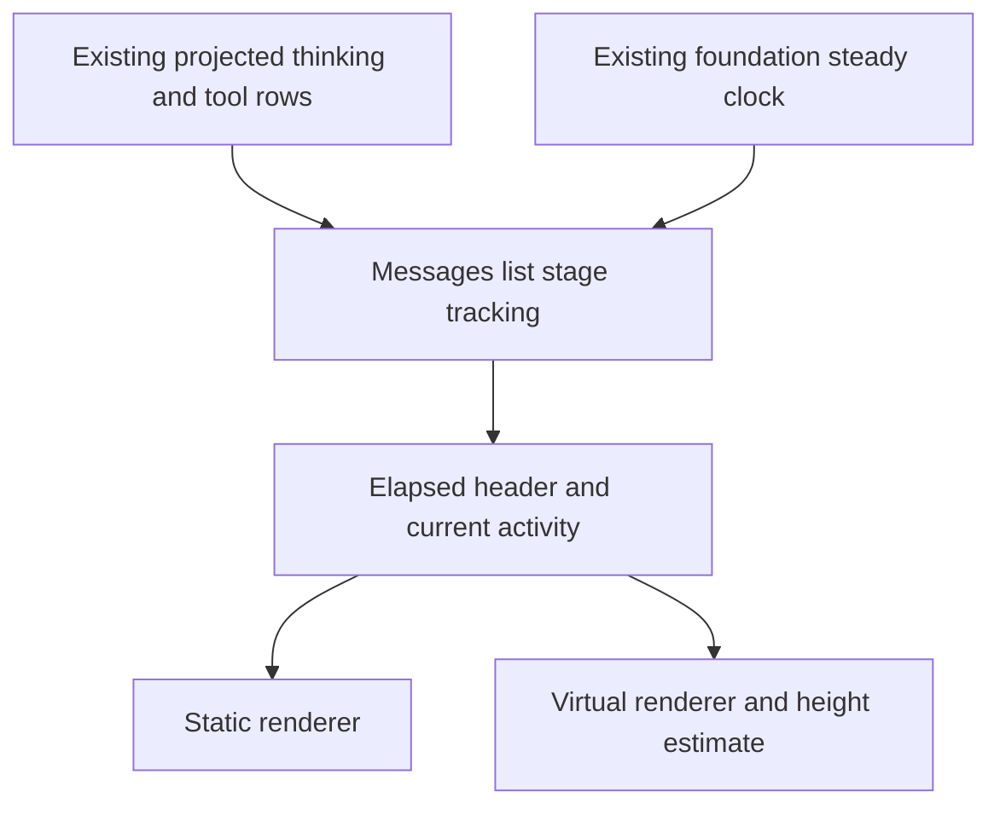

# RFC 0014 — Stable Compressed Chain Timing and Current Activity

## Summary

Keep the existing compressed-chain boundaries and disclosure interaction, but
give a locally observed stage one elapsed-time meaning from live display through
completion. Add at most one current-activity line beneath a live header, using
existing tool parameters rather than another model request. Completed stages
remain one line. This RFC is the local tracking record, following RFC 0013's
local workflow. The owner authorized commit and push after implementation and
verification were complete.

## Motivation

### Evidence

Source inspection on 2026-10-14 against clean master:

| Measurement | Current | Target | Instrument |
|---|---|---|---|
| Collapsed elapsed meanings | Live uses now minus earliest start; completed uses summed thinking duration | One locally observed stage interval, frozen on completion | messages_list_filter.cpp, deterministic clock tests |
| Expanded elapsed meanings | Expanded path uses thinking sum even while live | Same duration and identity as collapsed path | build_visible_rows tests |
| Live operation targets in collapsed chain | 0; header contains tool counts only | At most one extra line containing up to two active targets and an omitted count | native FTXUI render tests and PTY frames |
| Chain height estimate | Always 2 including top margin | 2 or 3 matching the activity-line presence | static and virtual renderer tests |
| Test baseline | 2550 registered | Baseline plus explicitly reconciled additions, no deletions | ctest --preset debug -N |

The UI already owns a persistent MessagesListInput in MessagesStore. Existing
core/persisted messages do not contain a complete stage interval. Thinking has
live start/duration metadata; some committed or restored tool rows do not. A
render-time sum cannot reconstruct elapsed wall time, especially with parallel
tools or gaps between requests. No exact historical elapsed claim is justified.

## Goals

- G1. A stage first observed live uses a steady-clock interval through the first
  observed stage-ending projection. Elapsed time never decreases, is identical
  expanded/collapsed, freezes on completion, and never sums parallel durations.
- G2. Preserve locally observed timing and the expansion key across streaming
  replacement and thinking-grace pruning. Prune state when its stage disappears;
  clearing/restoring a transcript cannot reuse unrelated timing.
- G3. Historical stages never observed live omit elapsed time instead of calling
  a thinking-only sum total work time. Timing is UI-local and not persisted.
- G4. A live mixed/tool stage shows one bounded current-activity line. Show actual
  running tools before pending tools, at most two descriptions in stable source
  order, and an omitted count. Finished tools are not described as running.
- G5. Keep edit/write tools, errors/cancellations, assistant text and user/system
  boundaries visible. No output body, authorization prompt or failure is hidden
  by the new activity line. Preserve existing grouping and full transcript mode.
- G6. At 40/80/120 columns, labels and disclosure remain visible without wrapping
  the activity row or displacing prompt controls. Both renderer paths agree.
- G7. Debug/release builds, serial full CTest, focused deterministic/snapshot
  tests, architecture gates and actual executable-in-PTY verification pass.

## Non-Goals

No query/wire/persistence changes, session timing migration, extra model calls,
new settings, output-preview subsystem, global transcript-mode redesign, new
render ticker, selection/scroll architecture rewrite, palette changes, library
split, dependency upgrade or external tracking issue creation.
Pure thinking may remain a single summary line; raw thinking text is not copied
into the new activity line. Existing authorization UI remains authoritative.

## Proposal

### Ownership and dependency direction

The owning module is loom.ui.messages.messages_list in loom_ui_messages. Add a
small UI-local timing record to its existing persistent input, semantic fields
to its synthetic VisibleRow, and implementation bodies in its existing filter,
envelope and geometry units. Use the existing foundation.clock test seam.
No new module, store, worker or upward dependency. If screen projection caching
fails to notice existing start-time metadata changing, correct only that source
comparison in ui/screens/repl_screen_messages.cpp. Clear timing records in the
existing MessagesStore reset_virtual_renderer_state hook already called on
clear/callback-clear/session restore, even without an empty render; do not move
timing ownership to screens. The user has authorized this presentation scope.

Actual PTY exposed a prerequisite in ui/app/app_render_event.cpp: committed
tool rows default to success even before execution, and the streaming overlay
can disappear once argument blocks stop. On every active Render, after the
committed-dirty branch, overlay matching nonempty tool_use_id rows from existing
streaming_tools_ lifecycle into committed rows. Finished calls use the known
outcome; otherwise an internal exec_started flag distinguishes Preparing from
Running. Set it on the existing ToolExecutionStart event, never infer execution
state from output-preview text (empty progress is valid). Copy the existing
start timestamp. Suppress a same-ID streaming tool row when its committed row
is authoritative, including during thinking grace; preserve distinct same-name
call IDs. Required replay evidence covers pending-to-running without a new
commit, empty progress, thinking grace duplicates and completed/error outcomes.
This small app-owned display lifecycle correction touches app.cppm,
app_handle_submit.cpp and app_render_event.cpp, adds no core event/persistence
field, and leaves historical projection defaults unchanged. Messages-only
inference cannot recover this app-owned state. Independently review this
amendment before implementation.

### Stage timing and identity

Identify stages from the raw projected sequence using the existing compressible,
edit and failure predicates, before display filters. Use the preceding material
boundary's shape and semantic payload text plus its occurrence among identical
boundaries as a UI-local stage key. Do not use its synthetic UUID: both the
chain anchor and a preceding assistant-text boundary can change UUID on commit.
An initial-stage sentinel covers a transcript that starts with compressible
rows. The full boundary text is compared, not a truncated prefix or hash-only
identity; total key bytes are bounded by extant boundary text, with linear
scanning in projected input bytes. This small local identity cost avoids adding
app/core IDs or a session protocol. Retain the first nonempty anchor UUID as the basis of a stable stage disclosure
ID. When that UUID already belongs to another stage, append a local stage
discriminator; never let two extant stages share a disclosure ID. Keep the ID
through anchor replacement. Identical material boundaries are
separated by their occurrence count. Do not key timing by thinking text or tool
name. The existing clear/restore reset hook clears the cache to distinguish
sessions containing identical synthetic IDs and text.

Maintain records on every build_visible_rows call, including transcript/search
and disabled-compression modes, so mode switches do not stop lifecycle tracking.
Keep at most one record per extant raw stage, with no process-global cache. An
empty input clears records. A first-seen historical stage has no live record and
no total-duration label. An observed live stage starts at the earliest valid
existing steady start, or at observation time if metadata is absent. Preserve
the earlier start through projection replacement. On live updates, clamp elapsed
to its previous value and zero. On the first non-live observation, include the
interval through that observation and freeze it. It cannot reopen during later
queries. This is an observed local interval, not server-side execution telemetry;
no render can retrospectively recover an end event it did not observe.

Keep thinking duration separate as existing per-thinking detail. Remove the
overloaded chain_thinking_duration meaning and duplicated expanded/collapsed
calculation. No persisted or externally consumed contract changes.

### Presentation

Use readable palette text without an extra dim modifier. Retain the origin dot
and Show details / Hide details action. Mixed/tool stages use Working / Worked;
pure-thinking stages use Thinking / Thought. Append elapsed when known and the
existing tool breakdown. Completed stages have no current-activity line.

For live tool stages derive descriptions from existing input fields: Read path,
Grep/Glob pattern and optional path, Bash command, WebSearch query, WebFetch URL;
unknown/MCP tools show their tool name and never arbitrary JSON. Use the existing loom.serdes.json parser for type-checked display fields;
valid JSON strings are decoded once, and incomplete/invalid JSON shows only
the tool name. Do not expand the search helper's raw-substring behavior. Sanitize control characters/newlines before rendering and
clip by terminal cells with existing Unicode helpers. Do not expose unrelated
parameter fields. Prefer Running over Pending; describe pending as Preparing,
not Waiting for approval, since Pending alone does not establish authorization
state. If no unfinished tools remain but the stage is live, show Waiting for
model. Current operation descriptions remain source ordered and bounded to two;
show a suffix for additional active operations. No operation-output tail is added.

Retain the second line for live tool stages while waiting between tool rounds,
including when expanded. Reuse existing row hit-testing for the complete block.
Expansion remains explicit and survives subsequent updates. The current row
uses the same width budget in static/virtual paths; its estimated height is one
extra row. Narrow headers may truncate optional detail to keep the action.
Reflow and stage completion use existing scroll/selection invalidation rules.

### Visible elapsed label deadlines

The first PTY timer check produced only six initial complete frames, all below
one second: existing app_animation.cpp wakes only welcome and explicit collapse/
paste transitions. Merely calculating elapsed in Render cannot update a silent
running tool. Expose one next-label-change deadline from the visible live chain
in MessagesListInput. Reset this output before each projection; it is absent in
transcript/search/hidden/completed stages. After rendering, AppAdapter arms that
single deadline in its existing wake worker, which consumes it once using the
existing compare-exchange pattern. A subsequent render re-arms only while the
elapsed label remains visible and live. Gate arming on query_running, clear it
when no applicable label exists, and do not poll UI state from the worker.
No new thread or unconditional query animation/render ticker. Add exact deadline
unit tests and actual silent-tool PTY progression/freeze evidence. Scrolled-away
active stages must not be claimed as viewport-visible without geometry evidence;
initial scope is normal-mode projected active chains, with no wake in transcript
or search mode. This small scheduling exception is necessary for G1/G7 and is
independently reviewed before implementation.

### Couplings and compatibility

The only shape changes are internal MessagesListInput/VisibleRow data and their
filter/render/height consumers. No registry key, task-notification tag, tool
schema, settings precedence, wire field or persisted trace changes. Virtual
rendering must continue consuming the original rich VisibleRow, not lossy
backend-index decoding. Existing chain expansion keys retain the chain: prefix; the remainder is a
stage-specific UI-only disclosure ID, with an optional collision suffix.
Update snapshot normalization for new time labels only after exact numeric
tests prove semantics; never normalize the numeric regression assertions.
Truecolor snapshots may change text/layout, not palette or SGR conventions.

## Phases and graduation criteria

| Phase | Title | Scope | Status | Graduation criteria (measured) |
|---|---|---|---|---|
| A | Timing and current activity | Local stage state, filter, renderer, geometry and deterministic UI tests | done | Exact clock tests for freeze/parallel/identity/modes/history, thinking-text-tool boundary UUID replacement, duplicate boundaries, independently expandable stages sharing an assistant UUID, and direct restore; static and virtual 40/80/120-column render tests; focused tests green |
| B | Streaming and terminal verification | Existing streaming replay snapshots and native PTY harness; final documentation | done | Actual loom PTY proves tool target, ticking elapsed, nondecreasing frozen completion, expansion/update/resize; selection/scroll PTY regressions green; dual builds/full serial CTest; RFC/UI9/store/TLL/inline gates; independent code review approved |

## Production Readiness Review

| Area | Plan / answer |
|---|---|
| Correctness | Existing native GTest, injectable clock, streaming fixture and forkpty harness; no tight wall-clock upper bounds. Cover empty/history/grouped/parallel/pending/failed/cancelled/mode/clear/replace cases. |
| Goldens | Review every changed normalized text/layout and truecolor snapshot; only chain changes allowed. Exact duration tests run before normalization. |
| Build discipline | Declaration/data-only internal interface additions, no inline bodies or new textual includes. Default Ninja parallelism; no job cap changes. Record debug/release elapsed build time and action count. |
| Memory | /proc producer PSS unavailable on macOS; no PSS or cold-CI claim. Cache bounded by extant raw stages and covered by clear/prune tests. Linux PSS remains an external measurement. |
| Graph | Existing foundation.clock downward dependency; run Tarjan UI9/store/TLL and inline-definition gates before/after. No new targets. |
| Compatibility | Session/settings/API request/response/debug trace formats unchanged. Missing historical timing deliberately omitted. No migration or shim. |
| Rollback | Revert this task's change as a unit; no data cleanup or migration. Phase B test/docs-only changes can be reverted independently. Commit and push were authorized after local verification. |
| Observability | Preserve messages.jsonl and dump-prompts. PTY evidence retains raw terminal output and selected decoded frames via the existing harness. No extra logging channel or background thread. |
| Documentation/deletion | Update docs index, timing/shape decision and misleading local comments. Remove the old dual-meaning field/duplicated timer logic. No project-wide convention changes requiring AGENTS/CLAUDE changes. |
| Platform | Require local macOS debug/release and real PTY; no new platform syscalls in production. Linux and macos-14 hosted CI cannot be claimed without execution there. |

### Review sign-off

| Role | Reviewer | Date | Verdict |
|---|---|---|---|
| Design | agent:design_prr_review | 2026-10-14 | approve |
| Production readiness | agent:design_prr_review | 2026-10-14 | approve |
| Code and conformance | agent:code_review | 2026-10-14 | approve; final dual-preset execution evidence independently verified |
| Independent final conformance | agent:claude-cli/final-conformance | 2026-10-14 | approve; no changes requested; execution gates remain separate |
| Phase B and implemented gate | agent:code_review | 2026-10-14 | approve; all local graduation gates satisfied |

## Rollout and rollback

Gate design and PRR before production edits. Implement A, then B on the same
reviewed checkout. Preserve unrelated concurrent changes. If verification
exposes a broader architecture requirement, amend and review the RFC before
expanding production scope. Roll back only owned hunks; no runtime data changes.

## Drawbacks

One extra row while tools are active reduces transcript space. UI-local timing
requires a bounded lifecycle cache because existing messages lack total stage
end metadata. Historical elapsed is unavailable after restart. Observed closure
includes UI scheduling delay; this must not be presented as exact tool-runtime
telemetry. Two simultaneous targets cannot show every parallel operation.

## Alternatives considered

1. Do nothing: keeps the completed-time regression and gives no current target.
2. Always sum thinking/tool durations: parallel execution double counts and
   request/permission gaps disappear; the number is not elapsed stage time.
3. Persist new core stage events: exact historical reconstruction is useful but
   requires app/query/session contracts beyond this local UI requirement.
4. Use only stateless start/end inference: committed tool rows lack end metadata;
   completion still shrinks or keeps increasing. Existing input-owned state is
   the smallest local solution that freezes an observed stage.
5. Render every tool by default: avoids stage state at the cost of losing the
   compact transcript. Full transcript mode already provides that view.

## Testing and verification plan

Baseline: 2550 registered tests. Reconcile additions after build discovery;
delete no existing tests. Use tests/ui/test_ui_messages.cpp for exact clock and
render/geometry contracts, existing streaming replay fixtures for app projection
and replacements, and tests/e2e/e2e_pty_shutdown.cpp for actual FTXUI/executable
interaction. Add the scenario to tests/e2e/CMakeLists.txt and existing evidence
retention, not a disposable script. Run relevant existing selection/scroll,
streaming, chain and geometry tests plus full serial CTest in both presets.
Review every golden delta. Run rfc_lint.py, graph_check.py --target-ui9
--store-lint --tll-lint, inline_def_check.py and git diff --check.

## Documentation impact

- docs/README.md: index this RFC and final stage.
- docs/decisions/design-decisions.md: stage elapsed is UI-local, never a thinking
  sum; rich virtual-row geometry and activity-height coupling.
- Local module comments: cache lifecycle, missing historical timing and height.
- AGENTS.md/CLAUDE.md: no change; build/layout/configuration conventions unchanged.

## Open questions

None blocking. Owner @Zzzode's requested scope fixes timing/current activity
first. Historical timing persistence, output previews and a thinking-preview
policy remain explicit non-goals.

## Implementation History

| Date | Phase | Event | Commit / PR | Evidence (metrics, test totals) |
|---|---|---|---|---|
| 2026-10-14 | — | RFC opened, provisional | local, uncommitted | Source proves live/static/expanded time mismatch; 2550 baseline registrations; native test/PTY inventory completed by agent:verification_inventory |
| 2026-10-14 | — | Design accepted and PRR implementable after independent re-review | agent:design_prr_review; local | Three P1 identity/lifecycle/disclosure findings resolved; full boundary identity, explicit reset and collision-safe disclosure; RFC lint14 and UI9/store/TLL baseline pass |
| 2026-10-14 | A | Implementation started | local, uncommitted | Existing chain tests22/22 green; 2550 baseline registrations; independent PTY inventory complete |
| 2026-10-14 | A | Real PTY exposed committed-tool lifecycle projection prerequisite; review requested | local | Permission prompt and Working header visible but activity incorrectly Waiting for model; source app_message_projection hardcodes success and app_render_event suppresses stopped argument overlay |
| 2026-10-14 | A | App projection prerequisite design/PRR amendment approved | agent:design_prr_review; local | Every-render exact-ID overlay, explicit exec_started independent of output, same-ID streaming suppression; replay required before graduation |
| 2026-10-14 | A | Silent-tool PTY exposed missing elapsed-label wake; scoped single-deadline review requested | local | Native unit38/38 passed, but actual PTY emitted only six initial frames and never reached1s; existing worker only welcome/collapse/paste wakes |
| 2026-10-14 | A | Elapsed-label deadline amendment approved; target decoding/filter/classification review fixes applied | agent:code_review; local | Existing worker consumes one conditional deadline; no new thread; JSON decoded by existing parser; visible-call filtering and explicit tool-stage classification |
| 2026-10-14 | — | Additional Claude CLI design and PRR approved; stale identity conformance finding rebutted | agent:claude-cli; local | Source-only mid-edit review. I1 referenced original boundary-UUID text already superseded after independent P1 proof that preceding streaming text UUID also changes on commit. Full semantic boundary key and reset/disclosure regressions are the reviewed current contract. I2 removed by JSON-parser fix; I3 raw-tail equivalence pinned by native tests. No build/PTy execution claimed by reviewer. |
| 2026-10-14 | A | Timing/activity implementation graduation; code re-review approved | agent:code_review; local | 19 new native cases; chain tests41/41 green; JSON/filter/classification P2 findings resolved; static/virtual40/80/120 and exact deadline/freeze/reset tests pass; no new target/thread/format |
| 2026-10-14 | B | Streaming and real-terminal evidence passed; broader verification started | local, uncommitted | Replay25/25 update pass; new lifecycle fixture covers thinking grace, commit-before-execution, empty progress, independent same-name IDs, failure before/after commit. Native PTY passed6.51s:0s to2s to completed2s to forced-redraw frozen2s, click/60-to120 resize/streamed update preserved expansion. Evidence /tmp/loom-rfc0014-pty-debug/compressed-chain-live. Discovery2572=2550+19unit+2replay+1PTY, zero deletions. |
| 2026-10-14 | B | Independent final Claude source conformance approved | agent:claude-cli/final-conformance; local | Current full-semantic-boundary implementation and both scoped amendments approved, no changes requested. Reviewer explicitly kept full serial dual-preset execution as an outstanding graduation gate; viewport-only scheduling remains outside this RFC. |
| 2026-10-14 | B | Initial full debug run exposed one stale golden and two harness input races; corrected and independently reviewed | agent:code_review, agent:pty_verification; local | 2572 registered; initial serial run426.15s. Pre-execution migration golden now expects Waiting to run and targeted rerun passes1/1. Both recovery traces combined historical Allow with early Preparing pwd and sent y into the normal prompt. Require corrected command JSON and permission actions in the same latest complete frame; all original recovery/payload assertions retained. Targeted recovery rerun2/2 passes2.60s; full clean rerun required before graduation. |
| 2026-10-14 | B | Full clean debug serial regression passed | local, uncommitted | 2572 registered = 2550 passed + 20 skipped + 2 pre-existing disabled; 0 failures, 401.00s. Includes all chain/replay/migration tests and actual compressed-chain, recovery, selection/scroll, escape and handoff PTY cases. Evidence /tmp/loom-rfc0014-pty-debug-clean. Release full serial regression remains pending. |
| 2026-10-14 | B | Final debug PTY artifacts independently verified | agent:pty_verification; local | Raw frames and timing confirm0s to2s to completed2s to redraw-frozen2s; targets, disclosure, streamed update and completion verified. Resize evidence proves readability and expansion continuity: first saved120-column frame retains a temporary60-column activity/prompt budget, corrected in the next complete frame. No claim of zero transient intermediate layout. |
| 2026-10-14 | B | Resize evidence limitation reviewed as non-blocking | agent:code_review; local | Existing ink_utils Active-screen dimx is read during Render before FTXUI Draw refreshes Terminal::Size/dimx, explaining the one-frame width lag. Activity stays one line, target/disclosure remain readable and prompt is not displaced; stable40/80/120 tests pass. G6 does not require zero transient resize frames. No shared-layout expansion justified. |
| 2026-10-14 | B | Dual-preset build and architecture metrics recorded | local macOS; default Ninja parallelism | Debug full source rebuild250 actions passed; release full rebuild319 scheduled actions passed219.81s. Final harness correction rebuilt both presets successfully; final no-op warm builds debug0.58s/release0.50s. Graph636 modules/791 units:0 cycles,0 upward edges,12 singleton UI areas; store/TLL59-target gates and637-interface inline ratchet pass. No Linux producer PSS or hosted-CI cold-build measurement claimed. |
| 2026-10-14 | B | Full release serial regression passed | local, uncommitted | 2572 registered = 2550 passed + 20 skipped + 2 pre-existing disabled; 0 failures, 343.45s. Real PTY again0s to2s to completed2s to redraw-frozen2s, with disclosure/stream/resize and all prior terminal regressions passing. Evidence /tmp/loom-rfc0014-pty-release. Both presets now pass on the same frozen production/test source. |
| 2026-10-14 | B | Phase B graduation and implemented gate independently approved | agent:code_review, agent:pty_verification; local, uncommitted | Reviewers directly checked full dual-preset counts/logs, release raw timing and terminal artifacts, builds, graph/inline gates and all prior review resolutions. No material findings remain. Local macOS verification only; historical timing unavailable, one transient resize-width frame documented, Linux/PSS/hosted CI unverified. RFC status and docs index updated; no commit or push per user instruction. |
| 2026-10-14 | — | Owner subsequently authorized commit and push of all related changes | user instruction | Earlier uncommitted implementation history is preserved. Delivery reuses the verified production/test source; only this delivery authorization text is updated before committing. |
