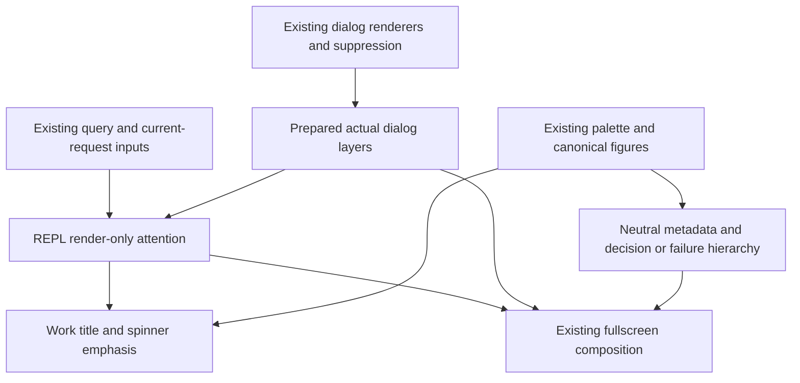

# RFC 0015 — State-Led Attention and Terminal Hierarchy

## Summary

Define and implement an explicit attention hierarchy for the actual Loom REPL:
normal, working, awaiting permission, and failed model request. Keep ordinary
chrome quiet and readable; emphasize the current activity, the decision the
user must make, or the operation that failed. These are presentation states
derived from existing lifecycle and rendered dialogs, not a new execution
state machine. Preserve the existing permissions, retries, configuration,
session data, native FTXUI architecture and seven themes. The owner explicitly
requested RFC and agent review before implementation, real-terminal validation,
and no commit or push. This RFC is the local tracking record, following RFCs
0013 and 0014; no external issue is created.

## Motivation

### Evidence

Inspection against clean `30e12668` on 2026-10-14 established:

| Measurement | Current | Target | Instrument |
|---|---|---|---|
| Defined cross-state attention rules | No four-state matrix in design-language.md | One explicit matrix with precedence, focus and subordinate surfaces | Document and real REPL pixel/PTY review |
| Actual built-in statusline | Model uses info, branch uses success, most other fields use dim | Neutral metadata with readable ink; status colors only for actual thresholds | prompt_input_footer.cpp, native pixel tests |
| Built-in cost | Always four decimal places when positive | `<$0.01` for positive sub-cent totals; otherwise two decimals | Native formatter/render cases |
| Loading glyph families | Canonical ten-frame braille, local REPL eight-frame stars, local widget sweep | Canonical braille for ordinary work; documented bridge connection exception | design_figures, repl_screen_welcome, widgets/spinner consumer audit |
| Permission focus input | Queue existence differs from actually rendered/actionable dialog | Classify from the same prepared visible layers used in composition | dialog_queue_render suppression and precedence tests |
| Typographic hierarchy | Local bold/dim decisions; no cross-component rank rules | Explicit title, activity, body, metadata and decoration rules | Seven-theme native FTXUI pixels |
| Baseline tests | 2573 registered | 2573 + reconciled additions; no deleted existing tests | ctest --preset debug -N |

The audit also corrected misleading premises. Palette105/Role25 is the achieved
RFC0013 count, not a regression; the nine permission-rule backgrounds predate
that RFC. `RenderStatusBar` has no calls: its ctx/v/^ and many-colored fields
are not the current REPL statusline. Actual ToolPermission uses a framed risk
panel with title and decision buttons, not merely the generic modal divider.
Existing typography and risk cues are useful but not governed consistently.

RFC0013 explicitly excluded typography redesign and retained StatusLine
defaults. This RFC adds the missing presentation rules without claiming to
complete provisional RFC0006. SGR2 dim is terminal-controlled, so source RGB
contrast alone cannot certify its final display brightness.

## Goals

- G1. Define normal/working/awaiting-permission/failure attention, with explicit
  precedence when history, current work and a decision coexist. Derive it from
  actual renderable layers and existing current-request state on every render.
- G2. Ordinary built-in metadata uses readable neutral tokens without dim.
  Preserve context thresholds, width priorities, segment masks, shell-command
  precedence, input bytes and permission-mode controls. Human-format cost.
- G3. Live compressed activity has a primary-token emphasized title while work owns
  focus; pending permission or current failure suppresses competing work
  emphasis and the bottom work spinner. Timing, targets and disclosure survive.
- G4. Permission titles/actions and failure origin/recovery have a defined
  hierarchy. Request targets, diagnoses and instructions remain readable;
  cancellations and denied tools are not turned into global failure alarms.
- G5. Ordinary work uses the existing canonical braille frames, with explicit
  bridge-connection and reduced-motion rules. Add no ticker, animation worker
  or model call.
- G6. Verify actual styles in seven themes and stable 40/80/120-column layouts;
  preserve first-resize-frame width, prompt caret/bytes, selection/copy, scroll,
  tool identity, permission decisions and request-scoped retry behavior.
- G7. Agent design/PRR gates precede production edits. Dual-preset builds and
  full serial CTest, scoped golden review, architecture gates and actual Loom
  PTY states/transitions pass before marking implemented.

## Non-Goals

No logo/artwork redesign, new fonts/font sizes, global palette taxonomy rewrite,
Palette/Role count target, permission-rule-list restyling, surface-tint rename,
light-hover redesign, full syntax-contrast audit, OSC11/automatic theme work,
global reduced-motion audit, new settings/presets, changed segment defaults,
new inspection UI, engine event/state changes, permission/risk-policy changes,
retry/cancellation changes, serialization/wire/tag changes, dependency changes,
new target/library, commit, push or physical-terminal brightness certification.
Agent identity colors, diff/status semantics and user-provided ANSI attributes
remain authoritative. Arbitrary custom status output is outside the built-in
attention-color guarantee.

## Proposal

### Ownership and justified shared changes

The owner is UI presentation: screens/repl_screen coordinates current focus;
messages owns compressed activity and model-failure presentation; prompt owns
built-in chrome; permissions owns decision panels; foundation owns glyph
constants and the design contract. Dialogs owns its registry capability metadata.
No new production module or upward edge.

The local alternatives of recoloring Palette fields or inspecting tool Pending
status are insufficient. Color equality does not establish a UI state's meaning;
Pending does not prove a visible approval request. Screens already has query,
message and dialog inputs, so it owns the render-only classification. Keep that
classifier implementation-local; do not add an AppState/store/core enum.

Prepare existing bottom/overlay/modal Elements once before constructing the
base chrome. A small render-local `PreparedDialogLayers` value in the existing
dialog_queue_render namespace carries those three Elements and whether their
top visible layer is a supported permission request. This is needed because
the current composer hides actual renderer success until after chrome has
been built. Rechecking queue presence duplicates the visibility invariant;
rendering twice duplicates renderer execution and may advance held payload state.
The prepared value solves only this concrete issue, has no lifetime beyond
Render, and replaces the current combined build-and-compose path rather than
adding a parallel framework. Preserve the original renderer call order, layer
order and all within-queue suppression/event-dispatch rules. Move standalone
takeover after frame measurements but before chrome construction. Existing
viewport measurement and action-box reset remain before preparation. Renderer
audit found no reads of viewport/action boxes, pasting/exit expiry, or footer
queue advancement; the latter maintenance may wait until takeover closes.
Notification expiry remains wall-clock based, so this does not extend its
lifetime or alter permission decisions. LayerAllDialogs consumes the prepared value; migrate its
single production caller and native tests together, without an obsolete shim.

The registry currently returns a nonempty generic placeholder when no renderer
is registered, and renderers/handlers can be registered separately. Add one
read-only `has_renderer_and_handler(DialogType) const noexcept` query on the
existing DialogRendererRegistry. A declaration in dialog_system.cppm and body
in its new dialog_system.cpp implementation unit keep interface bodies from
growing; add that unit to the existing dialogs target. This is the smallest
registry change: its private arrays are the authoritative capability metadata,
so a screens-only check cannot distinguish a placeholder/renderer-only panel
from a registered decision surface. No new registry, flag storage or simulated
event probe. The query adds no side effect and leaves registration/fallback
and event dispatch behavior unchanged. Permission focus additionally requires
the supported payload's existing on_response callback, its real non-null
render result, visibility and top-layer ownership. Missing registration,
renderer-only, handler-only, missing callback and null renderer never claim
AwaitingPermission. WorkerSandboxPermission is supported only when actually
registered and callback-backed; do not implement its currently absent renderer.

Account for existing outer ReplScreen owners as well: SettingsView wraps the
base in a modal; AgentsView and TrustDialog take over the rendered component.
These existing visible owners mask queued permission/work focus. Keep this
predicate in screens and share it between render classification and the top
component event gate. Forward events to their existing owned handlers, rather
than first dispatching to the hidden queue. In particular, wire the existing
forward_settings helper, currently defined but not used by CatchEvent. Keep
existing global redraw/exit policy and within-queue precedence/suppression;
only prevent hidden underlying permission from consuming decision keys. Native
tests must use the actual ReplScreen Component: y cannot resolve a queued tool
under Settings, closing Settings preserves the queued request, and the same y
can then resolve it. Agents/Trust takeover similarly cannot approve a hidden
queued tool. This prerequisite stays in the owning screens module and does
not migrate routing or change permission policy.

The chain title means the existing complete first-line summary, including
verb, elapsed time and tool breakdown. Keep its single whole-line ellipsization
and disclosure budget. Quiet chain summaries use the existing muted token rather than the old
message-list muted token: the latter is only 4.434:1 on the Light canvas.
Expanded chain blocks use the existing background token instead of
surface_tint_2: LightDaltonized primary on that tint is only 4.382:1. This
local surface/ink pairing keeps primary+bold work legible without palette RGB
edits; expansion remains explicit through Hide details and child rows.
The second current-activity line uses text ink; do not
split the first summary into new clipping runs. Bottom-spinner visibility
still requires IsToolAnimating; query_running alone never introduces a spinner.
Keep the existing loading footer hint and live-dot behavior while approval is
pending: they still describe the running query. Copy toasts, undercover/help
placeholders and unrelated dimmed historical surfaces are outside this bounded
consumer change; dimmed separators/dots remain decoration.

Pass one internal work-emphasis boolean through the existing RenderMessages
input/projection and synthetic chain row. Standalone message renderers retain
an emphasis-enabled default. It affects style only: no grouping, timing,
target, height or disclosure identity change. Statusline and permission/error
renderers use the existing palette tokens; no new token layer is required.

### Four-state attention matrix

| State | Exact signal and strongest focus | Work presentation | Ambient chrome and user action |
|---|---|---|---|
| Normal | No current work, visible permission or current terminal model-request failure; prompt/conversation is primary | Completed chains retain neutral summary, frozen elapsed and explicit details | Model bold text; path/branch/cost/context metadata muted, no dim; existing mode controls remain |
| Working | query_running or existing tool-loading presentation, without a higher focus owner | Live chain title primary+bold, current target text; bottom canonical spinner has primary glyph and readable neutral label | Metadata remains neutral; existing interrupt action stays available |
| Awaiting permission | Top actually rendered, registered renderer+handler and callback-backed ToolPermission, SandboxPermission or WorkerSandboxPermission layer, after suppression and all outer/modal/standalone precedence | Keep live elapsed/target/disclosure, but title is neutral and bottom work spinner is absent | Decision title/risk/action panel is primary; actual target and y/n/Esc instructions readable; never auto-decide |
| Failure | Query not running and latest current transcript entry is is_model_error && is_error | No competing work spinner/emphasis | Failure title warning/danger+bold, diagnostic body text, metadata muted; existing permitted retry/dismiss/clear actions primary |

Precedence is visible permission > current terminal model failure > work >
normal. A queued-but-suppressed permission does not claim attention. A modal
above an overlay masks its permission focus; a non-permission modal owns its
own existing presentation and suppresses underlying work emphasis. Standalone
dialogs retain full takeover and do not construct underlying chrome. Render
an empty/null registered permission as absent, not an invisible decision.
Support ToolPermission overlay and registered SandboxPermission/
WorkerSandboxPermission bottom payloads; a generic fallback, form or elicitation
is not inferred to be authorization. Existing outer Settings/Agents/Trust owners
win over queued layers for both attention and decision-key dispatch. Their
existing modal backdrop/takeover styling is outside ambient metadata guarantees.

Old tool failures remain visible inline but do not put a later working query
or a corrected-tool approval into Failure. An old model-error card does not
own focus after a new query starts. Automatic retry while query_running stays
Working. Dismiss/retry/clear keep their existing callbacks and request ownership.
No prose matching, severity guessing or new business state is introduced.

Initial-phase layout limitation: the three-column single-permission footer could clip
the end of its always-allow scope label even at the 90-column panel cap. This
work verifies the visible label ink and complete keyboard instructions without
claiming to fix that pre-existing layout. The complete 85-character keyboard-hint row is verified at 120 columns; the
existing narrower footer may clip its tail. Button/checkbox/hint reflow remains
outside this presentation-only phase; the explicit target and decision keys remain.

### Terminal hierarchy

Terminal fonts and cell height remain user controlled. This is a semantic
weight/color/spacing hierarchy, not a pixel type scale or generic style API.

| Rank | Use | Rendering rule |
|---|---|---|
| Decision/recovery title | Visible permission or failed operation | bold plus existing warning/danger; readable shape and literal title, never color alone |
| Current activity | Live working stage | primary+bold title only while work owns focus; target uses text, single bounded row |
| Body/input | Conversation, command target, diagnosis and editable prompt | text, regular weight; existing Markdown semantics remain |
| Metadata/instructions | Model context, path, cost, attempts, trace IDs, permission keys | muted regular; model and key labels may use text+bold; no dim for required information |
| Decoration/history chrome | Separators, empty padding and ornamental animation | subtle/border tokens; dim allowed only where no required information is encoded |

Keep existing explicit selection inversion and focus indicators. Agent names
in identity-bearing cards retain assigned colors. Historical completed chains
do not gain bold/accent merely because the next stage is live. In-progress
targets and errors do not lose information when emphasis changes. Preserve
existing margins/row counts except removing the work-spinner row when a
decision or failure owns focus; return that space through the existing layout
budget, without shrinking the prompt or increasing global bottom limits.

### Actual statusline and glyph consumers

Change RenderBuiltinStatusLine: model text+bold; ordinary branch/path/cost/
agent/task metadata muted regular. Context below 50% is muted, 50..79% warning,
80%+ danger. Keep widths, whole-field selection priorities, segment masks,
thresholds and defaults. A positive cost below 0.01 renders `<$0.01`; otherwise
two decimals. Zero/missing cost remains omitted. Detailed settings/usage views
retain precision. Remove only the application-added outer dim from custom
command content, preserving its explicit ANSI foreground/background/attributes,
content precedence, padding and height. Do not parse or recolor arbitrary
user-provided command text.

Delete the unused RenderStatusBar declaration/body after confirming zero
callers, including tests; inventory every removed helper likewise. Migrate any
coverage to canonical glyph assertions rather than deleting coverage. Do not remove shared StatusBarData projection fields still populated
by AppAdapter. This prevents future maintenance from treating the dead
ctx/v/^ assembler as the live contract.

Use figures::kSpinnerFrames/spinner_frame_glyph for ordinary REPL and widget
loading. Remove their local alternate frame arrays and now-unused helpers;
keep the widget's externally driven frame contract. The existing centralized
bridge connection frames remain an explicitly documented exception with a
different purpose. Honor reduced_motion in touched work spinners using the
existing static glyph; no new timer or global motion completion claim.

### Permission and failure consumers

Retain the existing risk-colored permission frame, bold title, action focus,
button order, callbacks, keyboard shortcuts and risk computation. Give the
body explicit text ink rather than inheriting the risk border color. Request
targets, descriptions, scope/remember labels and keyboard actions use readable
text/muted ink without dim. Required permission-key labels may use bold text;
the shared KeyboardHintRow follows that same invariant for its consumers.

Model-request error titles use the existing severity warning/danger and bold;
diagnostic body stays text. Attempts, response sizes, trace/request IDs and
recovery instructions are readable neutral metadata without dim. Preserve
diagnostics, expansion, elapsed retry countdown, severity resolution,
authentication restrictions and callback availability. Canceled/denied tool
result presentation remains distinct and is not restyled as a model failure.

### Compatibility and scope boundaries

Internal shapes touched: prepared dialog Elements/focus flag and messages-list
work-emphasis fields, plus their direct consumers/tests. No registry keys,
notification tags, tool schemas, status settings names/masks/defaults, wire
events, session messages.jsonl, prompt dumps or persisted values change.
There is no public CLI or data migration. No Palette fields/Role ordinals or
legacy theme lookup strings are removed. Existing selection geometry and the
fresh terminal-size query from the resize fix remain authoritative.

Goldens may change approved foreground/weight/dim attributes, the expanded
chain fill from surface_tint_2 to background, loading glyphs,
cost text, and work-spinner row removal when permission/recovery owns focus.
No unrelated transcript content, action, ordering or control sequence changes
are accepted. Keep exact glyph/style assertions outside time normalization.

## Phases and graduation criteria

| Phase | Title | Scope | Status | Graduation criteria (measured) |
|---|---|---|---|---|
| A | State hierarchy in actual renderers | Prepared dialogs, local classification, message work styling, neutral statusline, permission/failure hierarchy, canonical work glyphs | done | At least 10 new native registrations; seven-theme actual pixels and 40/80/120 layouts; current/historical/error/permission overlap, suppression/null/modal/outer-owner precedence, missing registration/callback/handler and one-render-per-layer tests; cost/threshold/default/custom ANSI contracts; exact work-emphasis invariants below; focused native suites pass; debug/release builds and graph/inline gates pass |
| B | Streaming and actual terminal graduation | Existing replay/goldens and native forkpty harness, final docs | done | Actual executable shows normal->work->permission->work->normal and work->failure->retry->normal; first-resize-frame, target/disclosure, input bytes, no duplicated side effects; raw complete frames prove foreground/bold/dim; all affected goldens independently reviewed; both full serial CTest pass with 2573+N registrations and zero deletions; final agent code/evidence approval |

Exact style-only graduation: clone one input-owned stage cache at an injected
clock, toggle only work-emphasis and compare before/after. The observed
chain_elapsed, cache started_at/elapsed/finished and stage count, target text,
chain_uuid, expansion keys/expanded state, row-height estimate and next
chain_update_due must be identical (zero differences). Run both static and
virtual renderers with the same clock/input; only approved foreground/bold
attributes may differ, never text, geometry, timing or deadline. Then advance
the clock and prove both presentations continue ticking and freeze equally.

## Production Readiness Review

| Area | Answer / verification |
|---|---|
| Correctness | Native FTXUI pixel tests for actual REPL Component and renderer paths, lifecycle overlap and suppression; registry metadata distinguishes real decision controls from placeholders; outer owners block hidden decision keys. No new execution-state inference; permission callbacks and failed-request retry remain authoritative. |
| Failure coverage | Queued-but-hidden/null permission, modal masking, historical tool failure plus corrected approval, active model failure, new query after old error, canceled/denied results, absent/zero cost, narrow/empty layouts and invalid headless dimensions. |
| Tests / goldens | Existing UI/dialog/replay suites plus at least10 new meaningful native cases. Update only native goldens after focused exact style/glyph tests pass. Independent review of every text/layout/SGR delta; do not normalize away policy assertions. Baseline 2573; additions explicitly reconciled, no test deletions. |
| Build discipline | Existing modules/targets, declaration/data-only internal shape additions, no new textual third-party includes in module units or interface function bodies. Default Ninja parallelism; record dual build actions/wall time and no-op warm time. |
| Memory / platform | Local macOS cannot provide /proc producer PSS, Linux execution or hosted macos14 CI metrics; explicitly report unavailable rather than substitute RSS. No new platform API; PTY driver remains under existing platform guards. |
| Architecture | Run UI9/store/TLL graph and inline-definition ratchet; no upward edges, new target or store. Existing foundation tokens/figures are downward dependencies. One body-only dialogs implementation unit owns the registry metadata query; no new module. |
| Compatibility | Existing configuration precedence/masks/defaults and custom command bytes/ANSI remain; application-added dim removal is intentional. No serialized or externally consumed protocol shape changes. |
| Observability | Keep traces/dumps intact. Extend existing optional PTY evidence retention with complete raw frames and decoded attributes; no new runtime logging or worker. |
| Timing / motion | Use existing frame input and conditional wakes; touched spinners honor reduced motion. PTY gates wait for observable states with existing bounded timeouts, not tight frame-rate deadlines. |
| Rollback | Revert owned presentation/test/docs hunks as one change; no data or settings migration. Earlier committed compressed-chain/resize behavior must remain intact. No commits/push per user instruction. |
| Documentation / deletion | Update design-language state/type matrices, decision register and docs index; remove unused status assembler and local spinner arrays. Preserve historical RFC0013/14 evidence; do not claim full RFC0006 completion. No AGENTS/CLAUDE build/config convention change. |

### Review sign-off

| Role | Reviewer | Date | Verdict |
|---|---|---|---|
| Design | agent:design_prr_review; agent:claude-cli-design-prr | 2026-10-14 | APPROVE |
| Production readiness | agent:design_prr_review; agent:claude-cli-design-prr | 2026-10-14 | APPROVE |
| Code / native visual evidence | agent:code_review; agent:design_prr_review; agent:claude-cli-code-review | 2026-10-14 | APPROVE; full-suite graduation independently verified |

## Rollout and rollback

Agent design and PRR approval must precede all production edits. Implement A,
then freeze production/test source for B. Parallel work has disjoint file
ownership and no competing builds in the same preset. Preserve unrelated work.
Amend/review this RFC before broadening production scope. Revert only owned
hunks; existing session/config data needs no cleanup. Keep all work uncommitted.

## Drawbacks

Less decorative color can feel quieter and change established screenshots.
Metadata without dim may appear brighter on some terminals. Preparing dialog
layers before chrome changes render construction order, requiring explicit
single-render/visibility and stacking tests. One internal message style flag
must stay synchronized across projection/static/virtual paths. Sub-cent compact
cost is less precise in the ambient row; the detailed view retains precision.
The read-only registry query is one additional internal method to maintain;
the outer-owner predicate must remain consistent between render and input.

## Alternatives considered

1. Do nothing: leaves required information dimmed and attention decisions
   implicit; the documented four-state contract would have no enforcement.
2. Only edit palette RGB/counts: cannot express state, weight or visibility;
   duplicate values can have legitimate different semantics in other themes.
3. Add a new persisted/global attention state machine: duplicates the query,
   error and dialog lifecycle, creating drift and migration for a render concern.
4. Infer permission from queue/Pending, or peek plus should_show_dialog: the
   latter handles suppression but cannot prove that a registered renderer
   returns a real Element. Null-renderer tests deliberately exercise that
   boundary. Rendering twice duplicates execution. Preparing the actual layers
   once makes composition and attention share one visibility invariant.
5. Dim the whole background under permission: may make body/history unreadable
   and breaks the premise of readable metadata. Suppress only competing work
   emphasis and use explicit local hierarchy.
6. Rewrite palette, logo, modes and inspection surfaces together: mixes user
   research, settings and architecture changes with this bounded presentation
   contract; not necessary to deliver the four states.

## Testing and verification plan

Use test_design_system with a focused new attention test TU if needed to avoid
overloading existing module-heavy tests; native framework/CMake integration
only. Exercise actual RenderReplScreen, prepared layers, statusline, single
permission, model-error and chain static/virtual renderers across seven themes.
Test 40/80/120 widths, multi-row CJK/emoji prompt/caret, headless fallback and
first-resize-frame behavior. RGB foregrounds on actual filled surfaces/reference
canvas must meet 4.5:1; required information must have dim=false. If muted
fails on a filled surface, use the existing text token there; palette RGB
edits remain excluded. Count one render with spy renderers registered through
the existing registry, never by probing handlers with synthetic decision keys. ANSI tests
check glyph/attribute/color-index distinctions, not universal RGB ratios.

Reuse actual compressed-chain and recovery PTY scenarios with local SSE/tool
gates, no real model calls. E2E_Pty_CompressedChain already drives a bounded
Bash permission gate; E2E_Pty_Recovery_API_Retry and API_Retry_Network own the
real failed-request/retry flow; bash-failure/permission-denial own correction
after old tool errors. Extend the decoder locally to retain foreground,
bold and dim; handle SGR0/1/2/22/39/49, named/indexed/truecolor colors. Assert
attributes at matching text cells, not frame-wide color presence. Save normal,
working, pending permission, failed request and recovered frames; verify old
tool error plus corrected approval precedence. Retain mouse expansion, resize,
Esc, selection/copy and request/sentinel assertions. Export success artifacts
for recovery as well as existing scenarios. Agent reviews raw and decoded
evidence, including theme policy limits.

Run focused tests, then both complete serial CTest presets on a frozen source
state; compare final registrations to 2573+N (N>=10). Run RFC lint,
graph_check.py --target-ui9 --store-lint --tll-lint, inline_def_check.py and
git diff --check for source/docs. Preserve fixed-width golden trailing cells;
review their unchanged text/non-SGR controls and run their whitespace check
with blank-at-eol disabled for those three files only (no Git config change).
An unqualified diff check reports those retained padded fixture lines.
Record exact pass/skip/disabled counts, build metrics and
known gaps before marking phases done/implemented. Never imply physical
terminal brightness, clinical accessibility or unexecuted platforms are proven.

## Verification results

All source, native-test and golden changes were frozen before the final full
runs. Debug and release CTest ran serially and sequentially, with no competing
PTY driver. The results do not include the earlier interrupted or expected
baseline-mismatch runs as passing evidence.

| Check | Observed result |
|---|---|
| Registrations | 2595 = 2573 baseline + 22 new; no deleted registrations |
| Debug full serial | 2573 passed, 20 skipped, 2 existing disabled, 0 failed; 414.28s |
| Release full serial | 2573 passed, 20 skipped, 2 existing disabled, 0 failed; 352.84s |
| Focused hierarchy/status/layer tests | 36/36 passed; seven themes, three widths, actual component focus, static/virtual/expanded style-only lifecycle/geometry and complete 120-column permission hints |
| Real executable PTY | Final state/recovery 5/5 passed; PromptWrap/selection/Escape/TLS/handoff 24/24 passed; all included again in both complete presets |
| Exact glyph/content normalization | Canonical/legacy/context/idempotence assertions passed; exact real glyph/ink checked independently outside normalization |
| Permission goldens | Exactly three native ANSI snapshots updated and independently approved; text, non-SGR controls, background, bold and focus attributes identical |
| Builds | Full debug/release at default Ninja parallelism passed with -Werror; final baseline-only build 8.74s/7.31s, no-op warm 0.56s/0.51s |
| Architecture | 636 modules, 792 units, zero cycles/upward edges; UI9/store/TLL passed, 12 singleton UI areas, 8 stores, 59 targets |
| Interface ratchet | 637 interfaces, 49 frozen, zero over 100; passed, no baseline update |
| RFC lint | 15 files / 15 unique numbers passed |
| Whitespace | Source/docs passed; fixed-width snapshots preserve their original trailing cells and pass scoped blank-at-eol-disabled checks; unqualified diff check reports those fixture padding lines |

The 20 skips are 16 existing BashDanger cases, one Windows-only PowerShell
execution case and three clipboard source guards. The two disabled
fullscreen callback tests remain disabled. Physical terminal color reproduction,
custom ANSI palette contrast, Linux/Windows execution, hosted CI cold-build
metrics and producer PSS remain unverified. Existing narrow permission-footer
clipping was outside that initial phase; the subsequent user-authorized bug fix
is recorded separately below.

### Post-implementation permission-footer correction

A subsequent user request explicitly authorizes fixing the layout limitation
above, without committing the result. A real Loom PTY reproduced a truncated
scope label even at 120x40. The correction belongs to SinglePrompt: compact
actions, independently wrapping scope labels, and atomic key/action hints.
It leaves the shared KeyboardHintRow and overlay height policy unchanged.

The existing 60% overlay height budget makes footer-only wrapping insufficient
at 24 rows. Request details now occupy a separate bounded, pageable region;
PageUp/PageDown preserve decision focus and callbacks. The registry adapter
routes those two keys through the same local helper as the standalone prompt.
The retained document requirement supplies its full rendered height; reflect
is used only for the viewport, since FTXUI clips reflected content boxes while
painting. Clearing the panel prevents transcript glyphs leaking into its gaps.

This is a local bug correction rather than a new RFC phase. Independent review
and measured build, native, golden and actual-terminal results are recorded
in the appended history. That release run exposed an intermittent HUP
shell-handoff failure; its subsequent root-cause correction and new verification
are recorded separately below, without rewriting the failed run.

## Documentation impact

- docs/design/design-language.md: explicit attention matrix, semantic terminal
  ranks, color ownership, readable instructions and canonical spinner exception.
- docs/decisions/design-decisions.md: UI-local classification, prepared-layer
  visibility, historical failure distinction, custom ANSI boundary and no ticker.
- docs/README.md: index and final RFC stage.
- Module comments: remove obsolete status/spinner claims; document internal
  style-only fields and same-frame prepared layer lifetime.
- AGENTS/CLAUDE: unchanged; no build/path/configuration convention change.

## Open questions

None blocking. The owner requested the verified four-state direction. This RFC
chooses readable, neutral ambient information; primary-token live work; explicit risk
and recovery focus. Palette taxonomy, hover strength, brand artwork, additional
inspection UI and global motion/theme governance remain separate work.

## Implementation History

| Date | Phase | Event | Commit / PR | Evidence (metrics, test totals) |
|---|---|---|---|---|
| 2026-10-14 | — | RFC opened, provisional | local, uncommitted | Clean30e12668;2573 baseline registrations; source proves no live RenderStatusBar caller, status dim/four-decimal cost, spinner family divergence and prepared-layer visibility requirement. agent:verification_inventory supplied independent failure/dialog/PTY inventory. |
| 2026-10-14 | — | Independent first gate requested changes; production held | agent:design_prr_review; local | P1 outer Settings/Agents/Trust owner and hidden decision-key routing; P2 registry placeholder/renderer-only capability gap; P2 exact style-only timing/geometry/deadline acceptance. RFC amended with bounded screens gate, one read-only registry query/body unit, capability/callback tests and zero-difference injected-clock invariants; re-review required. |
| 2026-10-14 | — | Independent revised design and PRR approved | agent:design_prr_review | All original P1/P2 findings resolved in the specification; approval permits implementation only. Claude independent design/PRR also approved direction; its necessity, clipping, spinner visibility, scope, contrast fallback and test-count clarifications incorporated before source edits. |
| 2026-10-14 | A | Design/PRR gates passed; implementation starts | local, uncommitted | Independent strict review and Claude CLI design/PRR approved; all requested clarifications incorporated. |
| 2026-10-14 | A | Initial code review found and resolved two P2 defects | agent:code_review | Actual permission capability result now controls work-focus suppression, including fallback/half-registered/missing-callback cases; additional affected-path count is no longer dim. Read-only source re-review APPROVE; tests and final evidence gate remain pending. |
| 2026-10-14 | A | Seven-theme chain pixels exposed local contrast pairing defects | agent:code_review; local native tests | Light quiet canvas4.434:1, quiet tinted fill3.920:1, LightDaltonized primary tinted fill4.382:1. Propose existing muted ink and background fill for this chain only; no palette RGB changes. Review required before the revised pairing lands. |
| 2026-10-14 | A | Local contrast-pair amendment approved | agent:design_prr_review | Design/PRR APPROVE for existing muted/background tokens in chain only; primary work emphasis, disclosure, rows, timing and deadline unchanged. Seven-theme actual-pixel and real-PTY revalidation required. |
| 2026-10-14 | A | Revised implementation and native evidence approved | agent:code_review; agent:design_prr_review; agent:claude-cli-code-review | Native36/36 incl seven-theme actual chain/static/virtual/expanded, complete85-char permission hint and Settings CtrlC/D/L. Claude paper re-review confirmed outer dbox ownership, identical existing control-event expressions, exact same non-mutating queue peek, imports/private fields/zero-caller compile evidence; initial conditional findings resolved without speculative pointer storage or routing rewrite. |
| 2026-10-14 | B | Final token-pair real-terminal replay passed | agent:pty_verification; local macOS | Final state/recovery5/5 in36.45s; earlier preserved PromptWrap/selection/Escape/TLS/handoff24/24 in30.14s. Complete raw/txt/per-cell style frames in /tmp/loom-rfc0015-pty-debug; final summary muted184/184/184, expanded fill32/33/36, primary work224/137/105 bold; observed0→2→completed3→repaint3seconds. Full suites pending. |
| 2026-10-14 | B | Native normalization compatibility retained | local |39-case replay preflight found only an existing expected golden-marker mismatch, not changed content. Canonical work glyphs now retain the established tool-spinner golden marker; existing legacy assertions remain and new canonical/context/idempotence assertions added to the same registration. Focused normalization1/1 passed; no fixture/golden files changed. |
| 2026-10-14 | A | Phase A graduated on frozen source | local, uncommitted |22 added native registrations,2595 total=2573+22;36/36 focused passed; debug/release full builds passed at default Ninja parallelism. Final incremental build13.28s/29.66s; no-op warm0.56s/0.51s. Graph636modules/792units,0cycles/upward,12UI singleton areas,8stores,59TLLtargets; inline637interfaces/49frozen/0over100. Local macOS /proc PSS and hosted macos14 cold-build metrics unavailable; no RSS substitute or isolated single-interface fan-out claim. |
| 2026-10-14 | B | Full-debug preflight reconciled approved style baselines | agent:code_review; local | First complete serial run423.65s had only3 old permission ANSI goldens and1 old info-spinner expectation failing. Native UPDATE_GOLDENS updated exactly3 files; focused4/4 passed. Independent per-character audit proved identical text/non-SGRcontrols/background/bold/invert/underline,0dim additions and294/250/244removed dim cells; FG changes limited to approved body/hints/metadata. Existing held-spinner assertions preserved with primary color expectation. Both complete serial presets will run again before graduation. |
| 2026-10-14 | B | Whitespace audit preserves terminal snapshot geometry | local, independently reviewed golden content | Source/docs diff check passed; the3 native fixed-width ANSI golden files retain their original trailing cells and pass a scoped check with blank-at-eol disabled. Unqualified git diff --check reports those padded fixture lines; no global Git attributes/config or source whitespace rule changed. |
| 2026-10-14 | B | Complete debug serial graduation passed | local, uncommitted | Final frozen source:2595registered=2573baseline+22new;2573passed,20skipped,2existingdisabled,0failed;414.28s. All replay/golden/real-PTY checks included. Release complete serial started on the identical production/test state; pending its result. Last baseline-only builds debug8.74s/release7.31s, default Ninja; no production edits since the approved token pair. |
| 2026-10-14 | B | Final full serial graduation independently approved; RFC implemented | agent:code_review; local, uncommitted | Debug414.28s and release352.84s independently counted: each2595registered,2573passed,20skipped,2existingdisabled,0failed. Native22 additions/0deletions, finalpairedtokenPTY, all replay/golden/focus/resize/input/selection/recovery checks and graph/inline gates passed. No unresolved material review findings; documentation and platform/padded-fixture limits retained. HEAD remains30e12668; no commit or push. |
| 2026-10-14 | Follow-up | Permission-footer correction independently approved | agent:footer_layout_review; agent:claude-cli-footer-review | Original scope/hint clipping reproduced in actual Loom120x40. Two initial P1 findings resolved: bounded request details now have explicit paging, and full height comes from the retained laid-out Element rather than stencil-clipped reflect. Final source review approved; optional comment/paging-polish nits are non-blocking and outside the correction. Shared adapter adds only PageUp/PageDown forwarding; overlay policy, permission decisions and persisted/public contracts unchanged. No commit or push. |
| 2026-10-14 | Follow-up | Native and actual-terminal verification passed | local macOS | 4 added registrations,0 deletions:2599=2595+4. Native permission31/31 excluding separately updated3/3 golden cases; design50/50. Actual forkpty Loom at40/60/80/120cols and24/40rows verifies complete scope labels, six decision hints plus paging hint, first resize frames, retained checked scopes/sandbox, real paging events, Escape cancellation and no write. Long native bodies verify end/top access and one-shot decisions through both entry paths; underlay pixels are cleared. Raw/text/style evidence retained in /tmp/loom-permission-footer-pty-final. |
| 2026-10-14 | Follow-up | Dual builds and complete debug passed; release gap retained | local, uncommitted | Default-Ninja debug/release builds passed. Debug serial404.25s:2599registered,2577passed,20existing skips,2existingdisabled,0failed. Release serial348.64s:2576passed,20skipped,2disabled,1failed: E2E_Pty_Handoff_hup timed out waiting for zsh. Isolated release replay passed9 times then failed on10th; no permission panel is entered in this scenario. Root cause not established; no exit/signal implementation changed and no green release-suite claim. Diagnostics /tmp/loom_pty_shutdown_06MxRN and /tmp/loom_pty_shutdown_IPY8pA; logs /tmp/loom-permission-footer-release-ctest.log and /tmp/loom-permission-footer-handoff-replay.log. Graph/UI9/store/TLL, inline ratchet and RFC lint passed; fixed-width ANSI golden padding retained. Cross-platform and smaller-than40x24 verification remain outside this run. |
| 2026-10-14 | Follow-up | HUP shell-handoff root cause proved in live process | local macOS; agent:hup_signal_review | Unpatched real Loom failed with main in RunOnceBlocking/Receive condition-variable wait, input reader in read, animation listener gone. /tmp/loom_pty_shutdown_ddqb59 records ICANON/ECHO/VMIN0/0/0 before stop and1/1/1 at timeout. Diagnostic newline immediately returned shell_ready=1; original attempt remained failed, never counted as pass. FTXUI Signal(SIGABRT) called OnExit before stopping readers, leaving a canonical read holding the last sender. Initial EINTR hypothesis rejected by live evidence. |
| 2026-10-14 | Follow-up | Minimal shared-root correction approved | agent:hup_signal_review; agent:claude-cli-hup-design | cmake/PatchFtxuiShutdown.cmake changes only FTXUI's internal Signal(SIGABRT) branch from OnExit to normal queued Exit. Quit/readers/senders finish before Uninstall joins then restores tty. No application exit callback, relay/status/API/configuration change. Exact source/updated guards fail on dependency drift; repeat debug configuration passed without rewriting the patched branch. Diagnostic newline code removed; optional bounded failure sample and terminal snapshots retained. New HupStress registration runs20 independent full real-shell handoffs. |
| 2026-10-14 | Follow-up | Independent HUP/TERM pressure verification passed | local macOS, uncommitted | Final source and dual default-Ninja builds: each preset repeated100 HUP and100 TERM real zsh/Loom handoffs,400 total; debug166.27s/release162.74s,0failed. Each verifies mouse reset, original termios, exit statuses and exact subsequent shell input, without rescue input. Logs /tmp/loom-hup-debug-stress.log and /tmp/loom-hup-release-stress.log; final complete serial suites are pending and are not claimed green by this row. |
| 2026-10-14 | Follow-up | First full-debug run retained an independent clipboard gap | local macOS | 2600 registered; 2577 passed,20 skipped,2 disabled,1 failed in432.43s. HUP and HupStress passed. Selection-wide failed before exit: native backend accepted6 bytes then exceeded its wait deadline; no clipboard payload file was created. Its concrete intermittent cause remains unconfirmed; no clipboard production or fixture code changed. Subsequent native isolated CTest replay30/30 passed in22.91s. Complete debug/release reruns remain the final gate; the original failure is not recast as a pass. |
| 2026-10-14 | Follow-up | Complete debug HUP-correction gate passed | local macOS; agent:hup_signal_review final source APPROVE | Frozen production/test source:2600 registered=2599 baseline+1 HupStress;2578 passed,20 existing skips,2 existing disabled,0 failed in419.70s. Selection-wide, normal HUP/TERM and20 independent HupStress handoffs all passed. Review found no blocking findings; no clipboard change, rescue input, public API or persisted-contract change. Same-state release serial gate is pending; no commit or push. |
| 2026-10-14 | Follow-up | HUP correction final dual-preset gate passed | agent:hup_signal_review; agent:claude-cli-hup-final-review; local macOS, uncommitted | Independent source reviews APPROVE with no blocking findings (Claude reviewed supplied source artifacts; on-disk integration independently checked). Same frozen production/test state: debug419.70s/release353.17s, each2600 registered,2578 passed,20 existing skips,2 existing disabled,0 failed. Both include full real-terminal HUP/TERM and20-attempt HupStress. Separate pre-gate400 real handoffs also passed. Complete logs /tmp/loom-hup-debug-ctest-final.log and /tmp/loom-hup-release-ctest-final.log; earlier failures retained above. Clipboard intermittent cause remains unconfirmed despite30 isolated and both final full passes; no clipboard implementation/fixture change. Other-platform runtime coverage is outside this macOS run. Prior permission-footer changes preserved; no commit or push. |
