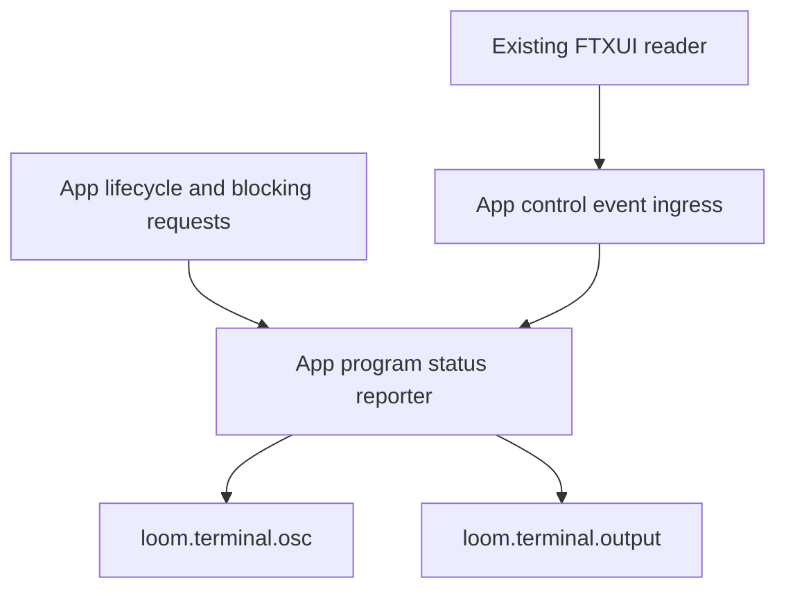

# RFC 0016 — Terminal Program Status (OSC 7501)

## Summary

Report Loom's interactive operation state through OSC 7501, revision 0.4.
Use the terminal's capability reply, the existing single FTXUI input reader,
and UI-thread output. A successful turn remains done until user interaction;
permission/question waits are distinct from work, cancellation and stopped
failure. This is an additive terminal integration, not a new rendering design.

## Motivation

### Evidence

| Measurement | Baseline | Target |
|---|---|---|
| Loom OSC 7501 encoders/probes/reporters | 0 (source inventory) | One encoder owner and one interactive App reporter |
| Existing OSC output owners | Pure loom.terminal.osc plus loom.terminal.output (RFC 0011) | Retain these owners |
| FTXUI5 OSC terminators | ST only | ST and BEL, through the same native reader |
| FTXUI incomplete-sequence timeout | 50ms for OSC and standalone Escape | OSC 7501 total1000ms; other OSC and standalone Escape unchanged |
| Turn completion signal | StreamEnd occurs per HTTP round, not per user turn | Outer stream_query return |
| Prior frozen full-suite registrations | 2600, before concurrent branding changes | Discover current baseline; account for every addition/deletion |

The terminal cannot infer reliable machine-readable state from Loom's title,
colors or spinner. RFC 0015 established attention semantics inside the UI;
OSC 7501 exposes the operational facts to a supporting terminal when the user
is looking elsewhere. Ghostty PR #14560 merged the libghostty-vt callback and
parser, not a guarantee of a visible Ghostty application indicator. Support
must come from the actual reply, not TERM_PROGRAM or version heuristics.

References: [protocol revision 0.4](https://www.superlogical.com/rex/docs/build/program-status),
[Ghostty implementation](https://github.com/ghostty-org/ghostty/pull/14560).

## Goals

- G1. Report only interactive foreground query/local-shell work and human
  requests, using one root record with app=loom. Include queued/suppressed
  worker-blocking dialogs; display focus does not determine operational state.
- G2. No new stdin reader, polling loop, recurring timer, terminal dependency,
  protocol output in Render, signal handlers or background workers.
- G3. Unsupported/noninteractive terminals retain existing behavior. Probe
  without blocking UI and consume valid, invalid and late 7501 control events
  before prompt/selection/permission key dispatch.
- G4. Preserve done/error across redraws and normal exit. Cancelled work ends
  idle after cleanup. No done pulse for intermediate API/tool rounds.
- G5. Preserve input, selection, authorization decisions, model wire formats,
  persisted data, existing OSC 2/8/52 bytes and HUP/TERM handoff ordering.

## Non-Goals

No child-agent records, progress percentages, arbitrary prompt/output messages,
notifications, title rewriting, OSC 9;4 fallback, tmux passthrough, terminal
emulation, authentication flow or configurable status framework. Detached
workers do not receive their own records in this phase. Existing independent
branding changes and historical clipboard flakes are not redesigned here.

## Proposal

### Ownership and shared-change gate

The owning module is ui/app. One concrete app-owned reporter holds capability,
last-reported status and current operation outcome; it is independently tested
with injected time and output. It is not a global terminal service. Keep its
implementation out of app.cppm using existing AppImpl/private storage; exported
interfaces contain declarations rather than new inline implementations.

Real-terminal acceptance also requires the existing ask-user responder to reach
its UI consumer. Investigation found that `set_global_ask_user_responder` and
`get_global_ask_user_responder` in `loom.tools.ask_user` used different
function-local static slots. The narrowly scoped prerequisite repair makes
the existing setter use the existing getter's slot; signatures and permission
checks stay unchanged. A registry-level native regression verifies callback
replacement/return and restores the previous callback through RAII. A fake UI
question or another adapter would conceal the incorrect storage boundary.
Existing QueryEngine and runtime permission gates are both exercised by the
PTY fixture; this RFC does not consolidate or bypass those gates.

Extend the existing pure terminal OSC owner with typed status/query encoders.
Every report repeats app=loom and state; kind is emitted only with blocked.
First version has no arbitrary text, title, id or progress fields, so it cannot
leak prompts, paths, credentials or output, or invent a progress denominator.
Use ST framing consistently. Existing title/link/clipboard encoders are intact.

Capability detection and raw framing cannot be correctly closed inside the
permission or rendering modules: FTXUI owns the only input reader. App-only
character swallowing after a partial response would steal real keystrokes.
Use an exact-match, idempotent, fail-on-drift configure patch, following the
existing FTXUI input/shutdown patch convention. Its changes are restricted to
OSC 7501: BEL framing, slow-fragment retention and bounded abort. Other OSCs
(including OSC 52) retain their existing ST-only parsing and 50ms behavior.

### Native input framing and exclusive delivery

Existing ParseOSC returns SPECIAL, and Send already creates Event::Special
with the full ESC ] command ; body terminator bytes. No new FTXUI event or
callback is needed. App intercepts this event at the top of OnEvent, before
selection, result acknowledgement or permission/prompt key dispatch. A consumed
control event is never also dispatched as keyboard input. Existing timeout
flush emits one Special containing the buffered bytes, not Characters; the
hazard is the unframed continuation arriving after that buffer was flushed.

The total frame budget starts when ESC ] is formed (not at the first ESC).
The scoped patch recognizes ESC ] followed by a still-possible 7501 prefix,
and the exact completed command 7501;. It uses a 1000ms TOTAL frame budget,
not an idle timeout reset on each byte, and caps pending frame storage at4096
bytes. Account for elapsed real steady-clock time even during continuous Add,
and accumulated Timeout time for deterministic native parser testing. Preserve
the original start/budget when another byte arrives. At the byte cap enter a
bounded discard mode through ST/BEL or the same total deadline; do not replay
captured/overflow bytes as characters. At truncation/deadline discard buffered
7501 bytes (or deliver an incomplete Special consumed by App), reset framing,
and allow subsequent fresh keyboard input. There is no promise to distinguish
an arbitrarily late unframed tail from a new key after the recovery boundary.

After ESC ] disambiguates to another OSC command, retain original parsing,
terminators and timeout. A standalone ESC still expires after50ms; therefore
the two-byte ESC ] introducer must arrive within that original50ms Escape
window. Once introduced, 7501 may be split anywhere in its command/payload
within its total1000ms frame window. This is explicit bounded support, not an
arbitrary-latency guarantee. No App character-swallowing reassembler or second
reader is introduced. Native tests use the in-repo target against the patched
FTXUI parser, including continuous input, byte cap/discard, split header,
BEL/ST, timeout/recovery, unchanged OSC52 and standalone Escape.

### State mapping and authoritative sources

| Condition | Report | Source/invariant |
|---|---|---|
| Startup, ready for next instruction | idle | No operation or terminal outcome |
| Query/tool/automatic retry/local ! shell | working | Start edge through actual worker completion |
| Tool/computer-use/sandbox/teammate/MCP consent pending | blocked, permission | Pending blocking request, even if hidden behind another view |
| Ask-user prompt pending | blocked, question | Actual pending answer, not an arbitrary settings modal |
| Interactive auth | blocked, auth | Reserved encoder vocabulary; no current App auth wait, so never inferred from credential errors |
| Whole operation returned successfully | done | Outer stream_query/local-shell completion; not StreamEnd |
| Whole operation stopped on error | error | Current terminal error, excluding recoverable tool errors and retries |
| Tool-round budget paused for Continue | blocked, question | tool_round_limit is a recoverable user-continuation boundary, not success/error |
| User abort | working while cleaning up, then idle | Cancellation marked before abort/request_stop; late abort network error cannot override it |

Permission takes precedence over question, then running work, then the retained
operation outcome. No pending human request can be hidden by generic work.
Permission precedes question because an outstanding authorization is the most
actionable/security-sensitive wait under one root record. Generic
settings/help/trust-management screens alone do not mean blocked.
A startup trust prompt before RunApp is outside this interactive reporter.
Recoverable historical transcript errors have no bearing on global status.

Each new foreground operation resets its outcome/cancellation and supersedes
its predecessor. Completion is marshalled through the existing UI action queue;
no report is written from workers. Capture current-turn failure before pending
UI errors are consumed. A local shell exit0 maps done; nonzero/spawn failure maps error, matching the
existing transcript is_error classification (including grep exit1). The reporter
does not reinterpret command-specific exit codes or change shell behavior. Existing
join-before-next-turn ordering prevents stale worker completion. Explicit user
cancel state wins over late I/O failure. Budget/error early returns use the same
outer completion boundary; no success inferred from a per-request StreamEnd.

Observe human requests across all queued dialog bands using existing read-only
queue queries, not only the currently visible overlay. Refresh after UI actions,
completion, submit and decision events. Render currently drains the same UI
actions and pending results, so completion callbacks ONLY update desired
state. Capture the current terminal error under result_mutex before publishing
query_running=false, while it cannot yet be consumed by Render. Flush only
in explicit startup/OnEvent/finish code, including an OnEvent scope-exit guard
for early returns. Emitting terminal bytes is never a painting side effect. A done/error outcome remains through render/resize/Custom
and terminal capability events. The next genuine user interaction acknowledges
it and returns idle, unless an operation/block remains. Mouse motion, terminal
queries and synthetic Custom events do not acknowledge a result. Exit gestures
(Ctrl-D, Ctrl-C exit controls, and Return submitting /exit or /quit) are exempt
from acknowledgement; Stop decides their final status. Typing the characters
of /exit is ordinary acknowledgement, so there may then be no unacknowledged
result left to preserve. A tool_round_limit continuation remains blocked until
Continue/new user input/cancellation/session end. Tests include retained
done/error followed directly by Ctrl-D, as well as acknowledged /exit.

Acknowledgement is evaluated against the pre-event actual blocking snapshot:

| Input | Acknowledge retained outcome? |
|---|---|
| Prompt/navigation/edit keys, ordinary modal keys, user scroll or activating click, no actual blocking request | Yes |
| Decision/answer to an actual visible or queued blocking request | No; after resolution reassert any retained foreground outcome |
| Ctrl-D/C exit controls; Return submitting /exit or /quit | No; finish owns final outcome |
| Mouse motion, resize/focus, OSC/capability/device replies, synthetic Custom | No |

Only actual operation cancellation marks the foreground turn cancelled. Escape
that declines a single permission/question is a request decision, not whole-turn
cancellation; the existing engine may continue and recover. Do not invent
business cancellation or remove dialogs for observability. If an existing cancel
path withdraws its pending request, the next snapshot is working(cleanup), then
idle. If a real request still blocks a worker, report blocked until it is
resolved/withdrawn; this is more truthful than falsely claiming cleanup is
running. Cancelling foreground work does not withdraw an unrelated teammate's
permission. Native tests cover hidden queue requests and retained outcome plus
background permission raise/resolve; PTY covers real request decline and cancel.

### Spec conformance (revision 0.4)

The specification's Records/States sections require records to outlive screen
switches; no heartbeat is required. Working/blocked end on attached-process
exit or a new shell prompt; done/error survive those events. This justifies
state-change deduplication and retained final outcomes. SIGKILL/disconnect can
prevent any final delivery; process/shell lifecycle cleanup is the terminal's
responsibility, not an invented client timeout. Kind is optional: unknown kind
is treated as absent, so kind-less blocked is valid. Feature detection may
advertise restricted states; this MVP deliberately requires the five core
states before enabling, rather than emitting an inaccurate fallback. Missing
lists have the specification's fixed default sets. See specification sections
Records and ids, States, Keys and Feature detection.

### Capability detection

After ftxui::Loop construction installs raw input, send exactly one
ESC ] 7501 ; ? ST, only when stdin and stdout are TTYs. No probe in constructors,
headless commands, dry-run, redirected output or server mode. No environment
heuristic enables reporting. Keep the latest desired status while probing.

The deadline is 1000ms from sending. Evaluate expiry on every ingress,
status transition and finish; no wakeup is needed for a non-visible, inactive
feature. A late reply is consumed but cannot enable reporting. No response
means no reports. Never wait synchronously for detection or consume stdin
outside FTXUI. Both complete ST and BEL replies are accepted, with whitespace,
unknown pairs and optional states/kinds lists. Missing lists mean the five
base states/three base kinds. Unknown values are ignored; an explicitly
restricted states list missing a base state disables this first implementation
rather than fabricating a misleading fallback. Unsupported kinds are omitted
while retaining blocked. App consumes recognized 7501 events even after
negotiation or when malformed, without treating them as user acknowledgement.

Capability latches on the first accepted reply. Later replies are consumed but
cannot broaden or restrict it; suspend/resume retains capability without a new
probe. Oversize complete events are consumed without enabling or becoming
keystrokes. An unsolicited pre-probe7501 event is consumed but cannot latch capability.
An accepted reply emits the latest snapshot once. Subsequent identical reports
are deduplicated. Output failure disables reporting for this lifetime with no
retry loop, without changing the user's task outcome or surfacing a modal.

### Exit lifecycle

Begin stopping in normal UI code before loop teardown; block further lifecycle
reports and capability activation. Preserve an existing done/error result on
normal exit, including a retained foreground result temporarily overlaid by a
background decision request when no foreground work is active. Active or cancelled work leaving the interactive session reports
idle, never success. Abnormal loop exit/HUP/TERM/exception does not assert task
success: best-effort idle if capability was already established. Do not issue a
new probe or wait for a reply while stopping. Never emit root clear: it would
remove other programs' surviving records too.

RunApp owns the single idempotent finish call: normal path immediately after
loop.Run (and explicit normal exit intent), catch path before rethrow, both
BEFORE Loop destruction. Finish/flush are best-effort noexcept, including
writer exceptions/allocation failure, and detach permanently. Existing
terminal.output fwrite+fflush delivers bytes before Loop destruction/termios
restoration; no extra flush layer is needed. Final reporting occurs on the UI
thread before Loop destruction restores tty;
then existing worker cancellation/join and ParentTerminalGuard's final flush
and restoration proceed unchanged. No output is attempted from a signal
handler, after writer detachment or after parent-shell handoff. Disconnect or
SIGKILL can prevent delivery; the terminal's working/blocked expiry rules are
the fallback. Finishing is idempotent, including exception unwinding.

### Compatibility

The only new external shape is OSC 7501 control traffic on supported interactive
terminals and its one feature probe. No settings keys, CLI switches, session
JSON, model requests, debug dump shapes, authorization rules or exit codes
change. No visible rendering or truecolor golden update is expected from this
feature. Existing concurrent logo snapshots are preserved independently.

## Phases and graduation criteria

| Phase | Title | Scope | Status | Graduation criteria (measured) |
|---|---|---|---|---|
| A | Protocol and lifecycle implementation | terminal encoders, native framing, App reporter/integration, native tests | done | Independent design/PRR and implementation APPROVE; dual native/PTY focused suites 83/83 each; graph637 modules/795 units, zero cycles/upward/dead imports; inline638 interfaces,49 frozen,0 over100; no recurring timer |
| B | Native terminal and full graduation | real forkpty Loom, docs and dual presets | done | Dual builds clean; each full serial suite2665 registrations:2643 passed,20 skipped,2 existing disabled,0 failed; debug443.57s/release377.67s. Both focused83/83,14 real-PTY registrations each. Frozen2566 source/build/test hashes unchanged; independent graduation APPROVE; docs and RFC lint complete |

## Production Readiness Review

- Correctness: native protocol/state-machine/parser tests and actual executable
  PTY acceptance cover normal and negative paths, restricted capabilities,
  duplicate/late replies, cancellation and teardown. Native golden suites run;
  no new golden changes authorized. Current test discovery is recorded before
  implementation and additions are reconciled, with zero silent deletions.
- Build: existing app-to-utils dependency direction; no new library or third
  party fetch. Interfaces have declarations only. Run graph/UI9/store/target
  and inline-definition gates. Default Ninja parallelism, never throttled.
- Metrics: local macOS has no /proc PSS; hosted macos-14 cold-build measurements
  unavailable in this session. Record limits explicitly; do not substitute RSS
  or invent producer fan-out metrics. Measure local build/test wall times.
- Observability: existing debug channels only; no new ad-hoc stderr logging or
  persisted traces. Program state reports contain no model/user text.
- Compatibility: additions only; no model or persisted migration. No changed
  native clipboard path or output acceptance claim. Control data is untrusted,
  bounded on App ingress, and can never authorize work.
- Lifecycle: input remains single-reader, output UI-thread serialized, probe
  expires lazily, teardown reports best-effort and detaches idempotently.
- Documentation/deletion: update docs index, user terminal-integration guide
  and non-obvious design decisions. No convention requiring AGENTS changes;
  no replaced API or dead service to migrate.
- Rollback: revert B docs/tests then A's coherent source changes; restore or
  repopulate patched FTXUI source before rebuilding. No data migration.
- Platform: dual local macOS presets and forkpty acceptance required. Linux,
  Windows and installed-terminal GUI presentation remain separate limits;
  absence must be stated, not recast as proved support.

## Rollout and rollback

Proceed after independent design and PRR approval, without committing per user
instruction. Keep unrelated working-tree changes byte-for-byte except shared
files where only reviewed OSC-specific hunks are added. Freeze source before
full suites. On rollback restore the captured baseline, not HEAD's unrelated
versions. Remove the configure patch include and repopulate dependency source;
removing an include alone does not reverse already patched sources.

## Drawbacks

Adds capability/outcome state and two small protocol integration boundaries.
Capability detection is new input control traffic; a malformed partial terminal
OSC can delay input until its bounded framing timeout. Supporting terminals
may display different indicators. A terminal report is not authenticated and
must never become an authorization decision.

## Alternatives considered

1. Do nothing: terminal consumers continue scraping title/screen content and
   cannot reliably distinguish work from a user wait.
2. OSC 9;4/bell/title glyphs: cannot express structured waiting reasons and
   record lifetime; retain existing behavior but do not use it as this protocol.
3. Unconditional reports/no detection: permitted by the spec, but loses actual
   support evidence; this phase chooses conservative automatic probing.
4. A new stdin reader or App character reassembler: competes with FTXUI or
   swallows real keys after a timeout. Fix the framing owner locally instead.
5. A generic global terminal capability service with many protocols: excessive
   scope for one concrete integration. Keep one concrete App reporter.

## Testing and verification plan

Protocol tests assert exact ST bytes, all states/kinds, invalid combinations,
unchanged OSC 2/8/52. Reporter tests inject time and writer to cover lazy expiry,
ST/BEL replies, restricted lists, late/malformed replies, deduplication, retained
outcomes and terminal-write failure. Native FTXUI parser tests cover fragmented
OSC with100ms gaps, split header, BEL/ST, truncation/1000ms total time, hard byte
cap and continuous-stream budget, adjacent normal keys, unchanged OSC52 and
standalone Escape. Auth has no App producer; encoder tests suffice. App-native
acceptance covers suppressed dialogs, retained outcome plus background request
raise/resolve, nonzero local shell, the acknowledgement classification table,
and oversize/latched capability handling. App-native tests exercise actual operation and
blocking-queue transitions and no Render emission.

Real PTY tests spawn the actual Loom binary with isolated configuration/model
server, respond to the observed probe, and verify raw protocol order plus
visible/typed-input invariants. Negative case withholds the response and checks
zero status reports; delayed/fragmented and subset replies exercise capability
boundaries. Exercise real work, permission, question, success, stopped failure,
cancel and exit/HUP/TERM handoff, retaining raw evidence.
The real ask-user case uses the existing PromptDialog's Enter-to-confirm
default answer and checks the parsed successful tool result, not merely a
string occurring in the model's tool input. Free-form prompt editing and
pre-existing question-body/frame rendering are outside this integration.
Run complete serial
CTest debug then release on frozen production/test source, plus architecture,
RFC and scoped whitespace checks. Do not weaken native clipboard or HUP tests
if an independent flake appears.

## Documentation impact

Add docs index/RFC entries, a user terminal-status guide covering automatic
support, status meanings and limits, and a design-decision ownership/lifecycle
entry. Preserve existing design-language and branding work. No configuration or
CLI reference changes are required.

## Open questions

None for product direction. Reviewers may require narrower ownership, clearer
terminal limitations or additional acceptance evidence before implementation.

## Implementation History

| Date | Phase | Event | Commit / PR | Evidence (metrics, test totals) |
|---|---|---|---|---|
| 2026-10-14 | — | Provisional RFC drafted; implementation not started | local, uncommitted | Source inventory and 85 existing dirty file hashes captured; input/state explorers identified per-round StreamEnd and 50ms OSC framing hazards. Design/PRR review pending. |
| 2026-10-14 | — | First independent gate requested changes | agent:osc_design_review | Three P2 findings: exit acknowledgement vs retained outcomes; tool-round continuation classification; Render draining UI actions. No implementation started. |
| 2026-10-14 | — | Revised design and PRR approved; RFC accepted | agent:osc_design_review | All three P2 findings resolved in the specification; native acceptance cases named. Independent Claude artifact review still pending before implementation. Current discovery2601 includes concurrent branding registration; baseline dirty85files retained. |
| 2026-10-14 | — | Claude artifact gate requested changes; specification amended | agent:claude-cli-osc-design | Native Special ingress/payload ownership and rev0.4 lifetime citations made explicit; framing narrowed to7501 with total time/storage/discard bounds; ack/block/exit policies pinned. Literal cancellation withdrawal rejected: reporting must not invent business cancellation or hide a still-blocked worker; actual request decline and operation abort remain distinct. Re-review pending, no production code edits. |
| 2026-10-14 | — | Revised Claude design and PRR APPROVE; implementable gate passed | agent:claude-cli-osc-design; agent:osc_design_review | M1–M12 resolved or explicitly accepted rebuttal. No blocking findings; budget epoch and pre-probe ignore policy pinned. Source edits are authorized to begin only after this gate. |
| 2026-10-14 | A | Implementation starts | local, uncommitted | Main owns App integration/CMake/docs; core worker owns protocol/reporter/parser tests and patch; PTY worker owns native terminal cases. No overlapping builds; preserve unrelated branding hunks. |
| 2026-10-14 | A | Independent implementation review requested changes; fixes re-reviewed APPROVE | agent:osc_design_review | Three P2s fixed: button-held mouse motion cannot acknowledge outcomes; extra ESC before BEL/ST cannot swallow following input; normal exit retains foreground outcomes under background request overlays. Native and PTY regressions added. Build/runtime gates remain pending. |
| 2026-10-14 | A | Real-terminal question prerequisite discovered; minimal repair reviewed and approved | agent:osc_design_review | Before repair, both real authorization gates completed but the tool result was No interactive input available and no Question opened. Existing ask-user setter/getter had different static slots; setter now uses getter storage, with registry/RAII regression. No signature, permission or global lifecycle redesign. Claude static OSC review APPROVE; its three P3 test-fidelity/coverage notes addressed. Final runtime gates pending. |
| 2026-10-14 | A | Implementation and prerequisite delta APPROVE; native acceptance complete | agent:osc_design_review; agent:claude-cli-osc-code | Both presets83/83 focused tests pass, including14 real-PTY registrations (16 actual terminal sessions per preset), true default-answer question result and Ctrl-D/HUP/TERM shell handoff.637 modules/795 units, zero cycles/upward/dead imports;638 interfaces,49 frozen,0 over100. Sibling global-slot audit found no other setter/getter pair. |
| 2026-10-14 | B | Full graduation starts on frozen source | local, uncommitted | Discovery2601 to2665:64 additions (7 encoder,25 reporter,12 parser,5 App,14 PTY,1 registry),0 deletions.2566 source/build/test hashes frozen, including concurrent branding state; no edits to branding by this work. Full debug then release serial CTest pending. Local release compile/link153.31s after prerequisite, final fixture increment4.10s; debug prerequisite48.08s, final test increments7.11s/6.04s; default Ninja parallelism. These are local warm/incremental timings, not cold CI or PSS claims. |
| 2026-10-14 | B | Complete debug serial CTest passed | local, uncommitted |2665 registrations:2643 passed,20 skipped,2 previously disabled,0 failed;443.57s. All real OSC PTY and existing HUP/clipboard cases passed. Frozen2566 source/build/test hashes unchanged. Release full serial suite now running on the same state. |
| 2026-10-14 | B | Complete release serial CTest passed | local, uncommitted |2665 registrations:2643 passed,20 skipped,2 previously disabled,0 failed;377.67s. Same frozen source; native OSC, actual default-answer question, cancellation, existing clipboard and HUP stress all pass. No skipped or disabled test was introduced by this RFC. |
| 2026-10-14 | B | Independent graduation APPROVE; RFC implemented | agent:osc_design_review | Reviewer independently counted both complete logs and83/83 focused suites, recalculated2566 source hashes, and extracted raw question and Ctrl-D/HUP/TERM status sequences.64 additions/0 deletions reconciled. Architecture/inline/RFC/scoped whitespace gates pass;29 owned files, preserving pre-existing shared-file branding hunks. Local macOS only; GUI indicators, Linux/Windows, PSS, cold CI builds and free-form prompt editing are not claimed. No commit or push. |
