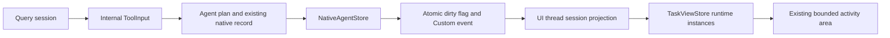

# RFC 0021 — Subagent Visibility and Proactive Delegation

## Summary

Show ordinary subagent instances above the prompt throughout their lifecycle,
including when the parent query is idle. Teach the actual default system
prompt and Agent tool when and how to delegate independent research, then
collect and verify results. Reuse the existing native records, session identity,
event loop, activity budget and palette. Do not create a second scheduler.

## Motivation

### Evidence

A real configured-endpoint FTXUI session on 2026-10-17 launched two background
agents whose native Bash execution intervals overlapped by 44.990904 seconds.
The main screen showed the parent saying both were launched, but no runtime
rows; idle completion did not update that screen. Raw ANSI and marker timestamps
are in ignored `build/subagent-parallel-demo-20261017/`.

Source tracing found three disconnected paths: `/agents` displays definitions,
`/tasks` uses a different scheduler, and the native-store projection in
`app_team.cpp` requires a team and excludes ordinary agents. Store updates have
no UI wake. Ordinary plans also do not populate the already persisted
`parent_session_id`, so displaying every store record would leak historical
or other-session activity into the current screen.

The production default system prompt in `query_engine_system_prompt.cpp` has
four generic sentences and no delegation policy. The richer constants composer
is not used by QueryEngine. Agent tool metadata describes mechanism, not
research delegation or result collection. Fork boilerplate incorrectly claims
the parent defaults to forking and instructs workers to commit unconditionally.

| Metric | Baseline | Target |
|---|---|---|
| Visible ordinary instance statuses during parallel run | 0 | Both, within available activity rows |
| Idle terminal completion wake | Absent | Event-driven native terminal update |
| Cross-session instance rows | Unsafe without scope | 0 unrelated rows |
| Production default delegation policy | Absent | Present only when Agent is available |
| Added render tickers / schedulers / settings | 0 | 0 |

### Comparable designs and sources

These are documented examples, not a universal ranking or a claim to know
private production prompts. Sources accessed 2026-10-17:

- [Codex subagents](https://learn.chatgpt.com/docs/agent-configuration/subagents):
  app threads, CLI `/subagents`, and an IDE panel above the composer expose
  activity and status. Delegation depends on user or applicable instructions.
- [OpenAI multi-agent prompt guidance](https://developers.openai.com/api/docs/guides/responses-multi-agent):
  developer instructions can explicitly enable proactive delegation when
  parallel work improves speed or quality; independent bounded tasks fit best.
- [Claude Code subagents](https://code.claude.com/docs/en/sub-agents):
  descriptions guide automatic delegation, including explicit proactive wording;
  background execution permits concurrent work and descriptions remain short.
- [Anthropic research system](https://www.anthropic.com/engineering/multi-agent-research-system):
  teach the coordinator objective, output, tools/sources and task boundaries,
  and scale effort to complexity to avoid duplicate and excessive research.

## Goals

- G1. Show names/descriptions for eligible active/failed current-session
  ordinary foreground/background agents within available rows. Phase E exposes
  current running/queued/attention counts while work exists, then folded
  completed/cancelled/idle counts when quiescent, without deleting any records.
  Completed/cancelled instances remain folded after the Phase D correction.
- G2. Wake and project on native changes even after the parent stops generating.
- G3. Isolate current-session records and preserve terminal states until session
  successful resume changes the active scope; failed resume must preserve scope.
- G4. Proactively delegate independent substantial research when it improves
  latency or coverage, without delegating trivial or tightly dependent steps.
- G5. Separate launch success from task completion, require result collection
  and verification, and preserve user/repository constraints in workers.

## Non-Goals

New scheduling, permission modes, model routing, mandatory agent counts, auto
task splitting in host code, recursive delegation, an agent transcript browser,
new stop/resume controls, team redesign, enabling Explore/Plan by default,
or repairs to unrelated UI/theme/accessibility changes.

## Proposal

### Ownership and shared-change justification

Owners are native agent execution/store, app runtime projection and the live
query prompt builder. The user requested coordinated visibility and delegation
changes. A renderer-only fix cannot receive idle changes or safely scope records;
a prompt-only fix cannot expose runtime state. Keep `/agents` definitions and
the existing team projection rules unchanged; Phase D refreshes that existing
projector on coalesced native changes. Do not edit dirty agent-card widgets.

### Detailed design

1. Carry the current session ID through internal ToolInput and AgentConfig
   into the existing plan/record `parent_session_id`; nested executions inherit
   the root session. This metadata is not model-provided JSON. Resume must bind
   newly executed work to its current parent session without rewriting history.
   Legacy records with no session ID are not guessed into a current session.
2. NativeAgentStore exposes subscribe_changed/unsubscribe_changed for
   in-process consumers. Mutations release the record mutex before observer
   snapshot/dispatch; no client code runs under record/store locks. Each token
   owns an active flag and callback; unsubscribe deactivates and removes it
   without waiting. Already-admitted callbacks may finish, so clients must use
   lifetime-safe handoffs. Re-entry into list and self-unsubscribe are legal.
   Observer exceptions are contained and cannot fail agent execution. Notify
   registration/execution, progress and terminal mutation, including foreground
   and background paths. No filesystem polling thread is added.
3. App reuses its existing shared UiActions handoff: the callback captures only
   the queue-backed ui_dispatcher and a shared atomic dirty flag, never an App
   raw pointer. It flags dirty and dispatches an empty action to post a Custom
   event; repeated mutations coalesce through dirty.exchange(true). Existing CloseUiActions serializes with dispatch, closes notifications
   and clears queued actions before adapter teardown; call it before unsubscribe.
   A callback admitted before close may finish, but post-close dispatch must be
   a no-op, proven by a deterministic native lifetime test.
   On the UI thread, project display data for records whose parent session
   matches current_session_id and whose team_name is missing/empty, with no
   teammate_backend/task_id/pane_id identity set. Render/Custom
   drains the dirty flag; initial and successful session transitions also
   refresh scope. Existing /clear keeps its session identity, so it must not
   hide still-running work or silently change that established command contract.

   | Boundary | Scope invariant |
   |---|---|
   | New root query | Internal input carries engine's current session ID |
   | Ordinary/nested child | Persist/inherit the originating root session ID |
   | Resume agent from current parent | New execution binds to current parent session; old transcript stays intact |
   | Successful UI session resume | Reproject the new session ID, excluding previous-session agents |
   | Failed UI session resume | Leave current scope and instances unchanged |
   | /clear | Preserve current ID and visible agents, including active background work |
   | Legacy missing session ID | Exclude rather than guess ownership |

4. Add a runtime-instance vector to TaskViewStore, separate from definition
   cards and live teammates. Keep the existing 0–5-row activity budget, cell
   clipping, palette, event-driven projection and empty-runtime layout.
   The following Phase D policy is historical; Phase E below supersedes its
   combined aggregate and mixed details. Phase D superseded the original count-based allocation: a real mixed PTY
   showed two completed Subagent details while all four Tasks were hidden.
   The owning mixed compositor now reserves only one aggregate row. It reports
   Subagents active/total, Tasks active and done/total, and Team Agents
   running/total before lifecycle/hidden counts, as terminal width permits.
   At constrained widths reduce to active counts for all nonempty groups
   before adding totals/terminal metadata; at one column preserve the active
   Subagent count. Width can still make later groups impossible to fit.
   No percentage-complete claims.

   Use remaining rows for self-labelled details, in deterministic fair rounds:
   one in-progress Task, one active Subagent, one running Team Agent, then
   repeat until those candidates or the budget are exhausted. Running Subagents
   precede queued ones, preserving input order within each state and each
   group's original order. Skip exhausted groups immediately. After active
   work, show failed Subagents and unknown-status Team Agents for attention,
   then pending Tasks. Completed/cancelled Subagents, completed Tasks and idle
   Team Agents appear only in the aggregate. Never infer completion from idle.
   Each detail says Task, Subagent or Team Agent; use existing public row
   renderers locally rather than change shared TodoPanel or teammate widgets.
   Preserve the existing response-parent todo prefix on Task details only,
   deducting its terminal-cell width before constructing the labelled row.

   | Budget | With all three groups running |
   |---|---|
   | 0 | No activity rows |
   | 1 | Combined aggregate |
   | 2 | Aggregate + first in-progress Task |
   | 3 | Aggregate + Task + Subagent |
   | 4 | Aggregate + Task + Subagent + Team Agent |
   | 5 | Previous rows + next active detail in the same fair order |

   Missing active groups yield their slots immediately to other active work.
   A fully completed Subagent group consumes only its aggregate, leaving four
   slots for active Tasks/team details. Count every omitted detail, including
   folded terminal records, in the aggregate hidden count. Retain lifecycle
   counts after idle completion. Short terminals keep editor/footer geometry;
   narrow summaries clip by cells and expose other groups as width permits.
   Keep session ordering/projection unchanged: cached creation time and ID
   break ties; first-loaded legacy records use first observation time, with no
   cross-process original-time promise. Do not render transcript/tool arguments.
5. In SystemPromptBuilder's real default branch, add a short delegation section
   only when effective config_.tools contains a definition named exactly Agent
   and session deny rules permit it. Per-request enabled_tools filtering remains
   authoritative: the policy says to use only tools available in the current
   request, and to work directly if delegation is unavailable. Do not alter
   established request filters or rewrite custom prompts.
   Never add it to custom_system_prompt; append prompt and contexts retain their
   existing order. Explicitly name subagent_type: "general-purpose" and
   run_in_background: true for independent concurrent tasks. Mention task_output
   only when that exact tool definition is present; it returns a non-blocking
   status/output snapshot, not a waiting operation. Describe independent research/review questions,
   clear objective/scope/output/evidence and ownership, main-agent continued work,
   avoiding duplication, collecting final results, and proportional effort.
   Preserve custom-system-prompt replacement and append/context ordering.
6. Agent metadata explains explicit general-purpose selection, limited child
   context, background concurrency, and that launch is not completion. Where
   task_output exists, explain non-blocking snapshot collection and final
   result/error checking without a tight polling loop.
   Remove fork boilerplate's invented parent policy and mandatory commits;
   retain scope and user/repository constraints. Do not advertise gated agent
   types as universally available.

No new module layering or wire API fields are required. Internal DTO additions
have defaults. The persisted parent_session_id field already exists and old
files stay readable; no migration. Session/tool-result/tag serialization stays
unchanged. New text affects API prompt content and UI output, not configuration.
Implementation bodies stay out of module interfaces where practicable.

## Phases and graduation criteria

| Phase | Title | Scope | Status | Graduation criteria (measured) |
|---|---|---|---|---|
| A | Session-scoped runtime visibility | Agent/store/app/layout and native tests | done | Foreground/background scope and mutation notifications, blocked-callback unsubscribe/re-entry and teardown safety, idle completion and bounded narrow/short rendering pass native tests; two real endpoint agents appear running and completed. Measured: two actual Read/Bash children, 29.846546 s command overlap, two running then two completed rows during parent idle |
| B | Proportional proactive delegation | Actual prompt, Agent metadata, fork text and native tests | done | Deterministic Agent/no-Agent/denied/custom/append HTTP body and exact metadata checks pass in both protocols; scripted lifecycle coverage distinguishes launch from final task_output; live research is a disclosed supplemental sample, not a compliance guarantee. Measured: 12 HTTP scenarios across two protocols; actual two-task task_output collection; a separate autonomous two-agent launch is observed but its timeout excludes completion acceptance |
| C | Integrated graduation | Dual builds, CTest, review and evidence | done | Debug/release -Werror builds and full CTest; focused architecture/RFC lint; independent code review; immutable binary/source hashes and real PTY screenshots recorded. Measured: each preset 2790 registered / 2765 passed / 23 skipped / 2 disabled / 0 failed; 2590 source and 214 executable hashes unchanged; final independent APPROVED |
| D | State-aware mixed activity priority | Local compositor, app native wake, native tests and evidence | done | Measured: each preset 2797 registered / 2772 passed / 23 skipped / 2 disabled / 0 failed; focused 19/19 each; real parent-busy/mixed/all-folded frames, 5-to-1 activity rows; 2590 inputs and 214 executables zero drift; final independent APPROVED |
| E | Layered plans and agent execution | Local activity composition, background status, teammate labels and native/PTY verification | done | Independent design/PRR before code; separate Tasks/Agents sections within 0–5 activity rows; idle-parent background hint; correct Team Agent(s) count; debug/release -Werror and complete serial CTest; configured-endpoint running/completed/narrow real PTY screenshots; preserved unrelated bytes and no commits |
| F | Explicit task and agent hierarchy | Local runtime compositor, REPL budget/envelope and native/PTY verification | done | Independent design/PRR before code; separate Tasks, Subagents and Agent Teams headers with indented children; measured-height allocation; debug/release -Werror and full serial CTest; real configured-endpoint running/completed/narrow frames; unrelated-byte preservation and no commits |

### Phase D corrective amendment (design/PRR approved)

Owners: mixed runtime activity compositor and the existing app native-change
projection handoff. No scheduling, store, prompt, wire, persisted shape,
configuration or shared widget changes. Remove the
obsolete exported count-only allocation helper; its only callers are the owning
renderer and native tests. This internal module helper is not an external API.

Live integration correction (independent design/PRR approved): a configured-endpoint run reproduced
native Team Agent Running with a real Bash marker in progress, while no team
DTO entered the mixed compositor during a parent notification query. Existing
Render/OnEvent drains the native dirty flag into ordinary projection only;
team projection waits for SyncState/pane observer/modal refresh. Consume the
same coalesced native-change event on the UI thread to invoke the existing
ProjectLiveTeammatesToScreenState too. Do not add polling, change team selection,
change the store callback/lifetime contract or duplicate teammate projection.
The extra existing store list is bounded to changed native events; the earlier
P2 long-history cost remains unbenchmarked. Regression: team running/completed/
queued/cancelled/failed updates while parent remains busy; no ordinary duplicate
or unrelated-team leak. The local correction was independently APPROVED by
`agent:/root/independent_review` before editing the app projection body. Rebuild/freeze and rerun both full suites afterward;
pre-integration Debug success (2796 registered, 2771 passed, 23 skipped,
2 disabled, 0 failed) is diagnostic, not final graduation. A native team wake
regression was also run red (1/1 failed) before the correction.

Success criteria: two completed Subagents contribute zero detail rows; an
in-progress Task and running Team Agent remain named in a five-row mixed area;
active work precedes attention/pending items; all-folded state is one row
when at least one current-session Subagent enters the mixed compositor.
This means completed/cancelled Subagents, completed Tasks and idle Team Agents,
with no failed/unknown attention items. Failed is terminal but remains eligible
for an attention detail. With no runtime Subagents, preserve the existing todo/team path and test the
empty-runtime boundary. The aggregate is the only summary row; hidden counts
all omitted individual items across the three groups, including terminal ones.
Native tests cover budgets 0–5, stable fair ordering, hidden/lifecycle counts,
failed/unknown/idle semantics, CJK/control clipping, collapsed flags and existing
short editor/footer behavior. Run debug/release -Werror and serial full CTest,
RFC/module graph lint, independent design/PRR and final code review. Re-run a
configured-endpoint mixed FTXUI PTY and retain unmodified ANSI/screenshots.
The previous validated baseline is 2790 registrations. Existing unrelated dirty
files remain byte-preserved. No commits. Rollback is local renderer/interface,
its native tests and this amendment; no data migration is required.

Alternatives: retaining group headers still spends scarce rows on labels before
work; adding a new dashboard or scheduler exceeds the reproduced local defect.
A single aggregate and existing labelled row renderers resolve it locally.
Linux producer PSS/hosted CI remain unavailable on this macOS host.

Independent gate: **APPROVED**, `agent:/root/independent_review`, 2026-10-17.
Two P1 findings are resolved: Task active counts remain in the aggregate, and
all-folded completion/cancellation/idle state is scoped to nonempty runtime
instances; failed/unknown attention remains eligible for details. Summary fallback
removes metadata/totals before omitting complete active-count fragments; no
ambiguous single-letter role abbreviations. Implementation is now authorized.

Phase D independent findings and resolution:

| Severity | Evidence / impact | Resolution |
|---|---|---|
| P1 | A done/total Task aggregate loses in-progress state when only one row fits | Include active Task counts; compact complete active-count fragments before totals/history; native intermediate-width regression |
| P1 | The one-row completion claim could silently change the no-Subagent todo/team path | Scope it to nonempty runtime instances; retain existing empty-runtime renderer/layout tests |
| P1 | Calling all terminal states folded would also hide failed attention details | Define all-folded as completed/cancelled Subagents, completed Tasks and idle Team only; failed/unknown remain eligible after active work |

Static code/RFC conformance verdict: **APPROVED**,
`agent:/root/independent_review`; final graduation still requires the measured
native suites and live evidence below.

## Production Readiness Review

- Correctness: native tests cover all lifecycle labels, scope, successful/failed resume and clear preserving active work,
  inactive parent wake, unsubscribe/in-flight lifetime, callback re-entry and constrained layout. No tight
  timing upper bounds. Baseline is 2757 registered tests (2732 passed, 23 skipped,
  2 disabled); new registrations must be reconciled.
- Build/modules: no new dependencies, textual standard-library includes or upward
  edges. The new UI module follows the existing FTXUI global-fragment header
  seam; creating a second third-party wrapper is outside this local change. Default
  Ninja concurrency remains unchanged. Graph lint is required. Producer BMI PSS
  requires Linux /proc and cannot be measured on this macOS host; report this
  limitation instead of substituting RSS. Avoid large interface bodies.
- Compatibility: additions use existing session metadata; custom prompts retain
  replacement semantics. Both Messages and OpenAI transport reuse unchanged
  prompt/record serialization. Existing task notification tags are untouched.
- Observability: existing transcripts/dump-prompts and real PTY ANSI evidence
  prove prompt wiring and runtime behavior. No print diagnostics or ticker.
- Documentation: this RFC is the design/research record. Index gains one row;
  user-facing runtime behavior and verification go in the existing dev guide.
- Platform: validate debug/release on this macOS host, truecolor and terminal
  cell widths. Linux CI and macos-14 hosted CI are not locally available; retain
  that limitation and inspect platform-neutral synchronization and destruction.
- Review: independent design/PRR verdict is required before implementation;
  independent code review is required before final graduation.

### Design review findings and resolution

Reviewer: `agent:/root/independent_review`, 2026-10-17, design and PRR approved.

| Severity | Evidence and impact | Recommendation and resolution |
|---|---|---|
| P1 | Proposed mutex-held callbacks could cycle with store list/UI teardown | Dispatch outside store locks; reuse shared UiActions, close before non-blocking unsubscribe; deterministic re-entry/in-flight tests required |
| P1 | Ordinary records lacked scope; /clear retains the existing session ID | Propagate root identity into the existing field; specify all resume/clear/legacy boundaries without changing /clear behavior |
| P1 | Existing allocation handled only todo/team and could starve agent state | Define the normative three-way 1–5-row matrix, stable ordering, overflow and terminal-cell tests |
| P1 | Vague tool availability/field guidance could advertise absent tools or trigger implicit fork | Name actual Agent/general-purpose/background/task_output contracts; preserve custom/append; assert real HTTP bodies in both protocols |
| P1 | A live model sample cannot prove reliable proactive delegation | Use deterministic request/metadata/lifecycle gates; disclose live behavioral samples separately |
| P1 | Real research read a 32,223-byte formatted source file; the existing 30,000-byte prefix split UTF-8 and produced an empty HTTP body | Keep the fix local to QueryEngine output truncation; preserve budget/marker and retreat to the scalar boundary. Independent reviewer approved the local solution and native streamed HTTP boundary regression |
| P2 | UI projection uses the existing store list, which reloads/parses complete persisted sidechains under the store mutex before producing small DTOs | Non-blocking acceptance limitation: live 300–800 KB sidechains remained responsive, but latency/throughput were not benchmarked. Defer a lightweight store summary snapshot until measurement justifies it; do not add a cache thread or claim no performance regression |

## Rollout and rollback

A and B are separately revertible; neither changes stored shapes or public
configuration. Revert the prompt metadata/text to disable the policy; revert
the UI subscription/projection and session propagation together for A.
Existing records remain readable in either version. Leave all changes
uncommitted unless the user separately requests commits.

## Drawbacks

An always-visible current-session runtime strip consumes scarce terminal rows;
the shared activity budget limits this. Proactive delegation can increase model
cost and expose inconsistent findings; bounded independent scopes and explicit
result verification reduce duplication but cannot guarantee model compliance.

## Alternatives considered

- Do nothing: proven absence of per-agent state persists.
- Show every native store record in `/agents`: mixes configuration and instances,
  leaks unrelated session history, and still has no idle wake.
- Poll store files/render on a fixed timer: adds idle I/O, thread/lifetime work
  and violates event-driven rendering; native mutations already know changes.
- Build a new scheduler/dashboard: duplicates lifecycle ownership and exceeds
  the requested scope; the current store and bounded activity area suffice.
- Always launch two agents: overinvests in simple or sequential tasks; teach
  proportional independent research rather than imposing counts.

## Testing and verification plan

Use the project's native GTest/CTest registration for store and session
propagation, app projection/lifetime, screen cell/layout and prompt/HTTP tests.
Request-body regressions cover Agent/no-Agent/custom/append cases in both
Messages and OpenAI formats; text-only composer tests are insufficient. UI
cell tests cover budgets 1..5, empty/todo/team/three-way combinations, 1/2/many
instances, queued/running/all terminal states, terminal-to-active resume, narrow
ASCII/CJK names and very short terminals. Review new golden/cell output rather
than blindly updating fixtures. Record actual totals after implementation. Existing empty-runtime goldens should
remain byte-identical for A–D; Phase E intentionally updates team-only output
while retaining the no-Agent TodoPanel boundary. Review native rendered cells
and real truecolor PTY screenshots. Run debug/release builds and serial full CTest, report first-pass
failures separately from isolated unchanged reruns. Run graph and RFC lint.
Retain immutable hashes and configured-endpoint parallel marker overlap;
capture running and completed frames without rewriting ANSI. Native desktop
automation is unavailable, so screenshots use a disclosed read-only xterm replay
of actual FTXUI PTY output, without REA. Behavioral prompt validation is a live
sample, not a general model quality claim.

## Documentation impact

Add this RFC to docs/README.md, preserving existing edits. Append runtime/prompt
verification to docs/dev/subagent-runtime-validation.md after graduation. No
convention, build layout, config cascade or public contract change is planned.

## Open questions

None blocking the proposed bounded design. Any implementation scope change
returns to independent review before widening the design.

## Implementation History

| Date | Phase | Event | Commit / PR | Evidence |
|---|---|---|---|---|
| 2026-10-17 | — | Opened provisional; native parallel baseline and source diagnosis recorded | uncommitted | Two Bash intervals overlap 44.990904 s; zero ordinary runtime rows |
| 2026-10-17 | — | Independent design and PRR approved by agent:/root/independent_review; accepted then implementable | uncommitted | Callbacks outside store locks and safe existing UI handoff; deterministic scope/budget/prompt gates approved |
| 2026-10-17 | A/B | Implementation started in disjoint runtime, UI and prompt workstreams | uncommitted | Gate approved before production edits; main agent owns integration and isolated validation |
| 2026-10-17 | A/B | First focused run exposed one-column summary truncation and an incorrect short-statusline fixture expectation; corrected with existing-layout reference | uncommitted | Initial focused: 78/80 passed; original failure log retained |
| 2026-10-17 | A | Integrated public mailbox resume ownership; native observer destruction concern independently rebutted and covered by owned-worker join test | uncommitted | Synchronous client lifetime made explicit; no extra lifetime framework |
| 2026-10-17 | C | Real research exposed UTF-8 tool-output truncation; reproduced with a red native HTTP test, fixed locally and verified green | uncommitted | All cuts within 2/3/4-byte scalars plus ASCII/complete boundaries; failed live trace retained and excluded from acceptance |
| 2026-10-17 | A/B/C | All phases graduated; final independent code gate APPROVED by agent:/root/independent_review | uncommitted | Debug/release each 2790 registered, 2765 passed, 23 skipped, 2 disabled, 0 failed; 33 new native registrations; real final pair 29.846546 s overlap and idle completion; task_output collection; 2590 source and 214 executable hashes without drift |

Phase D history (append-only):

| Date | Phase | Event | Commit / PR | Evidence |
|---|---|---|---|---|
| 2026-10-17 | D | Reopened implementable after independent design/PRR APPROVED by agent:/root/independent_review; implementation started | uncommitted | Native pre-fix regression run: 8 failed / 11; two design P1 findings resolved before production edits |
| 2026-10-17 | D | Real mixed PTY exposed missing Team DTO during parent generation; local event-only app refresh independently approved and implemented | uncommitted | Native team-wake regression red 1/1 before correction; five-state actual callback/Custom path green afterward; no shared store/widget changes |
| 2026-10-17 | D | Final independent graduation APPROVED by agent:/root/independent_review; phase done and RFC implemented | uncommitted | Debug/release each 2797 registered / 2772 passed / 23 skipped / 2 disabled / 0 failed; focused 19/19; 2590/214 zero drift; real configured-endpoint parent-busy/mixed/all-folded frames; live app exit 0, temporary credential copies removed and retained artifact scan zero hits |

### Original A/B/C graduation evidence

`build/subagent-visibility-validation-20261017/` contains complete native CTest
logs/XML, final-test-results.json, task-paths.json, hash-verification.json,
preservation-final.json and the graph/ratchet/RFC checks. Debug and release
builds passed with -Werror; final serial CTest took 475.29 s and 408.29 s.
The final debug executable SHA-256 is
`4b311881b53c172507f14ab673b5c38f836ad8e933d19d23c5c5cda7d6beb629`.

`build/subagent-visibility-accepted-parallel-20261017/` contains the final
configured-endpoint records, native Read/Bash results, marker timestamps and
unaltered PTY running/completed frames with their screenshots. Both agents
completed; the parent collected their actual task_output results.
The larger autonomous research sample demonstrates proactive two-agent
launch, but a stream timeout and subsequent cancellation exclude it from
completed-research acceptance. An intermediate launcher with the wrong CWD is
also excluded. Full evidence/limits, including P2 store projection cost and a
separate pre-existing Read pagination observation, are documented in
`docs/dev/subagent-runtime-validation.md`.

Final gate: **APPROVED**, reviewer `agent:/root/independent_review`. This is
local macOS graduation; hosted Linux/macOS CI, Windows, ASan and long-session
performance/PSS were not run. No production commit, push or release was made.

### Phase D final verification

The isolated final input set passed both -Werror builds at default Ninja
parallelism and both first-pass serial full CTest runs:

| Preset | Registered | Passed | Skipped | Disabled | Failed | Seconds |
|---|---:|---:|---:|---:|---:|---:|
| Debug | 2797 | 2772 | 23 | 2 | 0 | 508.06 |
| Release | 2797 | 2772 | 23 | 2 | 0 | 414.21 |

The seven registrations beyond the A/B/C baseline are six compositor regressions
and one native team-wake regression. Focused suites each passed 19/19. The
pre-fix compositor run failed 8/11 intentionally; the pre-fix team-wake case
failed 1/1. The pre-integration full Debug run (2796 registered, zero failures)
is retained separately and is not the final integrated result. No unchanged
retry was required for either final full suite. Graph/UI-area/store/target
checks pass (638 modules, 800 units), interface-body ratchet passes, and RFC
lint passes. Frozen hashes show zero drift across 2590 source/build/fixture
inputs and 214 executables. Seven owned files changed; the other 82 preexisting
dirty files remain byte-identical, with unchanged HEAD and empty staged diff.

Final configured-endpoint verification used the frozen debug binary SHA-256
`9a18bd005b0929a1f434c6d4f3be096a5ffa119f088b1b74ade19d2d865e88f6`.
Two ordinary Subagents completed actual Bash marker commands; an initial team
worker also completed a valid 90-second marker. The final binary used the
public `/resume` command to restore that root session, then `/clear` retained
its two completed ordinary records. It launched a fresh Team Agent with a
90-second Bash command. Unmodified real FTXUI PTY frames show the Task and Team
Agent while the parent is busy, the active mixed state after parent idle, and
one aggregate row after all four plan items complete. All four actual agents
are Completed with one Bash call each and exact SUB_A/SUB_B/TEAM_WORKER/
TEAM_FINAL outputs. Fixed helper slot names `resumed` and `cancel` in this
sample do not establish agent resume/cancellation or three-command overlap.

An earlier demo used an invalid 180-second helper delay (maximum 90 seconds)
and is excluded from successful execution acceptance. A CLI `--resume` attempt
addressed the separate ConversationStore rather than the UI session store and
is also excluded; the public UI `/resume` succeeded. A long endpoint request
was cancelled with Esc before `/clear` and a fresh bounded request. `/effort
low` was selected through the public command for the final sample; no claim of
provider-side effort enforcement is made. These diagnostics do not alter the
final native or real-execution acceptance results.

Evidence: `build/activity-priority-validation-20261017/` contains complete
logs/XML, final-test-results.json, frozen manifests, hash-verification.json and
preservation-final.json. `build/activity-priority-accepted-20261017/` contains
final-running/final-mixed/final-all-folded ANSI and screenshots, native execution
proof and credential-cleanup.json. The app exited normally with status 0;
live-only credential copies were removed, and retained text-artifact scanning
found zero credential-value hits. Screenshots are disclosed read-only xterm
replays of actual PTY bytes, not desktop-terminal screenshots; no REA was used.

Remaining non-blocking P2: the legacy shared prompt footer labels
`teammate_count` as teams (two members therefore show `2 teams`), already present
in the baseline. The corrected mixed area accurately labels `Team Agents 1/2`
and distinguishes Subagents. Do not expand this phase into shared footer/widget
changes; retain the old wording as a separate follow-up. The existing P2
long-history store/list cost, including the additional event-only team refresh,
remains unbenchmarked. Linux/Windows/ASan, hosted CI and producer PSS were not
run on this macOS host. No commit, push or release was made.

Final independent Phase D graduation gate: **APPROVED**,
`agent:/root/independent_review`. All Phase D blocking findings are resolved;
remaining P2 limitations are explicitly retained above.

## Phase E: layered plans and agent execution

This amendment supersedes Phase D's combined aggregate and fair interleaving,
not its session projection or native-change wake fix. The 140-column real PTY
frame retained a long line combining three roles, hidden counts and duplicate
lifecycle totals. It passed cell bounds but failed the user's information
hierarchy requirement. The parent Working/Thinking row also disappeared when
its spinner hid while a Team Agent continued running. Two members were called
`2 teams` by the legacy footer. The user explicitly authorized these UI fixes.

### Ownership and local closure

The owning modules are the pure runtime activity compositor, REPL chrome
composition and prompt footer labels. The footer is shared, but its incorrect
teammate-count wording is explicitly in scope: change its two rendered labels
to `Team Agent` / `Team Agents`, without renaming fields, configuration segment
keys, focus actions or stored shapes. Preserve unrelated accessibility edits.
The runtime renderer's existing internal interface can serve both ordinary
instances and team-only sessions; use it whenever either agent collection is
nonempty. Sessions with neither retain the existing TodoPanel-only layout.
No new store, scheduling, observer, timer, command, transcript browser, public
API, setting or persisted/protocol format is introduced.

### Presentation and allocation invariants

- Tasks and Agents form separate contiguous sections. Never join plan counts
  and agent counts into a single summary or interleave their detail rows.
- Tasks have a short progress header and active-first details. With in-progress
  work, use `Tasks <n> active · <done>/<total> done` so a header-only budget
  distinguishes active work from pending. Pending-only plans keep done/total;
  all-completed plans keep completed wording. Completed items
  contribute counts and no details in the mixed activity area; pending details
  may fill unused space. All-completed plans use one completed summary row.
  Keep the existing response-parent prefix and reduced cell width only while
  the actual parent work spinner is visible.
- Agents have one concise header with current running/queued/attention counts,
  or folded completion/cancellation/idle counts when no work needs attention.
  Do not append total/hidden statistics or repeat the same running count. Each
  detail explicitly says `Subagent` or `Team Agent`; available detail rows use
  stable rounds across these two types, with running details before attention
  details, then queued details. Failed ordinary agents and unknown team statuses
  contribute an attention count even when all detail slots are occupied. Preserve
  input order within each type/status; never sort or mutate source vectors. Idle
  teammates are not completed agents. Completed/cancelled ordinary instances
  and idle teammates have no detail rows, without deleting their records.
- Omit terminal history counts while active work exists. Header content stays
  within a small number of status fields rather than growing with every role.
  Clip all labels by terminal cells; no raw control sequence or CJK overflow.
- Do not promise a runtime history browser: `/agents` remains the definition
  library and `/tasks` remains its existing scheduler view. Existing results,
  `task_output`, and the team overview remain available through their actual
  contracts; do not add a nonfunctional expansion hint.
- Reuse the existing total activity budget of zero to five rows, measured after
  editor/footer chrome. At budget two or more with both sections populated,
  reserve one header for each before allocating details; budget one is the sole
  header-reservation exception, specified below. Activity never takes editor/caret/footer
  rows. Tiny heights may prevent simultaneous named details; counts remain.

| Activity budget | Both plans and agents have active work |
|---|---|
| 0 | No activity rows; retain the background status if fixed chrome permits |
| 1 | Agents current-state summary; do not concatenate Tasks |
| 2 | Tasks summary, then Agents summary |
| 3 | Tasks summary and first in-progress detail, then Agents summary |
| 4 | Tasks summary/detail, then Agents summary/first active detail |
| 5 | Tasks summary/detail, then Agents summary/two active details |

When both sections exist at budget one, show Agents if it has active or
attention work; otherwise show the Tasks summary, including all-folded plans.
An Agents-only input spends its header then available agent details. A no-Agent
input stays on the existing TodoPanel path and its established budget contract.
For budget two or more reserve both headers, then allocate one first in-progress
Task if present, then available agent details in the priority above, then
remaining active/pending Tasks. Keep all resulting section rows contiguous in
Tasks-then-Agents order despite this allocation priority. Exhausted groups yield
their slots immediately. With no in-progress Task, agent details precede pending
Tasks in allocation. All-folded mixed input uses one Tasks header at budget one,
and at most two rows at larger budgets: completed Tasks and folded Agents.
Type labels remain on visible agent details; the concise header is the combined
execution summary only.

### Background status and clipboard feedback

Keep `IsToolAnimating`, query lifecycle, spinner timing and foreground metrics
unchanged. When no parent work spinner is rendered, current-session background
ordinary instances in queued/running state or running live teammates provide
a static `Background agents running` / `Background agents queued` status in
the existing work-row slot. Do not animate background-only work or invent
foreground Thinking, token rate, elapsed time or cancellation shortcuts.
Apply the existing outer-focus/error guards. Native completion events remove
the status when no work remains; no render ticker is added.

The work-row left label and right clipboard copy feedback share that row.
First normalize the feedback to one line and truncate it at Unicode glyph
boundaries to no more than the complete row's terminal-cell width, including
its optional padding. Fix the feedback to that actual measured width, then
bound/clip the foreground or background left content to
`max(0, columns - feedback_width)`. Neither side wraps or adds a row. When a
long feedback consumes the whole row, left work text may be hidden; preserve
feedback and activity counts rather than claim both complete strings can fit.
Idle copy feedback continues to reuse the existing gap row. Both foreground
and background work preserve feedback without adding a second gap/status row,
and all fixed rows enter existing height measurement.
Other footer notifications retain their existing independent allocation.

### Verification, risks and rollback

Baseline: 2797 registered native tests from Phase D. Rewrite obsolete combined
aggregate assertions into behavioral regressions for contiguous sections,
budgets zero through five, active/terminal/attention priorities, ordinary-only,
team-only, no-agent boundaries, CJK/control widths and immutable input ordering.
Native REPL tests cover hidden parent spinner with active background children,
last completion removing background status, foreground status precedence,
copy feedback simultaneously visible where widths permit, long/CJK feedback
cell clipping and stable one-row geometry, modal/error suppression, narrow/short
editor/footer/caret survival, and both teammate-count rendering paths.

Build debug and release with -Werror at default Ninja parallelism; run focused
native tests then complete serial CTest for each preset without overlapping
presets. Run architecture/store/target, inline-body ratchet and RFC lint.
Freeze executed source/fixture and binary hashes in the existing isolated
managed checkout. Independently review design/PRR and final code/evidence.
Run the frozen executable with the actual configured endpoint in a real PTY:
show plans plus both agent types during execution, after completion, and after
actual PTY resize to narrow width. Retain original ANSI and disclose read-only
xterm replay screenshots when native desktop-terminal automation is unavailable.
No REA, unrelated edits, commits or pushes. No synthetic model responses count
as configured-endpoint acceptance.

The work is reversible by restoring only these UI bodies/interfaces, native
tests and this amendment; no migration. Existing long-history store-list cost
remains unbenchmarked. Linux/Windows/ASan/hosted CI and producer PSS are outside
this macOS validation. Small budgets can show summaries instead of every named
agent; this is explicit, bounded behavior rather than an expanding dashboard.

Phase E independent design/PRR gate: **APPROVED**,
`agent:/root/independent_review`, 2026-10-17. Initial reviewer
`agent:/root/independent_review` requested two P1 clarifications: exhaustive
budget-one/single-section/detail priority rules, and a bounded Unicode-safe
clipboard feedback contract. Both are now specified above. Production edits
begin only after this approval.

| Date | Phase | Event | Commit / PR | Evidence |
|---|---|---|---|---|
| 2026-10-17 | E | User authorized layered plans/agents, background status and teammate wording; design/PRR requested | uncommitted | Phase D real 140x42 screenshot and read-only layout diagnosis; baseline 89 dirty files saved in build/subagent-layering-validation-20261017/ |
| 2026-10-17 | E | Independent design/PRR APPROVED by agent:/root/independent_review; implementation started after two P1 contract clarifications | uncommitted | Exhaustive budget/header priorities and bounded Unicode clipboard contract; RFC lint 21/21 |
| 2026-10-17 | E | Independent code review P1 resolved in design: retain active Task count even when only its header fits | uncommitted | agent:/root/independent_review approved the bounded Task-only header adjustment; no store/schema changes |

| 2026-10-17 | E | Independent final graduation APPROVED by agent:/root/independent_review; Phase E done | uncommitted | Debug/release complete first runs: each 2783 passed, 23 skipped, 2 disabled, 0 failed; real configured-endpoint running/completed/60x30 PTY proof; frozen hashes and unrelated-byte preservation verified |

### Phase E final acceptance

| Complete serial CTest, first full run | Registered | Passed | Skipped | Disabled | Failed | Seconds |
|---|---:|---:|---:|---:|---:|---:|
| Debug | 2808 | 2783 | 23 | 2 | 0 | 479.15 |
| Release | 2808 | 2783 | 23 | 2 | 0 | 411.98 |

Both complete runs exited 0 without a failed-test retry. Focused debug/release
native suites each passed 75/75. Registrations increased by 11 against Phase D
(27 added names, 16 removed or renamed). Both builds used -Werror and default
Ninja concurrency; Release used -O2 -DNDEBUG. The initial Debug build exposed
a missing explicit messages_store import in a test, which was added. The first
focused run had four failures: an empty no-agent/no-task container consumed one
row, an old idle-detail assertion conflicted with folding, and two assertions
hardcoded the wrong Subagent glyph. The production empty-container guard and
behavioral test corrections passed before the frozen full runs. The independent
review P1 requiring active Task counts at header-only budgets is also resolved.
These earlier diagnostics are retained separately from the first full runs.

Architecture/module/UI/store/target checks and the interface-body ratchet pass.
The isolated manifest freezes 2590 source/build/fixture inputs and 214 executable
files; final verification finds zero drift. The executed debug binary SHA-256 is
`0bda68ea1dc5c186b524049bf34470abcecc3a0c01ad4e9d82f8939a2f3704c2`.
The 11-file Phase E manifest, complete logs/XML, final-test-results.json,
final-review.json, hashes and preservation proof are in ignored
`build/subagent-layering-validation-20261017/`.

The final configured-endpoint sample launched one ordinary Subagent and two
Team Agents with real Bash marker commands. Their execution intervals overlap
by 89.934487 seconds. All four native records, including one earlier ordinary
agent, completed with exact marker output. An initial unbracketed prompt was
truncated and is excluded from the three-agent launch proof; the repaired
bracketed-paste input matches the accepted session message exactly. Marker slot
names `cancel` and `resumed` are fixture identifiers, not cancellation/resume
claims. Actual todo_write maintains one in-progress Task during execution and
marks all three plans complete afterward.

The real PTY frames show running state at 120x36, actual resize to 60x30, and
completion at 120x36. The parent is idle while the background status remains;
Tasks and Agents occupy separate sections; details identify both agent types;
completed state folds to two summary rows and removes the background label;
input and footer survive the narrow frame, including `2 Team Agents`.
Screenshots are disclosed read-only xterm replays of original FTXUI PTY bytes,
not native desktop-terminal screenshots: native Terminal automation was
unavailable. Original ANSI prefixes and metadata hashes match all three scenes.
No REA was used. Evidence is in `build/subagent-layering-live-20261017/`, including
captures, frame-integrity.json, input-integrity.json, native-execution-proof.json
and result-final.json. The app exited 0, temporary credential settings were
deleted, and the owned viewer server/tab were closed. Scanning 193 retained
artifacts found no credential-value hits.

HEAD and the empty index remain unchanged. All 82 preexisting dirty files
outside task ownership retain their original bytes. The isolated checkout
contains only this phase's delta over its prior frozen baseline. The main
prompt_input_footer.cppm also retains unrelated preexisting accessibility work;
its whole-file hash intentionally differs from the isolated file, while the
Phase E label delta is identical. Do not treat the two dirty trees as identical.
The shared footer changes only two displayed count labels; no established
public contract, scheduler, store, protocol or configuration changed.

Final independent design, static code and graduation review: **APPROVED**,
`agent:/root/independent_review`, 2026-10-17. All material findings are resolved.
Phase E is done and RFC 0021 is implemented. Remaining limits: macOS and one
configured endpoint only; ASan, Linux/Windows devices, hosted CI and producer
PSS were not run; existing credential-dependent live E2E cases were skipped in
CTest, with the real endpoint PTY proof retained separately. Long-history store
cost is unbenchmarked. Extremely small activity budgets intentionally show
counts instead of every agent name. No commit, push or release was made.

## Phase F: explicit task and agent hierarchy

The user rejected Phase E's visual hierarchy after viewing the real terminal
frames: section labels and children were flush left, and one Agents heading
still combined ordinary instances and team members. Inline role text did not
make ownership clear. This amendment supersedes Phase E's two-section compositor,
Task-only response prefix, no-Agent renderer boundary, and arbitrary five-row
activity ceiling. Its background-status and copy-feedback contracts remain.

### Outcome, ownership and boundaries

The screen must show three distinct, contiguous peer sections, in this order:
`Tasks`, `Subagents`, `Agent Teams`. Every child begins two terminal cells to the
right of its own heading. Empty groups disappear. There is no generic Agents
heading. Subagents means ordinary session instances; Agent Teams lists live team
members, not a count of independent teams. A heading such as
`Agent Teams · 2 agents running` explicitly identifies the count unit; singular
uses `1 agent`. Keep `2 Team Agents` in the footer.
No duplicate role prefix is needed on every child because indentation and its
unambiguous section heading establish membership. Preserve glyph/name/status
and relevant team output tail. This phase changes pure UI presentation only.

Owners are runtime_agents implementation/interface, the owning REPL layout,
their existing native tests, this RFC and the existing runtime validation guide.
Reuse RenderTodoRow, RenderRuntimeAgentRow and RenderLiveTeammateRow without
modifying the shared todo/team widgets. Extend the local compositor to task-only
sessions so hierarchy does not depend on an Agent being present; remove the
obsolete REPL fallback. Preserve the existing task-only completed-detail grace
and completed_collapsed lifecycle, including the collapsed checkmark. The
all-completed grace rule applies consistently in mixed sessions too: completed
Tasks remain eligible in source order until todos_collapsed becomes true. Do not modify query/runtime/app
projection, stores, commands, footer widgets, scheduling, permissions, persisted
formats, protocol, settings, shared palette or global layout limits.

### Presentation and allocation contract

- Group headings have consistent bold/muted styling; details use existing
  palette tokens. Tasks retain active and done/total counts. Subagents count only
  ordinary instances; Agent Teams count only members. Running/attention/queued
  counts are group-local; ordinary completed/cancelled and team idle counts are
  folded group-local summaries when that group has no current work. Team idle
  never means completed. Ordinary completed/cancelled and team idle members
  consume no detail rows. If all Tasks are completed and todos_collapsed is false,
  completed Tasks remain eligible detail candidates in source order in every
  session; when true they fold into the checked completion header. Task-only
  sessions retain their existing active-first/remaining-source-order selection
  during partial completion; mixed sessions omit partially completed Task details.
  Failed ordinary/unknown team members remain attention.
- A visible foreground or background work status is the MessageResponse parent.
  Prefix the first visible heading once with the existing `  ⎿  ` convention;
  subsequent headings align beneath it using five spaces. The parent is visible
  only if work status is enabled and its actual allocated width after copy
  feedback is positive. A feedback label consuming all cells suppresses the
  connector and envelope indentation even though the status row stays reserved. All children add two
  spaces beyond that heading column. With no visible work status, headings start
  at column zero and children at column two. Do not invent a message, fake work
  state, repeated connector, extra response-label row, or terminal tree API.
- Deduct envelope and indentation widths before constructing child rows; sanitize
  control characters and clip at Unicode glyph boundaries by terminal cells.
  Neither headings nor children wrap or consume more than one row. Width zero
  is empty-width geometry; widths narrower than indentation show only the
  fitting prefix. Ordering and source vectors remain unchanged.
- The REPL derives a finite activity budget solely from the existing measured
  fixed chrome, half-screen bottom limit, header/sticky reservation and transcript
  floor (12 rows normally, 8 for multiline/popup, capped at half terminal height).
  Remove the additional term_rows/6 and five-row caps; do not enlarge the shared
  bottom limit or shrink the transcript floor. The renderer obeys the supplied
  nonnegative row budget rather than clamping it to five. Exhausted lists leave
  rows for the transcript, not blank padded activity. This permits all three
  headings and one child each when six activity rows fit, and more on tall
  terminals. Extremely short terminals cannot display every group/detail.
- Reserve one header for each nonempty group before any details. If fewer rows
  than groups fit, choose groups by current state: running/in-progress first,
  attention second, queued third, pending Tasks fourth, fully folded fifth;
  ties use Tasks then Subagents then Agent Teams. Render selected groups in the
  same canonical order. Do not concatenate categories to compensate for a tiny
  budget. Header totals remain accurate for the selected group.
- With headers reserved, allocate detail slots in stable rounds across Tasks,
  Subagents and Agent Teams, first all running/in-progress candidates, then
  attention, then queued ordinary instances, then pending Tasks. Skip exhausted
  groups immediately. Preserve input order within each group/status. Render
  allocated rows contiguously beneath their own headers, regardless of allocation
  round. All-completed Task grace candidates follow pending Tasks in allocation;
  the existing bounded grace does not take precedence over running agents.
  A group that is fully folded consumes only its header. All-folded mixed
  state consumes three rows when all three categories exist and space permits.

For three groups with running work, activity budgets zero through six produce:

| Budget | Visible groups and allocated children |
|---|---|
| 0 | None; fixed chrome remains authoritative |
| 1 | Tasks header |
| 2 | Tasks and Subagents headers |
| 3 | All three headers |
| 4 | All headers; first running Task |
| 5 | All headers; first Task and first Subagent |
| 6 | All headers; one running child from each group |

If Tasks are only pending while both agent groups run, a one-row budget selects
Subagents; two rows select Subagents and Agent Teams. Attention/queued/folded
fallbacks follow the priorities above. No expand/history interaction is promised.

### Plan, verification and rollback

1. Save the shared dirty baseline and retain the already attached isolated
   checkout. Amend/review this contract before production edits.
2. Implement the local three-group compositor and indentation; integrate measured
   budget and single response envelope in the REPL; update native behavioral
   regressions. Keep disjoint ownership between renderer and screen changes.
3. Independently review code and simplify any avoidable abstractions. Build
   debug/release with -Werror at default Ninja concurrency; focused native tests
   then complete serial CTest for each preset. Baseline: 2808 registrations;
   reconcile additions/removals. Run graph/store/target, interface-body and RFC
   checks; freeze source/build/fixture and executable hashes.
4. Run the frozen executable against the configured real endpoint in an actual
   PTY with Tasks, ordinary Subagents and Team Agents. Capture running, completed
   and actual narrow resize states; prove indentation in native cells and live
   frames, no clipping of editor/footer, and actual native command execution.
   Disclose read-only replay screenshots if native desktop automation is
   unavailable. No REA and no synthetic-model graduation evidence.
5. Record final independent graduation, counts, traces, preservation and limits.
   Leave all changes uncommitted and preserve unrelated dirty bytes.

Native tests cover zero through twelve activity budgets; task-only, subagent-only,
team-only, mixed, sparse/exhausted and folded groups; exact heading/child columns,
one foreground/background response connector, zero/one/two allocated work cells
after full-width copy feedback, state priorities and immutable
ordering; long/CJK/control clipping including widths zero/one/two; 40/60/80/120
columns and short/normal/tall screens; measured transcript floor, held caret,
footer and copy feedback. Update existing cell assertions to verify the new
hierarchy, not merely match renamed strings. Shared widget standalone tests
remain unchanged. The existing native PTY task-response header/indent assertions
follow the corrected layout; completion grace, expiry, clear and restart
assertions remain intact. No truecolor fixture blindly regenerated; native palette/cell
and live truecolor output are the presentation evidence.

Alternatives: adding indentation alone leaves the generic Agents category
ambiguous; retaining five rows cannot show one child in every group; displaying
all records unbounded would displace messages/editor/footer. Three explicit
local groups with the existing measured chrome envelope provide the simplest
bounded solution. No new dashboard, model, persistence or abstraction is needed.
Rollback restores these local compositor/layout/test/doc changes only; no
migration. macOS/one endpoint, skipped credential-dependent native live E2E,
ASan/other platforms/hosted CI/producer PSS and unbenchmarked long-history cost
remain disclosed limitations. The latest user request authorizes this correction;
all prior no-commit/no-REA and preservation constraints continue.

Phase F independent design/PRR: **APPROVED**,
`agent:/root/independent_review`, 2026-10-17. Production implementation starts
after this gate; static code and final graduation remain pending.
Initial independent review, agent:/root/independent_review, found two P1 issues:
completion grace must survive the task-only compositor replacement and apply
consistently to mixed sessions; a copy toast taking all work-row cells must not
leave an orphan response connector. Both are now explicitly contracted above,
with existing native PTY lifecycle checks and new allocated-work-width cell tests.

| Date | Phase | Event | Commit / PR | Evidence |
|---|---|---|---|---|
| 2026-10-17 | F | User rejected flat child rows and combined Agents group; independent design/PRR APPROVED by agent:/root/independent_review after two P1 resolutions | uncommitted | Three explicit sections and 2-cell children; preserve completion grace and suppress connector at zero work width; RFC lint 21/21; implementation starts after gate |

Phase F static code/RFC conformance gate: **APPROVED**,
`agent:/root/independent_review`. The initial Debug compile found two FTXUI
string helpers requiring explicit std::string conversion from string_view;
those two calls were corrected and rebuilt. Focused first run passed 81/83:
two old screen assertions still expected the previous one-row tie order and
immediate mixed completion folding. Both now assert the approved canonical
Tasks tie and !collapsed grace/checked collapsed header. Production behavior
was unchanged by these assertion fixes. Final focused Debug: 83/83 passed,
including existing real native PTY task response and completion lifecycle tests.
The complete suites and real configured-endpoint frames remain graduation gates.

### Phase F measured graduation evidence

| Complete serial CTest, first full run | Registered | Passed | Skipped | Disabled | Failed | Seconds |
|---|---:|---:|---:|---:|---:|---:|
| Debug | 2810 | 2785 | 23 | 2 | 0 | 473.20 |
| Release | 2810 | 2785 | 23 | 2 | 0 | 409.95 |

Both full suites exited 0 without failed-test retries. Debug and Release focused
suites each passed 83/83, including native real PTY task response/completion
cases; the earlier 81/83 focused and initial compile diagnostics remain separately
labelled. Registrations reconcile from 2808 to 2810: 16 added names and 14
removed/renamed, net +2. Both -Werror builds used default Ninja concurrency;
Release used -O2 -DNDEBUG. Final architecture/UI/store/target checks pass with
638 modules, 800 units, no new cycles or upward edges; interface-body violations
are empty. RFC lint is 21/21 in the shared checkout and 20/20 in isolation,
which intentionally excludes unrelated uncommitted RFC 0019.

Source/build/fixture inputs (2590) and both presets' executable files (214)
retain their frozen hashes after both full suites. The final debug executable
SHA-256 is `9d229efd9531f3ffce63f0b903a10b27d913484d5dc666a7e5aabce83e42c110`.
The nine owning files are byte-identical between the shared and isolated
checkout; this does not claim the entire dirty trees are identical. Prior
unrelated accessibility work, including the shared footer baseline difference
recorded in Phase E, remains excluded from isolated graduation. HEAD is unchanged,
the index is empty, 85 unrelated preexisting dirty files retain original bytes,
and no unrelated nonignored file was added or changed. No shared TodoPanel,
LiveTeammate widget, scheduler, store, query, persisted/protocol shape, setting
or established public contract changed in this phase.

Configured-endpoint PTY acceptance launched two ordinary Subagents and two
Team Agents. Each ran exactly one real Bash marker command and all four native
records completed with exact expected outputs. Their execution intervals
jointly overlap for 84.933393 seconds. The complete 1085-character launch input
matches its persisted user message, sent by bracketed paste in 100-character
chunks with a separate Enter. Fixture marker slots cancel/resumed are identifiers,
not agent cancellation/resume evidence. The native Todo tool kept one Task active
while commands ran, then completed all four plan items through the public query.

Original running/completed frames are 120x40; an actual PTY resize produced the
60x30 narrow frame. Both running captures fall within the four-command overlap.
All three retained ANSI prefixes and metadata SHA match the original raw stream.
Read-only xterm accessibility rows verify three headings at zero-based column 5,
child glyphs at column 7 and exactly one response connector. The final pinned
completed block is rows 32-34: checked Tasks 4/4 completed, Subagents 2 completed,
Agent Teams counting two idle agents; it has no children or background status.
Historical Todo result details in the message transcript remain unchanged and
are distinct from the folded current activity block. Screenshots are disclosed
read-only replays of actual FTXUI PTY bytes, because native desktop Terminal
automation is unavailable. No REA was used. The app exited 0; temporary credential
settings were deleted, original settings hash is unchanged, retained artifact
scanning found zero credential-value hits, and the owned viewer server/tab closed.

Evidence roots: `build/activity-hierarchy-validation-20261017/` contains complete
logs/XML, final-test-results.json, registration delta, source/executable manifests,
hash-verification.json, scoped review.patch, owned-input-parity.json and preservation
proof. `build/activity-hierarchy-live-20261017/` retains native-execution-proof.json,
input-integrity.json, frame-integrity.json, rendered-rows.json, hierarchy-geometry.json,
result-final.json, credential-cleanup.json and the running/completed/narrow captures.
Final independent graduation: **APPROVED**,
`agent:/root/independent_review`, after independent XML/log, source/executable
hash, scope/preservation and real PTY verification.

Limits remain explicit: macOS and one configured endpoint; ASan, Linux/Windows,
hosted CI and producer PSS not run; 23 environment/opt-in skips and two preexisting
disabled tests retained. Credential-dependent registered live E2E cases were
skipped, with separate real-endpoint PTY proof rather than synthetic responses.
Existing long-history store cost remains unbenchmarked. Tiny heights may show
only selected group headers instead of all names; fixed chrome and transcript
floor retain priority. No new expand/history interaction is implied. No commit,
push or release was made.

| Date | Phase | Event | Commit / PR | Evidence |
|---|---|---|---|---|
| 2026-10-17 | F | Independent final graduation APPROVED by agent:/root/independent_review; Phase F done and RFC implemented | uncommitted | Each complete serial preset: 2810 registered, 2785 passed, 23 skipped, 2 disabled, 0 failed; Debug 473.20s, Release 409.95s; focused 83/83 each; 2590 source/214 executables zero drift; four real Bash commands overlap 84.933393s; three hierarchical PTY frames; 85 unrelated dirty files preserved |
| 2026-10-17 | F | Commit-scope verification and source commit recorded after user authorization | eacf613b | Selected submission excludes unrelated accessibility work; fresh Debug/Release each 2842 registered, 2817 passed, 23 skipped, 2 disabled, 0 failed; 2586 source inputs frozen; logical commit review approved by agent:/root/independent_review; no new implementation changes |

## Interactive-session extension (RFC 0024)

RFC 0024 implements the interaction layer for both ordinary Subagents and
native Team Agents. With its phase A graduated, selection and Enter open the
matching interactive conversation; Details is a secondary action. This does
not merge Tasks, Subagents or Agent Teams, change their indented hierarchy or
activity priority, or change proactive delegation policy. Historical phase
contracts and evidence above describe the implemented versions at those dates;
RFC 0023 already supersedes failed-row occupancy/attention rules. RFC 0024 adds
conversation navigation while preserving those folded failure/history rules.

| Date | Phase | Event | Commit / PR | Evidence (metrics, test totals) |
|---|---|---|---|---|
| 2026-10-18 | — | Documented proposed interactive-session extension in RFC 0024 | Uncommitted | Existing implementation remains implemented; new navigation requires RFC 0024 design/PRR gates and phase graduation |

| 2026-10-18 | — | RFC 0024 interactive-session extension graduated locally | Uncommitted | Independent design/PRR and final graduation APPROVED; Enter now opens the target conversation, i retains Details; categories/priority preserved; complete Debug/Release each 2923 registered, zero failures; see RFC 0024 for exact totals and limitations |

### Authorized commit assembly (2026-10-18)

The user subsequently authorized logical commits and push for RFCs 0021-0024
and interactive Subagent/Team Agent sessions. This authorization replaces the
earlier task-specific no-commit restriction; historical review/graduation rows
above remain unchanged. The implementation commits are `4ca7c024` (RFC 0023
instance browser and controls), `5c822b42` (stable Skills subscription lifetime)
and `daebff79` (RFC 0024 interactive sessions). Design records are in `803dc893`.

Commit assembly reuses the independently approved frozen implementation evidence:
complete Debug and Release suites each registered 2923 tests, with 2898 passed,
23 skipped, 2 disabled and zero failed. These suites were not rerun for commit
assembly. Previously recorded failures and platform/runtime limitations remain
applicable. The final source matches the tested selected checkout; unrelated
working changes are excluded and preserved. Normal Git hooks remain enabled.
