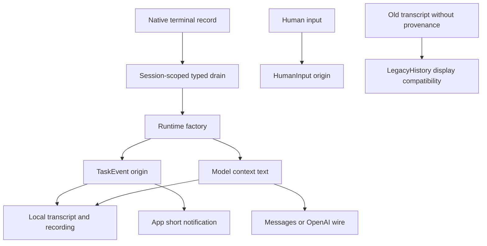

# RFC 0022 — Structured Task Events

## Summary

Carry native background completion as a typed, session-owned event. Retain the
existing XML text solely as a model-context compatibility projection; derive
user notifications directly from typed identity, terminal status and display
name. Persist provenance locally, preserve old transcripts through an explicit
untrusted legacy-history sentinel, and never classify new human XML as a runtime
event. Reuse the native store, UserMessage envelope and existing system-event UI.

## Motivation

### Evidence

The 2026-10-17 acceptance loaded 120 consecutive Assistant fixture messages and
sent real configured-endpoint follow-ups. Raw task XML remained in model history
while the UI displayed a compact completion; the UI could only recognize that
completion by reverse-parsing text. The prior final serial suites each registered
2821 tests (2796 passed, 23 skipped, 2 disabled). The current shared-source
snapshot includes unrelated accessibility work: its refreshed Debug baseline
build passes and registers 2880 tests. The initial snapshot build reused stale
BMIs because copied source retained old mtimes; advancing copied-file mtimes
fixed the build without project-source changes. Both results remain recorded.

Source inspection identifies exactly one automatic injection chain:
NativeAgentStore::take_pending_task_notifications -> QueryEngine::
append_pending_native_agent_notifications -> make_user_message -> conversation,
commit callback and session JSONL. The store currently consumes terminal records
without checking their persisted parent_session_id. The two App UserMessage
projection paths then infer event identity from a complete XML envelope. Neither
content text nor role=user proves an event came from the runtime.

| Metric | Baseline | Target | Instrument |
|---|---|---|---|
| Automatic event handoff | vector<string> XML | typed event plus model projection | native store/engine tests |
| Automatic routing | global drain | exact nonempty parent session match | interleaved-session tests |
| New human XML classified as event | possible | zero live and after restore | App/JSONL tests |
| New event UI identity from XML | all notifications | zero | conflicting metadata/content tests |
| Local provenance persistence surfaces | zero | transcript, conversation, fixture | native round trips |
| New Message alternatives/schedulers/tickers | zero | zero | source and graph audit |

### Comparable implementations

Sources accessed 2026-10-17. These support the separation principle, not a global
ranking or a claim that all products share an encoding:

- [Claude Agent SDK](https://code.claude.com/docs/en/agent-sdk/typescript#sdktasknotificationmessage):
  typed task notifications carry task identity, status and summary; automated
  task completion has distinct origin. [Background subagents](https://code.claude.com/docs/en/sub-agents#run-subagents-in-foreground-or-background)
  deliver completion in a later turn and expose running-first task state.
- [Codex app-server](https://learn.chatgpt.com/docs/app-server): typed thread
  items and item/started / item/completed lifecycle separate internal state from
  rendered text. Model-visible items remain an explicit interface.
- [OpenCode SDK](https://opencode.ai/docs/sdk#sessions): child sessions, abort,
  subscribed events and TUI notifications are separate APIs.

## Goals

- G1. Only a native runtime-produced TaskEvent creates a new trusted task
  notification. Human input cannot obtain this origin by resembling XML.
- G2. Model context retains completion results, output/worktree references and
  current XML bytes; UI shows only actor kind, terminal status and bounded name.
- G3. Route automatic events to their exact owning parent session, including
  restored sessions. Other sessions and child engines cannot consume them.
- G4. Preserve provenance through all local history/recording round trips;
  both model wire backends omit local provenance fields.
- G5. Read old histories without migration or modification. Legacy XML display
  compatibility never establishes trusted runtime identity.
- G6. Preserve cancellation finalization, resume, normal human messages, tool
  results, notification ordering and current event-driven rendering.

## Non-Goals

A new scheduler, event bus, outbox, exactly-once crash recovery, live-task progress
protocol, model/provider role changes, model prompt-policy changes, task UI
reorganization, a details browser, executing legacy notifications, changing
permissions, and repairs to unrelated accessibility/theme work. Do not unify
planning Tasks, legacy TaskStore and NativeAgent execution into one subsystem.

## Proposal

### Ownership and authorized shared changes

The native store owns completion and parent-session routing; QueryEngine owns
model-context insertion; core message values own origin; local persistence owns
origin encoding; App owns user notification projection. The user explicitly
requested this cross-module separation and compatibility migration. UI-only
parsing cannot establish origin, and runtime-only changes would lose origin on
restore. Extending UserMessage additively avoids changing the global Message or
ContentBlock alternatives and preserves existing visitors/token accounting.

Add a small pure value module loom.types.message_origin in loom_types, exported
through loom.types.types. UserMessage gains a trailing default-initialized
origin field. Its type is variant<HumanInput, LegacyHistory, TaskEvent>, default
HumanInput. Empty marker alternatives prevent contradictory enum/optional states.
TaskEvent carries only task_id, parent_session_id, TaskEventKind (Subagent or
TeamAgent), TaskEventStatus (Completed, Failed, Stopped), and display_name.
It does not duplicate model result/error bodies, output paths or worktree data.

A sibling loom.types.message_origin_json module owns the shared local codec,
with declarations in its interface and definitions in an implementation unit.
It imports only the pure origin module and existing JSON utilities. No upward
edge or target cycle is introduced: tools/query/session/App depend downward on
core types; JSON utilities already belong to loom_types' dependency closure.
The pure DTO module does not import JSON. New shared code is justified by the
single persisted provenance invariant required by several independent readers.

### Origin authority and projection invariants

TaskEvent metadata is the sole authority for UI identity, kind, status and name.
Content is an independent model-context projection, initially generated by the
same runtime factory from the same native record. Existing content replacement
or compaction may later change model text without changing UI origin. Do not
parse XML, require content equality or introduce a digest to validate new typed
UI events. Content need not remain a single TextBlock. Local structured-origin
validation does not authenticate edited local files; filesystem/session access
continues to be the existing trust boundary. Nothing in this metadata grants
execution, permissions or instruction priority.

Only the automatic runtime factory sets TaskEvent. Ordinary make_user_message
and external text APIs retain default HumanInput. Unknown/invalid provenance
fails closed to HumanInput while preserving content; it never falls through to
legacy parsing. Validated TaskEvent fields require nonempty task/session/name,
recognized kind/status and valid UTF-8 strings of at most 4096 bytes each.
The one shared validator rejects truncated/invalid continuations, overlong
encodings, UTF-16 surrogate code points and values above U+10FFFF. Task/session
identities additionally reject ASCII control characters and DEL; display names
may contain controls because the UI removes them using the existing policy.
Factory and codec use this same validator. Invalid or oversized native events
are not consumed or marked delivered; explicit task_output remains available.
Validation never rewrites the full model-context XML. UI clips on UTF-8 codepoint
boundaries using its existing single-line policy. Typed names are raw text:
entity-like text is not XML-decoded.

### Runtime and delivery

Replace the string drain with take_pending_task_events(parent_session_id),
returning typed event plus existing model-context text. Exactly one factory
maps Completed to Completed, Failed to Failed, and Cancelled to Stopped;
Queued/Running produce no event. Its kind is TeamAgent if and only if
record.team_name exists and is nonempty, otherwise Subagent. Backend/pane/task
metadata is not an alternative team predicate. display_name comes exclusively
from native_agent_display_name(record), never from summary/error/result parsing.
All mapping rules receive direct factory tests. Under the same store
lock, refresh persisted records and consume only background terminal records
whose nonempty parent_session_id equals the nonempty requested session. Empty,
ownerless, foreground and mismatched records stay unconsumed. Preserve current
lexical model-text ordering. QueryEngine supplies its actual session id and
appends a UserMessage with typed origin and the compatibility text.
The team_create automatic-start producer in runtime_registry_team_dispatch.cpp
must copy input.parent_session_id into its pre-created member record and into
its nested Agent ToolInput, alongside parent_model/api_context. Ordinary Agent
launches forward this field. Named teammate launches must prefer the explicit
nonempty plan owner when creating TeammateSpawnConfig; only a missing plan owner
may use the existing environment fallback. A native in-process teammate test
must use a parent distinct from LOOM_SESSION_ID and prove exact-owner delivery.
A real registry team_create test must verify the resulting native record owner
and typed TeamAgent delivery to that parent only, including after restart/resume
via the existing owner fallback in agent_sub_utils_hooks.cpp. Unowned pre-existing records
remain unowned; never infer their owner from team name or process environment.

Keep the existing notification_delivered lifecycle. Within a process, a
terminal record is consumed once until an explicit update/resume resets it.
Restoring the same parent session can receive its pending undelivered record;
already delivered records are not replayed. Resuming an agent retains its owner
and can produce a later completion for the same task id. Do not permanently
deduplicate by task id. Existing cancellation waits for cleanup before publishing
terminal state. Current delivery marks/persists before conversation append;
crash loss or restart duplication remains possible on failure. This is not an
outbox or an exactly-once guarantee. Ownerless old records require explicit
inspection through existing task tools; never deliver them to an arbitrary parent.

### Local persistence and compatibility

Fresh human/runtime writers write origin="human" or origin="task_event".
Only reserialization of an already-read LegacyHistory writes
origin="legacy_history"; existing append-only JSONL is never migrated in place.
Runtime-delivered UserMessage/local message records add task_event={version:1, task_id, parent_session_id,
kind:"subagent"|"team_agent", status:"completed"|"failed"|"stopped",
display_name}. Native agent records retain their existing source fields; the
factory derives the event at drain time without redundant persisted metadata.
All readers use the shared codec. Missing both fields means
LegacyHistory. Unknown origin/version, missing/extra-typed event requirements,
wrong scalar types, invalid enum, empty identity or oversized fields mean
HumanInput. Unknown extra fields are tolerated for additive evolution.
An explicit invalid origin must never receive missing-origin compatibility.

Persist LegacyHistory as that sentinel on re-save. It denotes ambiguous old
text, not a trusted event. New human records explicitly retain HumanInput on
restore, including exact byte-identical XML. Old user-written XML cannot be
distinguished from old runtime XML; the existing complete-envelope/single-text
parser may simplify its appearance only in LegacyHistory. This ambiguity is
inherent in old data and does not authorize execution or model changes.

Update every local surface together: query_engine_json.cpp session JSONL;
query_assembly.cpp App/SDK/server seed parsing; server_routes.cppm fresh human
message JSONL writing; session/history.cppm whole
conversation save/load; fixture_serializer.cpp commit recording; and
streaming_replay.hpp fixture parsing. Restore only reconstructs history and UI;
it does not enqueue, deliver or execute an event. Model wire implementations
serialize existing content only and must not include origin/task_event metadata.
Old readers ignore added local fields and retain the existing content envelope;
rollback therefore preserves readable context without rewriting files.

### UI, cache and protected contracts

Both App projection paths share one typed notification projection. Reuse
MessageDisplayEntry system/background_task and the existing faithful SystemText
renderer. Labels distinguish Subagent and Team Agent. Failed task notices do not
set model-error/retry flags. Only LegacyHistory reaches the existing strict XML
compatibility parser; HumanInput always remains user text. Cache equality must
compare the origin variant and all TaskEvent fields, even when content/id/time
are unchanged. Committed/cache/sync/restore paths must agree.

Keep task_output ToolResult XML contracts and the unused legacy notification
helper unchanged. They are tool/model text, not automatic trusted task events.
Constants/xml.cppm tag spelling and two wire backends remain unchanged. No new
UI variant, store field, palette, render ticker or public command is needed.
Truecolor notification components/goldens keep their style; only new typed
actor labels and explicitly human XML classification affect rendered text.

## Phases and graduation criteria

| Phase | Title | Scope | Status | Graduation criteria (measured) |
|---|---|---|---|---|
| A | Typed vertical slice | Origin value/codec, scoped runtime drain, engine insertion, all local persistence, App projection/cache, native regressions | done | Exact origin round trips on all local surfaces; two-session/empty-owner/resume coverage; no metadata in either wire; old/new XML distinction and cache invalidation; focused native suites pass; graph and inline constraints pass |
| B | Graduation | Full dual-preset builds/tests, real endpoint/PTy lifecycle/restore/narrow checks, docs and independent final review | done | Serial CTest registration delta reconciled from 2880 baseline; 0 failures in both presets; default Ninja -Werror, Release -O2; completed/failed/stopped visible in real PTY, restore and 60-column frames retained; model dump vs UI separation verified; exact-source/binary hashes and unrelated-file preservation; independent APPROVED |

Phase A is one atomic end-to-end change: shipping only metadata writers or only
readers would create origin loss, so no artificial partial migration or shim is
introduced. Parallel implementation ownership may be disjoint inside this phase.
Phase B changes no runtime contract and may be reverted independently.

## Production Readiness Review

### Correctness and tests

Required native coverage: codec valid/invalid/version/oversize, invalid UTF-8,
control names and CJK byte boundaries, factory status/team/name mapping; Human/Legacy/event
round trips through all three local persistence families; two interleaved engines,
empty owner, foreign owner, consumed-once, cancel cleanup, and resumed completion;
wire Messages/OpenAI request content and metadata exclusion; App typed label,
literal entities, controls, metadata-only cache changes, model-error flag absence,
committed/restore and long/narrow history. Existing notification regressions stay.
Goldens are assessed explicitly, not regenerated blindly. Existing TCP flakes
receive isolated reruns with first-pass results disclosed. Baseline is 2880 tests;
final additions and any removals are recorded by registration name.

### Build system and module discipline

Use default Ninja parallelism without concurrency caps; declarations and DTOs
only in new interfaces, codec bodies in implementation units. No new textual
third-party or standard includes. This adds a value field to widely imported
core types, so BMI fan-out is unavoidable; PIMPL/heap allocation for every message
would cost more than this bounded field. Record module BMI file sizes, build
wall time and fan-out before/after. Linux PSS via smaps_rollup and hosted macos-14
CI are unavailable on this local macOS host: do not substitute RSS or claim those
measurements. Local Debug/Release, architecture Tarjan/core/UI/store/target and
inline-body gates are mandatory. No dependency downloads are introduced.

### Rollback and compatibility

Additive local fields preserve existing role/content and are ignored by older
readers. Unknown future provenance loses trusted display semantics safely while
retaining text. Roll back the vertical slice as one change; leave existing files
untouched. Stable external tool_output and wire schemas remain covered by tests.
Commits/issues remain local per the user's explicit no-commit workflow; tracking
is this RFC and ignored validation directory until publication is requested.

### Observability and platform readiness

Keep messages.jsonl and prompt dumps: local provenance is visible only in local
records; model dumps retain their actual compatibility envelope. Use existing
native change notifications and UI event loop, no workers/tickers/log channels.
Keep termios/signals/platform guards unchanged. Real acceptance uses separate
config/runtime directories, never mutates actual credentials, and records binary
SHA, PTY bytes, dimensions, exit and cleanup. macOS truecolor is required; Linux,
Windows, ASan and hosted CI remain explicitly unverified on this host.

### Documentation and deletion

Update the current tag-format decisions, AGENTS debug/provenance guidance and
RFC index; extend the existing runtime-validation guide. Remove the old string
drain and obsolete new-event XML inference path; retain legacy-only parsing and
external tool response formatting. Comments and documentation remain English.

### Review sign-off

| Role | Reviewer | Date | Verdict |
|---|---|---|---|
| Design | agent:/root/independent_review | 2026-10-17 | approved |
| Production readiness | agent:/root/notification_research | 2026-10-17 | approved |
| Code / graduation | agent:/root/independent_review | 2026-10-17 | approved |
| Runtime evidence | agent:/root/notification_research | 2026-10-17 | approved |

## Rollout and rollback

Apply the complete Phase A vertical slice only after design and PRR approval.
Phase B graduates the same frozen inputs. Revert Phase A files together to roll
back; no session rewrite, runtime record migration, setting toggle or dependency
rollback is needed. Preserve origin fields on disk for future readers; old
readers still receive the compatible role/content they already understand.

## Drawbacks

One additional local provenance shape must remain consistent across transcript,
conversation and fixture serializers. The core value-field change recompiles a
large BMI closure. Old ambiguous text can only receive legacy display semantics.
Crash-safe delivery remains unsolved, deliberately separate from provenance.

## Alternatives considered

1. Do nothing / improve XML heuristics: cannot distinguish human input from
   runtime events or prevent another engine from consuming the event.
2. Add a new global Message or ContentBlock alternative: introduces broad visitor,
   wire, token-budget and transcript changes without improving this separation.
3. Use SystemMessage: engine/session/UI deliberately exclude it as prompt state;
   it does not preserve visible model context and completion history correctly.
4. Separate UI-only side-channel: loses replay/restore consistency and requires
   another ordering/delivery store. A generic bus/outbox is disproportionate.
5. Enum origin plus optional event: allows contradictory combinations. A small
   origin variant expresses the three legitimate states directly.
6. Parse/hash model text to validate typed UI: restores string coupling or breaks
   existing context replacement; separate projections have separate authorities.

## Testing and verification plan

Use native CTest targets, not disposable scripts, for behavioral acceptance.
Capture registration names before/after and full XML/logs. Run focused cases,
then default-parallel Debug and Release builds and serial full ctest. Run graph,
inline-definition and RFC lint. Real public FTXUI/PTY with configured endpoint
must demonstrate new typed local records, model XML without provenance fields,
compact completion/failure/stopped notices, parent-session ownership, resume,
60-column wrapping/status and normal exit. Clearly identify seeded fixtures;
real endpoint-generated records/replies are separate proof. No REA.

## Documentation impact

- AGENTS.md: local origin fields vs actual wire prompt dumps; old tag coupling.
- docs/decisions/design-decisions.md: origin authority and local schema ownership.
- docs/README.md: RFC index and stage.
- docs/dev/subagent-runtime-validation.md: exact commands, source/executable
  freeze, complete native totals, independent verdict and real PTY screenshots.

## Recorded implementation measurements

Phase A focused native tests: 244/244 passed after both P1 review fixes.
Baseline registration 2880 becomes 2901 with 21 additions and zero removals.
First complete serial Debug and Release suites each report 2876 passed,
23 conditional skips, two pre-existing disabled tests and zero failures;
wall times are 491.53 s and 413.08 s respectively. Default Ninja Release
build is -O2/-Werror, exit 0 in 313.57 s. No concurrency cap was used.

Core types BMI bytes: Debug 2499320 to 2713092; Release 2499336 to 2713108.
New origin/codec BMIs: Debug 26440/23664; Release 26460/23680 bytes.
Observed combined rebuilds compile 385 objects/184 module interfaces for the
reviewed Debug changes and 442/223 for Release. These mixed incremental build
counts are not a pure single-interface benchmark; Release also incorporates
the earlier shared-source snapshot. PSS and hosted cold/CI timings remain
unavailable, not inferred from BMI bytes. Architecture is 640 modules/803
units, with zero module cycles/new upward edges; core/UI/store/target and
inline gates pass in both checkouts. RFC lint passes all 22 records.

Final frozen Debug demonstrates actual UI /resume, real follow-up model
context and 60-column rendering. Final frozen Release independently launches
three new native Subagents (completed, intentional maxTurns=1 failure, stopped)
and one named TeamAgent (completed), all owned by the actual parent. Seven
persisted event records include the three original events without duplicates.
Actual wire requests retain all four new XML contexts and no local metadata.
Twelve raw PTY frames are prefix/hash checked; three successful runs exit 0.
120x40 running, 120x54 terminal notices and 60x34 narrow Release screenshots
are retained. Credentials remain unchanged and staged settings are removed.
The initial CLI conversation-store resume attempt failed and is excluded;
the successful resume uses the public UI session command.

Evidence and exact commands are in docs/dev/subagent-runtime-validation.md,
build/structured-task-events-validation-20261017 and
build/structured-task-events-live-20261017. Production/test source is frozen
separately from final documentation. Final independent graduation is approved
by agent:/root/independent_review; runtime evidence is independently approved
by agent:/root/notification_research.
No commit, push or REA is used.

## Open questions

| Question | Owner | Resolved by |
|---|---|---|
| Old user XML provenance | @Zzzode | Cannot be inferred; LegacyHistory display only |
| Ownerless old native record | @Zzzode | No automatic delivery; explicit task inspection |
| Crash-safe delivery | @Zzzode | Out of scope; existing best-effort semantics disclosed |
| Model text vs typed metadata disagreement | @Zzzode | Independent projections; metadata owns UI, text owns model context |

## Implementation History

| Date | Phase | Event | Commit / PR | Evidence (metrics, test totals) |
|---|---|---|---|---|
| 2026-10-17 | — | RFC opened provisional; source and UI investigation completed | uncommitted | Fresh shared-source snapshot Debug build exit 0; 2880 registrations; previous complete suites 2821 each |
| 2026-10-17 | — | Design review revision: canonical actor/status/name mapping, shared UTF-8 validity and size rules, explicit legacy re-save semantics | uncommitted | agent:/root/independent_review P1-1/P1-2/P2 addressed before implementation |
| 2026-10-17 | — | Design gate approved; RFC accepted. PRR source audit adds team_create parent-session forwarding and native producer regression | uncommitted | agent:/root/independent_review approved; agent:/root/notification_research identified the nested ToolInput propagation gap |
| 2026-10-17 | — | PRR approved; RFC implementable | uncommitted | Design agent:/root/independent_review; PRR agent:/root/notification_research; all material findings resolved |
| 2026-10-17 | A | Implementation started after both independent gates | uncommitted | Shared-source baseline 2880 tests; source baseline saved; no REA or commits |
| 2026-10-17 | A | Static implementation gate approved | uncommitted | agent:/root/independent_review approved; agent:/root/notification_research server repair approved; focused native 244/244; graph/inline/RFC lint pass; named teammate owner and server human-origin P1 findings fixed with native regressions |
| 2026-10-17 | B | Graduation started on frozen source | uncommitted | Default Ninja dual-preset builds, serial full CTest and real PTY evidence pending; no production behavior changes after this point |
| 2026-10-17 | B | Graduation approved; RFC implemented locally, uncommitted | uncommitted | agent:/root/independent_review independently verified source and owned-doc hashes, scope/preservation, complete dual-preset XML, graph/inline/RFC lint and final Release PTY; agent:/root/notification_research independently approved runtime evidence; 2876 passed/23 skipped/2 disabled/0 failed in each preset; no unresolved material findings |
