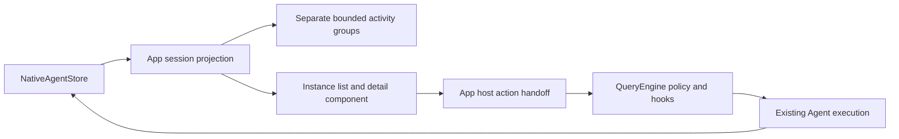

# RFC 0023 — Agent Instance Browser and Host Controls

## Summary

Make current-session delegated work discoverable through an instance browser
with an Active/History list, a bounded read-only detail view, and explicit
Continue/Stop controls. Fold ordinary terminal subagents into a compact history
heading rather than leaving failed rows permanently above the prompt. Preserve
Tasks, Subagents and Agent Teams as distinct categories. Reuse NativeAgentStore,
Agent Tool execution, the existing event handoff and DialogQueue. Do not add a
scheduler, persistent acknowledgement state, or a fresh-retry workflow.

## Motivation

### Evidence

The committed-source configured-endpoint acceptance on 2026-10-18 is retained in
`build/agent-failure-demo-20261018/README.md`, with raw PTY output, eleven browser
terminal screenshots, native records, actual request/response dumps and audits.
A sales CSV contained 40, 60 and 50. A worker executed Bash but exhausted its
one-turn definition before reporting. Its failed row was not clickable; the
`/agents` menu exposed definitions, and `/tasks` said `No tasks.` while the failed
worker remained visible. `/clear` preserved that row. An explicit same-ID Agent
resume with a larger isolated definition preserved seven sidechain entries,
appended two, ran zero new tools and completed with 150. A fresh retry succeeded
but left the original failure unchanged. No product code changed for that demo.

| Metric | Current | Target | Instrument |
|---|---|---|---|
| Discoverable runtime detail entry | None | Local command and clickable group heading, including while parent is busy | App/component tests and real PTY |
| Failed ordinary detail rows when idle | One per failure within budget, no expiry | Zero; bounded ended/failed history heading remains | Native cell renderer tests |
| UI-issued same-instance continuation | Requires model JSON using undeclared fields | Host-owned action through full existing tool policy path | Query/Agent native regressions and real endpoint |
| Same-ID duplicate continuation | Active counts do not reject duplicate starts | At most one admitted launch while prior execution is active or admission is reserved | Store/Agent race tests |
| Detail owner leakage | No detail implementation | Zero other-session or missing-owner records | App tests |
| Existing selected-tree registration | 2842 (2817 passed, 23 skipped, 2 disabled) | Baseline plus named additions, no removals | Complete Debug/Release JUnit reconciliation |

### Comparable designs

Official material rechecked on 2026-10-18:

- [Codex subagents](https://learn.chatgpt.com/docs/agent-configuration/subagents):
  inspect/switch agent threads; activity and completed results have separate
  entry points. UI control availability varies by client.
- [Claude Code subagents](https://code.claude.com/docs/en/sub-agents#run-subagents-in-foreground-or-background):
  successful workers leave the panel immediately; failed/stopped rows remain
  briefly and can be dismissed. This is not deletion of execution context.
- [Claude Code teams](https://code.claude.com/docs/en/agent-teams): persistent
  teammates have different idle/failed display rules and restoration limits.
- [Cursor release notes](https://prod.cursor.com/docs/release-notes): failed local
  subagents leave the live tray while their Task blocks remain openable.
- [OpenCode instance tab](https://github.com/anomalyco/opencode/blob/86c7f7c84048d776ba94b94bfab782b2b0a6d776/packages/tui/src/routes/session/composer/subagents-tab.tsx):
  bounded active/history navigation and entry into child work.

These support progressive disclosure, not a universal timing rule or a claim
that every product offers a retry button.

## Goals

- G1. Open current-session instance lists and details without invoking a model,
  including while the parent query is running; retain stable selection by ID.
- G2. Separate active work from ended history; show failed counts as facts,
  never infer that a user response is needed solely from Failed/unknown.
- G3. Continue eligible direct local ordinary subagents with the same ID and
  preserved context under current tool policy, model/API context and definition
  budget, without concurrent execution of that ID.
- G4. Stop only actual current-process, session-owned executions. Show pending
  cancellation until execution finalizes; do not invent stopped states.
- G5. Keep ordinary Subagents and Team Agents distinguishable in list, detail
  and activity display; idle teammates remain idle, not completed.
- G6. Preserve RFC 0022 model/user projection separation and repeated terminal
  events after a same-ID continuation.
- G7. Fit 40/60-column terminals with readable text, scrolling detail and keyboard
  navigation; reserve the existing editor/status/clipboard budget.

## Non-Goals

New scheduling or workers beyond one bounded App launch operation; persistent
attempt lineage, acknowledgement/read states, auto retry, budget escalation,
model selection controls, new permissions, process-level checkpoints, external
pane process control, nested-worker continuation, changing `/tasks` scheduler
semantics, new wire fields, migration of runtime records, prompt-policy changes,
and unrelated theme/accessibility work.

## Proposal

### Ownership and shared-change justification

The owner is the agent instance workflow: features/agents presents it, App owns
composition and session scope, QueryEngine owns permission/hook dispatch, and
NativeAgentStore owns atomic execution admission and cancellation ownership.
The user explicitly authorized this cross-module workflow. UI-only actions
would bypass policy and race live work; direct registry execution omits engine
permission and Pre/PostToolUse hooks. A new scheduler would duplicate ownership.

Necessary shared changes are additive declarations for host continuation and
owned cancellation, atomic per-ID admission, and a state-held dialog payload.
No existing public CLI command changes meaning. No persisted data or model wire
shape changes. Query/module interfaces gain declarations only; implementations
remain in bounded implementation units. Rollback removes the entry points and
restores the previous projection without rewriting stored sessions.

### UI and data flow

The feature component imports only downward UI modules and plain view data; it
must not import dialogs/screens/App. App registers its renderer in a dedicated
implementation unit to avoid increasing the existing aggregator closure.

### Entry points and navigation

Add `/subagents [history|team|<full-id>]` as an additive local UI command. `/agents`
continues to manage definitions and `/tasks` retains its TaskScheduler contract.
The browser exposes ordinary Subagents and Team Agents as visibly separate
categories, with Active/History selection within the current category. The
existing team overview remains available; team group/history entry can open the
Team category of the same browser. Tasks remain the existing plan checklist.

Handle local browser commands before the App's busy-query guard. This exemption
permits viewing only, not starting a model turn or running a continuation while
another engine operation is active. Runtime group headings expose a short
command hint and mouse hit target. Store actual reflected boxes per frame,
clear them before each render, and ignore stale/covered targets. No global
shortcut is repurposed.

Up/Down selects a stable ID, Enter opens detail, Tab switches Active/History,
Left/Right changes category, and Escape returns detail to list then closes the
modal. Refresh preserves selection if the ID survives a tab transition; removed
or filtered IDs produce a safe nearest selection or an explicit empty state.
Mouse and keyboard use the same component actions. Component state and focus
survive renders; never rebuild it each frame.

The instance modal yields to actionable Tool/Sandbox/WorkerSandbox permission
requests, including one already pending when `/subagents` is entered and one
arriving later. Before modal event dispatch/render, close only the instance
browser when such a request exists, retaining its selection for reopening.
Other modal priority is unchanged. Do not open the instance browser over a
pending permission request; surface a short explanation. This prevents the
parent worker from being blocked behind an unreachable permission overlay.

### Activity and history

Ordinary Queued/Running entries are the only expanded ordinary activity rows.
Completed/Failed/Cancelled all fold into the existing heading. Show ended and
failed counts and a discoverable history entry. While active work exists, keep
its count and bounded rows first, with failures still represented in the group
heading when space permits. Do not append a separate unconditional footer row.
At narrow widths prefer label/status/count/entry over full names; status text
and icons remain meaningful without color.

Team activity keeps its separate heading and member semantics. Idle does not
mean a terminal worker. Do not reinterpret unknown as failed or attention.
The browser reads native team records directly where available; pane-only
members remain in the existing team overview with no invented transcript or
host-control capability. This phase does not redesign team IPC or restoration.

The browser does not merge pane-only members into native instance rows:

| Source | Category / identity | Status | Detail and controls |
|---|---|---|---|
| Exact-session native record without team/backend/task/pane identity | Subagent / native agent_id | Native Queued/Running/Completed/Failed/Cancelled | Bounded native detail; Continue/Stop determined by host capability checks |
| Exact-session native record with any team/backend/task/pane identity | Team Agent / native agent_id, team label when known | Native status verbatim; no inferred Idle | Bounded native detail; no Continue; Stop only proven native ownership |
| Pane-only LiveTeammate | Existing Agent Teams overview / member identity | Running/Idle/Unknown unchanged | Existing overview only; no invented native detail or controls |

The same classification predicate is used for activity and browser snapshots.
Native records are unique by agent_id. A pane member that also has a native
record is not appended to the browser again; the existing overview remains a
separate surface. There is no cross-session merge by display name. Classification
and exact-owner tests include team metadata, pane duplicates and Idle/Unknown.

Terminal records are not deleted or marked successful when folded. `/clear`
keeps its established current-session behavior; the new history entry remains
usable. Notification delivery remains independent of visibility.

### List/detail snapshots and scope

App filters exact nonempty parent_session_id before exposing records. Ordinary
classification uses the same team identity exclusions as RFC 0021. Team records
are labeled Team Agent with team name. Legacy/missing-owner/other-session IDs
are inaccessible even when a command supplies the full ID.

The activity projection stays small. The browser asks App for plain snapshots
and fetches selected detail by ID. Read only NativeAgentStore; never follow an
output_file/transcript path from the UI to read arbitrary files. Detail includes
ID, name/type/category, status, description, current error, bounded output tail
and a bounded transcript excerpt. Strip terminal controls, preserve UTF-8 and
wrap by cells. Each text section is bounded (at most 16 KiB; transcript tail at
most 80 lines), scrollable, and explicitly marked when truncated. Do not promise
immutable per-attempt history or complete partial results: same-ID execution can
replace output/error, and the existing transcript is the retained evidence.

Observer changes refresh an open browser via the existing dirty/UI dispatcher.
Use the exact current session again on every action and detail lookup. A session
switch closes or clears the old browser; a queued action for a previous session
is rejected. No polling/render ticker is added.

### Continue execution

UI uses a typed App action with session ID, agent ID and continuation text;
it does not ask a model to generate JSON. The new narrow QueryEngine entry
builds its own Agent request and invokes the existing execute_single_tool
permission, PreToolUse/PostToolUse and registry path. It supplies current API
execution context, model and owner session exactly like normal tools. Internal
host serialization is permitted at this existing JSON tool seam; feature/UI
code must not own that protocol.

Only terminal, current-session, direct ordinary local subagents are eligible:
no nonempty parent_agent_id (original nested depth is not persisted), no team
or external-backend identity, a resolvable current definition, and retained
context. Unsupported cases show a specific disabled reason. Current definition
budget applies; the action neither raises maxTurns nor guarantees success.
The UI offers an editable continuation message, with a short default request
to continue previous work without unnecessarily repeating completed operations.
This is a new Agent turn with retained context, not an OS/process checkpoint.

App serializes this operation with normal parent queries: acquire the existing
busy guard, close the browser so permission prompts remain reachable, then run
the short launch on an owned/joined operation thread. Queries and session changes
cannot mutate engine state concurrently. Background execution stays owned by
NativeAgentStore and the original registry stop token. Shutdown cancels/joins
launch work before engine, permission callbacks or UI teardown. Success means
launch accepted, not task completed; normal store events update the terminal
state and subsequent RFC 0022 notification.

Validate the target/session/status before policy dispatch and again after any
hook-modified payload, before execution. Both `ToolPermissionHook::updated_input_json`
and user `PreToolUse` `RetryWithModifiedPayload` must be checked after rewriting
and before `ToolRegistry::execute`. Parse the final fields and revalidate the
immutable agent_id, current session, type, resume=true, background=true and
ordinary/local/no-team tuple; reject all target or mode redirection. Tests inject
these two rewriting sources independently and assert no foreign record,
SubagentStart hook or execution side effect. A hook cannot redirect a trusted host
resume to another ID, owner, type or fresh spawn. Permission and engine hooks
run before AgentTool and do not mutate the native record.

The native admission protocol is an ephemeral per-ID reservation under the same
Store mutex as active execution counts; it is not a persisted state:

1. `AgentTool::execute` resolves the plan, then calls a narrow Store reservation
   API before `start_background_agent`, `run_agent_and_finalize`, any record
   upsert, or SubagentStart hook. Every resumed request (host, model and mailbox)
   takes this path. Reject if the ID is missing, has an active execution count,
   or already has a reservation. Host continuation additionally requires exact
   nonempty session, direct ordinary local identity and a terminal record.
2. A scoped lease keeps the ID reserved through native startup hooks and launch.
   Any denial, exception, missing registry/deferred launch or normal return
   releases the reservation. Rejection does not clear output/error, append
   history, reset notification delivery, or run startup hooks.
3. Background launch registers its outer active execution while the lease is
   still held, before returning success. Foreground execution registers its
   active execution before running and releases it on completion. Release of
   the lease never decrements active counts. There is therefore no gap between
   reserved admission and active ownership.
4. Existing internal begin/end pairs remain reference counts, not new admissions:
   they may increment during this one admitted execution. Worker cleanup erases
   the active entry only when its count reaches zero. A new resume is refused
   even if a terminal status was already written but cleanup is still active.
5. Fresh generated IDs keep their existing path. Direct legacy Store begin/end
   callers do not acquire resume admission; all production resume entry points
   must converge through AgentTool. Tests cover both simultaneous reservation
   and a second call during startup hooks, execution and final cleanup.

The reservation guard uses scoped release on all exits and cannot be copied to
create another launch. Store tests exercise the admission transition under its
mutex; Agent integration tests prove that the losing request leaves the record
and hooks untouched. No fake queued/running state is persisted when policy
rejects. A disabled UI button is not the concurrency invariant.

### Stop execution

Stop is an explicit user cancellation, analogous to the parent interrupt action,
not a new model invocation. A narrow host API checks exact session, current
registry owner token and actual active execution in NativeAgentStore under its
existing mutex, then requests cancellation. External panes, stale persisted
running records and another registry's workers are rejected without mutation.
Owned nested workers may be stopped but cannot be continued by this phase.
Team-native workers are stoppable only if that ownership can be proven; otherwise
the button explains the unavailable capability.

Do not directly mark Cancelled or use a task_update workaround. A terminal status
can be published before worker cleanup ends; keep the action unavailable for
Continue until active ownership is released. Repeated stop requests are safe.
The UI displays cancellation requested until the existing execution finalizer
publishes the final state. Stop remains usable while the parent query is busy;
it does not touch QueryEngine conversation/usage/hook mutable state.

### Compatibility and coupling catalog

- New `/subagents` is additive; `/agents`, `/tasks`, `/teams` retain meaning.
- Dialog type/name/slot/payload/renderer mappings change together with native
  dialog tests; no unrelated dialog formatting changes.
- Browser view models remain UI-local and are not serialized.
- Agent JSON resume parameters stay at the existing seam; host target validation
  covers hook modification. Existing model transport schemas are unchanged.
- RFC 0022 origin codec, XML compatibility text and notification_delivered retain
  their exact meanings. Same-ID continuation resets terminal event delivery via
  the established lifecycle, not by treating a viewed item as delivered.
- No new setting, file format, endpoint or external dependency is introduced.

## Phases and graduation criteria

| Phase | Title | Scope | Status | Graduation criteria (measured) |
|---|---|---|---|---|
| A | Instance navigation and detail | Browser, local entry, scoped snapshot, bounded text, active/history | done | Native component/App regressions cover busy-parent entry, permission preemption (pending/new request, original y/n callback, Escape/reopen), owner isolation, stable ID, keyboard/mouse, 40/60/120 columns; no upward module edges; existing selected tests remain registered |
| B | Owned Continue/Stop | Engine policy seam, atomic resume admission, owned cancellation, App operation lifecycle | done | Native tests cover actual same-ID retained context, permission/hook denial, hook redirection, double launch, current-owner stop, foreign/stale stop refusal, cancellation/teardown and second terminal event; browser reads never change notification_delivered/root history; host continuation creates no root tool pair; next normal parent turn drains the second same-ID/owner/kind event once; wire origin remains excluded; no artificial success marking |
| C | Activity folding and graduation | Terminal summary/hit targets, docs, full dual builds and live acceptance | done | Failed detail rows zero while idle; history remains openable; existing row-budget/clipboard regressions pass at 40/60/120 columns; Debug/Release builds at default parallelism and first serial complete CTest results recorded; real configured-endpoint PTY failure→detail→Continue→completed and running→Stop→terminal plus 60-column screenshots |

## Production Readiness Review

### Correctness and tests

New native regression groups cover the measurable phase invariants. Reuse
`test_runtime_agents`, App runtime tests, QueryEngine wire fixtures, Agent wire
and runtime-observer tests. Add coverage through existing CMake targets. Existing
text/golden suites are run unchanged unless an owned activity summary expectation
needs updating; independently inspect every changed golden. No test deletions.
Do not use disposable demo helpers as the unit/integration gate.

### Build system and module discipline

Add only feature/App implementation units and additive declarations in owning
modules. Default Ninja parallelism is preserved; serial CTest provides the
signal. Record affected BMI file sizes and observed compile-object fan-out plus
local build wall time. Linux compiler PSS via smaps_rollup and hosted macos-14
cold/warm timing are unavailable on this macOS host; explicitly report these as
unverified, never substitute RSS or BMI bytes for PSS. Graph/store/target/inline
checks must pass and new interface inline definitions must be zero.

### Rollback and compatibility

Each phase is independently reversible at its declared boundary, with phase B
reverted before its runtime helper declarations. Stored messages, agent records,
settings and wire protocols require no migration. If phase C is reverted, terminal
failure rows return but records remain intact. No commits or publication are
performed in this task; local verification artifacts track each phase.

### Observability and lifecycle

Retain messages.jsonl, actual request dumps, current native records and normal
completion/stop/error events. No model tool-use/result pair is fabricated in
root model history for a UI action. The existing native sidechain records the
continued execution. Host action failure is an explicit UI error; launch accepted
is distinct from completion. Coalesced event updates and owned/joined launch
lifetime replace polling; shutdown and queued stale-session actions have tests.

### Documentation and deletion

Update the docs index, user runtime-instance guide and coupling register. The
repository guidance is updated only if this workflow creates a new convention.
There is no replacement scheduler or obsolete persisted shape to remove.
All comments and documentation are English. Remove the old Failed detail-rank
and misleading attention mapping only within the owned instance presentation.

### Platform readiness

Debug and Release run locally with -Werror and existing truecolor settings.
No platform-specific process control is introduced. Linux/Windows/ASan and hosted
CI remain unverified unless separately executed; no new package/network fetch is
required. Native interface tests use loopback fixtures; live PTY uses the existing
configured endpoint with credentials staged privately then deleted.

### PRR checklist answers

| Checklist | Concrete answer and required evidence |
|---|---|
| Correctness / native tests | Extend existing targets with named cases for InstanceBrowser stable selection, bounded control stripping, narrow rendering and actions; AppRuntimeAgents busy entry, permission preemption and owner isolation; AgentWire same-ID resume/admission; QueryEngine host permission/PreToolUse redirect denial; NativeAgentStore owned stop and cleanup. Final history records actual registered names, not a promised guessed count. |
| Test totals | Save `ctest --preset debug --show-only=json-v1` and Release equivalent before changes (2842 each); compare exact test-name sets after build. Expected final total = 2842 + actual named additions, no removed baseline names. Parse complete unfiltered serial JUnit for pass/fail/skip/disabled; report first-pass failures separately. |
| Known flakes | Run full `ctest --preset debug -j1` and release `-j1`. If ServerMain.DirectConnect* fail despite serial execution, rerun only those unchanged in isolation and disclose first-pass failure; no blanket all-green assertion. |
| Golden / truecolor | Run existing UI/dialog/prompt/truecolor suites; manually inspect any owned summary golden change and real PTY 40/60/120-column text and colors. No unrelated golden refresh. |
| Module graph | Run `python3 tools/arch/graph_check.py --target-core8 --target-ui9 --store-lint --tll-lint --json` before/after. Baseline output saved in validation evidence; require DAG, no upward feature→dialog/screens edge and passing target/store checks. |
| Interface / includes | Review changed .cppm declarations and use the repository inline-body checks. No new interface implementation bodies; existing bodies change only where the existing AgentTool execution seam requires it. New FTXUI headers follow existing GMF pattern only where framework definitions are required; no new third-party dependency or textual standard-library headers. |
| Build metrics | Configure/build both presets with default Ninja parallelism and -Werror; record build wall seconds, compiled object count and before/after affected BMI bytes, labeling each metric accurately. |
| PSS / hosted CI | N/A locally: this macOS host has no Linux /proc smaps_rollup, and no hosted macos-14 CI run is requested. Compiler PSS and hosted cold/warm timings remain explicitly unverified; RSS/BMI sizes are not substitutes. |
| Rollback / deprecation | Additive local workflow; remove UI entrypoints then host helpers to roll back. No persisted/wire shape replacement, migration, deprecation or compatibility shim. Keep changes uncommitted as requested; logical phase boundaries documented. |
| Observability | Existing native sidechain, messages and prompt dumps remain; no root tool-pair fabrication. Real endpoint audit verifies same-ID retained context, second normal-turn notification drain and actual cancellation cleanup. |
| Documentation / deletion | Add English runtime-instance guide, index and coupling-register entry. Delete only obsolete failed-detail ranking/attention inference. No new repository-wide convention, so AGENTS/CLAUDE changes unnecessary. |

### Review sign-off

| Role | Reviewer | Date | Verdict |
|---|---|---|---|
| Design | agent:/root/instance_rfc_design_review | 2026-10-18 | APPROVED; both P1 and both P2 findings resolved |
| Production readiness | agent:/root/instance_rfc_prr_review | 2026-10-18 | APPROVED; policy rewrite, admission, ownership, lifecycle and measurement checks covered |

## Rollout and rollback

After both review gates, A and B may be developed in parallel with disjoint file
ownership; integrate and graduate A, then B, then C against a frozen source snapshot in the
attached managed checkout. Preserve the unrelated main-checkout dirty files and
mixed-file hunks. Save source/binary hashes before native/full/live verification;
any material source change invalidates affected checks. Copy only owned changes
to the verification checkout. No commit/push is authorized by this task.

## Drawbacks

A browser and direct controls add focus/selection, session lifetime and policy
surface. Details are bounded excerpts, not a forensic log viewer. Direct
continuation cannot cover nested or external workers without new durable runtime
metadata and backend contracts. History counts remain visible in a compact
heading rather than disappearing completely. Parent-idle launch serialization
means Continue can be unavailable while a parent turn runs.

## Alternatives considered

1. **Do nothing / natural-language-only control.** Lowest code cost, but the
   real acceptance proved unavailable detail and command discovery, hidden
   resume fields and persistent failure rows.
2. **UI directly calls resume_agent or registry.execute.** The first can return
   an old result without execution; the second bypasses engine policy/hooks.
   Neither addresses atomic admission or current-session authority.
3. **A new unified task scheduler and persistent attempts/acknowledgements.**
   Larger migration, duplicated invariants and no need for the first instance
   browser. Tasks, members and scoped workers have distinct lifetimes.
4. **Only hide failures with a timer.** Removes occupancy but leaves users
   unable to inspect or continue. This proposal retains an explicit history
   entry and keeps failure facts intact.

## Testing and verification plan

Baseline is the previously verified committed code tree: 2842 registered tests.
Record actual baseline names before modification and reconcile final additions
exactly; skips/disabled are reported separately. Run focused native tests during
each phase, architecture/inline/RFC checks, then configure/build Debug and Release
with -Werror at default parallelism and run unfiltered serial CTest with JUnit.
Report any first-pass failures separately from retries.

Real acceptance uses the public `/subagents` entry and actual keyboard/mouse
controls, not a fixture-only UI seam. Run a CSV worker against the configured
endpoint, trigger a bounded-budget failure, open its detail/history, continue
that same ID after explicit isolated definition correction, and verify final
output/history retention. Start a cancellable owned worker and Stop it through
the UI; confirm actual process drain and terminal persistence. Capture active,
failed-history/detail, continued-completion and 60-column views. Use a real PTY
with live terminal pixels or disclose read-only ANSI replay; never synthesize
product rows. No REA. Preserve unrelated work and credential bytes/mtime.

## Documentation impact

- Docs index: add this RFC and the runtime-instance user guide.
- Decision register: instance snapshot scope, host-control policy seam, terminal
  folding distinct from event delivery and Team idle semantics.
- AGENTS.md/CLAUDE.md: only add workflow entry guidance if conventions change.
- Public CLI help: additive `/subagents` entry; current command contracts remain.

## Open questions

| Question | Owner | Resolved by |
|---|---|---|
| Persistent acknowledgement / fresh retry lineage | @Zzzode | Deferred beyond this RFC; no fields added |
| External pane and nested-worker continuation | @Zzzode | Unsupported with explicit capability reason; requires separate durable execution/backend design |
| Hosted timing and Linux PSS | @Zzzode | Report unavailable on this host; no inference from local BMI bytes |

## Implementation History

| Date | Phase | Event | Commit / PR | Evidence (metrics, test totals) |
|---|---|---|---|---|
| 2026-10-18 | — | Opened provisional after official-source research and real failure inspection | Uncommitted | Prior demo: seven retained entries, two appended, zero repeated tools, total 150; no product changes before review |
| 2026-10-18 | — | Independent PRR approved after two blocking clarifications | Uncommitted | agent:/root/instance_rfc_prr_review; RFC 23/23, graph and inline checks passed; implementation not started |
| 2026-10-18 | — | Independent design approved; accepted then implementable after PRR approval | Uncommitted | agent:/root/instance_rfc_design_review; no unresolved material findings |
| 2026-10-18 | A/B | Started with disjoint UI and execution ownership after both gates | Uncommitted | Implementation allowed in parallel; graduation remains A then B then C |
| 2026-10-18 | A/B | Independent implementation reviews approved after fixes | Uncommitted | agent:/root/instance_ui_review and agent:/root/instance_rfc_prr_review; input isolation, nonempty dialog ID, explicit detail routing/cache and real host-constraint AgentWire coverage resolved; 71 focused native tests passed |
| 2026-10-18 | A/C | Real PTY found transparent modal; local matte and composed-cell regression added and independently approved | Uncommitted | agent:/root/instance_ui_review; 40/60/120-column dbox coverage; pre-final full runs intentionally interrupted and will not count as graduation evidence |

| 2026-10-18 | A | Graduated session-scoped instance navigation and detail | Uncommitted | Independent UI/App approval; native 40/60/120-column selection, owner isolation, input/permission-preemption and opaque full-width composition regressions passed; actual keyboard and mouse entry plus History captured in live PTY |
| 2026-10-18 | B | Graduated owned Continue/Stop | Uncommitted | Independent runtime/PRR approval; actual same-ID Continue retained 4 entries and appended 4, completed with 150, root history 14 to 14; actual child shell/sleep drained after UI Stop while parent sleep returned success; next normal parent turn delivered each terminal event exactly once |
| 2026-10-18 | C | Graduated local dual-preset and real-terminal acceptance | Uncommitted | Final Debug/Release each 2874 registered: 2849 passed, 23 skipped, 2 disabled, 0 failures; first complete runs each had one obsolete ChromeBudget text expectation failure, fixed before fresh full reruns. Default Ninja final incremental builds 119.82/208.67 s, 45 compiled objects each; graph/store/TLL/inline gates passed. Release QueryEngine BMI 2587772 to 2613136 bytes, AgentRuntime 2704444 to 2914516; new instance-browser BMI 12974964. Linux PSS, hosted timings, ASan/Linux/Windows unverified. Captured/final Release SHA identical. Evidence: build/agent-instance-validation-20261018/README.md |
| 2026-10-18 | — | Final independent delivery review approved | Uncommitted | agent:/root/instance_rfc_prr_review: no unresolved source/control findings; all 48 owned paths scoped, other WIP preserved. Final source/binary manifests rechecked after both full suites; no commit or push |

## Interactive-session extension (RFC 0024)

This RFC remains the completed instance-management foundation. RFC 0024 extends
it with actual target-bound conversations for ordinary and native Team Agents.
RFC 0024 phase A has graduated; its Enter-to-session rule selectively replaces
this RFC's Enter-to-detail rule. `i` retains the existing Details inspector.
The previous phase/graduation rows remain historical facts and are not evidence
that interactive sessions were already implemented by RFC 0023.

RFC 0024 also extends scoped host input to native Team continuation and active
mailbox guidance, with atomic admission and unchanged policy/hook/owner checks.
It retains failure folding, exact session filtering, metadata Details, owned Stop
and notification separation. Ended nested workers and external panes retain
explicit capability limits. Interactive completion and its independent
design/PRR, implementation and validation evidence belong to RFC 0024; this
addendum does not substitute the earlier evidence for those new gates.

| Date | Phase | Event | Commit / PR | Evidence (metrics, test totals) |
|---|---|---|---|---|
| 2026-10-18 | — | Documented selective interactive-session extension under RFC 0024 | Uncommitted | Original A/B/C completion and evidence preserved; RFC 0024 initially provisional |

| 2026-10-18 | — | RFC 0024 interactive extension graduated locally without rewriting earlier A/B/C history | Uncommitted | Independent source/UI/runtime/graduation APPROVED; ordinary and native Team conversations, running queue and same-ID text continuation verified; failure/history/Details and exact owner filtering retained; complete Debug/Release each 2923 registered, zero failed |

### Authorized commit assembly (2026-10-18)

The user subsequently authorized logical commits and push for RFCs 0021-0024
and interactive Subagent/Team Agent sessions. This authorization replaces the
earlier task-specific no-commit restriction; historical review/graduation rows
above remain unchanged. The implementation commits are `4ca7c024` (RFC 0023
instance browser and controls), `5c822b42` (stable Skills subscription lifetime)
and `daebff79` (RFC 0024 interactive sessions). Design records are in `803dc893`.

Commit assembly reuses the independently approved frozen implementation evidence:
complete Debug and Release suites each registered 2923 tests, with 2898 passed,
23 skipped, 2 disabled and zero failed. These suites were not rerun for commit
assembly. Previously recorded failures and platform/runtime limitations remain
applicable. The final source matches the tested selected checkout; unrelated
working changes are excluded and preserved. Normal Git hooks remain enabled.
