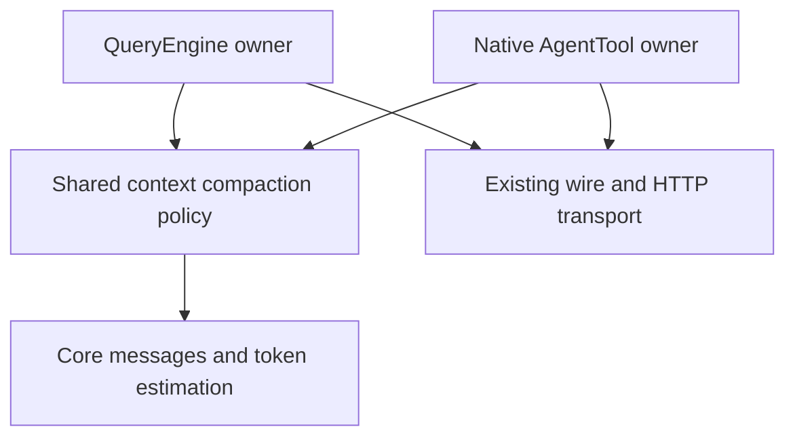

# RFC 0025 — Unified Context Compaction for Main and Native Agents

## Summary

Replace byte-prefix conversation trimming with a shared, provider-neutral
semantic checkpoint policy used by QueryEngine and native AgentTool workers.
Account for the complete request, reserve response space, summarize older
history through the owner's existing authenticated and cancellable transport,
retain complete recent interactions, and commit only a valid, smaller context
that fits the usable budget. Classify HTTP and in-band context failures and
allow one recovery per business request. Persist successful checkpoints so
resume cannot resurrect compacted history. Keep full audit history, tool
execution semantics, permissions and existing wire protocols intact.

## Motivation

### Evidence

The 2026-10-19 native audit ran public QueryEngine and AgentTool interfaces over
real loopback HTTP at baseline `7e4ec393e6f4b9c6375818488249beab2faba266`.
Evidence and reproducible native test patches are in
`build/context-compaction-validation-20261019/` (machine-local, gitignored).

| Metric | Current | Target | How measured |
|---|---|---|---|
| Main adversarial cases | 5 pass / 7 fail per Debug and Release | All equivalent positive and explicit-unrecoverable contracts pass | Native GoogleTest, captured requests and events |
| Large recent tail | Estimated 4,217 tokens after compaction for a 1,000-token window | Candidate fits usable input budget or preserves history and returns a precise error | Shared-policy and public HTTP tests |
| Short-history retry | Identical 40,239-byte requests after HTTP 413 | Actually smaller retry or no retry | Captured request bytes |
| Overflow recognition | Selected strings; in-band overflow fails | Structured codes, case-insensitive messages and stream errors; bounded recovery | Both protocols and both loops |
| Native overflow recovery | Six protocol/error cases fail after one request | Summarize, retry and finish without extra business turns | Public AgentTool and store assertions |
| Semantic summary | Each old message first 300 bytes; about 8,000 bytes total | Model checkpoint retaining constraints and task state | Late-constraint, repeated-compaction and live-model checks |
| Input accounting | TextBlock byte count / 4 | System, schemas and every model-visible block; observed usage calibration | Table-driven block and schema tests |

The original tool-result audit needs a qualification: ordinary tool execution
returns TextBlock and is counted. The synthetic ToolResultBlock representation,
tool inputs and media are omitted by the old estimator. The new tests exercise
actual owner representations and captured wire requests, not that synthetic
shape alone. HTTP payload bytes and context tokens are separate limits.

Comparable public implementations were inspected at fixed revisions: Codex
`8c076942cb70fba8e5c4732c23f1faabc4aed484`, Gemini CLI
`ed96faedfd5571f055c44f2c9509d62321d1138d`, and OpenCode
`501b15af26915ba52682e20e220e7e137e89e92f`. Their useful patterns are model
checkpoints, calibrated request estimates, safe tail boundaries and committing
only successful results. Claude Code documents independent child compaction,
context reconstruction and stopping repeated no-progress compression. These
are design references, not independently certified competitor runtime results.

## Goals

- G1. Both loops use one budget calculation, safe-boundary selector, semantic
  checkpoint builder, candidate validator and overflow classifier.
- G2. Before every business request, account for complete model-visible input
  and reserve output plus safety space. Estimate conservatively and calibrate
  against the last observed request usage; never call estimates exact tokens.
- G3. Preserve the latest human request verbatim and complete tool call/result
  groups. Completed interactions within that same task may be summarized.
  Summarize old constraints, decisions, progress, failed approaches,
  files/references and next steps without prefix-only omission.
- G4. A successful checkpoint is nonempty, structurally valid, strictly reduces
  input and fits the usable budget. Failures, cancellation and conflicts leave
  the previous working history and checkpoint unchanged.
- G5. Recognized HTTP/in-band context overflow recovers at most once per
  business request. Summary calls cannot execute tools or consume maxTurns.
- G6. Native resume starts from the latest valid committed checkpoint and
  replays subsequent entries without duplicating preambles or old history.
- G7. Verify both protocols, both loops, prior failures, constraint retention,
  cancellation, bounded retries and full Debug/Release suites, uncommitted.

## Non-Goals

Provider-native opaque compression endpoints, a Responses API migration,
background speculative compression, new user-facing settings, a new scheduler,
changing monetary/output/turn budget meanings, external pane backends,
rewriting old transcripts, lossless visual understanding, or guaranteeing a
model never forgets a fact. No commit, push or external publication is part of
this local implementation request.

## Proposal

### Ownership and dependency direction

Add `loom.services.compact.context_compaction` in `loom_services`, with a small
declaration-only `.cppm` and out-of-line `.cpp`. Its only project dependencies
are core message types, JSON, existing token estimation and error utilities.
It must not import wire, orchestration, tools, QueryEngine or UI.

Shared changes are explicitly authorized by the user's request to unify the
two loops. Local alternatives cannot enforce a single budget/boundary/error
invariant: copying the policy would recreate drift, and importing QueryEngine
into orchestration would reverse the established dependency direction. Keep
authentication, cancellation, hooks, notifications, persistence and native
message ownership in their existing modules. No new library target is needed.

### Shared policy contract

The internal interface provides policy and observation values; complete input
estimation; context-versus-payload error classification; a semantic compaction
operation taking an owner-supplied summary callback; and a result containing
the original retained anchor/tail indices, summary text and before/after estimates.
Returning indices lets native workers copy their original API messages,
including redacted thinking and signatures, without a lossy round trip through
core messages. Policy defaults preserve the existing 200k window and 90%
trigger. Existing model output settings supply the response reserve.

The usable input ceiling is the smaller of the configured threshold and the
window less response reserve and safety margin. The safety margin is bounded
and proportional (2% of window, at least 64 tokens). Invalid policies, static
instructions/schemas that exhaust the ceiling, or a latest human request that
cannot fit return an actionable non-retryable compaction error. Small synthetic
window tests must configure a correspondingly small valid output reserve.

Observed usage anchors record the last business request's estimated input and
observed input tokens. Estimate subsequent growth locally and take the maximum
of the full local estimate and calibrated estimate. Messages cache read/write
tokens count toward its input; OpenAI prompt-token accounting must not add
cached tokens twice. Reset anchors on history replacement and restore.

The exact calibration is `max(L, U + max(0, L - A))`, where L is the current
complete local estimate, A is the estimate captured with the last successful
business request, and U is that request's observed input. No observation means
L alone. Normalize Messages U as input + cache_creation + cache_read; OpenAI U
is prompt_tokens, whose cached subset is not added again. The anchor belongs
to the exact model, wire, system and tool-declaration snapshot. Reset it on
any such change, history restore/replacement or clear; summary usage is charged
but never becomes the business-history calibration anchor.

The callback contract is typed and synchronous: SummaryRequest contains
instructions, transcript text and maximum output tokens; SummaryResponse
contains text, completion validity, tool-use presence and actual TokenUsage.
It returns the existing Result error with ContextWindowExceeded only for a
classified token/payload size rejection, and preserves other errors. The shared
operation also receives a cancellation predicate checked before each call and
chunk. Owners keep socket shutdown or parser-transfer cancellation active while
waiting. Account actual summary usage/cost immediately, including rejected
candidates, without business-turn hooks, output continuations or maxTurns.

For both wire APIs, a summary request inherits exactly endpoint, model,
credentials, API version, enterprise routing/signing and timeout. Strip tools,
native computer tools, tool_choice, thinking/budget, context edits, task budget,
response schema, output continuations and business event/hook callbacks. Set
only checkpoint instructions, transcript and bounded max_tokens (streaming is
an owner transport choice). Callback success requires an ordinary final
stop/end_turn, no tool call, no truncation, no stream error and a fully completed
response. Tests inspect both actual wire bodies, auth, cancellation and usage.

### Complete input and safe boundaries

Count system instructions, serialized tool declarations, message overhead,
text, thinking, tool names/arguments, all tool-result representations and
media. Reuse the UTF-8-aware TokenEstimator for text; use conservative media
estimates and observed server usage rather than an unsupported exact claim.
Keep monetary spend and accumulated output budgets separate from input size.

The owner explicitly identifies the newest human/task request index. Main uses
typed HumanInput/LegacyHistory origin, excluding TaskEvent and tool-result-only
messages. Native workers track the initial request and accepted queued/explicit
resume inputs; skill/hook preambles and runtime messages are not human anchors.
Never infer human identity from XML, role alone, or summary text. RFC 0022
origins and external wire serialization remain unchanged.

Build tail candidates at boundaries where all tool uses and results are closed,
including parallel calls. Keep the newest human request as a separate required
anchor, then retain a token-bounded recent suffix in original order, without
duplicating the anchor when it is already in that suffix. Completed assistant/
tool exchanges between that anchor and the recent suffix may be summarized:
a single task with many tool rounds must remain compactable. Include only
complete call/result groups on each side. There is no fixed six-message
requirement. Refuse unsafe dangling-tool input.
Do not mutate retained roles, order, tool IDs, per-call errors or signatures.

### Semantic checkpoint and bounded generation

The checkpoint has six required sections: Goal, Constraints, Decisions,
Progress, Next Steps, and References. Instructions explicitly require preserving
user prohibitions and preferences, unresolved work, exact paths/identifiers,
important failures, and outstanding work without claiming it finished. Treat
the transcript as data; no business tools are available to summary generation.
The owner's callback must reject truncated/incomplete responses and tool calls.

Older transcript text is processed in bounded UTF-8-safe chunks, carrying the
previous checkpoint into subsequent chunks. This includes text beyond the old
300-byte prefix and avoids silently dropping an oversized old message. Media
is represented by typed provenance markers; original audit history remains.
Cap chunk passes and reductions; if the summary request itself exceeds context,
reduce chunk input and retry with a strict bound. Abort checks cover every
request and chunk. The summary output budget is bounded by the target context.

Internal bounds are 16 summary requests per compaction operation and 3 input
reductions per rejected chunk. Initial summary output reserve is
`min(4096, max(64, usable_input_ceiling / 4))`; initial transcript chunk budget
is the model window less that reserve, checkpoint instructions, previous summary
and safety margin. Halve chunk budget on a classified size rejection, with a
64-token minimum. Every failed attempt counts toward 16; no-progress or a
non-size error ends immediately. If 16 calls cannot cover the transcript, fail
without replacing history. Split a large old text message on UTF-8 scalar
boundaries and never silently discard its remainder. Select retained content
against the usable ceiling and expected summary reserve, then measure final
composition again. Malformed/expanding/oversized final output is a failed
candidate, not an unbounded additional summarization loop.

Compose summary plus the retained original tail and complete static overhead;
accept only a valid checkpoint that is strictly smaller and under the usable
ceiling. An empty, truncated, malformed, expanding or still-oversized checkpoint
must not replace history. A smaller tail/re-summary may be tried within the
same bounded policy operation and request-count limit; otherwise return an explicit error. No false
success for a short history and no no-progress retry loop.

### Main QueryEngine integration

Move automatic budget enforcement from append-time network activity to each
business-request boundary, after existing tool-output spill/microcompaction.
Manual `/compact` uses the same semantic operation. Reactive recovery calls
the same policy. Snapshot history under its mutex, generate outside the lock,
then verify the working history has not changed before atomic replacement.
Build the replacement and successful boundary before publishing it; failures
must not alter task-budget remaining, summaries or transcript projections.

Reuse the existing wire backend and cancellation path for a no-tools,
no-thinking summary request, preserving endpoint/model/authentication. Internal
summary responses are not normal assistant turns and do not trigger tools,
completion hooks or memory extraction. Account their actual usage separately
in the existing usage/cost counters. Recompute context state after commit.

Keep existing compact boundary and summary marker representations. Commit
callback/session records must permit a successful checkpoint to restore as the
same working history. Legacy full transcripts remain readable. Session summary
file writes remain best-effort and occur only after successful memory commit;
do not repeatedly append accumulated summaries into every fresh system prompt.

### Native Agent integration and persistence

Carry window/output/threshold/auto policy in the existing internal immutable
ApiExecutionContext snapshot; fill both QueryEngine factories. It is never
serialized, so credentials and per-session settings cannot leak into records.
Use the existing api-to-core conversion for estimates/planning only; retain
original API tail messages for sending and resume. Workers use the same shared
policy before requests and during a single bounded recovery attempt.

Add an append-only versioned native sidechain compaction record containing the
successful working message snapshot, reason and before/after counts. Use a
distinct type and a non-message snapshot field so old generic parsers do not
render it as user text. Old readers retain full history; new readers validate
the record and resume from the latest valid boundary plus later entries.
Keep complete earlier audit messages. Do not duplicate skill/hook preambles.
Publish a new worker working history only after the complete checkpoint record
has been persisted successfully through the owning Store. The existing
best-effort append cannot certify this; add a narrowly scoped checked append
that persists a copied record under the existing Store owner lock and replaces
the live record only on success. Do not change other mutation semantics. A
failed write preserves the old working history; truncated or malformed records
are ignored in favor of the last valid committed boundary. The main session's
authoritative checkpoint has the same checked-before-publish requirement when
session storage is enabled; its separate summary.md remains best-effort.
Do not implement this by calling persist_native_agent_record on a copy: that
legacy function truncates auxiliary and authoritative files before all writes
are checked. The checked checkpoint path must reuse record encoding but replace
the authoritative agent record atomically, leaving the previous record readable
on any failure. Auxiliary sidechain views cannot become an earlier authority.

Main checkpoints use a separate append-only `context-checkpoints.jsonl` in the
existing session directory. Each versioned record stores the session identity,
last original audit-message ID, and committed core-message snapshot. Atomically
replace the checkpoint log to append a complete record; do not rewrite original
messages.jsonl. Newly appended local audit messages include their stable `id`
so checkpoints can bind to the actual disk audit; legacy records without IDs
retain existing decoding. This additive local field never reaches either wire
protocol. Commit verifies the audit anchor exists on disk. Restore chooses the
newest structurally valid record whose audit anchor is
present, then replays later original messages. Ignore malformed/truncated records.
Expose the existing ConversationStore message encode/decode functions rather
than duplicating their origin/content/metadata codec. Existing UI resume must
set the destination session ID before restore; SDK/assembly must use that same
identity rule. No changed legacy message decoding is required.
Document this additive local format and test malformed/legacy records.

The existing Messages streaming client must retain a bounded HTTP error body
and provider error signals, and preserve input/cache usage events. OpenAI keeps
its existing transport and error adaptation. Cancellation, one terminal status,
notification ownership, permissions and Agent maxTurns remain unchanged.

### Error classification and retry boundaries

Classify known structured context codes and case-insensitive provider text from
HTTP and SSE errors. Treat an unexplained 413/request-too-large as a payload
byte failure, not proof of a token overflow. A reducible textual history may
still be compacted once, but retry requires actual request reduction; static
or latest-request payload failures produce explicit errors. Authentication,
quota, monetary budget and cancellation errors must not trigger compaction.

Each business request gets at most one post-overflow compaction/retry. Summary
requests never recursively invoke this business recovery. They have their own
bounded chunk reduction. A second overflow ends visibly without duplicate tools
or terminal notifications. Auto=false suppresses proactive compaction; explicit
manual and classified reactive compaction retain existing main-agent semantics.

A business request is one owner sampling step: current working history after
queued notifications and completed tool results, before obtaining the next
assistant response. Its local retry marker resets only after a valid complete
response advances the loop. Recovery may resend only while that response has
not been committed and no tools from it have executed. Streamed draft text may
be discarded with the existing error/reset lifecycle; partial responses never
trigger tools. Never retry a committed assistant or finalized child. Summary
calls/retries do not increment native maxTurns; actual usage is still charged.
Tests cover a second HTTP/SSE overflow, partial text followed by overflow, zero
duplicate tools and exactly one native terminal status/notification.

## Phases and graduation criteria

| Phase | Title | Scope | Status | Graduation criteria (measured) |
|---|---|---|---|---|
| A | Shared policy | Services module, policy tests, internal config snapshot | done | All block estimates, schemas/reserve, UTF-8 chunks, closed parallel calls, semantic constraints, invalid/no-progress/cancel cases passed; 13 shared-policy cases per preset; module/target graph checks passed |
| B | Both execution owners | QueryEngine, AgentTool, transport error/usage fidelity, checkpoints | done | Both protocols passed proactive/HTTP/SSE recovery, preserved failures/anchors/signatures and checkpoint resume; 17 new WireTransport, 16 AgentWire and 1 ApiStreaming cases per preset; independent source reviews approved |
| C | Graduation | Native/live checks, documentation and independent review | done | Both -Werror builds and full serial CTest passed, each 3,053 registrations / 0 failures; live main and child passed; lint/architecture/inline checks passed; agent:/root/compaction_design_audit independently approved final evidence; no commit/push |

## Production Readiness Review

### Correctness and tests

Native services/query/agent tests cover G1-G7, not disposable verification
scripts. Reapply the prior failing scenarios with valid small-window output
budgets and real message representations; add late constraints, multiple
checkpoints, signatures, malformed snapshots, cancellation and second-overflow
cases. Fresh baseline Debug/Release each register 3,004 tests after complete builds;
reconcile exact additions/removals at graduation. No rendering changes are
planned, so goldens remain unchanged and run in the complete suites. Record
first-pass failures separately from unchanged reruns; respect known socket and
PTY flakes. Never weaken assertions or regenerate unrelated goldens.

### Build and module discipline

Use existing target order and declaration-only interfaces. No services-to-wire
edge, no new header/library dependency, no concurrency caps or render ticker.
Run graph_check core8/TLL and inline_def_check. This host is macOS, where Linux
`/proc/.../smaps_rollup` PSS and hosted macos-14 CI are unavailable; record that
limitation explicitly, never substitute RSS or claim remote CI. Record actual
local build wall times and affected recompiles, with source/binary hashes.

### Compatibility, rollback and platform readiness

Existing external tool arguments, wire fields, settings and XML notifications
are unchanged. Internal ApiExecutionContext adds defaulted fields. Local native
checkpoint records are additive and legacy full histories remain readable.
Main local audit records add a stable message ID; no existing field changes.
Rollback restores the pre-change readers/writers together; older readers can
still replay original audit records, but lose the checkpoint optimization.
No security permission changes and no credential persistence. Existing transport
owns TLS/provider signing, teardown and abort. Local Debug/Release are mandatory;
Linux and hosted CI are disclosed if not available. No dependency fetch changes.

### Observability and deletion

Use existing debug/session/dump-prompt paths. Record successful trigger,
estimated before/after and failure reason; label estimates. Internal summary
traffic must be identifiable and not rendered as task completion. Delete the
obsolete prefix-summary builder after callers migrate. Preserve existing output
spill and optional API context editing. Update the decision register and a
developer validation note; AGENTS changes only if repository conventions change.

### Review sign-off

| Role | Reviewer | Date | Verdict |
|---|---|---|---|
| Design | agent:/root/compaction_design_audit | 2026-10-19 | Approved after findings resolved |
| Production readiness | agent:/root/research_gemini_opencode | 2026-10-19 | Approved after four P1 findings resolved |
| Implementation and graduation evidence | agent:/root/compaction_design_audit | 2026-10-19 | Approved after complete dual-preset native and main/child live verification |

## Rollout and rollback

Apply A then integrate both owners in B, leaving the work uncommitted. Existing
wire/projection shapes stay readable throughout. Keep policy and owner changes
coherent; rollback the integration and additive checkpoint readers/writers
together, then remove the unused shared module. Never delete historical user
records, previous validation artifacts or unrelated work. Do not publish an
issue, commit or push under this task's explicit local-only instruction; the
RFC's Implementation History is its local tracking record.

## Drawbacks

Compaction now uses paid model requests and has latency. Model summaries remain
lossy, and chunked folding may compound omissions. Conservative estimates can
compact earlier than needed. Supporting two native message representations and
checkpoint replay adds bounded complexity; returning original indices and
keeping transport/persistence owner-local limit that cost. Static prompts or
an enormous latest request can be impossible to compact safely.

## Alternatives considered

1. Do nothing or only broaden overflow strings: leaves semantic loss, invalid
   budgets and missing native compaction unresolved.
2. Copy a summarizer into AgentTool: duplicates budget, boundary and retry
   invariants and repeats today's drift.
3. Make AgentTool use QueryEngine: reverses dependencies and replaces unrelated
   lifecycle/permission/notification ownership.
4. Use only provider-native compaction: not portable across Loom's current
   Messages/OpenAI endpoints and requires a larger protocol capability change.
5. Keep prefix trimming as a failure fallback: returns apparent success after
   silently discarding late constraints. Preserve history and report instead.

## Testing and verification plan

Freeze baseline revision and exact CTest registrations, then record every new
test by name. Shared tests exercise all content blocks and static schemas,
budget math, valid cut points, UTF-8, long old messages and bounded summary
failures. Main/child HTTP tests inspect actual request bodies and streaming
events for proactive and reactive compression, late constraints, no-op rejection,
usage accounting, cancellation and full checkpoint replay. Test both wire APIs.

Build Debug and Release at established default parallelism, run focused native
suites followed by full serial CTest. Parse complete logs/XML, not progress
tails. Run RFC lint, graph checks and inline checks. Use real configured model
requests through the public executable/native interface in an isolated config
and runtime directory; preserve task constraints across at least one checkpoint
for main and native child, then continue to a verified final answer. Keep
credentials out of prompts, fixture bodies and evidence manifests. A missing
provider/environment is a disclosed incomplete gate, never a substituted mock.

Required native case families (exact registrations recorded at graduation):
ContextCompaction.AccountsForEveryBlockAndSchema, ReservesOutputAndCalibratesUsage,
RetainsRequestAndClosedToolTail, PreservesLateConstraintAcrossChunks,
RejectsEmptyTruncatedExpandingAndOversizedSummary, BoundsSummaryOverflowRetries,
and HonoursCancellation; WireTransport and AgentWire exercise both protocols,
SingleTaskToolRoundsCompactAndContinue, ContextOverflowRecoversOnce,
InBandOverflowRecoversOnce, SummaryRequestStripsBusinessOptions, and
CheckpointResumeAndWriteFailure.

Use opt-in native live tests against an isolated copy of the configured
endpoint/model. Seed a constraint after byte 300 and completed tool progress,
force a valid small-window checkpoint, and assert the next actual request
carries the constraint, a known intermediate result and the original current
request. The model then finishes with the expected result while preserving the
prohibition against commit/publication. Run main and child; retain sanitized
traces, checkpoint records and native XML. The manifest records revision,
source/binary hashes, model, stage estimates/call counts, exact assertions,
native totals and platform limitations, never credentials.

After unmodified full builds, capture baseline registrations with
`ctest --preset <preset> --show-only=json-v1`; capture final lists identically
and reconcile named additions/deletions. Full suites run with
`ctest --preset <preset> -j1 --output-log <evidence-path>`; parse complete
logs/XML and retain first-pass failures separately from unchanged reruns.

### Local graduation evidence

The evidence directory is `build/context-compaction-validation-20261019/`
(gitignored). `graduation-all-inputs.json` freezes 2,596 build inputs against
baseline `7e4ec393e6f4b9c6375818488249beab2faba266`, with no unplanned input
drift. `graduation-source-inputs.json` records the 42 changed source/build/test
paths; `graduation-binaries.json` records 212 executable hashes. Documentation
edits after that freeze do not change the executed binaries.

The fresh preset-derived directories are `build/compaction-debug` and
`build/compaction-release`. Their configuration uses the established presets
and existing local dependency sources; neither the toolchain nor dependency
versions changed. The original Debug build cache encountered Ninja 1.13.2
`Builder::FinishCommand` crashes, so these fresh directories are the validation
artifacts. Default build parallelism was retained. The installed executable and
original default build directories were not replaced.

Each preset registers 3,053 tests, up from 3,004: 49 named additions and zero
removals. Exact names are in `graduation-{debug,release}-registration-delta.json`.
The ordinary suite skips the two paid-provider tests; their explicit execution
is recorded separately rather than counted as ordinary-suite passes.

| Check | Debug | Release |
|---|---|---|
| Final full build, `-Werror` | Passed, 60.03 s | Passed, 201.56 s |
| Final full serial CTest | 3,026 passed; 25 skipped; 2 disabled; 0 failed, 567.60 s | 3,026 passed; 25 skipped; 2 disabled; 0 failed, 486.59 s |
| HTTP status regression after fix | Passed | Passed |

`graduation-live-{main,child}.{log,xml}` records actual configured-model
Messages requests using `model_api/experimental_0812_256k`. Both passed with
the current Debug binary: main 22.74 s, child 27.10 s. Each verified an exact
random constraint placed beyond byte 300, completed arithmetic result `47`,
and the prohibition on commit, push and publication through a real checkpoint
and final continuation. Main retained the current request verbatim. The
child checkpoint records estimated input reduction from 4,250 to 2,417 tokens.
Live artifacts do not expose main per-stage local token estimates or all
transport summary-call counts; bounded calls and budget fit are asserted in
the deterministic native transport tests. `graduation-manifest.json` indexes
the available evidence and states these measurement limits explicitly. The
summary and final answer are under `live-graduation/`; test configuration and
memory writes are isolated there, and the temporary copied credential-bearing
settings file was removed after execution. The original user settings were
not modified. Earlier fixture-owned session summaries were archived into the
evidence directory, recorded in `owned-fixture-cleanup.json`.

The first complete Debug run before the final diagnostic fix had one failure
out of 3,053: `SpawnBatchTest.EndpointFailureIsNotReportedAsCompleted` required
the HTTP status code in the child error text. That source defect was fixed and
independently reviewed; both focused regressions and the final complete Debug
run passed. The old Release run was interrupted to rebuild the same fix and
is not complete-suite evidence. Earlier focused and live failures remain in
Implementation History and their original logs. The main live assertion now
accepts both `publish` and `publication`, while retaining the exact nonce,
result and all three prohibition checks.

Local module/target graph checks and inline-definition checks passed. Linux
PSS and hosted CI were not available on this macOS host. Media token costs
remain estimates. Live thinking was disabled; deterministic signature and
redacted-thinking byte-retention tests establish fidelity, not universal
provider acceptance of signed thinking after prefix replacement. Old audits
without owner metadata use the typed fallback; ordinary anchor metadata is
best-effort, while successful checkpoint publication requires checked durable
commit. No universal semantic fact-retention or lossless media guarantee is
claimed.

## Documentation impact

- Document budget and semantic checkpoint invariants in the decision register.
- Add developer instructions for native and configured-model validation.
- Keep comments and documents in English; do not change unrelated AGENTS rules.
- Link this RFC from docs/README.md and update status only after agent verdicts.

## Open questions

| Question | Owner | Resolved by |
|---|---|---|
| Provider-specific opaque checkpoints? | @Zzzode | Explicit non-goal; portable semantic callback first |
| Exact media tokenization? | @Zzzode | Conservative estimates plus observed usage; no exact claim |
| Remote issue/commit tracking? | @Zzzode | User requested local uncommitted work; local history is the tracking exception |
| Linux PSS and hosted CI? | @Zzzode | Disclose unavailable platform evidence; mandatory local dual-preset native/live evidence |

## Implementation History

| Date | Phase | Event | Commit / PR | Evidence (metrics, test totals) |
|---|---|---|---|---|
| 2026-10-19 | — | RFC opened provisional after source and competitor study | Uncommitted | Baseline 7e4ec393; previous main probes 5/12 pass per preset; six native child failures reproduced; shared ownership explicitly authorized |
| 2026-10-19 | — | Independent design requested changes; specification corrected before code | Uncommitted | agent:/root/compaction_design_audit P1 single-task tool-loop anchor/suffix, P2 explicit origin identity and P2 durable-before-publish checkpoint semantics addressed; re-review pending |
| 2026-10-19 | — | Independent design approved | Uncommitted | agent:/root/compaction_design_audit; main separate checkpoint log and existing codec reuse approved; native authoritative record must use atomic checked replacement |
| 2026-10-19 | — | PRR requested changes; contracts made measurable before code | Uncommitted | agent:/root/research_gemini_opencode: typed summary requests/results, business-field stripping, 16-call/3-reduction bounds, calibrated usage formula and retry identity specified; native/live evidence families added; re-review pending |

| 2026-10-19 | — | PRR independently approved; implementable | Uncommitted | agent:/root/research_gemini_opencode; all four P1 and evidence P2 closed; no production edits preceded both approvals |
| 2026-10-19 | A | Shared policy implementation started | Uncommitted | Fresh Debug/Release baseline each 3004 registrations, 2590 baseline inputs frozen; complete baseline builds 60.66s Debug / 164.00s Release; local warm/stale-target refresh, not cold CI |
| 2026-10-19 | B | Independent implementation review requested changes | Uncommitted | Main: cumulative task-budget restore, actual payload-byte reduction, sent-request usage snapshot, explicit runtime/human anchor, legacy tool pairs, disk audit identity and closed snapshot validation. Native: media codec, fork anchor, atomic progress persistence, summary error/completion fidelity and interrupted tool resume. Findings addressed before graduation; re-review and execution evidence required |
| 2026-10-19 | C | Initial execution evidence retained | Uncommitted | Original Debug cache hit three Ninja 1.13.2 FinishCommand SIGSEGVs; fresh preset-derived binary directories retained default concurrency and reached compiler/test execution. First focused run: 69 registrations, 56 passed / 13 failed; failures investigated, never relabeled green. Initial live main rejected oversized injected static instructions; initial live child rejected incomplete/malformed checkpoint; second live child passed with actual marker, result 47 and prohibition preserved (2738 summary tokens) |
| 2026-10-19 | B | Independent implementation source reviews approved | Uncommitted | Main/shared: agent:/root/audit_subagent_compaction; native: agent:/root/compaction_design_audit and agent:/root/compaction_tests. Additional execution-discovered Thinking/RedactedThinking serializer loss fixed and independently approved. Main microcompact/replacement/snip mutations now reset usage calibration and revision |
| 2026-10-19 | B | Terminal stream consumption contract closed | Uncommitted | Source interleaving showed an empty poll can precede producer terminal publication with final Usage/Stop still buffered. Native summary/business owners perform a final poll after terminal publication; public StreamParser status semantics stay unchanged. ApiStreaming.TerminalPublicationDoesNotDrainFramesAfterAnEarlierEmptyPoll records the deterministic contract. Independently approved; this does not establish the cause of the initial live rejection |
| 2026-10-19 | C | Second focused execution retained | Uncommitted | 91 registrations: 87 passed, 2 live opt-in skipped, 2 failed. Signed-block wire loss was a production defect fixed above; the existing team wait timed out during parallel build load and requires a fresh serial full-suite result. This run is not presented as all green |
| 2026-10-19 | C | First complete Debug failure diagnosed; old Release interrupted | Uncommitted | 3,053 registrations, 1 failure: child endpoint error omitted HTTP status. Corrected diagnostic and both focused preset regressions passed; Release old-binary run deliberately interrupted and not counted as complete. Native live main assertion corrected for publication synonym; exact nonce/result/all prohibitions retained |
| 2026-10-19 | A/B/C | Final native and live graduation passed; implemented | Uncommitted | Debug/Release -Werror builds 60.03/201.56 s. Complete serial CTest each 3,053 registered: 3,026 passed, 25 skipped, 2 disabled, 0 failed; 567.60/486.59 s. 49 additions, 0 deletions per preset. Current-binary live main/child passed, 22.74/27.10 s. Graph/inline/RFC checks passed; 2,596 inputs and 212 binary hashes have zero drift. Final independent gate Approved by agent:/root/compaction_design_audit; platform/measurement limits disclosed above. No commit, push or installation |
