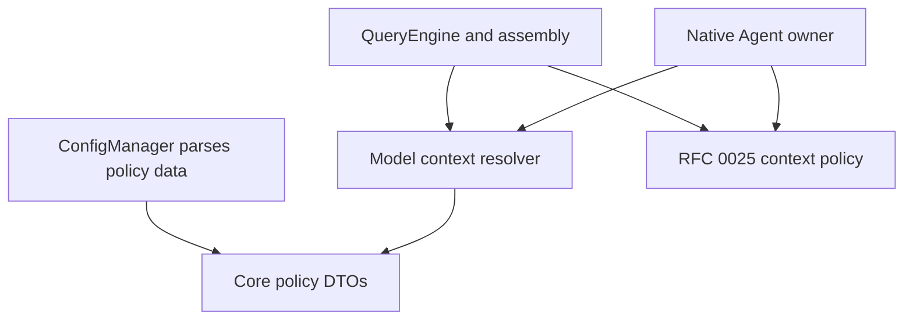

# RFC 0026 — Model-Aware Context Budgets

## Summary

Resolve context and output limits for the actual endpoint, wire API and model
through one lower-level policy. Re-resolve on initial assembly, model switches,
SDK overrides, overload fallback and native child execution. Keep RFC 0025's
semantic checkpoint mechanism, but give it the correct model budget. Add exact
per-model configuration and a small source-backed official model catalog; unknown
deployments retain the legacy configured fallback rather than guessed capacity.
The implementation was first validated locally without commits. Subsequent
user authorization permits logical commits and remote push.

## Motivation

### Evidence

Baseline is `72cfc5742ac69c7742004262f62d91077732dc4f`. Both presets register
3,053 tests. Read-only review found these concrete disconnected paths:

| Path | Current | Required |
|---|---|---|
| Assembly | Model string selected independently of global contextWindowSize | Resolve the selected model's budget |
| Runtime switch | set_model_params changes only ModelParams | Update window and output reserve before the next request |
| Main overload fallback | Directly assigns a different model string | Same resolution path as explicit switching |
| Native child | Selects its own model, inherits the parent's resolved window | Resolve actual child model from an immutable complete policy snapshot |
| Unknown model | Default 200,000 tokens without capability lookup | Explicit fallback provenance; exact manual profile supported |
| Model list | ModelConfig.max_tokens displayed as context | Never present an output limit as detected context |

`BootstrapClient::fetch()` currently returns an empty response. Bootstrap cache
has no endpoint/wire scope, ModelOption and server ModelInfo have no window
field, and AppState models are not authoritative capabilities. Reusing these
would claim discovery that has not happened. RFC 0025's native tests validate
compaction with supplied windows, not automatic model capability resolution.

Comparable designs: [OpenCode model limits](https://dev.opencode.ai/v2/docs/models/)
combine catalog data with explicit per-model limits and disclose custom-model
fallbacks. [Codex configuration](https://learn.chatgpt.com/docs/config-file/config-reference)
uses model defaults and explicit overrides. A generic OpenAI-compatible models
response is not a universal context-capacity discovery protocol.

## Goals

- G1. One deterministic resolver for main and native execution, keyed by exact
  model and scoped endpoint/wire; no substring capacity guesses.
- G2. A known model or configured profile switches between 1,000,000 and 256,000
  tokens without stale budgets, including fallback and parent/child mixtures.
- G3. Preserve requested output settings across switches; apply any known output
  cap independently from total context, then use the effective output reserve.
- G4. The first business request after a smaller-model switch runs RFC 0025's
  budget check; no oversized business request or duplicate tool execution.
- G5. Unknown custom deployments use explicit profiles or the configured legacy
  fallback, with source visible through the engine API and documentation.
- G6. Preserve authentication, wire choice, cancellation, immutable session
  isolation, tool arguments and checkpoint formats.

## Non-Goals

Network capacity probing, background model discovery/catalog downloads, new
provider transports, broad provider catalogs, new native overload fallback,
arbitrary configuration hot reload, replacing bootstrap/server discovery,
provider-native compaction and changes to RFC 0025's checkpoint format. This
does not promise discovery of an arbitrary private model alias. Existing
settings edits still require engine reconstruction; model switching within the
already loaded policy must work immediately. The initial no-commit/no-push
constraint was lifted after local acceptance by subsequent user authorization.
Installation remains outside this scope.

## Proposal

### Ownership and dependency direction

Add `loom.services.compact.model_context` with declaration-only interface and
out-of-line implementation in `loom_services`. It depends on standard types and
the existing low-level core DTOs, never QueryEngine, configuration, orchestration
or UI. Configuration parses plain policy data; owners invoke the resolver.



The owning behavior is model budgeting across these owners. Shared DTO,
configuration, query and native changes are explicitly authorized. Owner-local
lookup tables would duplicate the core invariant. Do not add callbacks capturing
an engine to the rank-1 ApiExecutionContext or introduce a new target/library.

### Configuration and resolution

Add `modelContextLimits`, an array of exact profiles:

```json
{
  "contextWindowSize": 200000,
  "modelContextLimits": [
    {"model": "large-model", "contextWindowSize": 1000000},
    {"model": "small-model", "contextWindowSize": 256000,
     "maxOutputTokens": 16384,
     "baseUrl": "https://gateway.example/v1", "wireApi": "openai"}
  ]
}
```

`model` and positive contextWindowSize are required. maxOutputTokens is an
optional positive output cap. baseUrl and wireApi must either both appear or
both be absent. A scoped profile matches endpoint + wire + exact model; an
unscoped explicit profile applies that exact model at the configured endpoint.
Reject malformed entries, nonintegral/zero/out-of-range limits, empty identity,
invalid wire and duplicate tuples instead of silently accepting unsafe values.
Any invalid entry fails the complete configuration load at every JSON tier;
existing tolerance for a non-JSON user/local file stays unchanged. Duplicates
mean duplicate normalized identity tuples within one physical array.
Do not include credentials in profile identity or diagnostics. Only normalize
trailing endpoint slashes; preserve paths and exact model spelling.
Scoped endpoints must be HTTP(S) URLs without userinfo, query, fragment,
whitespace or control characters. Profile wire names are the canonical
`messages` and `openai`; owners normalize existing transport aliases before
resolution instead of importing wire code into the lower-level resolver.

Resolve context and output cap independently. Context priority is scoped explicit
profile, unscoped explicit profile, source-backed catalog entry for a trusted
official endpoint/wire/exact model, then legacy global contextWindowSize
(default 200,000). Output-cap priority is the first present cap from the scoped
profile, unscoped profile, applicable trusted catalog, then no known cap. A
context-only profile must not discard a known catalog output cap. The legacy global value is explicitly
the fallback in this design, even when saved by older versions; old save paths
write the default and cannot reliably distinguish automatic from explicit
200,000. Users who intentionally restrict a known model migrate that restriction
to a model profile. This precedence change is documented and tested, not inferred
from whether the numeric value equals a default.
For example, an old global contextWindowSize of 100000 also yields to a known
catalog model; retain that deliberate ceiling with an exact profile such as
`{"model":"gpt-4.1","contextWindowSize":100000}`. This applies to non-default
legacy values as well as automatically saved 200000.

Config tiers merge profiles by their identity tuple with higher-tier matching
entries replacing lower-tier entries; unrelated profiles survive. An empty
array explicitly clears the profile set. Project saves must not copy user/local
profiles into the project file; preserve its existing profile JSON just as
unknown keys are preserved. Round-trip user/project/local behavior is tested.
This is a file-only configuration key: do not expand the existing closed scalar
configuration tool/get/set contract. Saves preserve the destination file's
original profile JSON rather than serializing the merged effective vector.

The small catalog contains only exact IDs with a dated official source next to
each entry. OpenAI GPT-4.1 at its official OpenAI wire endpoint is documented as
1,047,576 context and 32,768 output tokens; aliases/snapshots are separate exact
entries only when verified. Claude entries require the same explicit official
verification. Never apply catalog values to an arbitrary compatible proxy based
solely on its model name, or infer beta/long-context entitlement. No Gemini API
entry without a supported native wire path.

Return resolved window, effective output, optional known output cap, window
source (`profile`, `catalog`, `fallback`) and independent output-cap source
(`profile`, `catalog`, `none`). Effective output is min(requested output,
known output cap) when a cap exists; preserve the original requested output so
switching back to a larger-output model restores it. An output reserve that
cannot fit the window remains an explicit RFC 0025 error, not silent truncation.

### Main owner lifecycle

QueryEngine stores the original immutable fallback + profile policy separately
from the active resolved budget. Assembly supplies configured profiles. Direct
QueryEngineConfig construction keeps its supplied window as fallback, preserving
small-window fixtures and embedders. Initialization and set_model_params use one
refresh operation; fallback uses the same operation rather than assigning a model
string. SDK run/stream and TUI model changes already call set_model_params.

Keep ModelParams.max_tokens as requested output; wire request construction and
RFC 0025 budgeting use effective output. Summary requests respect a known model
output cap without inheriting an unrelated business output setting. Updating a
model clears usage calibration tied to the old request identity. Do not compact
inside a synchronous model setter; enforce the new budget at the existing next
request boundary. Switching back restores the original output request/cap.
For Messages manual Forced thinking, the thinking budget must remain strictly
below effective output tokens. Check this before the auto_compact early return
and before any summary/business request; return an actionable InvalidRequest
when a smaller output cap makes the original thinking request impossible.
Do not silently crop thinking or reject Adaptive/Disabled/OpenAI requests for
an unused manual budget. Test both query/stream, equality, auto_compact=false
and restoration after switching back.

Expose the resolved budget/source through a small read-only accessor and continue
projecting the actual window to the status line. `/model` presentation must not
label output max_tokens as context; use separate optional context data or an
honest unknown value. No unrelated UI layout/golden redesign.

### Native owner lifecycle

Extend ApiExecutionContext with an optional shared immutable policy-data snapshot,
not a resolver callback, mutable global or persisted credentials. Carry the
original fallback and complete profile set, not only the parent's resolved
window. ApiExecutionContext.context_output_tokens carries the original requested
output, before any parent model cap. Both child business requests and summaries
resolve against the actual model; a parent's effective output is never reused
as the raw child request. Preserve legacy scalar fields for callers that supply a custom snapshot
without the new policy; those values remain the fallback for that context.

Resolve using actual plan.model before each business request and request.model
for compaction. Business max_tokens uses the effective output for that model.
Descendants inherit the same immutable policy and the immediate parent's model,
then apply their own explicit/definition model selection. Resume retains current
model-selection precedence and rechecks its resolved budget before sampling.
Null api_context must retain existing default-client/environment transport
behavior; do not construct an empty-auth context merely to attach budget data.
No new native fallback loop or model field in NativeAgentRecord is required.

## Phases and graduation criteria

| Phase | Title | Scope | Status | Graduation criteria (measured) |
|---|---|---|---|---|
| A | Policy and configuration | Core DTOs, resolver, source-backed catalog, config parser | done | Exact/scoped priority, unknown endpoint, aliases, numeric validation, tier merge/save and reversible output-cap native tests pass; no graph cycles |
| B | Main and child owners | QueryEngine switches/fallback, native actual-model budgeting | done | Both protocols capture correct 1M/256K decisions for initial/switch/SDK/fallback/parent-child/grandchild/resume; no duplicate tools or cross-session policy/auth leakage |
| C | Graduation | Full builds/tests, independent source and evidence review, docs | done | Debug/Release -Werror and complete serial CTest; named additions reconciled with baseline 3053; graph/inline/RFC lint; frozen source/binary evidence; independent approval; no commit/push |

## Production Readiness Review

- Correctness: native resolver/config and public loopback owner tests verify
  actual outgoing models, output max_tokens, summary calls and final working
  history. Use real 1M/256K settings and sufficient deterministic history, not
  renamed small capacities. Validate both wire APIs and both parent-child orders.
- Build: declaration-only new module, default Ninja concurrency, no dependency
  upgrades or interface-body growth. Record local wall time and touched units.
  Linux PSS and hosted macOS CI are unavailable here and must be disclosed.
- Compatibility: existing settings remain readable; the known-model global
  fallback precedence change is explicit above. modelContextLimits is additive.
  No wire/tool/origin/checkpoint/agent-record format changes. No auth changes.
- Observability: expose resolved context/source, keep existing prompt/session
  traces; do not dump policy credentials or invent measured token usage.
- Documentation: update developer guide, decision register and index. AGENTS
  conventions do not change. Remove output-as-context presentation.
- Rollback: revert owner use and policy/config additions together. Older readers
  ignore modelContextLimits and keep their original global budget behavior.

## Rollout and rollback

Implement A after design and PRR approval, then B, then complete C. Keep each
owner's transport/lifecycle intact. This Implementation History substitutes for
a published tracking issue under the user's initial no-commit request. After
local acceptance, the user authorized logical commits and remote push, followed
by real-terminal validation. Preserve the committed RFC 0025 baseline and its
evidence; retain the original uncommitted history rows as historical records.

## Drawbacks

Catalog values can become stale; a small explicit catalog limits maintenance but
does not cover arbitrary aliases. Configured profiles can be wrong. Per-model
output caps and scoped identity add state to the shared snapshot. Full arbitrary
settings hot reload remains unavailable; loaded model switching works without a
restart, while editing profile files requires reconstruction.

## Alternatives considered

1. Do nothing/shared 200K: wastes large windows and misbudgets smaller-model
   switches or children.
2. Separate owner tables: repeats the main/native drift that RFC 0025 removed.
3. Guess from model strings or output max_tokens: unsupported and unsafe.
4. Probe by growing requests or universal /models discovery: not portable,
   potentially expensive, and not warranted by current transports.
5. Make all manual/global values override the catalog: old save paths persist
   200K automatically, so nominal automatic resolution would never activate.

## Testing and verification plan

Freeze the clean baseline and registrations in
`build/model-context-validation-20261019/`. Add native tests to established
services/query/tools targets; no disposable scripts count as runtime acceptance.
Required families: profile precedence and invalid values; official vs proxy;
fallback provenance; output cap restoration; 1M→256K→1M in both query/stream
entry points; SDK and overload fallback; parent1M/child256K and reverse; grandchild
override/resume; auth/session isolation; summary model/limit consistency.
Verify parent-small-output-cap to child-large-output-cap and the reverse, with
raw requested output restored rather than inherited effective output.

Use real loopback HTTP with captured bodies and actual native APIs. Do not send
million-token provider requests just to prove a deterministic resolver. Existing
RFC 0025 live semantic tests remain opt-in and are not substitutes for these
capacity-resolution tests. Full serial Debug/Release CTest includes PTY/goldens;
record first failures separately from unchanged reruns and never change
unrelated golden expectations. Reconcile exact named test additions/deletions,
freeze executed input/binary hashes, then independent source/evidence review.

## Documentation impact

Update docs/dev/context-compaction.md with automatic coverage, profile examples,
scope/priority, global fallback migration, output vs context, source diagnostics
and restart requirements for file edits. Add decision and docs index entries.

## Open questions

| Question | Owner | Resolved by |
|---|---|---|
| Arbitrary private model discovery | @Zzzode | Explicit profiles; no false claim of universal discovery |
| Global numeric override ambiguity | @Zzzode | Treat legacy global as fallback; document per-model migration |
| Catalog freshness | @Zzzode | Small source-dated exact-ID set; profiles override it |
| Linux PSS / hosted CI | @Zzzode | Disclose platform limitation, require local dual-preset evidence |

## Implementation History

| Date | Phase | Event | Commit / PR | Evidence (metrics, test totals) |
|---|---|---|---|---|
| 2026-10-19 | — | RFC opened provisional after source review | Uncommitted | Baseline 72cfc574; 3053 registrations per preset; assembly/switch/native budget disconnections confirmed; no production code edits |
| 2026-10-19 | — | Design and PRR requested changes, then independently approved | Uncommitted | agent:/root/compaction_design_audit and agent:/root/compaction_tests: independent output-cap source, raw requested output across descendants, strict file-only profile validation and physical save isolation, non-default legacy migration resolved before production edits |
| 2026-10-19 | A/B | Implementation authorized; implementable | Uncommitted | Both agent gates Approved; policy/config and native owners assigned disjoint files; root owns main integration and final validation |
| 2026-10-19 | A/B | Independent implementation source reviews completed | Uncommitted | agent:/root/audit_subagent_compaction approved policy/config and SDK tests; agent:/root/compaction_design_audit approved main/native after P2 model-info output-as-context display fixed; agent:/root/compaction_tests approved actual-value main/native HTTP coverage |
| 2026-10-19 | C | Initial build and focused results retained | Uncommitted | First Debug build failed because a new assembly test called private api_execution_context; corrected to the public assembly context factory without expanding production API. Second Debug build passed in 28.06 s. First focused run: 33 tests, 32 passed, 1 failed (parallel native policy isolation); investigation required, not relabeled green |
| 2026-10-19 | C | Native parallel fixture corrected; Debug focused passed | Uncommitted | Empty business tool schema was incorrectly classified as a summary by the fixture. Registered visible WireProbe and independently checked summary marker against tools classification, preserving auth/model/cap/count assertions. Production code unchanged. agent:/root/compaction_tests independently Approved the correction. Debug rebuild 10.39 s and focused 33/33 passed |
| 2026-10-19 | B/C | Forced-thinking boundary finding resolved | Uncommitted | agent:/root/compaction_design_audit found and then Approved the P2 fix: reject Messages Forced thinking budget >= effective output before auto-compaction/HTTP, preserve raw settings, cover query/stream, equal boundary, auto-compaction off, switch-back restoration, OpenAI/Adaptive/Disabled. Both new native tests passed; earlier final-* artifacts predate this fix and are intermediate evidence only |
| 2026-10-19 | C | Final binaries built and focused coverage passed | Uncommitted | acceptance-* artifacts: Debug build 46.90 s and Release build 213.26 s, both exit 0; focused 35/35 passed per preset. Each preset registers 3084 tests: 31 named additions, 0 removals against 3053 baseline. Frozen 2599 source/fixture inputs and 222 CTest-command/bin executables. Complete serial suites and final evidence gate remain pending |
| 2026-10-19 | C | Documentation review approved after precision correction | Uncommitted | agent:/root/compaction_design_audit Approved all four documents after separating global window fallback from absent output cap (none, retaining requested output); no claim of arbitrary alias discovery or remote-provider capacity acceptance |
| 2026-10-19 | A/B | Policy and owner phases graduated | Uncommitted | All 31 added tests pass in both focused runs (35 including 4 existing); independent policy/config/main/native/SDK source reviews Approved. Graph: 644 modules / 820 units, 0 module cycles, 0 upward violations, 0 dead imports; core/UI/store/TLL gates pass (60 targets, 0 target SCCs). Inline check passes, 645 interfaces, no interface over 100 bodies. Global fallback migration and Forced-thinking boundary documented |
| 2026-10-19 | C | Complete Debug first pass passed | Uncommitted | acceptance-debug-ctest.xml/log and acceptance-debug-results.json: 3084 cases, 3057 passed, 25 skipped, 2 disabled, 0 failures; exit 0, 573.15 s. Release complete serial run and final zero-drift/evidence review remain pending |
| 2026-10-19 | C | Complete Release first pass and zero-drift check passed | Uncommitted | acceptance-release-ctest.xml/log and acceptance-release-results.json: 3084 cases, 3057 passed, 25 skipped, 2 disabled, 0 failures; exit 0, 484.38 s. acceptance-drift.json: 0 changed source/fixture inputs out of 2599, 0 changed executables out of 222. No source edits or failed-test reruns during either complete suite; final independent dual-preset gate pending |
| 2026-10-19 | C | Integrity and Debug evidence independently approved | Uncommitted | agent:/root/compaction_tests independently verified current source/binary hashes, 31 named additions and both focused 35/35 results; complete Debug XML and log Approved. All 31 additions actually ran and passed. Existing skips: 16 tree-sitter-disabled cases, 5 real-provider opt-in cases, 3 source-path guards and 1 Windows-only case; 2 pre-existing disabled cases. Real-provider capacity/semantic acceptance, tree-sitter-enabled build, Linux PSS and hosted CI are not established by this run |
| 2026-10-19 | C | Final independent graduation Approved; implemented | Uncommitted | agent:/root/compaction_tests independently Approved both complete first-pass XML/logs, identical existing skip/disabled lists, 31 additions / 0 removals, current 2599-input / 222-binary zero drift and graph/inline/RFC gates. All phases done. HEAD remains 72cfc5742ac69c7742004262f62d91077732dc4f; no commit, push or installation. Evidence directory: build/model-context-validation-20261019/; acceptance-* files are authoritative, final-* files are intermediate |
| 2026-10-19 | Delivery | User authorized logical commits and remote push | Pending delivery | agent:/root/compaction_tests independently Approved exact preservation of 28 files, 2599 inputs and 222 binaries, and five groups: RFC (1 file), shared policy/config (8), main owner/SDK/UI tests (12), native owner/tests (4), usage docs (3). Existing dual-preset complete first passes remain valid; real-terminal validation follows push |
