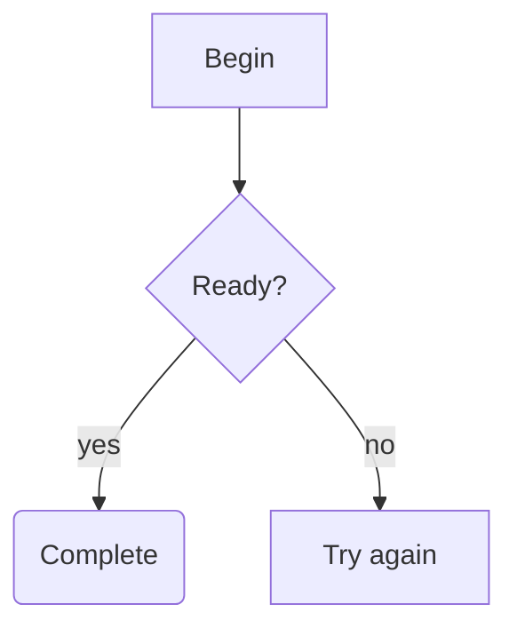
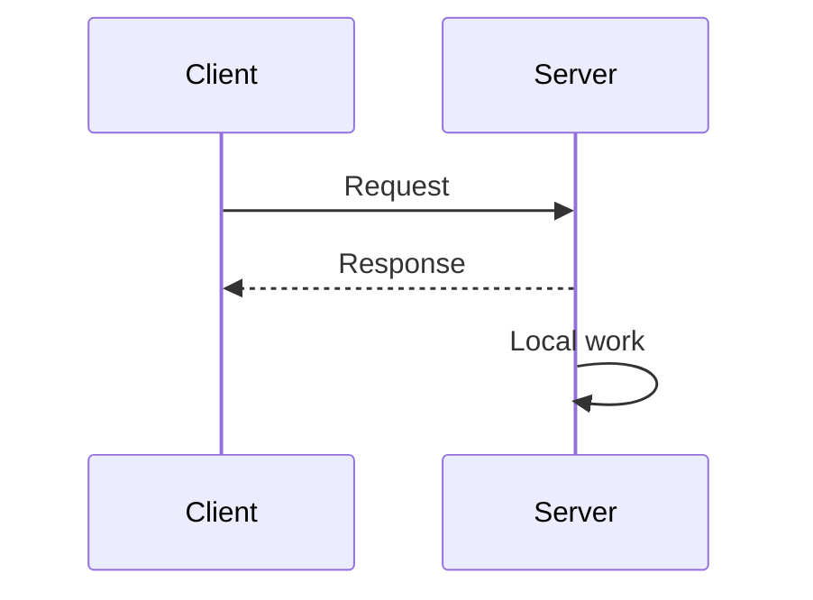

# Mermaid diagrams in the terminal

Closed `mermaid` code fences in model responses render as Unicode diagrams in
Loom's terminal UI. The renderer runs inside the existing C++/FTXUI application;
no Node.js, browser, remote service or terminal image extension is required.

This is an explicitly limited terminal renderer, not the full Mermaid engine.
Unsupported, malformed, incomplete, oversized or too-wide input stays as the
original code block. The renderer accepts the whole diagram or keeps its source;
it never deliberately drops an unsupported statement to draw a partial graph.

## Examples

Flowcharts support branches, cycles and self edges:

Sequence diagrams support named participants, aliases, ordinary requests,
dashed replies and self messages:

## Supported syntax

| Item | Supported form |
|---|---|
| Language marker | Lowercase `mermaid` as the first word of the fence info string. |
| Flowchart header | `flowchart` or `graph`, followed by `TD`, `TB`, `BT`, `LR` or `RL`. |
| Node IDs | ASCII letters or underscore first, followed by letters, digits or underscore. |
| Flowchart nodes | Bare `A`, rectangular `A[text]`, rounded `A(text)`, decision `A{text}`. |
| Flowchart edges | `A --> B`, `A -->|label| B`; chains repeat these pairs. Branches use repeated statements. |
| Sequence header | `sequenceDiagram`. |
| Participants | `participant A`, `participant A as Alias`, or first appearance as a message endpoint. |
| Messages | `A->>B: text`, `A-->>B: text`; endpoints can reverse or refer to the same participant. |
| Labels | Single-line plain Unicode, including Chinese; flow labels may use whole-label double quotes without backslash escapes. Sequence labels stay unquoted. |
| Separation | Newlines or semicolons outside labels/quotes; blank lines and full-line `%%` comments. |

Bare references may receive a later label or alias. Identical explicit
declarations are allowed; conflicting explicit declarations keep source.
Participant order follows first appearance. IDs identify nodes independently
of displayed labels.

HTML labels, entities (including hash-prefixed Mermaid entities), labels
containing `#`, backtick/Markdown labels, configuration directives,
style/click/class declarations, subgraphs, other arrow operators, sequence
activation/notes/control blocks and other diagram types retain source. These
boundaries are intentional: a diagram must not look valid after losing meaning.
Quoted or escaped sequence labels, sequence wrapping prefixes and backslash
escaping inside quoted flow labels also retain source. Flow control words
`end`, `subgraph`, `direction`, `style`, `linkStyle`, `classDef`, `class` and
`click` cannot be node IDs; `A["end"]` remains a supported displayed label.
Sequence structure/control words such as `loop` and `end` cannot be participant
IDs, regardless of case; they may still appear in aliases and message text.
See [RFC 0030](../rfcs/0030-terminal-mermaid-diagrams.md) for the exact grammar.

## Streaming, width and copying

While the model is still writing an unclosed code fence, the source stays
visible. Closing the fence triggers diagram rendering. Resizing to a width that
cannot show the complete diagram restores the code block; widening restores
the diagram. Source fallback uses the existing code-block behavior, including
right-edge clipping of long source lines.

Dragging over the screen copies the visible Unicode diagram cells. The
message's Copy action retains the original Markdown, including the Mermaid
source. Saved conversations and model request/response traces also retain
original model content.

The renderer bounds each block to 64 KiB of source, 64 flowchart nodes, 128 edges,
32 sequence participants, 128 messages and 256 terminal cells per label. The
canvas is at most 240 columns by 1024 rows, with one cumulative routing/drawing
work budget per diagram. Hitting a bound preserves source. Ambiguous routing also
preserves source instead of showing a potentially misleading connection.
