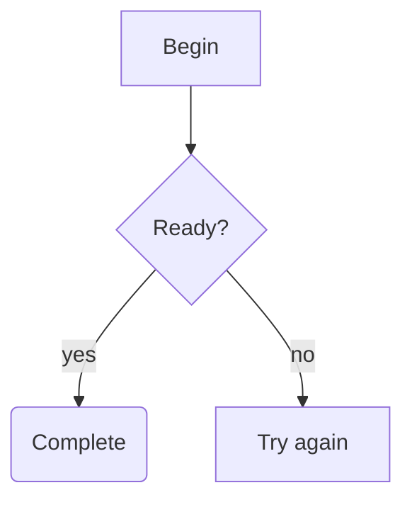
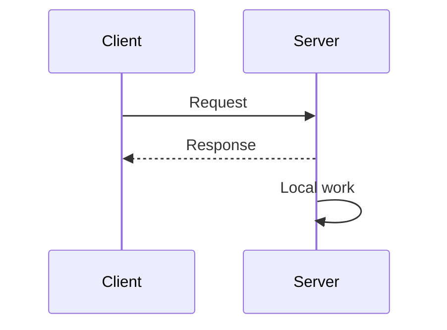
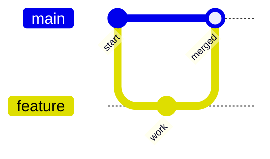

# Mermaid diagrams in the terminal

Closed `mermaid` code fences in model responses render as Unicode diagrams in
Loom's terminal UI. The renderer runs inside the existing C++/FTXUI application;
no Node.js, browser, remote service or terminal image extension is required.

This is an explicitly limited terminal renderer, not the full Mermaid engine.
Unsupported, malformed, incomplete, oversized or too-wide input stays as the
original code block. The renderer accepts the whole diagram or keeps its source;
it never deliberately drops an unsupported statement to draw a partial graph.

## Examples

Flowcharts support branches, cycles, self edges and nested groups:

Sequence diagrams support named participants, aliases, ordinary requests,
dashed replies, self messages, multiline labels and over-participant notes:

Git graphs retain branch lanes, commit IDs, tags, merges and cherry picks:

## Supported syntax

| Item | Supported form |
|---|---|
| Language marker | Lowercase `mermaid` as the first word of the fence info string. |
| Flowchart header | `flowchart` or `graph`, followed by `TD`, `TB`, `BT`, `LR` or `RL`. |
| Flowchart node IDs | ASCII letters, digits and underscore, including bounded dotted or hyphenated IDs that do not consume an edge operator. |
| Flowchart nodes | Bare `A`, rectangular `A[text]`, rounded `A(text)`, decision `A{text}`; classic stadium, circle, double circle, subroutine, hexagon, cylinder, asymmetric, trapezoid and parallelogram forms. Classic shapes require single-line labels. Closed `A@{ shape: rect }`, `rounded` and `diam` properties are also supported. |
| Flowchart edges | `A --> B`, `A -.-> B`, `A ==> B`, optionally with `|label|`; chains and `A & B --> C & D` Cartesian branches. |
| Groups | `subgraph ID`, `subgraph ID[title]`, nested `end`, and local `direction TD/TB/BT/LR/RL`. Empty groups are retained. |
| Sequence header | `sequenceDiagram`; a header/comment-only diagram is valid empty output. |
| Sequence IDs | Safe plain Unicode and names containing spaces, ordinary dashes, digits, `=` or `.`; outer whitespace is trimmed and internal spaces remain significant. Whole quoted IDs are a terminal compatibility extension and retain their literal inner text. |
| Participants | `participant A`, `participant A as Alias`, `actor A`, `actor A as Alias`, or first appearance as a message endpoint. Actors have a person figure above their header. |
| Messages | Solid/dotted filled `->>` / `-->>`, unheaded `->` / `-->`, async `-)` / `--)`, cross `-x` / `--x`, and bidirectional `<<->>` / `<<-->>`. Optional `()` at endpoints draws a central circle. Endpoints can reverse or refer to the same participant; labels may be empty. |
| Participant boxes | `box [color] [title]`, participant/actor declarations, then `end`. A group owns the complete member timelines; siblings are separate and empty groups produce no frame. Color is disclosed as exact text in a separate compartment. Nested boxes, noncontiguous members or conflicting membership retain source. |
| Sequence title | A title-only frontmatter block (`---`, one plain `title: Login flow` field, `---`) before the sequence header, or an inline `title Login flow` / `title: Login flow` statement. The last inline setter wins and overrides frontmatter. Inline titles consume one required space or tab after the keyword/colon and retain remaining spaces and literal quotes; exact lowercase ` ` stays literal on that single row. Frontmatter titles support ` ` display rows. Other metadata or ambiguous YAML retains source. |
| Sequence numbering | `autonumber`, `autonumber off`, and `autonumber START [STEP]`, with unsigned integers or decimals of at most two fractional digits. Hidden messages still advance the counter; bare enable resumes its current state, and a start-only command resets the step to one. Exact displayed prefixes share the existing label budget. |
| Sequence activation | `activate ID`, `deactivate ID`, or one `+`/`-` after a message arrow. Plus opens the receiver and minus closes the sender after the message. Keyword and shorthand forms share a stack; nested depths remain distinct, and unclosed intervals extend to the final lifeline row. |
| Sequence fragments | `loop`, `opt`, `alt`/`else`, `par`/`and`, `critical`/`option`, `break` and `rect`, closed by `end`. Nested frames retain exact type/condition headers, ordered branches and empty regions; rect color tokens are shown in the header. |
| XY charts | `xychart` or `xychart-beta`, vertical/horizontal band categories, vertical finite increasing numeric x ranges, finite bar/line data, named series and axis titles/ranges. Omitted x axes use1..N. Category count, domain precision, overlapping ownership and layout must fit the bounded native profile. |
| XY empty states | With no plots and no configuration metadata, the terminal shows an explicit no-data state retaining orientation, title, ordered band categories, Y-axis title and an optional range. An unspecified range stays unspecified. Numeric X domains and nonempty X-axis titles retain source in this profile. Zero-valued plots still require complete data geometry. |
| Pie charts | `pie`, an optional title and labeled finite nonnegative values. Native proportional bars retain labels and values. |
| Git graphs | `gitGraph`, optional `LR`, `TB` or `BT` direction and optional colon; `commit`, `branch`, `checkout`, `merge`, `cherry-pick`, and nonnegative branch `order:`. Commit `id:`, `tag:` and `type: NORMAL/REVERSE/HIGHLIGHT` retain their meaning. Compact markers and branch-head references remain visible. |
| Git graph configuration | One strict leading JSON init directive may set `gitGraph.mainBranchName` and `showCommitLabel: true`; unknown options and hidden commit labels retain source. |
| Git graph / state frontmatter (RFC 0031 E2a) | A config-free, init-free `---` frontmatter carrying only a folded `description: >-` block is admitted for `gitGraph` and `stateDiagram-v2`; the description is documentation-only, is never rendered and is discarded before layout. A state `title:` is additionally shown because the relations family already projects a title; gitGraph has no title projection, so a titled git graph retains its whole source. Frontmatter that carries `config:`, `theme`/`themeVariables` or a `%%{init}%%` directive retains whole source (deferred to E2b). Rows the current native parser or layout cannot complete also retain source; the per-row disposition is reviewed in `docs/dev/mermaid-e2a-cohort.md`. |
| Relations | Bounded `classDiagram`, `erDiagram`, `stateDiagram-v2` forms retain members, relationship endpoints/direction, ER cardinalities and state grouping/notes. The complete syntax families remain under verification. |
| Sequence notes | `Note over A: text`, `Note over A,B: text`, `Note left of A: text` or `Note right of A: text`, with case-insensitive keywords. First use can create participants. Explicit border ports or solid leaders identify the target lifelines. |
| Sequence lifetimes | `create participant C`, `create actor C as Alias` and `destroy C` bind to the next receiving/involving message. Headers retain declaration order at the top; a created lifeline begins at its message and a destroyed lifeline ends at a separate cross. Complete self returns, intervening notes/fragments and nested activation termination are preserved. Notes or activation targeting an unborn/dead participant retain source in the current terminal profile. |
| Labels | Plain Unicode, including Chinese; rectangular nodes, edges, group titles and sequence aliases/messages/notes decode exact ` `, ` ` and ` ` line breaks, retaining blank rows. Flow labels may use whole-label double quotes without escapes. Sequence labels remain unquoted. |
| Sequence text references | Aliases, messages and notes support `#35;` (hash), `#59;` (semicolon), `#9829;` (heart), `#lt;`, `#gt;` and `#infin;`. They decode once after raw line-break splitting; decoded punctuation never becomes grammar. IDs and titles keep their separate admission rules. |
| Separation | Newlines or semicolons outside labels/quotes and protected references; blank lines and full-line `%%` comments. Sequence documents also admit standalone `# ...` comments. |

Ungrouped `TD` flowcharts with single-line rectangular nodes also support open
and bidirectional normal, dotted and thick links, inline edge captions, and
explicit minimum edge lengths. For example, `A --- B` is open, `A <--> B`
has two point markers, and `A ----> B` requests additional rank separation.
Captions and marker placement are retained together; unsupported endpoint
symbols or exhausted layout bounds keep the complete source.

Bare references may receive a later label or alias. Identical explicit
declarations are allowed; conflicting explicit declarations keep source.
Participant order follows first appearance. IDs identify nodes independently
of displayed labels. A node belongs to the first group that references it, even
if it was created earlier outside a group. Duplicate group IDs and group IDs as
edge endpoints retain source. Rounded and decision nodes remain single-line.

Sequence text also accepts lowercase `<br` followed by horizontal spaces or tabs,
an optional slash and `>`. An escaped `#lt;br#gt;` remains literal ` ` text;
it does not create another break. A tab inside escaped literal text follows the
existing visible control-character disclosure, unlike syntax whitespace in an
actual break tag.

Literal arrows and colons in sequence text remain text after their structural
separator. Other HTML tags and character references outside the reviewed sequence
text subset, unprotected hashes in labels, backtick/Markdown labels, configuration directives,
flow style/click/class declarations, unsupported arrow operators retain source. Other forms and diagram families are being verified in complete cohorts. These
boundaries are intentional: a diagram must not look valid after losing meaning.
Font Awesome icon introducers such as `fa:fa-user` and ellipse `A(-text-)` also keep source.
Quoted or escaped sequence labels, sequence wrapping prefixes (case-insensitive) and backslash
escaping inside quoted flow labels also retain source. Flow control words
`end`, `subgraph`, `direction`, `style`, `linkStyle`, `classDef`, `class` and
`click` cannot be node IDs; `A["end"]` remains a supported displayed label.
Sequence structure/control words such as `loop` and `end` cannot be participant
IDs, regardless of case; they may still appear in aliases and message text.
The terminal compatibility profile permits the complete words `activate` and
`deactivate` as unquoted message endpoints, regardless of case. Standalone
activation commands keep their existing meaning; reserved names in declarations
still require quotes.
See [RFC 0030](../rfcs/0030-terminal-mermaid-diagrams.md) for the exact grammar.

XY frontmatter admits a reviewed subset of finite nonnegative chart/axis metrics,
visible titles/axes, known themes, hexadecimal paint values and
`config.xyChart.chartOrientation: vertical` / `horizontal`. An explicit diagram
header orientation overrides the configuration; a bare header keeps it. These map to
fixed terminal cells and monochrome ownership markers. Unknown fields, hidden
axes or malformed configuration retain source; this is not SVG pixel or font
equivalence.

XY data labels admit Boolean `showDataLabel` and `showDataLabelOutsideBar` in
the reviewed frontmatter fields or one leading strict JSON `%%{init: ...}%%`
directive containing only those `xyChart` options. A single unnamed bar series
places exact values at its endpoints or in reserved outside slots. Multiple
series and line charts retain every owner/category value in ordered readouts
alongside the complete plotted geometry. Named single-series charts with data
labels, negative bar-reference value profiles and other unresolved layouts still retain source.
Unknown options, duplicate keys and incorrectly typed values also retain source.

A single named bar or line series without data labels has its own complete
style key below the axes. Names retain Unicode and spaces and must fit together
with the two-cell key inside the existing canvas. Names containing the unresolved
composite delimiter or data requiring extra precision readouts still retain
source; captions cannot substitute for the owner key.

Class frontmatter accepts a folded documentation field written as
`description: >-` or `description: >`. Documentation produces no diagram caption;
class names, members and relationships still come from the complete diagram body.
The reader preserves following root fields and body init directives. Duplicate
fields, inconsistent block indentation, unsupported scalar forms, unsafe text or
an incomplete closing fence retain the whole source.

Class frontmatter and init directives accept root `layout: dagre` and
`layout: elk`. Both use Loom's bounded terminal layout while retaining the complete
business graph. They do not load a browser layout engine. Unknown selectors,
wrong value types, duplicate selectors and unreviewed config fields retain source.

The bounded State profile supports transitions between nested states and root
states, and between states in sibling groups. Group captions and ownership remain
part of the drawing. Complex routes that cannot be completed within the existing
limits still retain the whole source.

Header-only ER entities can retain multiple self relationships with independent
same-face endpoint ports, complete labels, cardinalities and solid/dashed routes.
Their outer lanes reserve space from the actual label and endpoint sizes;
unsupported configurations and exhausted routing limits still retain source.

Participant-box colors admit the reviewed CSS named-color list and
`transparent`, legacy `rgb`/`rgba` and `hsl`/`hsla` comma forms, plus the upstream
terminal extension of 3/4/6/8-digit hexadecimal tokens. Numeric components must
fit finite native numbers. The terminal discloses source color text; it does not
reproduce browser fills. Unsupported color expressions preserve the whole source.

Sequence admission is bounded to 32 participants, 128 messages, 64 notes,
64 fragments, 64 box openings, fragment/activation nesting depth16 and512 ordered events. A malformed/unclosed
fragment, mismatched divider, activation underflow or exhausted limit retains the complete source.
The kind and complete condition together share the existing 256-cell/glyph
label budget. Existing 64-KiB source, 240-column/1024-row canvas and cumulative
work bounds remain unchanged. A zero-participant empty fragment still draws
its type and closed region; a header/comment-only document remains empty.

Sequence display labels disclose control characters, invisible direction marks
and unattached combining marks as `\u{XXXX}` instead of emitting unsafe terminal
characters. Literal backslashes are doubled, so authored text cannot impersonate
a disclosed character. Attached combining marks retain their original spelling.
Quoted participant IDs use literal default headers; an explicit alias owns the
displayed text, including when declared after its first message. The original
Markdown remains unchanged, and expanded display text obeys the same label limit.

## Streaming, width and copying

While the model is still writing an unclosed code fence, the source stays
visible. Closing the fence triggers diagram rendering. Resizing to a width that
cannot show the complete diagram restores the code block; widening restores
the diagram. Source fallback uses the existing code-block behavior, including
right-edge clipping of long source lines.

Dragging over the screen copies the visible Unicode diagram cells. The
message's Copy action retains the original Markdown, including the Mermaid
source. Saved conversations and model request/response traces also retain
original model content.

The renderer bounds each block to 64 KiB of source, 64 flowchart nodes, 128 edges,
32 sequence participants, 128 messages, 64 sequence notes, 64 groups, group depth 16 and 256 terminal
cells/glyphs per label summed across its rows. The
canvas is at most 240 columns by 1024 rows, with one cumulative routing/drawing
work budget per diagram. Hitting a bound preserves source. Ambiguous routing also
preserves source instead of showing a potentially misleading connection.

## Official corpus coverage

The offline native capability matrix pins all 2145 official Mermaid 12.2.0
`.mmd` files. It reports successful drawings, correct source fallback and errors
separately. Two complete configured XY originals pass reviewed native terminal
profiles; originals with other unsupported semantics keep source. A separate593-input flowchart/sequence body diagnostic track exposes
parser/layout behavior after removing metadata. That diagnostic track does not
establish compatibility with the original configured diagrams. See
[the corpus guide](../dev/mermaid-conformance.md) for provenance, reproduction,
per-width outcomes and evidence limits.

Class annotations accept the literal `<<interface>>` form and one complete
encoded delimiter pair, such as `&lt;&lt;interface&gt;&gt;`. The annotation
keeps its complete inner text. Mixed or double encoding, unknown entities,
incomplete pairs and unsafe control characters retain the whole source.

Class member generic types use the terminal display forms `List<int>` and
`List<List<int>>`. Method names, parameters and return types are converted
separately. Visibility and literal internal stars remain visible. Static and
abstract member markers remain visible as `$` and `*`; ordinary non-generic
members retain their complete authored text. These text markers do not reproduce
CSS underline, italic or browser font styling.
